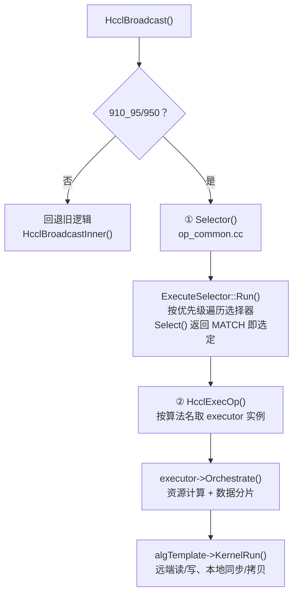
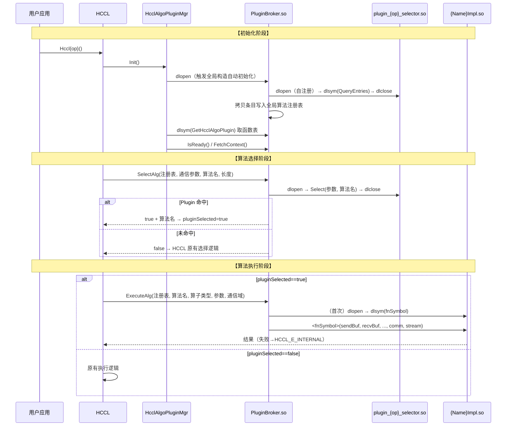

# HCCL-ALGO-Plugin：自定义算法扩展框架

> **深度参考** · 前置阅读：[源码课程单元 10｜MC2 框架与官方样例](/通信与昇腾/源码课程/10-MC2框架与官方样例.md)。本篇为参考手册体例，检索导向；事实基线见文首引用块。

> **RFC 0002**。HCCL-ALGO-Plugin 为 HCCL 提供自定义算法扩展框架：允许用户**在不修改 HCCL 核心代码的前提下**，针对已有算子（AllReduce/AllGather 等）通过**动态库形式**添加自定义算法，无缝接入现有的算法选择与执行流程。
>
> 事实来源：`hccl/docs/zh/rfcs/0002-HCCL-ALGO-Plugin.md`（RFC 权威）、`hccl/src/算法插件.md/`（`hccl_algo_plugin_mgr.{h,cc}`、`inc/hccl_algo_plugin_broker_api.h`、`inc/hccl_algo_plugin_common.h`）、`hccl/experimental/eco_system/算法插件.md/`。

---

## 1. 背景与动机

### 1.1 当前算法选择方式

| 方式 | 说明 |
| --- | --- |
| **拓扑感知选择** | 根据集群拓扑（1D Mesh、2D Mesh、CLOS 等）自动选最适合的算法 |
| **数据大小阈值** | 根据传输数据大小选算法（小数据 OneShot，大数据 TwoShot/NHR） |
| **硬件形态适配** | 不同硬件形态（如 950）需不同算法实现 |

### 1.2 添加新算法的四个痛点 → 四个解决

| 痛点 | Plugin 解决方案 |
| --- | --- |
| **代码侵入**：需改 HCCL 源码加注册代码 | 只需实现标准接口打包为动态库，**无需修改任何 HCCL 源码** |
| **构建耦合**：新算法需与 HCCL 一起编译 | 独立 `.so` 交付，`dlopen` 运行时加载，**与主库完全解耦编译** |
| **发布依赖**：算法更新需重编发整个 HCCL | 更新算法只需**替换对应 `.so`** |
| **选择逻辑封闭**：新算法难接入选择流程 | 在原选择流程入口插入**优先匹配**逻辑，未命中自动回退，两套机制互不干扰 |

### 1.3 支持场景

新算法实现（优化的 Ring/Tree 变体）、新硬件支持、定制化优化（特定网络/数据模式）、实验性算法验证。

---

## 2. HCCL 算子执行流程（Plugin 接入点）

以 Broadcast 为例，`HcclBroadcast()` 经**算法选择**与**算法执行**两步（910_95/950 设备）：



| 步骤 | 函数 / 位置 | 逻辑 |
| --- | --- | --- |
| **① 算法选择** | `Selector()`（`op_common.cc`）→ `ExecuteSelector::Run()`（`selector/execute_selector.cc`） | 从全局选择器注册表取所有选择器；Mc2 模式仅用优先级 18 的选择器；按优先级从高到低遍历，`Select()` 返回 `MATCH` 即选定 |
| | `Select()`（`selector/auto_selector_base.cc`） | 按运行模式（DPU/CCU_MS/AIV/AICPU）调对应选择函数（如 `SelectAicpuAlgo()`） |
| | `SelectAicpuAlgo()`（`broadcast/selector/broadcast_auto_selector.cc`） | 按拓扑信息选算法名（如 Level0Topo 为 Mesh 选 `ParallelMesh1DNHR`） |
| **② 算法执行** | `HcclExecOp()`（`op_common.cc`） | 按操作类型 + 算法名取 executor 实例，创建线程、计算资源，调 `executor->Orchestrate()` |
| | `Orchestrate()`（`broadcast/algorithm/executor/ins_v2_broadcast_sole_executor.cc`） | 计算资源、数据分片，调算法模板 `KernelRun()` |
| | `KernelRun()`（`broadcast/algorithm/复盘写作模板.md/aicpu/ins_temp_broadcast_nhr.cc`） | 按 NHR 逻辑执行远端读/写、本地线程同步、本地拷贝 |

> **Plugin 接入点**：在 `Selector()` 入口处插入 `plugin->SelectAlg()` 优先匹配；命中则 `plugin->ExecuteAlg()` 执行自定义算法，未命中回退原有 `Selector → HcclExecOp` 流程。

---

## 3. 总体架构：三部分


> 图源：`hccl/docs/zh/rfcs/总体架构图.png`

| 组成 | 载体 | 职责 |
| --- | --- | --- |
| **① Plugin 管理器** `HcclAlgoPluginMgr` | 内嵌 HCCL 仓（随 `libhccl.so` 编译） | `dlopen` 加载 PluginBroker，保存句柄与函数表指针，在 HCCL 中调用自定义算法的选择与执行 |
| **② PluginBroker 动态库** `libhccl_algo_PluginBroker.so` | 独立于 HCCL | HCCL 与自定义算法的**桥梁**；加载时全局静态对象构造函数自动扫描算子根目录、构建全局算法注册表 |
| **③ 自定义算法实现动态库** | 用户独立编译安装 | 算法选择库 `libhccl_plugin_{op}_selector.so` + 算法实现库 `lib{Name}Impl.so` |

### 3.1 PluginBroker 的接口（`HcclAlgoPlugin_t`）

| 接口 | 作用 |
| --- | --- |
| `IsReady()` | 返回自动初始化是否成功 |
| `FetchContext()` | 返回自动构建的全局算法注册表指针 |
| `SelectAlg()` | 加载对应算子的选择动态库（`libhccl_plugin_{op}_selector.so`）进行选择决策 |
| `ExecuteAlg()` | 按算法名定位实现动态库（`lib{Name}Impl.so`），懒加载后调执行函数 |
| `QueryAlgs()` | 查询已注册的自定义算法列表 |

---

## 4. 调用时序（三阶段）



| 阶段 | 关键行为 |
| --- | --- |
| **初始化** | `HcclAlgoPluginMgr::Init()` → `dlopen` PluginBroker（触发全局构造扫描 `HCCL_PLUGIN_ALG_DIR`）→ 对每个算子目录的 `libhccl_plugin_{op}_selector.so` 依次 dlopen（触发自注册）→ `dlsym(HcclAlgoPluginQueryEntries)` 取条目拷贝到全局注册表 |
| **算法选择** | 每次集合通信优先调 `plugin->SelectAlg()`；PluginBroker `dlopen(RTLD_NOW\|RTLD_LOCAL)` 选择库 → `dlsym(Select)` → 决策 → `dlclose`。命中返回算法名 + `pluginSelected=true`；未命中回退原有逻辑 |
| **算法执行** | 命中则 `plugin->ExecuteAlg()`：定位注册条目 → 首次懒加载实现库 → `dlsym(fnSymbol)` → 调执行函数。返回非 `HCCL_SUCCESS` 时记录原始错误码后**统一转 `HCCL_E_INTERNAL`，不再回退原有算法** |

> **短生命周期取舍**：当前不缓存 Selector 的 dlopen 句柄，保持 `dlopen → Select → dlclose` 短生命周期，减少长期驻留、简化隔离管理；代价是重复加载开销（高频小数据量场景更明显），当前版本接受此取舍。

---

## 5. 目录组织

```text
${ASCEND_HOME}/opp/vendors/cust/lib64/
└── libhccl_algo_PluginBroker.so          ← ② PluginBroker（HCCL_ALGO_PLUGIN_PATH 指定）

${HCCL_PLUGIN_ALG_DIR}/                    ← ③ 自定义算法根目录
├── AllReduce/                             ← 算子子目录（按算子类型命名）
│   ├── libhccl_plugin_allreduce_selector.so   ← 算法选择库（每算子有且仅一个）
│   ├── libRingAndTreeAlgsImpl.so              ← 算法实现库（可多算法打包一个 so）
│   └── libMeshAlgImpl.so                      ← 也可每算法独占一个 so
├── AllGather/
│   ├── libhccl_plugin_allgather_selector.so
│   └── libGatherAlgsImpl.so
└── Broadcast/
    ├── libhccl_plugin_broadcast_selector.so
    └── libBroadcastAlgsImpl.so
```

AICPU 算法实现的源码目录示例：

```text
MyRingAlg/
├── CMakeLists.txt
├── op_host/my_ring_alg.cc          ← Host 侧算法编排，导出执行函数 HcclAlgoPluginMyRingAllReduce()
├── op_kernel_aicpu/
│   ├── my_ring_alg_kernel.cc       ← Device 侧 Kernel
│   └── libmy_ring_alg.json         ← AICPU Kernel 算子描述文件
└── inc/my_ring_alg.h
```

> 每个算子目录下**有且只有一个**选择库（存该算子所有自定义算法的名称、实现库路径、执行函数符号名，并负责选择决策）；算法实现 `.so` 的数量与分组由用户自定，PluginBroker 依赖 `HcclAlgoPluginQueryEntries()` 返回的 soPath/fnSymbol 定位调用。

---

## 6. 接口设计

### 6.1 HcclAlgoPluginMgr（集成于 HCCL，单例）

| 接口 | 作用 |
| --- | --- |
| `Init()` | dlopen 加载 PluginBroker（触发其自动初始化），取函数表指针，多次调用安全 |
| `GetPlugin()` | 返回 `HcclAlgoPlugin_t` 函数表指针 |
| `GetContext()` | 返回 Init 阶段缓存的全局算法注册表指针 |
| `IsLoaded()` | 检查 PluginBroker 是否已成功加载（调 GetPlugin 前须先检查） |

### 6.2 三方共享 ABI：`HcclAlgoPluginParam`

HCCL、PluginBroker、自定义算法 SDK 三方共享的 ABI 数据结构（独立定义于 `hccl_algo_plugin_common.h`，不依赖 HCCL 内部 OpParam）：

| 字段 | 说明 |
| --- | --- |
| `version`/`magic`/`structSize` | 版本号/魔数/结构体大小（ABI 校验） |
| `opType`/`opName` | 算子类型/名称（如 "AllReduce"） |
| `count`/`root` | 元素个数（语义由算子定义；Scatter 为 recvCount）/根节点 Rank |
| `topoType`/`topoName` | 拓扑类型/名称（如 "CLOS"/"MESH_1D"） |
| `rankNum`/`serverNum` | 通信域总 Rank 数/server 数 |
| `sendBuf`/`recvBuf`/`stream` | 发送/接收缓冲区/执行流 |
| `dataType`/`reduceOp` | 数据类型/规约类型 |
| `remoteRank` | Send/Recv 对端 Rank |
| `deviceNumPerModule`/`moduleNum`/`superPodNum`/`serverNumPerSuperPod`/`isAsymmetricTopo` | 拓扑层级信息 |
| `reserved[7]` | ABI 兼容扩展保留 |

### 6.3 自定义算法须实现的接口

```cpp
// 算法选择入口（须由算法开发者实现并导出）
extern "C" bool Select(const HcclAlgoPluginParam* param, char* algName, size_t algNameLen);

// 算法注册宏（SDK 头文件提供，开发者只需调用声明）
REGISTER_HCCL_ALGO(algName, soPath, fnSymbol)
// 内部：static HcclAlgoPluginAutoRegister _hccl_algo_reg_<LINE>(algName, soPath, fnSymbol)
// dlopen 时构造函数自动写入本 .so 私有注册表

// SDK 统一提供、无需手写：
extern "C" const HcclAlgoPluginAlgEntry* HcclAlgoPluginQueryEntries(int* count);
```

`HcclAlgoPluginAlgEntry`（算法条目）：`algName[128]`（算法名）+ `soPath[512]`（实现库路径）+ `fnSymbol[128]`（执行函数符号名）。

### 6.4 算法执行函数标准签名

`fnSymbol` 由用户自定义，但**签名须与算子标准签名严格一致**（PluginBroker 经 `dlsym(handle, fnSymbol)` 解析后按标准签名调用）：

```cpp
/* AllReduce */ extern "C" HcclResult <fnSymbol>(void* sendBuf, void* recvBuf, uint64_t count, HcclDataType dataType, HcclReduceOp op, HcclComm comm, aclrtStream stream);
/* AllGather */ extern "C" HcclResult <fnSymbol>(void* sendBuf, void* recvBuf, uint64_t sendCount, HcclDataType dataType, HcclComm comm, aclrtStream stream);
/* Broadcast */ extern "C" HcclResult <fnSymbol>(void* buf, uint64_t count, HcclDataType dataType, uint32_t root, HcclComm comm, aclrtStream stream);
/* Reduce    */ extern "C" HcclResult <fnSymbol>(void* sendBuf, void* recvBuf, uint64_t count, HcclDataType dataType, HcclReduceOp op, uint32_t root, HcclComm comm, aclrtStream stream);
```

> 一个 `.so` 可导出多个算法的执行函数，各自以不同 `fnSymbol`/`algName` 调 `REGISTER_HCCL_ALGO` 注册。注册表容器为 SDK 头文件内联单例，须设为 hidden 可见性（`-fvisibility=hidden` + 导出映射），仅显式导出 `Select()` 与 `HcclAlgoPluginQueryEntries()`，避免多选择库同时 dlopen 时符号插入破坏隔离性。

---

## 7. 兼容性

| 维度 | 说明 |
| --- | --- |
| **编译期开关** | CMake 选项 `ENABLE_HCCL_ALGO_PLUGIN`（默认 **OFF**）；仅显式 `=ON` 时 `src/算法插件.md` 参与构建、`libhccl.so` 才定义 `HCCL_ALGO_PLUGIN_ENABLE` 宏 |
| **向后兼容** | 仅在原选择/执行流程新增**可选分支**；`HCCL_ALGO_PLUGIN_PATH` 未配置时所有新增分支跳过，行为与原有完全一致 |
| **接口版本管理** | `HcclAlgoPlugin_t.version`（`HCCL_PLUGIN_API_VERSION=1`）校验 PluginBroker 合法性，非法则降级原有逻辑 |
| **数据结构兼容** | HCCL 从内部 `OpParam`/`TopoInfoWithNetLayerDetails` 提取填充通信参数，Plugin 不直接依赖 HCCL 内部结构体 |
| **生命周期** | PluginBroker 与实现库的注册表/句柄为**进程级资源**，可被多通信域共享，不与通信域生命周期绑定，无显式销毁接口，随进程退出释放 |
| **错误码边界** | Plugin 返回的原始错误码用于内部诊断/日志；HCCL 在 Plugin 边界对所有非 `HCCL_SUCCESS` **统一映射为 `HCCL_E_INTERNAL`**，且**不回退**原有算法（避免部分执行副作用后重复执行） |

---

## 8. 代码落点

| 组件 | 路径 |
| --- | --- |
| **Plugin 管理器** | `hccl/src/算法插件.md/hccl_algo_plugin_mgr.{h,cc}` |
| **Broker API / 公共定义** | `hccl/src/算法插件.md/inc/hccl_algo_plugin_broker_api.h`、`inc/hccl_algo_plugin_common.h` |
| **试验性生态示例** | `hccl/experimental/eco_system/算法插件.md/` |
| **调优器** | `hccl/src/common/tuner/`（`tuner_host_funcs.cc`、`tuner_setup.{h,cc}`） |

---

## 9. 参考资料

- `hccl/docs/zh/rfcs/0002-HCCL-ALGO-Plugin.md`：HCCL-ALGO-Plugin RFC（本文主要来源，起始 2026-05-29，PR 1285，Issue 126）
- `hccl/src/算法插件.md/`：Plugin 管理器实现
- `hccl/experimental/eco_system/算法插件.md/`：算法插件生态示例
- 关联：[README.md](/通信与昇腾/参考手册/扩展机制/)（扩展机制总览）、[mc2_and_rfc.md](/通信与昇腾/参考手册/扩展机制/mc2_and_rfc.md)（MC2 框架与 RFC 演进）、[../algorithms/algo_selector.md](/通信与昇腾/参考手册/算法参考/algo_selector.md)（原有算法选择器）

