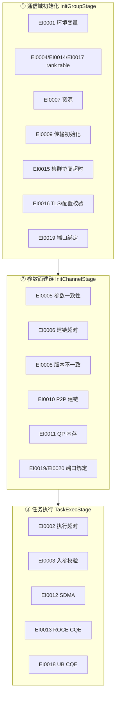

# HCCL 错误码全表（EI0001~EI0020）

> **深度参考** · 前置阅读：[实战复盘（真实需求案例）](/实战复盘/)。本篇为参考手册体例，检索导向；事实基线见文首引用块。

> HCCL 针对常见报错场景在业务打屏日志上报 `EI****`/`EJ****` 故障码。本文是错误码速查总表；完整定义（现象/可能原因/解决方法）见 `hcomm/docs/zh/EI错误码全表.md/`，场景化定位见 `hccl/docs/zh/user_guide/fault_diagnosis/`。
>
> 事实来源：`hcomm/docs/zh/EI错误码全表.md/README.md`（错误码清单）、`hccl/docs/zh/user_guide/fault_diagnosis/debug_thinking.md`（A3/A2 与 950 故障码表）、各 `*_EI00xx.md` 诊断文档。

---

## 1. 错误码全表

| 错误码 | 英文名 | 中文含义 | 所属阶段 | 典型触发场景 | 诊断文档 |
| --- | --- | --- | --- | --- | --- |
| **EI0001** | Config_Error_Invalid_Environment_Variable | 环境变量配置异常 | 初始化 | `HCCL_RDMA_SL`/`HCCL_SOCKET_IFNAME` 配置错误、IP Family 校验不一致 | `env_config_error_EI0001_troubleshooting.md` |
| **EI0002** | Communication_Error_Timeout | 通信算子执行超时 | 执行 | notify wait 超时（等待远端）；HOST/AICPU/CCU 执行超时 | `notify_wait_timeout_EI0002.md`、`task_exec_stage_troubleshooting.md` |
| **EI0003** | Invalid_Argument_Collective_Communication_Operator | 集合通信算子入参校验失败 | 执行 | 入参非法（按报错信息中具体入参判断） | — |
| **EI0004** | File_Operation_Error_Parse | rank table 文件加载/解析失败 | 初始化 | rank_table 文件读取失败、字段配置错误 | `rank_table_file_read_fail_EI0004.md`、`rank_table_field_config_error_EI0004.md` |
| **EI0005** | Invalid_Argument | 参数一致性校验失败 | 建链 | 各 rank 参数不一致 | `param_consistency_check_EI0005.md` |
| **EI0006** | Communication_Error_Get_Socket | 参数面建链超时（获取 socket） | 建链 | 建链超时 | `link_timeout_EI0006.md` |
| **EI0007** | Resource_Error | 资源初始化失败 | 初始化/建链 | 通信域初始化或参数面资源申请失败 | — |
| **EI0008** | Package_Error_Incorrect_HCCL_Version | HCCL 版本不一致 | 建链 | 各 rank HCCL 版本不同（VersionConflict） | — |
| **EI0009** | Communication_Error_Initialize_Transport | 传输初始化失败 | 初始化 | transport 初始化失败（RunFailed） | — |
| **EI0010** | Communication_Error_P2P | Server 内卡间建链失败 | 建链 | P2P（HCCS/PCIe）建链失败 | — |
| **EI0011** | Resource_Error_Insufficient_Device_Memory | QP 内存资源申请失败 | 建链 | Device 内存不足、QP 资源申请失败 | `qp_mem_resource_apply_EI0011.md` |
| **EI0012** | Execution_Error_SDMA | 算子执行时 SDMA 任务异常 | 执行 | HCCS 链路异常、多 bit ecc、远端 core dump | `sdma_error_EI0012.md` |
| **EI0013** | Execution_Error_ROCE_CQE | 算子执行时 ROCE CQE ERROR | 执行 | RoCE 网卡返回错误 CQE | `error_cqe_report_EI0013.md` |
| **EI0014** | Config_Error_Ranktable | 集群信息校验失败（rank table 配置） | 初始化 | device_ip 字段校验失败、superDeviceId 重复 | `rank_table_device_ip_field_validation_fail_EI0014.md`、`super_device_id_duplicate_EI0014.md` |
| **EI0015** | Communication_Error_Ranktable_Detect | 集群信息协商阶段超时（topo 探测） | 初始化 | topo 探测超时、部分 rank 无法连 server、socket 连接超时 | `topo_detect_timeout_EI0015.md`、`typical_multi_node_comm_init_fail_EI0015.md` |
| **EI0016** | Config_Error | TLS 信息配置不一致 / 通信域配置项校验失败 | 初始化 | 各 rank TLS 配置不一致 | `tls_info_config_inconsistent_EI0016.md` |
| **EI0017** | Config_Error_Ranktable | rank table 配置错误 | 初始化 | rank table 配置非法 | — |
| **EI0018** | Execution_Error_UB_CQE | 算子执行时 UB CQE ERROR | 执行 | UB 网卡返回错误 CQE | — |
| **EI0019** | Communication_Error_Bind_IP_Port | 端口绑定失败 | 初始化/建链 | server 节点端口绑定失败、参数面端口绑定失败 | `server_node_port_bind_fail_EI0019.md`、`param_port_bind_fail_EI0019.md` |
| **EI0020** | Communication_Error_Bind_IP_Port | IP/Port 绑定失败 | 初始化/建链 | IP/端口绑定失败 | — |
| **EI9999** | — | HCCL 内部错误 | 任意 | 结合 CANN 日志排查；无法解决联系技术支持 | — |

---

## 2. 按阶段归类

---

## 3. 950 故障码关键字表

Ascend 950PR&950DT 系列（`debug_thinking.md`）——三级关键字标识任务执行方式或异常类型（`HOST`/`AICPU`/`AIV`/`CCU`/`CQE ERROR`）：

| 故障码或场景 | 一级关键字 | 二级关键字 | 三级关键字 |
| --- | --- | --- | --- |
| EI0001 环境变量配置异常 | InitGroupStage | EnvConfig | - |
| EI0003 算子入参校验失败 | TaskExecStage | InvalidArgument | - |
| EI0002（HOST 执行超时） | TaskExecStage | Timeout | HOST |
| HOST 其他执行异常 | TaskExecStage | RunFailed | HOST |
| EI0002（AICPU 执行超时） | TaskExecStage | Timeout | AICPU |
| AICPU 其他执行异常 | TaskExecStage | RunFailed | AICPU |
| AIV 其他执行异常 | TaskExecStage | RunFailed | AIV |
| EI0002（CCU 执行超时） | TaskExecStage | Timeout | CCU |
| CCU 其他执行异常 | TaskExecStage | RunFailed | CCU |
| CQE 错误 | TaskExecStage | RunFailed | CQE ERROR |
| 心跳检测到 CQE 错误 | TaskExecStage | HeartbeatAbnormal | CQE ERROR |
| EI0007 通信域初始化资源申请失败 | InitGroupStage | Resource | - |
| EI0007 参数面资源申请失败 | InitChannelStage | Resource | - |
| EI0009 传输初始化失败 | InitGroupStage | RunFailed | - |
| EI0014 rankTable 集群配置校验失败 | InitGroupStage | RanktableCheck | - |
| EI0015 集群信息协商阶段异常 | InitGroupStage | RanktableDetect | - |
| EI0016 通信域配置项校验失败 | InitGroupStage | RanktableCheck | - |

> 950 的 EI0014 与 EI0016 同属初始化阶段配置校验，检索关键字相同，需结合故障码和报错信息区分。检索示例：`grep -F '[TaskExecStage][InvalidArgument]'`、`grep -F '[TaskExecStage][Timeout][AICPU]'`。

---

## 4. A3/A2 故障码说明表

Atlas A3 / A2 系列（`debug_thinking.md`）：

| 故障码 | 说明 |
| --- | --- |
| EI0001 | 环境变量配置异常 |
| EI0002 | 通信算子执行超时 |
| EI0003 | 集合通信算子入参校验失败（按报错信息中具体入参判断） |
| EI0004 | rankTable 文件加载失败 |
| EI0005 | 参数一致性校验失败 |
| EI0006 | 通信算子参数面建链超时 |
| EI0007 | 资源初始化失败（按报错信息判断） |
| EI0008 | HCCL 版本不一致，校验失败 |
| EI0009 | 传输初始化失败 |
| EI0010 | Server 内卡间建链失败 |
| EI0011 | QP 内存资源申请失败 |
| EI0012 | 算子执行时发生 SDMA 任务异常 |
| EI0013 | 算子执行时发生 ROCE CQE ERROR 异常 |
| EI0014 | 集群信息校验失败 |
| EI0015 | 通信域集群信息协商阶段超时 |
| EI0016 | TLS 信息配置不一致 |
| EI0019 | 通信域创建阶段 server 节点端口绑定失败 / 参数面建链阶段端口绑定失败 |
| EI9999 | HCCL 内部错误（结合 CANN 日志排查，仍无法解决联系技术支持） |

---

## 5. 参考资料

- `hcomm/docs/zh/EI错误码全表.md/`：EI0001~EI0020 完整定义（`EI00xx-<英文名>.md`，含现象/可能原因/解决方法）
- `hccl/docs/zh/user_guide/fault_diagnosis/debug_thinking.md`：950 与 A3/A2 故障码表、多级检索关键字
- `hccl/docs/zh/user_guide/fault_diagnosis/`：各 `*_EI00xx.md` 场景化定位文档
- 关联：[README.md](/通信与昇腾/参考手册/排障手册/)（排障总览）、[localization_flow.md](/通信与昇腾/参考手册/排障手册/定位流程.md)（三阶段诊断详解）

