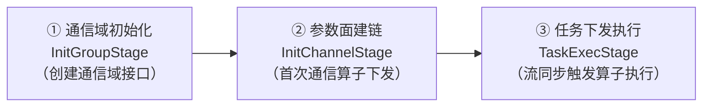
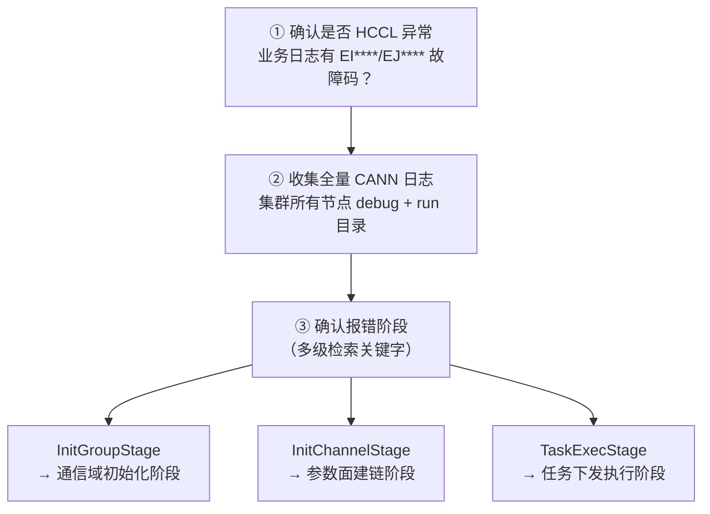
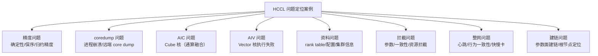

# debug：故障定位与调试

> **深度参考** · 前置阅读：[实战复盘（真实需求案例）](/实战复盘/)。本篇为参考手册体例，检索导向；事实基线见文首引用块。

> HCCL 集合通信是通信域内**全局协同行为**——某节点的异常报错往往是因等待某对端超时。故障定位需收集**集群下所有节点**的 CANN 日志（debug + run 目录），结合错误码与多级检索关键字定位根因。本目录是排障总入口，含**定位流程**、**错误码体系**与**按问题类型分类的定位案例**。
>
> - **定位流程**（[localization_flow.md](/通信与昇腾/参考手册/排障手册/定位流程.md)）：三阶段排障 + 建链根节点定位 + 集群心跳 + task exception 机制
> - **错误码全表**（[error_codes.md](/通信与昇腾/参考手册/排障手册/EI错误码全表.md)）：EI0001~EI0020
> - **问题定位案例**（[cases/](/通信与昇腾/参考手册/排障手册/案例/)）：精度 / coredump / AIC / AIV / 资料 / 拦截 / 整网 / 建链
>
> 事实来源（可信度：代码 > 仓内文档 > 社区资料）：
> `hccl/docs/zh/user_guide/fault_diagnosis/`（42 篇诊断文档）、`hcomm/docs/zh/EI错误码全表.md/`（EI0001~EI0020 错误码定义）、`hccl/docs/zh/user_guide/fault_diagnosis/debug_thinking.md`（定位思路权威）。

---

## 1. HCCL 业务三阶段

HCCL 业务存在三个阶段，不同阶段使用的硬件资源、通信拓扑和同步方式有明显差异——**先确认报错阶段，再分阶段排查**：

| 阶段 | 一级关键字 | 触发接口 | 报错日志关键字 | 常见错误码 |
| --- | --- | --- | --- | --- |
| **① 通信域初始化** | `InitGroupStage` | 通信域创建接口失败 | `topoinfo`、`ranktable` | EI0001/EI0004/EI0007/EI0009/EI0014/EI0015/EI0016/EI0019 |
| **② 参数面建链** | `InitChannelStage` | 通信算子接口失败 | `transport` | EI0005/EI0006/EI0011/EI0019 |
| **③ 任务下发执行** | `TaskExecStage` | 流同步时算子执行失败 | `TaskExceptionHandler`、`FFTS+ run failed`、`Task run failed` | EI0002/EI0003/EI0012/EI0013/EI0018 |

---

## 2. 快速定位定界思路

> 图源：`hccl/docs/zh/user_guide/fault_diagnosis/figures/debug_thinking.png`

> **无清晰首报错时**：大集群故障需梳理每个 rank 的行为，通过 rank 间依赖关系找根节点。HCCL 提供**建链根节点定位能力**与**集群心跳能力**，并在常见问题中给出诊断结果。
>
> **EI9999 / 无故障码**：可能为少见场景或 HCCL 内部问题，需基于实际 CANN 日志和代码分析，无法解决时联系技术支持。

---

## 3. 多级检索关键字

`debug_thinking.md`——根据报错日志关键字快速识别报错阶段（CANN 8.5.0+ 支持）：

| 一级关键字 | 二级关键字 | 故障场景 |
| --- | --- | --- |
| **InitGroupStage** | EnvConfig | 初始化阶段环境变量配置异常 |
| | RanktableConfig | rankTable 文件读取失败 |
| | RanktableCheck | rankTable 集群信息校验失败 |
| | RanktableDetect | 集群信息探测失败 |
| | Resource | 节点资源初始化失败 |
| **InitChannelStage** | ParameterConflict | 参数一致性校验失败 |
| | VersionConflict | HCCL 版本不一致校验失败 |
| | Timeout | 参数面建链超时 |
| **TaskExecStage** | InvalidArgument | 算子入参校验失败 |
| | Not Supported | 不支持场景 |
| | Timeout | 算子执行超时 |
| | RunFailed | 算子执行失败 |
| | HeartbeatAbnormal | 心跳异常事件 |

> **950 三级关键字**：进一步标识任务执行方式或异常类型，取值 `HOST`/`AICPU`/`AIV`/`CCU`/`CQE ERROR`（入参/环境变量校验未进入执行阶段则无三级关键字）。例：`grep -F '[TaskExecStage][Timeout][AICPU]'` 定位 AICPU 执行超时。

---

## 4. 日志快速检索关键字

HCCL 在 run/plog 日志中提供关键信息检索字：

| 关键字 | 内容 |
| --- | --- |
| `Communicator Key Info` | 通信域：`identifier[通信域名]`、`rankSize`、`serverNum`、`moduleNum`、`superPodNum`、`multiModuleDiffDeviceNumMode`、`multiSuperPodDiffServerNumMode` |
| `LocalRank Key Info` | 本端：`userRank`、`hostIp`、`devicePhyId`、`server`、`deviceIp`、`superPodId`、`useSuperPodMode`、`isStandardCard` |
| `LinkInfo` | 链路：`userRank`、`remoteRank`、`localProtocol`、`remoteProtocol`、`engine`、`channel[当前/总数]` |
| `HCCL_ENV` | 各环境变量实际生效值与来源（环境变量/默认值） |
| `HeartbeatAbnormal` | 心跳异常事件（见 [localization_flow.md](/通信与昇腾/参考手册/排障手册/定位流程.md)） |

> 通信域初始化/析构默认打印；通信算子下发需开启 `HCCL_ENTRY_LOG_ENABLE`。

---

## 5. 诊断相关环境变量

| 环境变量 | 作用 |
| --- | --- |
| `HCCL_CONNECT_TIMEOUT` | 建链阶段超时（建议 < `HCCL_EXEC_TIMEOUT`，以正确上报首报错、区分本端/远端阻塞） |
| `HCCL_EXEC_TIMEOUT` | 执行阶段超时（默认 1836s） |
| `HCCL_ENTRY_LOG_ENABLE` | 算子级入参记录开关——集群行为一致性问题时开启，记录各 rank 集合通信行为，卡间横向比对找差异引入点 |
| `HCCL_DEBUG_CONFIG` | 模块级日志开关（仅 A3/A2）——分析算子内部算法选择、任务编排 |
| `HCCL_DFS_CONFIG` | 高级故障探测配置（建议保持默认） |
| `HCCL_DIAGNOSE_ENABLE` | task 级信息跟踪开关（A3/A2 需手动开启） |

---

## 6. 错误码体系（EI0001~EI0020）

完整错误码清单见 [error_codes.md](/通信与昇腾/参考手册/排障手册/EI错误码全表.md)。速览：

| 阶段 | 错误码 |
| --- | --- |
| **配置类** | EI0001（环境变量）、EI0004/EI0014/EI0017（rank table）、EI0016（TLS/配置）、EI0005（参数） |
| **通信类** | EI0002（执行超时）、EI0006（建链超时/socket）、EI0009（传输初始化）、EI0010（P2P）、EI0015（集群信息探测）、EI0019/EI0020（端口绑定） |
| **资源类** | EI0007（资源）、EI0011（Device 内存不足/QP） |
| **执行类** | EI0012（SDMA）、EI0013（ROCE CQE）、EI0018（UB CQE） |
| **其他** | EI0003（算子入参）、EI0008（HCCL 版本不一致）、EI9999（内部错误） |

---

## 7. 问题分类定位案例

除按**阶段**定位外，HCCL 故障也可按**问题类型**归类。[cases/](/通信与昇腾/参考手册/排障手册/案例/) 目录按问题类型组织定位案例：

| 案例文档 | 问题类型 | 典型现象 / 关键词 |
| --- | --- | --- |
| [cases/precision/](/通信与昇腾/参考手册/排障手册/案例/精度/) | **精度问题** | 多次执行结果不同、精度调优；`HCCL_DETERMINISTIC`、保序、BIRS |
| [cases/coredump/](/通信与昇腾/参考手册/排障手册/案例/coredump/) | **coredump 问题** | 进程崩溃、远端 core dump 触发 SDMA 异常、STUCK/LOST |
| [cases/aic/](/通信与昇腾/参考手册/排障手册/案例/aic/) | **AIC 问题** | Cube 核（通算融合 MC2）执行失败、`fault kernel_name`、抢核 |
| [cases/aiv/](/通信与昇腾/参考手册/排障手册/案例/aiv/) | **AIV 问题** | `fault kernel_name=aiv_*`、控核不足、多域抢核死锁、数据量回退 |
| [cases/config_data/](/通信与昇腾/参考手册/排障手册/案例/资料配置/) | **资料问题** | rank table 加载/字段/校验、环境变量配置、集群信息协商（EI0001/EI0004/EI0014/EI0015/EI0016） |
| [cases/interception/](/通信与昇腾/参考手册/排障手册/案例/拦截/) | **拦截问题** | CCU_MS 标卡拦截、参数校验、一致性校验、AIV 多域拦截、算法重定向 |
| [cases/whole_network/](/通信与昇腾/参考手册/排障手册/案例/整网/) | **整网问题** | 集群心跳（ERROR CQE/STUCK/LOST、crimer rank）、行为一致性、快慢卡、交换机拥塞 |
| [cases/link/](/通信与昇腾/参考手册/排障手册/案例/建链/) | **建链问题** | 参数面建链超时、级联传播、根节点定位、socket/QP（EI0005/EI0006/EI0011/EI0019） |

---

## 8. 文档索引

| 文档 | 内容 |
| --- | --- |
| [localization_flow.md](/通信与昇腾/参考手册/排障手册/定位流程.md) | **定位流程**：三阶段排障（初始化/建链/执行）、快速定位定界、**建链根节点定位机制**、**集群心跳机制**、**task exception 机制**、典型案例 |
| [error_codes.md](/通信与昇腾/参考手册/排障手册/EI错误码全表.md) | **EI0001~EI0020 错误码全表**（编号/英文名/中文含义/典型触发场景/对应诊断文档）+ 950 与 A3/A2 故障码对照 |
| [cases/](/通信与昇腾/参考手册/排障手册/案例/) | **问题定位案例**（8 类）：精度 / coredump / AIC / AIV / 资料 / 拦截 / 整网 / 建链 |

---

## 9. 参考资料

- `hccl/docs/zh/user_guide/fault_diagnosis/`：`README.md`（诊断目录）、`debug_thinking.md`（定位思路）、`comm_domain_init_stage.md`/`comm_domain_init_flow.md`（初始化）、`param_link_stage_troubleshooting.md`（建链）、`task_exec_stage_troubleshooting.md`（执行）、`cluster_heartbeat_mechanism_troubleshooting.md`（心跳）、`task_exception_mechanism_troubleshooting.md`（任务异常）、`aiv_comm_op_exec_fail.md`（AIV 执行失败）、各 `*_EI00xx.md`（错误码场景）
- `hcomm/docs/zh/EI错误码全表.md/`：EI0001~EI0020 错误码定义（现象/原因/解决方法）
- `hccl/docs/zh/user_guide/hccl_env/`：`HCCL_CONNECT_TIMEOUT`、`HCCL_EXEC_TIMEOUT`、`HCCL_ENTRY_LOG_ENABLE`、`HCCL_DEBUG_CONFIG`、`HCCL_DFS_CONFIG`、`HCCL_DIAGNOSE_ENABLE`、`HCCL_DETERMINISTIC`
- 关联：[README.md](/通信与昇腾/参考手册/排障手册/)、[../communicator/创建方式.md](/通信与昇腾/参考手册/通信域/创建方式.md)（通信域创建）、[../profiling/](/通信与昇腾/参考手册/性能分析/)（性能问题定位）、[../reference/环境变量.md](/通信与昇腾/参考手册/运行与约束/环境变量.md)（环境变量）、[../reference/可靠性与安全.md](/通信与昇腾/参考手册/运行与约束/可靠性与安全.md)（可靠性/确定性）

