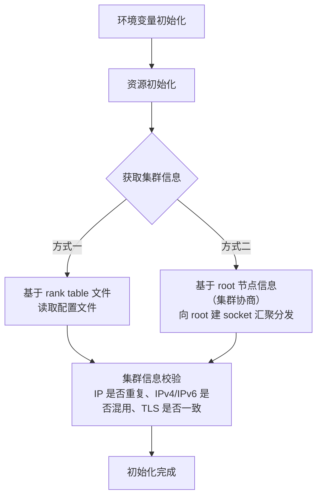

# 定位流程：三阶段排障与根因定位机制

> **深度参考** · 前置阅读：[实战复盘（真实需求案例）](/实战复盘/)。本篇为参考手册体例，检索导向；事实基线见文首引用块。

> 本文是 debug 篇的**定位流程主干**：按 HCCL 业务三阶段（通信域初始化 / 参数面建链 / 任务下发执行）展开排障流程，并详解两大根因定位机制（**建链根节点定位**、**集群心跳**）与 **task exception 机制**。
>
> 按**问题类型**分类的定位案例见 [cases/](/通信与昇腾/参考手册/排障手册/案例/)（精度 / coredump / AIC / AIV / 资料 / 拦截 / 整网 / 建链）；错误码全表见 [error_codes.md](/通信与昇腾/参考手册/排障手册/EI错误码全表.md)；排障总览与检索关键字见 [README.md](/通信与昇腾/参考手册/排障手册/)。
>
> 事实来源：`hccl/docs/zh/user_guide/fault_diagnosis/`（`comm_domain_init_flow.md`、`cluster_info_nego_troubleshooting.md`、`param_link_stage_troubleshooting.md`、`cluster_heartbeat_mechanism_troubleshooting.md`、`task_exception_mechanism_troubleshooting.md`、`typical_multi_node_comm_init_fail_EI0015.md`、`process_hang_or_peer_heartbeat_loss_example.md`）。

---

## 1. 通信域初始化阶段（InitGroupStage）

### 1.1 总体流程


> 图源：`hccl/docs/zh/user_guide/fault_diagnosis/figures/comm_domain_init_flow.png`



### 1.2 常见故障与定位

| 子阶段 | 二级关键字 | 错误码 | 常见原因 | 诊断文档 |
| --- | --- | --- | --- | --- |
| **环境变量配置** | EnvConfig | EI0001 | `HCCL_RDMA_SL`/`HCCL_SOCKET_IFNAME` 配置错误、IP Family 不一致 | `env_config_error_EI0001_troubleshooting.md` |
| **rank table 加载** | RanktableConfig | EI0004 | 文件路径/权限错误、文件读取失败、字段配置错误 | `rank_table_load_fail_troubleshooting.md` |
| **集群信息协商** | RanktableDetect | EI0015/EI0019 | topo 探测超时、部分 rank 无法连 server、端口绑定失败 | `cluster_info_nego_troubleshooting.md` |
| **集群信息校验** | RanktableCheck | EI0014/EI0016 | device_ip 校验失败、superDeviceId 重复、TLS 配置不一致 | `cluster_info_verify_fail_troubleshooting.md` |


> 图源：`hccl/docs/zh/user_guide/fault_diagnosis/figures/cluster_info_nego_flow.png`

**集群协商方式**（基于 root 节点）：通过 Host 侧网卡向 root 节点建 socket 连接，进行信息汇聚与分发。须确保配置的网卡、端口正确；若部分 rank 未及时将信息传递给 root 节点，会导致此阶段失败。


> 图源：`hccl/docs/zh/user_guide/fault_diagnosis/figures/topo_detect_theory.png`。topo 探测超时（EI0015）是集群协商阶段常见故障。

> **rank table 一致性**：通过 rank table 创建时，须确保文件路径/权限正确，且**在集群各 rank 保持一致**——HCCL 会在后续参数面建链做一致性校验，不满足则终止业务。

---

## 2. 参数面建链阶段（InitChannelStage）

首次通信算子下发时触发参数面建链。报错日志含 `transport` 关键字。

### 2.1 建链失败根节点定位


> 图源：`hccl/docs/zh/user_guide/fault_diagnosis/figures/link_fail_root_debug.png`。HCCL 提供**建链根节点定位能力**——大集群无清晰首报错时，通过 rank 间依赖关系找根节点。

### 2.2 常见故障

| 二级关键字 | 错误码 | 常见原因 | 诊断文档 |
| --- | --- | --- | --- |
| ParameterConflict | EI0005 | 各 rank 参数不一致 | `param_consistency_check_EI0005.md` |
| VersionConflict | EI0008 | HCCL 版本不一致 | — |
| Timeout | EI0006 | 建链超时（socket） | `link_timeout_EI0006.md` |
| Resource | EI0007/EI0011 | 资源申请失败、QP 内存不足 | `qp_mem_resource_apply_EI0011.md` |
| — | EI0010 | Server 内卡间 P2P 建链失败 | — |
| — | EI0019/EI0020 | 参数面端口绑定失败 | `param_port_bind_fail_EI0019.md` |

---

## 3. 任务下发执行阶段（TaskExecStage）

通信域创建与算子下发均成功，但**流同步时算子执行失败**。报错日志含 `TaskExceptionHandler`、`FFTS+ run failed`、`Task run failed`。

### 3.1 集群心跳机制

HCCL 基于已有通信域信息与邻近 rank 建立**独立维测链路**，提供集群单点故障广播扩散能力（控制维测链路数量与通信量，不损通信性能），使**任意 rank 的 plog 日志均含故障根节点信息**。

| 优先级 | 异常类型 | status（run/plog） | ExceptionType（debug/plog） | 判断标准 |
| --- | --- | --- | --- | --- |
| 1 | **网络问题** | `ERROR CQE` | Error cqe Occurred | 定期轮询 ROCE 驱动重传超次事件，通过 QPN 映射远端 IP |
| 2 | **进程卡死** | `STUCK` | Stuck Occurred | 每隔 1/3 的 `HCCL_EXEC_TIMEOUT` 轮询所有算子入/出次数分析是否卡住 |
| 3 | **进程退出** | `LOST` | Heartbeat Lost Occurred | 30s 内未收到远端心跳报文 |

> 优先级 `ERROR CQE > STUCK > LOST`；Cluster Exception ERROR 日志只打印有效事件前三个，全量心跳事件在 run 目录检索。

**心跳异常日志格式**：

```text
[HeartbeatAbnormal]local rank[IP/ID]: crimer rank[IP/ID] status[异常类型] by informer rank[IP/ID]
```

| 字段 | 含义 |
| --- | --- |
| `local rank` | 当前节点信息 |
| `crimer rank` | **根节点信息**（故障源） |
| `status` | 异常事件类型（ERROR CQE/STUCK/LOST） |
| `by informer rank` | 集群故障上报者 |

**集群故障定位日志**（task exception 回调后）：

```text
[TaskExecStage][HeartbeatAbnormal]Cluster Exception Location[IP/ID], Arrival Time:[...], Discoverer:[IP/ID], ExceptionType:[...], Possible Reason:可能原因
```

> 检索关键字 `HeartbeatAbnormal`。若超时后无异常事件，可能为**集群行为一致性问题**——优先排查脚本、版本、数据集，必要时开 `HCCL_ENTRY_LOG_ENABLE` 做算子级行为跟踪。

### 3.2 task exception 机制

通信算子任务编排完成后下发到 Device 异步执行；若执行失败，通过**回调函数**通知 HCCL 异常 task 信息（stream + taskId），HCCL 检索下发时的 task 信息，打印失败 task 详情及所在算子信息。

> A3/A2 需通过 `HCCL_DIAGNOSE_ENABLE` 手动开启 task 级信息跟踪。关键日志：**`Task run failed`** 或 **`TaskExecStage`**。

```text
[TaskExecStage][Timeout][Host]Task run failed, base information is streamID:[2], taskID[21], tag[AllReduce_...], AlgType(level 0-1-2):[fullmesh-ring-NHR].
[TaskExecStage][Timeout][Host]Task run failed, groupRank information is group:[...], rankSize[4], rankId[2].
[TaskExecStage][Timeout][Host]Task run failed, opData information is timeStamp:[...], deviceId[2], index[21], count[256], reduceType[sum], src[0x...], dst[0x...], dataType[float32].
```

| 信息段 | 内容 |
| --- | --- |
| **base information** | 算子所在 stream、taskId、tag（识别报错算子）、AlgType（level 0-1-2 算法） |
| **groupRank information** | 通信域名（group）、通信域大小（rankSize）、本卡 rankId |
| **opData information** | 算子入参：deviceId、第几个算子（index）、数据量（count）、reduceType、src/dst 地址、dataType |

**两种可能失败的 task**：

| task 类型 | 常见场景 |
| --- | --- |
| **Notify** | 算子执行阶段等待远端超时 |
| **SDMA** | HCCS 链路异常、多 bit ecc，也较低概率在远端 core dump 时触发 |


> 图源：`hccl/docs/zh/user_guide/fault_diagnosis/figures/op_execute_sequence.png`

### 3.3 常见故障

| 二级/三级关键字 | 错误码 | 常见原因 | 诊断文档 |
| --- | --- | --- | --- |
| Timeout（HOST/AICPU/CCU） | EI0002 | notify wait 超时、执行超时 | `notify_wait_timeout_EI0002.md`、`task_exec_stage_troubleshooting.md` |
| RunFailed + CQE ERROR | EI0013/EI0018 | ROCE/UB CQE 错误 | `error_cqe_report_EI0013.md` |
| RunFailed | EI0012 | SDMA 任务异常 | `sdma_error_EI0012.md` |
| InvalidArgument | EI0003 | 算子入参校验失败 | — |
| HeartbeatAbnormal | — | 心跳异常（见 §3.1） | `cluster_heartbeat_mechanism_troubleshooting.md` |
| —（AIV） | — | AIV 通信算子执行失败（A2） | `aiv_comm_op_exec_fail.md` |

---

## 4. 典型案例

| 案例 | 现象 | 定位 | 文档 |
| --- | --- | --- | --- |
| **多机通信域初始化失败** | EI0015，部分 rank 无法连 server | 集群协商阶段 topo 探测/socket 超时，排查网卡/端口/防火墙 | `typical_multi_node_comm_init_fail_EI0015.md` |
| **进程卡死或对端心跳丢失** | 算子执行超时，心跳报 STUCK/LOST | 经 `HeartbeatAbnormal` 日志的 crimer rank 定位根节点 | `process_hang_or_peer_heartbeat_loss_example.md` |

---

## 5. 参考资料

- `hccl/docs/zh/user_guide/fault_diagnosis/`：`comm_domain_init_flow.md`、`comm_domain_init_stage.md`、`cluster_info_nego_troubleshooting.md`、`cluster_info_verify_fail_troubleshooting.md`、`rank_table_load_fail_troubleshooting.md`、`param_link_stage_troubleshooting.md`、`task_exec_stage_troubleshooting.md`、`cluster_heartbeat_mechanism_troubleshooting.md`、`task_exception_mechanism_troubleshooting.md`、`typical_multi_node_comm_init_fail_EI0015.md`、`process_hang_or_peer_heartbeat_loss_example.md`
- `hccl/docs/zh/user_guide/hccl_env/`：`HCCL_DIAGNOSE_ENABLE.md`、`HCCL_ENTRY_LOG_ENABLE.md`、`HCCL_CONNECT_TIMEOUT.md`、`HCCL_EXEC_TIMEOUT.md`
- 关联：[README.md](/通信与昇腾/参考手册/排障手册/)（排障总览）、[error_codes.md](/通信与昇腾/参考手册/排障手册/EI错误码全表.md)（错误码全表）、[cases/](/通信与昇腾/参考手册/排障手册/案例/)（按问题类型分类的定位案例）、[../communicator/创建方式.md](/通信与昇腾/参考手册/通信域/创建方式.md)（通信域创建）、[../reference/可靠性与安全.md](/通信与昇腾/参考手册/运行与约束/可靠性与安全.md)（心跳/重执行可靠性机制）

