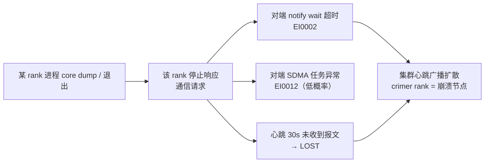
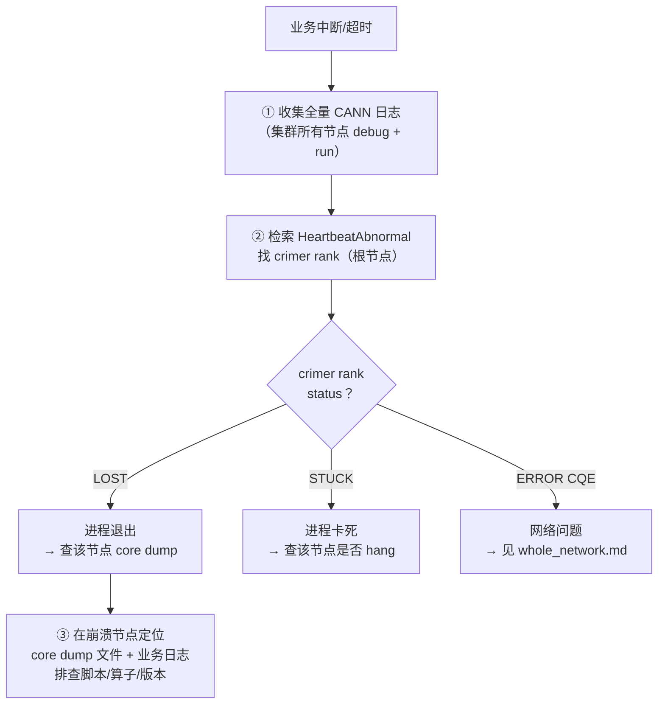

# coredump 问题定位

> **问题类型**：某 rank 进程崩溃（core dump）或异常退出，导致通信域内其他 rank 等待超时、SDMA 异常或心跳丢失，业务整体中断。
>
> 事实来源：`hccl/docs/zh/user_guide/fault_diagnosis/debug_thinking.md`（core dump 排查）、`task_exception_mechanism_troubleshooting.md`（远端 core dump 触发 SDMA）、`cluster_heartbeat_mechanism_troubleshooting.md`（STUCK/LOST）、`process_hang_or_peer_heartbeat_loss_example.md`。

---

## 1. 问题现象

| 现象 | 说明 |
| --- | --- |
| **业务中断** | 训练/推理进程崩溃，产生 core dump 文件 |
| **他 rank 超时报错** | 崩溃 rank 的对端因等待其响应而 notify wait 超时（EI0002） |
| **SDMA 异常** | 远端 core dump 时，本端较低概率触发 SDMA 任务异常（EI0012） |
| **心跳 LOST/STUCK** | 集群心跳检测到进程退出（LOST）或卡死（STUCK） |

> ⚠️ coredump 的**首报错往往不在崩溃节点本身**——其他 rank 会先报"等待对端超时"。需结合全量日志找**最先异常的根节点**。

---

## 2. 根因与传播



| 传播路径 | 表现 |
| --- | --- |
| **notify wait 超时** | 对端算子执行阶段等待崩溃 rank 的 notify，超时报 EI0002 |
| **SDMA 异常** | HCCS 链路对端崩溃时，本端 SDMA 任务可能异常（EI0012） |
| **心跳 LOST** | 30s 内未收到崩溃 rank 的心跳报文，心跳机制报 LOST |

---

## 3. 定位流程



> 若 CANN 日志中**无 HCCL 组件报错**，需排查是否有其他组件报错；若无任何报错，注意训练脚本本身有无异常、是否存在 **core dump 或进程卡住**（`debug_thinking.md`）。

---

## 4. 关联错误码与日志关键字

| 错误码/关键字 | 含义 |
| --- | --- |
| **EI0012**（Execution_Error_SDMA） | 算子执行时 SDMA 任务异常（HCCS 链路异常、多 bit ecc、**远端 core dump**） |
| **EI0002**（Communication_Error_Timeout） | 对端崩溃导致 notify wait 超时 |
| `HeartbeatAbnormal` + `LOST` | 心跳检测到进程退出（30s 未收到心跳报文） |
| `HeartbeatAbnormal` + `STUCK` | 心跳检测到进程卡死（每隔 1/3 `HCCL_EXEC_TIMEOUT` 轮询算子入/出次数） |
| `crimer rank[IP/ID]` | 心跳日志中的**故障根节点**信息 |

心跳异常日志格式（详见 [../localization_flow.md §3.1](/通信与昇腾/参考手册/排障手册/localization_flow.md)）：

```text
[HeartbeatAbnormal]local rank[IP/ID]: crimer rank[IP/ID] status[LOST] by informer rank[IP/ID]
```

---

## 5. 处置与规避

| 处置 | 说明 |
| --- | --- |
| **定位崩溃根因** | 在 crimer rank 节点查 core dump 文件、业务日志，排查训练脚本、自定义算子、版本兼容性 |
| **区分本端/远端** | 建议 `HCCL_CONNECT_TIMEOUT` < `HCCL_EXEC_TIMEOUT`，以正确上报首报错、区分阻塞原因在本端还是远端 |
| **task 级跟踪** | A3/A2 开启 `HCCL_DIAGNOSE_ENABLE` 跟踪 task 级信息 |
| **容错恢复** | A3 可配合算子重执行（`HCCL_OP_RETRY_ENABLE`）+ 通信域挂起恢复（`HcclCommSuspend/Resume`）提升容错，见 [../../reference/reliability_security.md](/通信与昇腾/参考手册/运行与约束/reliability_security.md) |

---

## 6. 参考资料

- `hccl/docs/zh/user_guide/fault_diagnosis/debug_thinking.md`：core dump/进程卡住排查
- `hccl/docs/zh/user_guide/fault_diagnosis/task_exception_mechanism_troubleshooting.md`：远端 core dump 触发 SDMA 异常
- `hccl/docs/zh/user_guide/fault_diagnosis/cluster_heartbeat_mechanism_troubleshooting.md`：STUCK/LOST 心跳检测
- `hccl/docs/zh/user_guide/fault_diagnosis/process_hang_or_peer_heartbeat_loss_example.md`：进程卡死/心跳丢失案例
- `hccl/docs/zh/user_guide/fault_diagnosis/sdma_error_EI0012.md`：SDMA 异常
- 关联：[README.md](/通信与昇腾/参考手册/排障手册/案例/)、[whole_network](/通信与昇腾/参考手册/排障手册/案例/整网/)（整网心跳）、[../localization_flow.md](/通信与昇腾/参考手册/排障手册/localization_flow.md)（task exception 机制）、[../error_codes.md](/通信与昇腾/参考手册/排障手册/error_codes.md)

