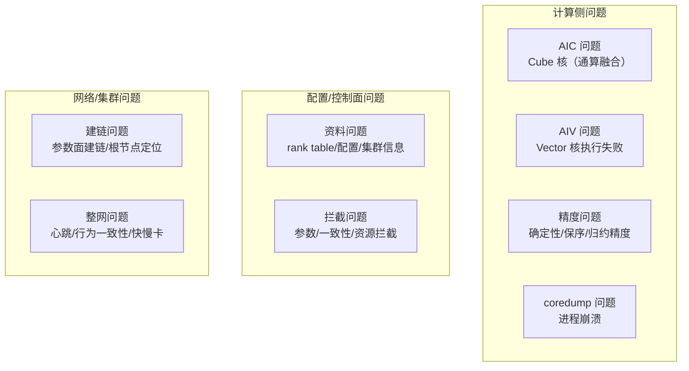
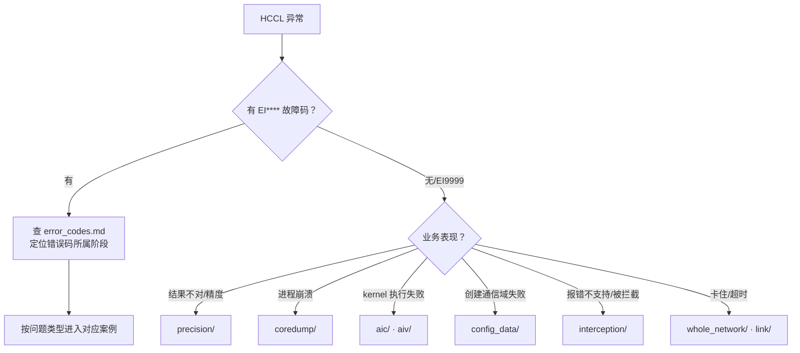

# cases：问题定位案例（按类型）

> **深度参考** · 前置阅读：[实战复盘（真实需求案例）](/实战复盘/)。本篇为参考手册体例，检索导向；事实基线见文首引用块。

> 按**问题类型**归类的 HCCL 故障定位案例。每个案例含：问题现象、定位流程、常见根因、关联错误码/日志关键字、处置与规避。
>
> 与 [../定位流程.md](/通信与昇腾/参考手册/排障手册/定位流程.md)（按**阶段**定位）互补：阶段定位回答"在哪个阶段报错"，案例定位回答"是哪一类问题、怎么查"。错误码全表见 [../EI错误码全表.md](/通信与昇腾/参考手册/排障手册/EI错误码全表.md)。

---

## 1. 案例分类总览



| 案例 | 问题类型 | 主要阶段 | 关联错误码 | 文档 |
| --- | --- | --- | --- | --- |
| **精度问题** | 归约结果不确定/精度偏差 | 执行 | —（功能问题） | [precision](/通信与昇腾/参考手册/排障手册/案例/精度/) |
| **coredump 问题** | 进程崩溃/远端 core dump | 执行 | EI0012（SDMA） | [coredump](/通信与昇腾/参考手册/排障手册/案例/coredump/) |
| **AIC 问题** | Cube 核执行失败（通算融合） | 执行 | EI0002/EI9999 | [aic](/通信与昇腾/参考手册/排障手册/案例/aic/) |
| **AIV 问题** | Vector 核通信算子执行失败 | 执行 | EI0002 | [aiv](/通信与昇腾/参考手册/排障手册/案例/aiv/) |
| **资料问题** | rank table/环境变量/集群信息配置 | 初始化 | EI0001/EI0004/EI0014/EI0015/EI0016 | [config_data](/通信与昇腾/参考手册/排障手册/案例/资料配置/) |
| **拦截问题** | HCCL 主动拦截报错 | 初始化/建链/执行 | EI0003/EI0005/EI0007 | [interception](/通信与昇腾/参考手册/排障手册/案例/拦截/) |
| **整网问题** | 集群级协同异常 | 执行 | EI0002 + 心跳 | [whole_network](/通信与昇腾/参考手册/排障手册/案例/整网/) |
| **建链问题** | 参数面建链失败/超时 | 建链 | EI0005/EI0006/EI0011/EI0019 | [link](/通信与昇腾/参考手册/排障手册/案例/建链/) |

---

## 2. 目录组织与案例结构

**每一类问题一个目录**，目录内含一个 `README.md`（该类问题的**定位总览**）与若干**具体案例**文件（按需补充，当前各类暂无独立案例文件）：

```text
cases/
├── README.md              ← 本文件（案例分类索引）
├── precision/README.md    ← 精度问题总览（+ 后续具体案例）
├── coredump/README.md     ← coredump 问题总览
├── aic/README.md          ← AIC 问题总览
├── aiv/README.md          ← AIV 问题总览
├── config_data/README.md  ← 资料问题总览
├── interception/README.md ← 拦截问题总览
├── whole_network/README.md← 整网问题总览
└── link/README.md         ← 建链问题总览
```

每类 README（及后续具体案例）统一按以下结构组织：

| 部分 | 内容 |
| --- | --- |
| **问题现象** | 典型报错日志、打屏信息、业务表现 |
| **定位流程** | mermaid 流程图 + 检索关键字 |
| **常见根因** | 根因分类表 |
| **关联错误码/关键字** | 对应 EI 错误码、plog 检索关键字 |
| **处置与规避** | 解决方法与预防配置 |
| **参考文档** | fault_diagnosis 源文档 |

> 新增具体案例时，在对应类别目录下新建 `.md` 文件，并在该目录 README 中登记链接。

---

## 3. 定位入口选择



---

## 4. 参考资料

- `hccl/docs/zh/user_guide/fault_diagnosis/`：42 篇诊断文档（各案例的源文档）
- `hcomm/docs/zh/EI错误码全表.md/`：EI0001~EI0020 错误码定义
- 关联：[../README.md](/通信与昇腾/参考手册/排障手册/)（排障总览）、[../定位流程.md](/通信与昇腾/参考手册/排障手册/定位流程.md)（按阶段定位流程）、[../EI错误码全表.md](/通信与昇腾/参考手册/排障手册/EI错误码全表.md)（错误码全表）

