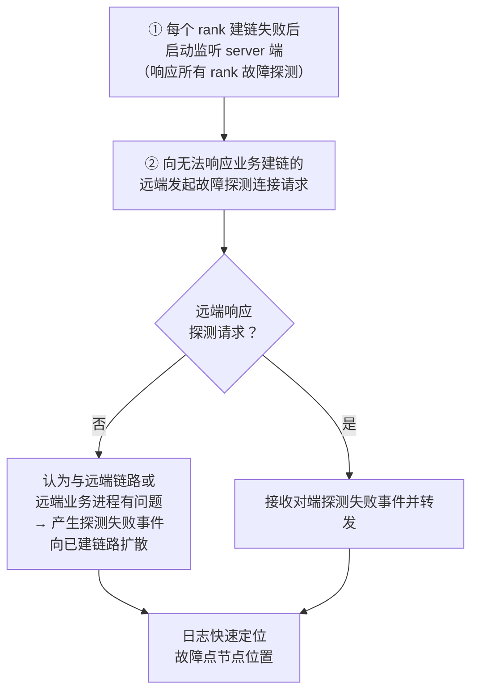
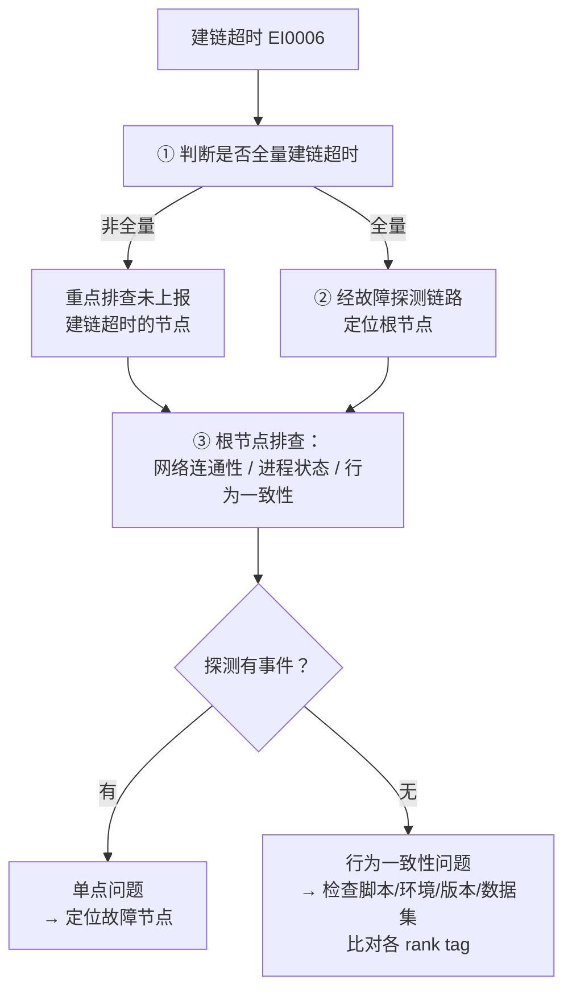

# 建链问题定位

> **问题类型**：参数面建链失败/超时。调用通信算子时，HCCL 通过参数面网络基于 **TCP 协议**进行 socket 连接创建，交换地址等信息；若部分 rank 未调用到预期算子、网络连通性或行为一致性问题，会导致 socket 连接超时。属**建链阶段**（InitChannelStage），报错日志含 `transport` 关键字。
>
> 事实来源：`hccl/docs/zh/user_guide/fault_diagnosis/param_link_stage_troubleshooting.md`（建链失败定位思路权威）、`link_timeout_EI0006.md`、`param_consistency_check_EI0005.md`、`param_port_bind_fail_EI0019.md`、`qp_mem_resource_apply_EI0011.md`。

---

## 1. 问题现象

| 现象 | 说明 |
| --- | --- |
| **建链超时报错** | 调用通信算子时 socket 连接超时（EI0006） |
| **报错含 transport** | 日志含 `transport`、`InitChannelStage`、`Alloc transports failed` |
| **级联传递** | 建链超时在 rank 间**级联传递**——rank0 等 rank1、rank1 等 rank2，根因可能在 rank1-rank2 之间 |

> 由于 HCCL 算法和算子调用顺序，建链超时会呈现 rank 间**级联传递**——发现建链超时需**优先找到故障点位置**（根节点），而非停留在表面报错的 rank。

---

## 2. 建链根节点定位机制

考虑到级联传播，HCCL 在业务建链失败后**立即启动故障探测链路**：


> 图源：`hccl/docs/zh/user_guide/fault_diagnosis/figures/link_fail_root_debug.png`



> 任何单点问题导致的建链失败，都可通过日志快速定位故障点节点位置，再进行下一步定位。

---

## 3. 一致性校验机制

HCCL 与对端成功创建 socket 连接后，互相交换**算子入参、CANN 版本**等信息并与本端校验，不一致则上报错误并返回错误码：

| 校验项 | 不一致错误码 |
| --- | --- |
| **算子入参** | EI0005（参数一致性校验失败） |
| **CANN/HCCL 版本** | EI0008（版本不一致） |

> **单算子模式限制**：为保证性能，HCCL 仅在每个通信域**新类型或算法的算子首次调用**时才触发建链；建链成功后才一致性校验，因此该特性**无法拦截所有下发不一致问题**。

---

## 4. 报错阶段分析

参数面建链阶段常见报错场景：

| 场景 | 错误码 | 排查命令 |
| --- | --- | --- |
| **device 网卡端口绑定失败** | EI0019 | `grep -rE "socket type\[(0\|1)\].*Please check the port status and whether the port is being used by other process"` |
| **参数面 socket 建链超时** | EI0006 | `grep -r "wait socket establish timeout"` |
| **一致性校验失败** | EI0005 | `grep -r "CMD information .* check fail"` |
| **QP 内存资源申请失败** | EI0011 | 见 `qp_mem_resource_apply_EI0011.md` |

> 端口绑定失败排查仅适用 A3/A2。

---

## 5. 定位流程



判断是否全量建链超时的命令：

```bash
for i in *;do cd $i;pwd;grep -rnc "connection fail" | grep -v ":0" | wc -l; cd ..;done
```

> 若探测无任何事件，很可能是**行为一致性问题**——各 rank 均已进入建链阶段并响应探测，但彼此调用的通信算子不一致导致链路互等超时。可通过 `Alloc transports failed` 的 tag 信息推测算子行为（见 [whole_network §4](/通信与昇腾/参考手册/排障手册/案例/整网/)）。

---

## 6. 关联错误码与关键字

| 错误码/关键字 | 含义 |
| --- | --- |
| **EI0005** | 参数一致性校验失败（`CMD information ... check fail`） |
| **EI0006** | 参数面建链超时（`wait socket establish timeout`） |
| **EI0008** | HCCL 版本不一致 |
| **EI0011** | QP 内存资源申请失败（Device 内存不足） |
| **EI0019/EI0020** | 端口绑定失败 |
| `Alloc transports failed` | 建链失败（tag 信息可推测算子行为） |
| `InitChannelStage][Timeout` | 建链超时关键字 |

---

## 7. 处置与规避

| 处置 | 说明 |
| --- | --- |
| **找根节点** | 经故障探测链路定位级联传播的根节点，而非表面报错 rank |
| **查网络连通性** | 排查网卡、端口、防火墙、交换机连通性 |
| **查端口占用** | 端口绑定失败时检查端口是否被其他进程占用；单卡多进程配置端口范围 |
| **保证一致性** | 各 rank 算子入参、HCCL/CANN 版本一致 |
| **超时配置** | `HCCL_CONNECT_TIMEOUT`（默认 120s）合理配置 |

---

## 8. 参考资料

- `hccl/docs/zh/user_guide/fault_diagnosis/param_link_stage_troubleshooting.md`：建链失败定位思路（本文主要来源）
- `hccl/docs/zh/user_guide/fault_diagnosis/link_timeout_EI0006.md`：建链超时
- `hccl/docs/zh/user_guide/fault_diagnosis/param_consistency_check_EI0005.md`：参数一致性校验
- `hccl/docs/zh/user_guide/fault_diagnosis/param_port_bind_fail_EI0019.md`、`qp_mem_resource_apply_EI0011.md`
- 关联：[README.md](/通信与昇腾/参考手册/排障手册/案例/)、[config_data](/通信与昇腾/参考手册/排障手册/案例/资料配置/)（资料/一致性）、[whole_network](/通信与昇腾/参考手册/排障手册/案例/整网/)（行为一致性）、[../定位流程.md](/通信与昇腾/参考手册/排障手册/定位流程.md)（建链阶段）、[../EI错误码全表.md](/通信与昇腾/参考手册/排障手册/EI错误码全表.md)、[../../comm/roce_rdma.md](/通信与昇腾/参考手册/协议与传输/roce_rdma.md)（QP/建链）

