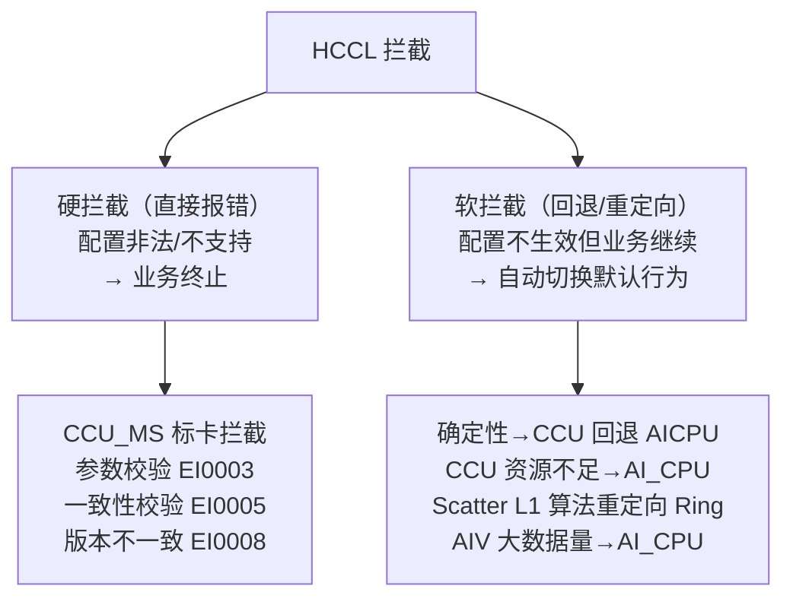
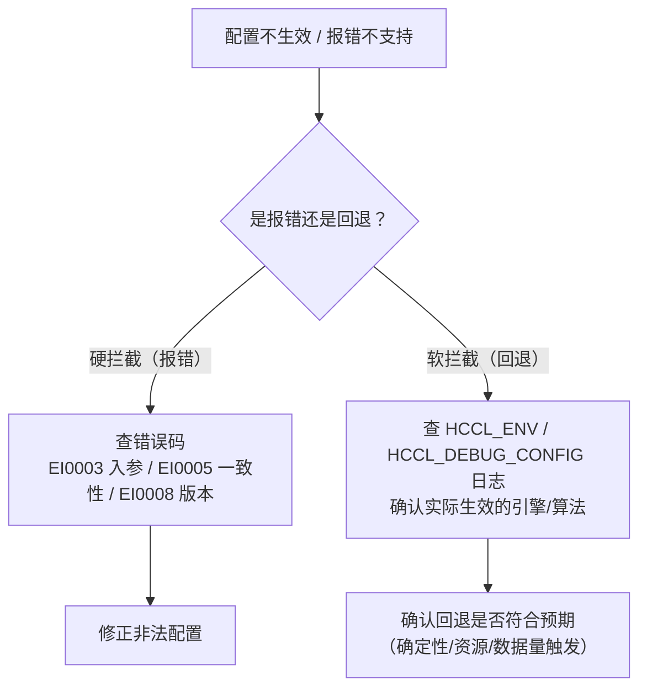

# 拦截问题定位

> **问题类型**：HCCL 对不支持/非法的配置或场景**主动拦截**——表现为直接报错（硬拦截）或自动回退/重定向（软拦截，配置不生效）。常见于展开模式、算子入参、一致性校验、确定性计算等场景。
>
> 事实来源：`hccl/docs/zh/user_guide/hccl_env/HCCL_OP_EXPANSION_MODE.md`（展开模式拦截/回退）、`hccl/docs/zh/user_guide/约束.md`（约束拦截）、`hccl/src/ops/*/selector/*_auto_selector.cc`（引擎回退/算法重定向）、`hccl/docs/zh/user_guide/fault_diagnosis/param_consistency_check_EI0005.md`（一致性校验拦截）。

---

## 1. 两类拦截

| 类型 | 表现 | 影响 |
| --- | --- | --- |
| **硬拦截** | 直接报错、返回错误码、业务终止 | 需修正配置才能继续 |
| **软拦截** | 配置不生效，自动回退/重定向到默认行为 | 业务继续但可能与预期不符（性能/算法变化） |

---

## 2. 常见拦截场景

### 2.1 硬拦截（报错）

| 场景 | 触发条件 | 行为 | 错误码 |
| --- | --- | --- | --- |
| **CCU_MS 标卡拦截** | 标卡（PCIe）环境配置 CCU_MS | **直接拦截报错** | — |
| **算子入参校验** | 入参非法（count/dataType/root 等） | 报错 | EI0003 |
| **参数一致性校验** | 各 rank 算子入参不一致 | 报错终止 | EI0005 |
| **版本一致性校验** | 各 rank HCCL 版本不一致 | 报错（VersionConflict） | EI0008 |
| **AIV 多域并发** | 多个通信域同时配 AIV | 不可预期行为（应避免） | — |
| **AIV 控核不足** | Vector 核数不满足算法编排 | 报错并提示最低核数 | — |
| **静态 shape 图 + AI_CPU** | 300I Duo 静态 shape 图指定 AI_CPU 展开 | 不支持 | — |

### 2.2 软拦截（回退/重定向）

| 场景 | 触发条件 | 回退行为 |
| --- | --- | --- |
| **确定性 → CCU 回退** | `DETERMINISTIC_STRICT` + CCU_MS/CCU_SCHED | 回退 **AICPU** |
| **CCU 资源不足** | CCU 资源不足 | 自动切换 **AI_CPU**（`CCU_FAIL`） |
| **CCU_SCHED 大数据量** | 单机 AR/RS/Reduce 数据量超阈值 | 自动切换 **AI_CPU** |
| **CCU_SCHED PCIe 域** | CCU_SCHED 遇 PCIe 链路域 | 回退 **AICPU_TS**（>8 卡再回退 AIV） |
| **AIV 大数据量** | Broadcast/AR/RS/AG/AlltoAll（单机）数据量超阈值 | 自动切换 **AI_CPU** |
| **Scatter L1 算法重定向** | Scatter 的 Server 间算法非 Ring/NHR/NB | 重定向为 **Ring** |
| **确定性优先级** | 同时设 `HCCL_DETERMINISTIC` 与 AIV 展开 | 确定性优先，AIV 展开可能不生效 |

> 引擎回退规则（9 条）详见 [../../algorithms/algo_selector.md §3](/通信与昇腾/参考手册/算法参考/algo_selector.md)。

---

## 3. 定位流程

> 用 `HCCL_DEBUG_CONFIG`（A3/A2）分析算子内部**算法选择、任务编排**日志，确认拦截/回退的实际行为；用 `HCCL_ENV` 检索环境变量生效值。

---

## 4. 关联错误码与关键字

| 错误码/关键字 | 含义 |
| --- | --- |
| **EI0003** | 集合通信算子入参校验失败 |
| **EI0005** | 参数一致性校验失败（`CMD information ... check fail`） |
| **EI0008** | HCCL 版本不一致（VersionConflict） |
| `InitChannelStage][ParameterConflict` | 参数一致性校验失败关键字 |
| `InitChannelStage][VersionConflict` | 版本不一致关键字 |
| `TaskExecStage][InvalidArgument` | 算子入参校验失败关键字 |
| `TaskExecStage][Not Supported` | 不支持场景关键字 |

---

## 5. 处置与规避

| 处置 | 说明 |
| --- | --- |
| **核对配置合法性** | 对照 [../../reference/约束.md](/通信与昇腾/参考手册/运行与约束/约束.md) 与 [../../engine/README.md](/通信与昇腾/参考手册/通信引擎/) 检查展开模式/算子/产品支持度 |
| **保证一致性** | 各 rank 算子入参、HCCL 版本、TLS 配置一致 |
| **预期回退** | 理解确定性/资源/数据量触发的回退是保护机制；如需强制某引擎用 `AIV_ONLY`（不满足则报错而非回退） |
| **标卡避免 CCU_MS** | 标卡环境勿配 CCU_MS（硬拦截） |

---

## 6. 参考资料

- `hccl/docs/zh/user_guide/hccl_env/HCCL_OP_EXPANSION_MODE.md`：展开模式拦截与回退
- `hccl/docs/zh/user_guide/约束.md`：系统约束（虚拟化/多进程/CCU 规格/并发图）
- `hccl/docs/zh/user_guide/fault_diagnosis/param_consistency_check_EI0005.md`：参数一致性校验
- `hccl/src/ops/*/selector/*_auto_selector.cc`：引擎回退与算法重定向
- 关联：[README.md](/通信与昇腾/参考手册/排障手册/案例/)、[config_data](/通信与昇腾/参考手册/排障手册/案例/资料配置/)（资料/一致性）、[../../algorithms/algo_selector.md](/通信与昇腾/参考手册/算法参考/algo_selector.md)（引擎回退规则）、[../../reference/约束.md](/通信与昇腾/参考手册/运行与约束/约束.md)（约束）、[../../engine/README.md](/通信与昇腾/参考手册/通信引擎/)（展开模式）

