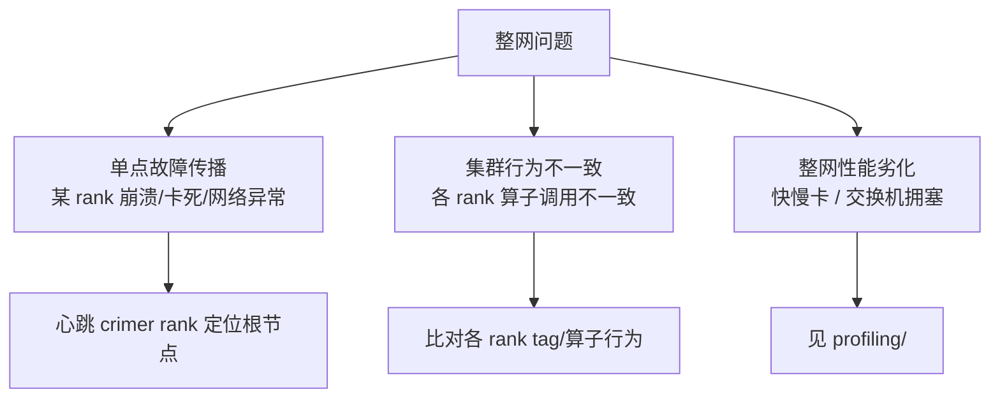
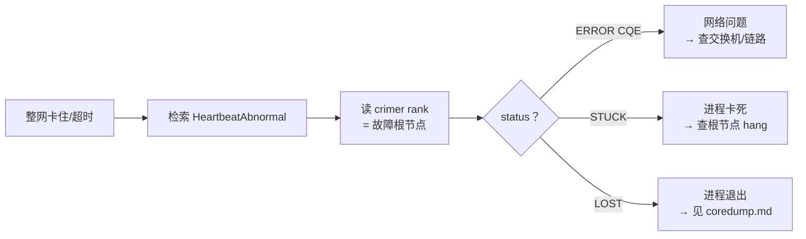

# 整网问题定位

> **问题类型**：集群级（整网）协同异常——无清晰首报错的全局卡住/超时、集群行为不一致、整网性能劣化。集合通信是通信域内**全局协同行为**，某节点异常往往表现为其他节点等待超时，需收集**全量 rank 日志**找根节点。
>
> 事实来源：`hccl/docs/zh/user_guide/fault_diagnosis/cluster_heartbeat_mechanism_troubleshooting.md`（集群心跳）、`process_hang_or_peer_heartbeat_loss_example.md`、`param_link_stage_troubleshooting.md`（行为一致性）、`debug_thinking.md`、`hccl/docs/zh/user_guide/perf_analysis/`（快慢卡/拥塞）、`hccl/docs/zh/user_guide/hccl_env/comm_retry_perf_impact.md`（重执行对整网性能）。

---

## 1. 问题现象

| 现象 | 说明 |
| --- | --- |
| **全局卡住/超时** | 算子执行超时（EI0002），无清晰首报错 |
| **集群行为不一致** | 各 rank 调用的通信算子不一致，链路互等超时 |
| **整网性能劣化** | 快慢卡、交换机拥塞导致整网通信变慢 |
| **心跳异常** | 日志报 `HeartbeatAbnormal`（ERROR CQE/STUCK/LOST） |

---

## 2. 根因分类



---

## 3. 集群心跳机制（单点故障定位）

HCCL 与邻近 rank 建立独立维测链路，提供集群**单点故障广播扩散**能力，使任意 rank 的 plog 均含故障根节点信息（机制详见 [../localization_flow.md §3.1](/通信与昇腾/参考手册/排障手册/localization_flow.md)）：

| 优先级 | 异常类型 | status | 判断标准 |
| --- | --- | --- | --- |
| 1 | **网络问题** | `ERROR CQE` | 定期轮询 ROCE 驱动重传超次事件，通过 QPN 映射远端 IP |
| 2 | **进程卡死** | `STUCK` | 每隔 1/3 `HCCL_EXEC_TIMEOUT` 轮询所有算子入/出次数 |
| 3 | **进程退出** | `LOST` | 30s 内未收到远端心跳报文 |

**心跳异常日志**（检索 `HeartbeatAbnormal`）：

```text
[HeartbeatAbnormal]local rank[IP/ID]: crimer rank[IP/ID] status[LOST] by informer rank[IP/ID]
```

| 字段 | 含义 |
| --- | --- |
| `crimer rank` | **故障根节点**（整网问题的源头） |
| `local rank` | 当前节点 |
| `by informer rank` | 故障上报者 |



> 若超时后**无异常事件**，则可能为**集群行为一致性问题**（见 §4）。STUCK 检测时间为 (1/3~2/3)×`HCCL_EXEC_TIMEOUT`；网络异常和进程退出可能同时导致 LOST 和 ERROR CQE，需结合具体情况甄别。

---

## 4. 集群行为一致性问题

各 rank 均已进入建链/执行阶段并响应探测，但**彼此调用的通信算子不一致**导致链路互等超时——一般由集群行为一致性问题引起。

| 排查项 | 说明 |
| --- | --- |
| **脚本** | 各 rank 训练脚本是否一致 |
| **环境** | 环境变量、配置是否一致 |
| **版本** | HCCL/CANN 版本是否一致（不一致报 EI0008） |
| **数据集** | 各 rank 数据分布是否导致不同算子调用 |

> **算子行为比对**：通过建链失败日志关键字 `Alloc transports failed` 对应的 **tag 信息**推测算子行为——遍历每个 rank 的 tag，如 16 rank 通信域内 15 个为 allgather、1 个为 AllReduce，则重点分析两个算子的调用逻辑差异。开启 `HCCL_ENTRY_LOG_ENABLE` 记录各 rank 集合通信行为，卡间横向比对找差异引入点。

---

## 5. 整网性能劣化

整网性能问题（非报错，但通信变慢）详见 [../../profiling/](/通信与昇腾/参考手册/性能分析/)：

| 问题 | 现象 | 定位 | 文档 |
| --- | --- | --- | --- |
| **快慢卡** | notify wait 被计入算子耗时 | 分析前置计算波动/下发瓶颈 | [../../profiling/slowfast_congestion.md](/通信与昇腾/参考手册/性能分析/slowfast_congestion.md) |
| **交换机拥塞丢包** | ~4s 的 notify wait 任务 | `hccn_tool -stat -g` 查 `roce_new_pkt_rty_num` | [../../profiling/slowfast_congestion.md](/通信与昇腾/参考手册/性能分析/slowfast_congestion.md) |
| **重执行性能影响** | 开启重执行后整网性能变化 | 评估重执行对整网性能影响 | `comm_retry_perf_impact.md` |

---

## 6. 关联错误码与关键字

| 错误码/关键字 | 含义 |
| --- | --- |
| **EI0002** | 通信算子执行超时（整网等待） |
| **EI0013/EI0018** | ROCE/UB CQE 错误（网络问题） |
| `HeartbeatAbnormal` | 心跳异常事件 |
| `crimer rank` | 故障根节点 |
| `Alloc transports failed` | 建链失败（tag 信息可推测算子行为） |
| `Communicator Key Info` / `LocalRank Key Info` / `LinkInfo` | 通信域/本端/链路关键信息检索 |

---

## 7. 处置与规避

| 处置 | 说明 |
| --- | --- |
| **收集全量日志** | 集群所有节点 debug + run 目录日志 |
| **心跳定根节点** | 检索 `HeartbeatAbnormal` 的 crimer rank 定位故障源 |
| **行为一致性比对** | 开启 `HCCL_ENTRY_LOG_ENABLE`，比对各 rank tag/算子行为 |
| **超时配置** | `HCCL_CONNECT_TIMEOUT` < `HCCL_EXEC_TIMEOUT`，正确上报首报错、区分本端/远端 |
| **性能问题** | 采集全量 Profiling，见 [../../profiling/](/通信与昇腾/参考手册/性能分析/) |

---

## 8. 参考资料

- `hccl/docs/zh/user_guide/fault_diagnosis/cluster_heartbeat_mechanism_troubleshooting.md`：集群心跳机制（本文主要来源）
- `hccl/docs/zh/user_guide/fault_diagnosis/process_hang_or_peer_heartbeat_loss_example.md`：进程卡死/心跳丢失案例
- `hccl/docs/zh/user_guide/fault_diagnosis/param_link_stage_troubleshooting.md`：行为一致性、tag 推算
- `hccl/docs/zh/user_guide/fault_diagnosis/debug_thinking.md`：全量日志收集、超时配置
- `hccl/docs/zh/user_guide/hccl_env/comm_retry_perf_impact.md`：重执行对整网性能影响
- 关联：[README.md](/通信与昇腾/参考手册/排障手册/案例/)、[coredump](/通信与昇腾/参考手册/排障手册/案例/coredump/)（进程崩溃）、[link](/通信与昇腾/参考手册/排障手册/案例/建链/)（建链）、[../../profiling/](/通信与昇腾/参考手册/性能分析/)（性能分析）、[../localization_flow.md](/通信与昇腾/参考手册/排障手册/localization_flow.md)（心跳机制）

