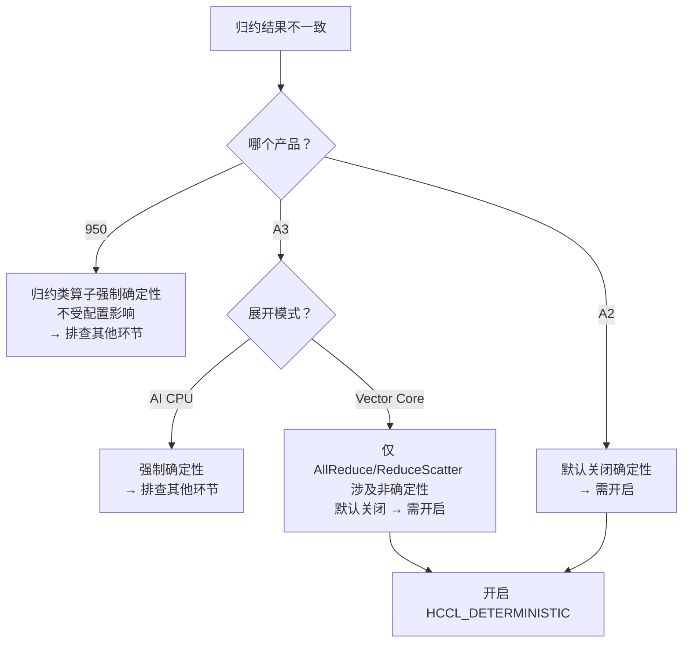

# 精度问题定位

> **问题类型**：归约类通信算子（AllReduce/ReduceScatter/ReduceScatterV/Reduce）多次执行结果不一致、精度偏差、训练/推理结果不可复现。
>
> 事实来源：`hccl/docs/zh/user_guide/hccl_env/HCCL_DETERMINISTIC.md`、`hcomm/docs/zh/api_ref/comm_mgr_c/data_type_definition/HcclCommConfig.md`（hcclDeterministic）、`hccl/docs/zh/rfcs/0001-add-batch-invariant-reducescatter.md`（BIRS）。

---

## 1. 问题现象

| 现象 | 说明 |
| --- | --- |
| 多次执行结果不同 | 相同硬件、相同输入，归约类算子多次执行输出存在 bit 级差异 |
| 精度调优困难 | 模型精度调优时结果不可复现，难以定位是通信还是计算引入的偏差 |
| batch 变化结果变化 | 推理场景同一 prompt 因 batch 组成不同产生不同 logits |

---

## 2. 根因：非确定性归约

> 不开启确定性计算时，多次执行结果可能不同——差异来源一般是算子实现中**异步多线程执行导致浮点数累加顺序变化**。开启确定性计算后，算子在相同硬件和输入下多次执行产生相同输出。

---

## 3. 定位流程

---

## 4. 处置：确定性计算配置

`HCCL_DETERMINISTIC` 环境变量（或 `HcclCommConfig.hcclDeterministic` 通信域粒度，后者优先）：

| 值 | 含义 | 支持产品 |
| --- | --- | --- |
| **false**（默认） | 关闭确定性计算 | 全部 |
| **true** | 开启归约类算子确定性计算 | 全部 |
| **strict** | **严格确定性（保序）**：所有 bit 位归约顺序一致 | 950/A3/A2 |

各产品默认行为：

| 产品 | 默认确定性行为 |
| --- | --- |
| **950PR&950DT** | 所有归约类算子**强制确定性**，不受配置影响 |
| **A3** | AI CPU 展开：强制确定性；Vector Core 展开：仅 AllReduce/ReduceScatter 涉及非确定性，默认关闭 |
| **A2** | 所有归约类算子默认关闭确定性 |

### 4.1 保序（strict）约束

| 产品 | 保序约束 |
| --- | --- |
| **950** | 支持 AllReduce/ReduceScatter；rank size ≥3；仅 INF/NaN 模式；**仅 AI_CPU 展开**（CCU_MS/CCU_SCHED/AIV 配置保序会回退 AI_CPU） |
| **A3** | 仅多机对称分布；支持 AllReduce/ReduceScatter（float16/float32/bfp16，仅 sum）；rank size ≥3；仅 HCCS 链路 SDMA 通信（不支持 `HCCL_INTER_HCCS_DISABLE=TRUE`） |
| **A2** | 仅多机对称分布；支持 AllReduce/ReduceScatter/ReduceScatterV |

> 保序仅支持 INF/NaN 模式（不支持饱和模式），且有性能下降，**建议推理场景使用**。

---

## 5. 注意事项

| 项 | 说明 |
| --- | --- |
| **性能权衡** | 开启确定性后算子执行变慢、性能下降；一般无需开启，仅在结果不可复现或精度调优时开启辅助调试 |
| **与 AIV 优先级** | 同时设 `HCCL_DETERMINISTIC` 与展开模式 AIV 时，**确定性优先级更高**，某些场景 AIV 展开不生效 |
| **配置优先级** | 通信域粒度 `hcclDeterministic` > 环境变量 `HCCL_DETERMINISTIC` > 默认 |
| **BIRS 算法** | A3 可用 BIRS（批大小不变 ReduceScatter）在保证确定性前提下提升大消息性能（相比 RHD 最高 +25%），见 [../../extension/mc2_and_rfc.md](/通信与昇腾/参考手册/扩展机制/mc2_and_rfc.md) |

---

## 6. 参考资料

- `hccl/docs/zh/user_guide/hccl_env/HCCL_DETERMINISTIC.md`：确定性计算/保序配置（本文主要来源）
- `hcomm/docs/zh/api_ref/comm_mgr_c/data_type_definition/HcclCommConfig.md`：hcclDeterministic 字段
- `hccl/docs/zh/rfcs/0001-add-batch-invariant-reducescatter.md`：BIRS 批大小不变 ReduceScatter
- 关联：[README.md](/通信与昇腾/参考手册/排障手册/案例/)（案例索引）、[../../reference/reliability_security.md](/通信与昇腾/参考手册/运行与约束/reliability_security.md)（确定性计算）、[../../extension/mc2_and_rfc.md](/通信与昇腾/参考手册/扩展机制/mc2_and_rfc.md)（BIRS）、[../../operators/reduce_scatter.md](/通信与昇腾/参考手册/算子参考/reduce_scatter.md)（保序算子）

