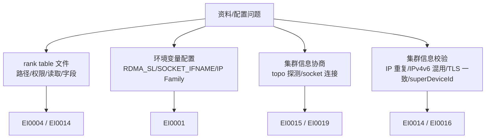
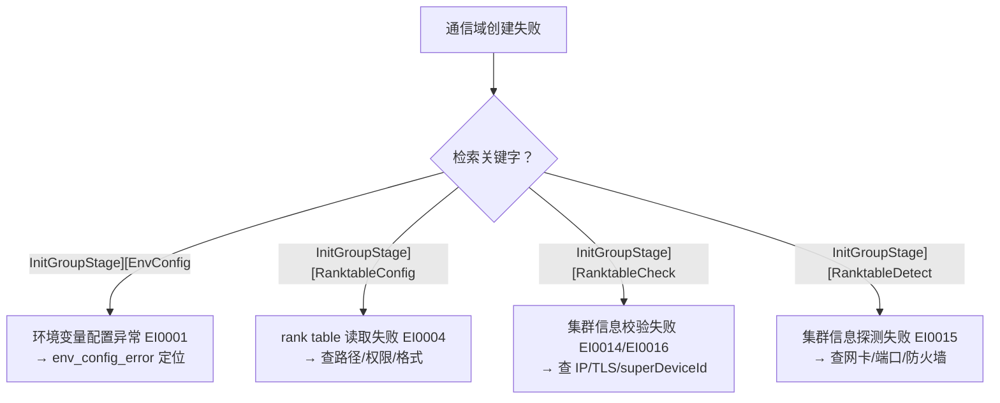

# 资料问题定位（配置资料 / 集群信息）

> **问题类型**：通信域**配置资料**类问题——rank table 文件、环境变量、集群信息（协商/校验）等"资料"配置错误或不一致，导致通信域初始化失败。报错日志含 `topoinfo`、`ranktable` 关键字，属**初始化阶段**（InitGroupStage）。
>
> 事实来源：`hccl/docs/zh/user_guide/fault_diagnosis/`（`rank_table_load_fail_troubleshooting.md`、`rank_table_file_read_fail_EI0004.md`、`rank_table_field_config_error_EI0004.md`、`rank_table_device_ip_field_validation_fail_EI0014.md`、`super_device_id_duplicate_EI0014.md`、`env_config_error_EI0001_troubleshooting.md`、`cluster_info_nego_troubleshooting.md`、`cluster_info_verify_fail_troubleshooting.md`、`tls_info_config_inconsistent_EI0016.md`、`ip_family_check_inconsistent_EI0001.md`）、`hccl/docs/zh/user_guide/cluster_info_config/`。

---

## 1. 问题现象

| 现象 | 说明 |
| --- | --- |
| **通信域创建失败** | 调用 `HcclCommInit*` 接口失败 |
| **报错含资料关键字** | 日志含 `topoinfo`、`ranktable`、`InitGroupStage` |
| **集群信息校验终止** | rank table 各 rank 不一致，参数面建链时一致性校验终止业务 |

---

## 2. 根因分类

| 子类 | 常见根因 | 错误码 |
| --- | --- | --- |
| **rank table 文件** | 文件路径/权限错误、读取失败、字段配置错误 | EI0004 |
| **rank table 字段校验** | device_ip 字段校验失败、superDeviceId 重复 | EI0014 |
| **环境变量配置** | `HCCL_RDMA_SL`/`HCCL_SOCKET_IFNAME` 配置错误、IP Family 校验不一致 | EI0001 |
| **集群信息协商** | topo 探测超时、部分 rank 无法连 server、socket 连接超时、端口绑定失败 | EI0015/EI0019 |
| **集群信息校验** | IP 重复、IPv4/IPv6 混用、TLS 配置不一致 | EI0014/EI0016 |

---

## 3. 定位流程

> 图源：`hccl/docs/zh/user_guide/fault_diagnosis/figures/comm_domain_init_flow.png`

> 多级检索关键字详见 [../README.md §3](/通信与昇腾/参考手册/排障手册/)。集群信息协商流程见下图：

> 图源：`hccl/docs/zh/user_guide/fault_diagnosis/figures/cluster_info_nego_flow.png`

---

## 4. rank table 一致性（重点）

> 通过 rank table 文件配置通信域信息时，须确保**文件路径、权限正确**，并保证文件在**集群中各 rank 保持一致**——HCCL 会在后续算子的参数面建链过程中进行 rank table **一致性校验**，不满足要求会**终止业务**。

| 约束 | 说明 |
| --- | --- |
| **各 rank 一致** | rank table 须在集群所有 rank 保持一致 |
| **rank_id 编排** | 建议按 NPU 物理连接顺序排序；不支持跨 Server 交叉配置 |
| **A3 多超节点** | 同一超节点内 AI Server 信息须配置在一起，不支持交叉配置 |
| **net_layer 升序** | `net_layer` 须从 0 开始升序排列 |

> rank table 字段 ↔ RankGraph 概念映射、五套版本对比详见 [../../04_昇腾集群组网总览.md §4](/通信与昇腾/参考手册/总览/集群组网总览.md)。

---

## 5. 关联错误码与关键字

| 错误码 | 英文名 | 场景 | 诊断文档 |
| --- | --- | --- | --- |
| **EI0001** | Config_Error_Invalid_Environment_Variable | 环境变量配置异常、IP Family 不一致 | `env_config_error_EI0001_troubleshooting.md` |
| **EI0004** | File_Operation_Error_Parse | rank table 读取/解析失败、字段配置错误 | `rank_table_file_read_fail_EI0004.md` |
| **EI0014** | Config_Error_Ranktable | device_ip 校验失败、superDeviceId 重复、集群信息校验失败 | `rank_table_device_ip_field_validation_fail_EI0014.md` |
| **EI0015** | Communication_Error_Ranktable_Detect | topo 探测超时、部分 rank 无法连 server | `topo_detect_timeout_EI0015.md` |
| **EI0016** | Config_Error | TLS 信息配置不一致 | `tls_info_config_inconsistent_EI0016.md` |

---

## 6. 处置与规避

| 处置 | 说明 |
| --- | --- |
| **校验 rank table** | 检查文件路径/权限、字段格式、各 rank 一致性 |
| **检查环境变量** | 用 `HCCL_ENV` 日志检索环境变量生效值；核对 `HCCL_RDMA_SL`/`HCCL_SOCKET_IFNAME`/`HCCL_IF_IP` |
| **核对网络配置** | 集群协商失败时排查网卡、端口、防火墙连通性 |
| **TLS 一致** | 确保各 rank TLS 配置一致 |
| **superDeviceId 唯一** | A3 超节点场景确保 superDeviceId 不重复 |

---

## 7. 参考资料

- `hccl/docs/zh/user_guide/fault_diagnosis/`：`rank_table_load_fail_troubleshooting.md`、`env_config_error_EI0001_troubleshooting.md`、`cluster_info_nego_troubleshooting.md`、`cluster_info_verify_fail_troubleshooting.md`、各 `*_EI00xx.md`
- `hccl/docs/zh/user_guide/cluster_info_config/`：rank table 配置（A2/A3/A5/910/300I Duo）
- 关联：[README.md](/通信与昇腾/参考手册/排障手册/案例/)、[link](/通信与昇腾/参考手册/排障手册/案例/建链/)（建链阶段一致性校验）、[../EI错误码全表.md](/通信与昇腾/参考手册/排障手册/EI错误码全表.md)、[../../communicator/创建方式.md](/通信与昇腾/参考手册/通信域/创建方式.md)（通信域创建）、[../../04_昇腾集群组网总览.md](/通信与昇腾/参考手册/总览/集群组网总览.md)（rank table 配置）

