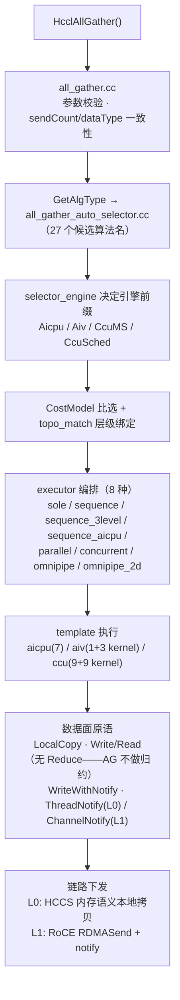

# HcclAllGather 算子解析

> **深度参考** · 前置阅读：[《集合通信》第 1 章（语义）与第 4 章（AG/RS/AlltoAll）](/通信与昇腾/01-Collective语义与代价模型.md)。本篇为参考手册体例，检索导向；事实基线见文首引用块。

> 代码基线：`hccl/src/ops/all_gather/`（950/A5 路径）+ `hcomm/src/legacy/ascend910/algorithm/base/alg_template/temp_all_gather/`（910/A2/A3 路径，23 个模板）。
> 参数与约束以 `hccl/docs/zh/api_ref/comm_op_interface/HcclAllGather.md` 为准。

## 1. 算子概述

**功能**：将通信域内所有节点的输入**按照 rank id 重新排序**（rank id 按从小到大顺序），然后拼接起来，再将结果发送到所有节点的输出。

> 每个节点都接收按照 rank id 重新排序后的数据集合，即**每个节点的 AllGather 输出都是一样的**。


> 图源：`hccl/docs/zh/api_ref/comm_op_interface/figures/allgather.png`

**函数原型**（注意是 `sendCount` 而非 `count`）：

```c
HcclResult HcclAllGather(void *sendBuf, void *recvBuf, uint64_t sendCount, HcclDataType dataType,
                         HcclComm comm, aclrtStream stream)
```

| 参数 | 输入/输出 | 描述 |
| --- | --- | --- |
| `sendBuf` | 输入 | 源数据 buffer（本 rank 贡献的那一段） |
| `recvBuf` | 输出 | 目的 buffer，长度 = `sendCount × rankSize` |
| `sendCount` | 输入 | **每个 rank 输入**的数据个数 |
| `dataType` | 输入 | 数据类型（**无 op 参数**——AllGather 不做归约） |
| `comm` / `stream` | 输入 | 通信域 / 本 rank 的 stream |

> **输出布局**：`recvBuf[i*sendCount : (i+1)*sendCount]` 来自 rank i——**严格按 rank id 升序拼接**，这是 AllGather 与 AlltoAll 的关键区别（后者按维度切分重排）。

## 2. 产品支持与约束

**数据类型**：950 支持 int8/int16/int32/int64/uint64/float16/float32/float64/bfp16；A3/A2 支持 int8/int16/int32/int64/float16/float32/bfp16；Atlas 训练系列 int8/int32/int64/float16/float32；300I Duo int8/int16/int32/float16/float32。

**约束说明**：

- 所有 rank 的 `sendCount`、`dataType` 均应相同
- **针对 Atlas 300I Duo 推理卡：仅支持单 Server 场景，单 Server 中最大支持部署 16 张 300I Duo（即 32 个 NPU）**
- 通信算子需串行下发，不允许乱序、多线程并发下发，不支持线程重入
- 同一 Device 上，同一通信域内所有通信算子的下发线程需使用相同 Context

## 3. 分级通信编排（L0/L1/L2）

| 阶段 | 层级 | 操作 | 为什么这个顺序 |
| --- | --- | --- | --- |
| 阶段一 | **L0** | Server 内 AllGather | **先层内后层间**——保证 Server 间通信数据块的**连续性** |
| 阶段二 | **L1** | Server 间 AllGather | 每个 Server 已持有本 Server 全量数据，跨机只需交换 Server 粒度分片 |


> 图源：`hccl/docs/zh/user_guide/coll_algo_intro/figures/allgather_hierarchical_flow.png`
> 官方说明：AllGather 算子要求**第 i 个 rank 的输入数据出现在结果的第 i 个位置上**，为了保证 Server 间通信数据块的连续性，首先在 Server 内执行 AllGather，再在 Server 间执行。

> **与 ReduceScatter 顺序相反**：AG 先层内后层间，RS 先层间后层内——两者都为了让跨机数据块地址连续。AllReduce 则把 AG 放在**最后**一阶段（L0），见 [all_reduce.md §4](/通信与昇腾/参考手册/算子参考/all_reduce.md)。

## 4. 实现流程图（真实代码路径）



> **与 AllReduce 的原语差异**：AllGather **不涉及归约**，因此只用 `LocalCopy` / `Write` / `Read`，不用 `WriteReduce` / `LocalReduce`——这直接体现在模板命名上（AG 模板无 `_reduce_` 字样）。

## 5. 代码结构（实测文件清单）

```
all_gather/
├── all_gather.cc / .h
├── selector/all_gather_auto_selector.cc / .h       # 27 个算法名
├── algorithm/
│   ├── executor/                                   # 8 种执行器
│   │   ├── ins_v2_all_gather_sole_executor.cc
│   │   ├── ins_v2_all_gather_sequence_executor.cc
│   │   ├── ins_v2_all_gather_sequence_executor_3level.cc    # 三级拓扑
│   │   ├── ins_v2_all_gather_sequence_executor_aicpu.cc
│   │   ├── ins_v2_all_gather_parallel_executor.cc
│   │   ├── ins_v2_all_gather_concurrent_executor.cc
│   │   ├── ins_v2_all_gather_omnipipe_executor.cc
│   │   └── ins_v2_all_gather_omnipipe_2d_executor.cc
│   │   # 注意：AllGather 无 order_preserved 执行器（保序仅 AllReduce/ReduceScatter 支持）
│   └── template/
│       ├── aicpu/                                  # 7 个模板
│       │   ├── ins_temp_all_gather_mesh_1D.cc
│       │   ├── ins_temp_all_gather_mesh_1D_Z_axis_detour.cc   # CLOS Z 轴绕路
│       │   ├── ins_temp_all_gather_nhr.cc
│       │   ├── ins_temp_all_gather_nhr_dpu.cc                 # 框间（DPU）NHR
│       │   ├── ins_temp_all_gather_omnipipe_mesh_1D.cc        # 流水 Mesh
│       │   ├── ins_temp_all_gather_omnipipe_nhr.cc            # 流水 NHR
│       │   └── ins_temp_all_gather_omnipipe_nhr_dpu.cc        # 流水框间 NHR
│       ├── aiv/
│       │   ├── aiv_temp_all_gather_mesh_1D.cc
│       │   └── kernel/aiv_all_gather_mesh_1d.h
│       │            aiv_ag_mesh_1d_superkernel.h
│       │            aiv_all_gather_op.h
│       └── ccu/                                    # 9 模板 + 9 kernel
│           ├── ccu_temp_all_gather_mesh_1D.cc / _mem2mem.cc
│           ├── ccu_temp_all_gather_2dies_mesh_1D.cc / _2dies_mesh_1d_mem2mem.cc   # 跨双 Die
│           ├── ccu_temp_all_gather_nhr_1D_mem2mem.cc
│           ├── ccu_temp_all_gather_nhr_1D_multi_jetty_mem2mem.cc                  # 多 Jetty
│           ├── ccu_temp_all_gather_concurrent_mesh_mem2mem_nhr.cc                 # Mesh+NHR 并发
│           ├── ccu_temp_all_gather_omnipipe_mesh1d_mem2mem.cc / _omnipipe_nhr1d_mem2mem.cc
│           └── kernel/ccu_kernel_all_gather_*.cc
└── op_graph/all_gather_proto.cc
```

## 6. 可选算法名（selector 实测，27 个）

| 引擎 | 编排 | 算法名 |
| --- | --- | --- |
| **AICPU_TS** | Sole | `AicpuAllGatherSoleMesh`、`SoleMeshConcur`、`SoleNHR`、`SoleNHRMultiLink` |
| | Sequence | `SequenceMeshConcurNHR`、`SequenceMeshConcurNHRNHR` |
| | Parallel | `ParallelMeshNHR`、`ParallelMeshNHRMultiJetty`、`ParallelNHRNHR` |
| | PipeLine | `PipeLineMeshNHR`、`PipeLineMeshNHRNHR` |
| | Concur | `ConcurMeshNHR` |
| **CCU_MS** | Sole | `CcuMSAllGatherSoleMesh`、`SoleMesh2Die` |
| **CCU_SCHED** | Sole/Seq/Para/Pipe/Concur | `CcuSchedAllGatherSoleMesh`、`SoleMesh2Die`、`SoleMeshConcur`、`SoleNHR`、`SoleNHRMultiLink`、`SequenceMeshMesh`、`ParallelMeshNHR`、`ParallelMeshNHRMultiLink`、`PipeLineMeshNHR`、`ConcurMeshNHRMultiLink` |
| **AIV** | Sole | `AivAllGatherSoleMesh` |

## 7. 实现要点

| 要点 | 说明 |
| --- | --- |
| **TP/SP 并行主力** | 张量并行/序列并行的前向与反向权重汇聚常用；ZeRO-3/FSDP 参数聚合亦依赖 AG |
| **无归约语义** | 纯数据搬运，因此模板不含 `_reduce_`；γ 项为 0，耗时公式比 RS 少 $\frac{p-1}{p}n\gamma$ |
| **910 路径 23 个模板** | `_ring_direct`（直连环）、`_ring_concurrent_direct`（并发直连环）、`_slim_ring`（精简环）、`_mesh_direct`、`_mesh_atomic`、`_mesh_mix`、`_hccs_sio`（HCCS+SIO 双链路）、`_hd_stage`、`_unified_march`、`aligned_*_double_ring`、`_graph_pipeline`、`_v_pipeline`、`_v_graph_pipeline` |
| **Pipeline 是 AG 的重点算法** | 官方 Pipeline 文档即以 **AllGather 为例**讲解（Server 间 Ring + Server 内 FullMesh 并发），见 [../algorithms/pipeline.md](/通信与昇腾/参考手册/算法参考/pipeline.md) |
| **AHC 支持** | 仅 RS/AG/AR 三算子支持 AHC（`all_gather_ahc.cc`、`_ahc_broke.cc`），仅 Atlas A3 |
| **跨双 Die 专用模板** | `ccu_temp_all_gather_2dies_mesh_1D*`——A3 每 NPU 含 2 Die，需专门的跨 Die 聚合路径 |
| **无 order_preserved** | 保序执行器仅 AllReduce 与 ReduceScatter 有；AllGather 天然保序（按 rank id 拼接）无需额外机制 |

## 8. 上层消费方

| 上层算子 | 说明 |
| --- | --- |
| `AllGatherMatmul` / `V2` / `V3` | AllGather + Matmul 融合（TP 前向主力） |
| `AlltoAllAllGatherBatchMatMul` | 三段融合 |
| `MatmulAllReduceAddRmsNorm` | 其中的 AG 语义阶段 |
| `MoeDistributeDispatch` 族 | EP Dispatch 的 token 聚合 |
| `EngramFetch` 族 | 参数聚合 |

详见 ../../mc2/operators/、../../ep/operators/。

## 9. 参考资料

- `hccl/docs/zh/api_ref/comm_op_interface/HcclAllGather.md`：参数（`sendCount`）、约束、300I Duo 限制
- `hccl/docs/zh/user_guide/api_comm_impl.md`：AllGather 语义（按 rank id 重排拼接）
- `hccl/docs/zh/user_guide/coll_algo_intro/hierarchical_comm_principle.md`：AllGather 分级流程图（本文 §3 来源）
- `hccl/docs/zh/user_guide/coll_algo_intro/Pipeline.md`：以 AllGather 为例的流水算法讲解
- `hccl/src/ops/all_gather/`：950/A5 路径实现
- `hcomm/src/legacy/ascend910/algorithm/base/alg_template/temp_all_gather/`：910/A2/A3 路径 23 个模板
- [all_gather_v.md](/通信与昇腾/参考手册/算子参考/all_gather_v.md)：变长版本；[reduce_scatter.md](/通信与昇腾/参考手册/算子参考/reduce_scatter.md)：镜像算子（顺序相反）
- 算法详解：[../algorithms/](/通信与昇腾/参考手册/算法参考/)；层级原理：[../03_L0L1L2分级通信实现原理.md](/通信与昇腾/参考手册/总览/L0-L1-L2分级原理.md)

