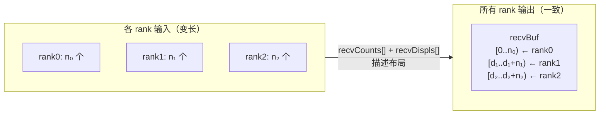
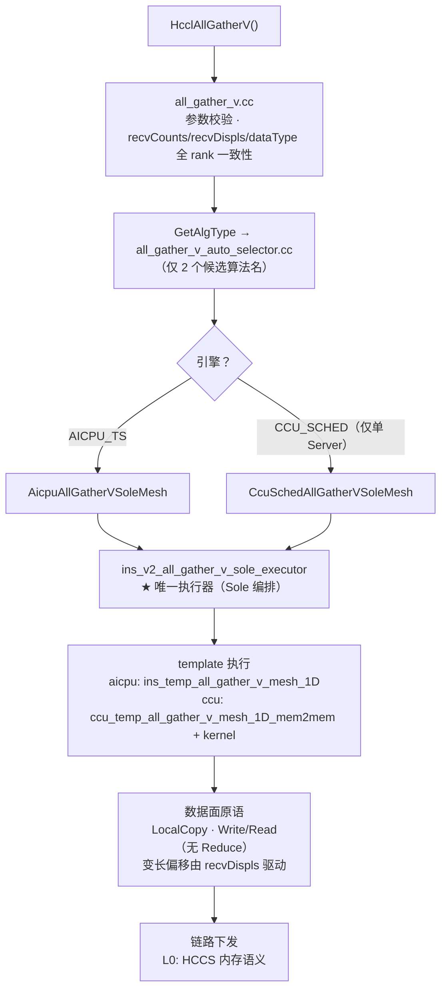

# HcclAllGatherV 算子解析

> **深度参考** · 前置阅读：[《集合通信》第 1 章（语义）与第 4 章（AG/RS/AlltoAll）](/通信与昇腾/01-Collective语义与代价模型.md)。本篇为参考手册体例，检索导向；事实基线见文首引用块。

> 代码基线：`hccl/src/ops/all_gather_v/`（950/A5 路径）+ `hcomm/src/legacy/ascend910/algorithm/base/alg_template/temp_all_gather/all_gather_v_*.cc`（910/A2/A3 路径）。
> 参数与约束以 `hccl/docs/zh/api_ref/comm_op_interface/HcclAllGatherV.md` 为准。
> **实现最精简的集合通信算子之一**：仅 1 种执行器、2 个算法名。

## 1. 算子概述

**功能**：将通信域内所有节点的输入按照 rank id 重新排序，然后拼接起来，再将结果发送到所有节点的输出。**与 AllGather 算子不同的是，AllGatherV 算子支持通信域内不同节点的输入配置不同大小的数据量。**

> 每个节点都接收按照 rank id 重新排序后的数据集合，即**每个节点的 AllGatherV 输出都是一样的**。


> 图源：`hccl/docs/zh/api_ref/comm_op_interface/figures/allgatherv.png`

**函数原型**（用 `recvCounts` + `recvDispls` 数组描述变长布局）：

```c
HcclResult HcclAllGatherV(void *sendBuf, uint64_t sendCount, void *recvBuf,
                          const void *recvCounts, const void *recvDispls, HcclDataType dataType,
                          HcclComm comm, aclrtStream stream)
```

| 参数 | 输入/输出 | 描述 |
| --- | --- | --- |
| `sendBuf` | 输入 | 本 rank 的源数据（长度 `sendCount`，**各 rank 可不同**） |
| `sendCount` | 输入 | 本 rank 输入的数据个数 |
| `recvBuf` | 输出 | 目的 buffer，容纳所有 rank 数据拼接结果 |
| `recvCounts` | 输入 | **数组**：各 rank 的数据个数（`recvCounts[i]` = rank i 的贡献量） |
| `recvDispls` | 输入 | **数组**：各 rank 数据在 `recvBuf` 中的起始偏移 |
| `dataType` | 输入 | 数据类型（**无 op 参数**——不做归约） |
| `comm` / `stream` | 输入 | 通信域 / 本 rank 的 stream |



## 2. 约束说明

| 约束 | 说明 |
| --- | --- |
| **全 rank 一致** | 所有 rank 的 `recvCounts`、`recvDispls`、`dataType` 均应相同（即**变长布局本身必须全局一致**，只有 `sendCount` 各 rank 可不同） |
| **Atlas A3** | **仅支持单 Server 场景** |
| **Atlas A2** | **仅支持多机对称分布场景，不支持非对称分布（即卡数非对称）的场景** |
| **Atlas 300I Duo** | 仅支持单 Server 场景，单 Server 中最大支持部署 **2 张** 300I Duo（即 **4 个 NPU**）——比 AllGather 的 16 张（32 NPU）限制严格得多 |
| **CCU_SCHED** | ReduceScatterV、AllGatherV 算子**仅支持单 Server 场景** |
| **通用** | 串行下发、不允许乱序/多线程并发、不支持线程重入；同一通信域下发线程需相同 Context |

> **A2 的"仅对称分布"约束与 AHC 的关系**：AllGatherV 在 A2 上不支持卡数非对称场景，而 **AHC 算法正是为解决非对称分布而生**（"层次间 NPU 对称或者非对称分布"），但 AHC **仅支持 ReduceScatter/AllGather/AllReduce**——**不含 AGV**。因此 AGV 的非对称场景在当前实现下无解，只能约束为对称分布。

## 3. 分级通信编排（L0/L1/L2）

| 阶段 | 层级 | 操作 |
| --- | --- | --- |
| 阶段一 | **L0** | Server 内 AllGatherV |
| 阶段二 | **L1** | Server 间 AllGatherV |

> 与 AllGather 一致：**先层内后层间**，保证 Server 间通信数据块的连续性。

## 4. 实现流程图（真实代码路径）



> **无 Sequence/Parallel/PipeLine 编排**：AGV 只有 Sole 执行器，因此**不做多级流水/并行拆分**——变长布局使切片计算复杂化，当前实现选择在单算法内完成。多级 MESH_1D 在 CCU 调度模式下明确不支持（`reduce_scatter_v_auto_selector.cc:119` 同类告警）。

## 5. 代码结构（实测文件清单）

```
all_gather_v/
├── all_gather_v.cc / .h
├── selector/all_gather_v_auto_selector.cc / .h     # 2 个算法名
├── algorithm/
│   ├── executor/
│   │   └── ins_v2_all_gather_v_sole_executor.cc / .h    # ★ 唯一执行器
│   └── template/
│       ├── aicpu/ins_temp_all_gather_v_mesh_1D.cc / .h
│       └── ccu/
│           ├── ccu_temp_all_gather_v_mesh_1D_mem2mem.cc / .h
│           └── kernel/ccu_kernel_all_gather_v_mesh1d_mem2mem.cc / .h
└── op_graph/all_gather_v_proto.cc
```

> **全算子最精简结构**：1 执行器 + 2 模板（aicpu/ccu）+ 1 kernel，**无 aiv 模板**（AGV 不在 AIV 展开模式支持列表内）。

## 6. 可选算法名（selector 实测，2 个）

| 引擎 | 算法名 | 约束 |
| --- | --- | --- |
| **AICPU_TS** | `AicpuAllGatherVSoleMesh` | — |
| **CCU_SCHED** | `CcuSchedAllGatherVSoleMesh` | **仅单 Server 场景** |

> 无 `Aiv*`、无 `CcuMS*`（CCU_MS 仅支持 Broadcast/Reduce/AllReduce/ReduceScatter/AllGather，不含 AGV）。

## 7. L1 算法支持度

| 算法 | AGV 支持情况 |
| --- | --- |
| **NHR** | ✅ Atlas A3、A2、Atlas 训练系列 |
| **Ring** | ✅ Atlas A3、A2 |
| **NB** | ✅ Atlas A3、A2、Atlas 训练系列 |
| **Pipeline** | ✅ **仅 Atlas A2** |
| H-D_R / AHC / Pairwise / NHR_V1 | ❌ |
| 950PR&950DT | —（NHR 自动接管，但 AGV 未在 950 的 NHR 支持列表中） |

## 8. 实现要点

| 要点 | 说明 |
| --- | --- |
| **变长语义的实现代价** | 只有 Sole 编排 + Mesh 拓扑——变长布局（`recvCounts`/`recvDispls`）使数据切片计算复杂化，当前未实现 NHR/Pipeline 等分层算法的 950 路径模板 |
| **910 路径有独立流水模板** | `all_gather_v_pipeline.cc`、`all_gather_v_graph_pipeline.cc`——A2 的 AGV Pipeline 支持即来自这两个模板 |
| **EP 场景的典型用途** | MoE Dispatch 后各 rank 的 token 数不等，AGV 用于聚合不等长的专家输出/统计量 |
| **与 AlltoAllV 的分工** | AGV = 所有 rank 得到**相同**的拼接结果（广播式聚合）；AlltoAllV = 每 rank 得到**不同**的定向数据（转置式交换） |
| **300I Duo 限制最严** | 最大 4 个 NPU（对比 AllGather 的 32 个）——推理卡上 AGV 仅用于小规模场景 |

## 9. 参考资料

- `hccl/docs/zh/api_ref/comm_op_interface/HcclAllGatherV.md`：参数（`recvCounts`/`recvDispls`）与按产品约束（本文 §2 来源）
- `hccl/docs/zh/user_guide/api_comm_impl.md`：AllGatherV 语义（支持不同节点配置不同大小数据量）
- `hccl/docs/zh/user_guide/coll_algo_intro/algo_intro.md`：AGV 两阶段分级编排
- `hccl/docs/zh/user_guide/hccl_env/HCCL_OP_EXPANSION_MODE.md`：CCU_SCHED 下 AGV 仅单 Server
- `hccl/docs/zh/user_guide/hccl_env/inter_server_algo_support.md`：AGV 的 L1 算法支持度
- `hccl/src/ops/all_gather_v/`：950/A5 路径实现
- `hcomm/src/legacy/ascend910/algorithm/base/alg_template/temp_all_gather/all_gather_v_pipeline.cc`、`all_gather_v_graph_pipeline.cc`：A2 的 AGV Pipeline
- [all_gather.md](/通信与昇腾/参考手册/算子参考/all_gather.md)：定长版本（实现丰富得多）；[reduce_scatter_v.md](/通信与昇腾/参考手册/算子参考/reduce_scatter_v.md)：变长归约散布
- 算法详解：[../algorithms/](/通信与昇腾/参考手册/算法参考/)；层级原理：[../03_L0L1L2分级通信实现原理.md](/通信与昇腾/参考手册/总览/L0-L1-L2分级原理.md)

