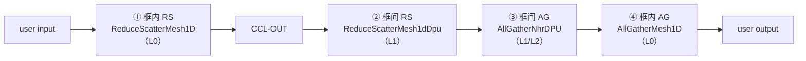
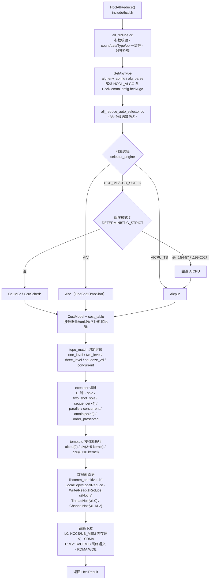

# HcclAllReduce 算子解析

> **深度参考** · 前置阅读：[《集合通信》第 1 章（语义）与第 4 章（AG/RS/AlltoAll）](/通信与昇腾/01-collective-semantics-cost.md)。本篇为参考手册体例，检索导向；事实基线见文首引用块。

> 代码基线：`hccl/src/ops/all_reduce/`（950/A5 路径）+ `hcomm/src/legacy/ascend910/algorithm/base/alg_template/temp_all_reduce/`（910/A2/A3 路径）。
> 参数与约束以 `hccl/docs/zh/api_ref/comm_op_interface/HcclAllReduce.md` 为准。
> **AllReduce 是 HCCL 实现最复杂的算子**：11 种执行器、38 个可选算法名、三引擎全覆盖。

## 1. 算子概述

**功能**：将通信域内所有节点的输入数据进行相加（或其他归约操作）后，再把结果发送到所有节点的输出 buffer，其中归约操作类型由 `op` 参数指定。


> 图源：`hccl/docs/zh/api_ref/comm_op_interface/figures/allreduce.png`

**函数原型**：

```c
HcclResult HcclAllReduce(void *sendBuf, void *recvBuf, uint64_t count, HcclDataType dataType,
                         HcclReduceOp op, HcclComm comm, aclrtStream stream)
```

| 参数 | 输入/输出 | 描述 |
| --- | --- | --- |
| `sendBuf` | 输入 | 源数据 buffer 地址 |
| `recvBuf` | 输出 | 目的数据 buffer 地址，集合通信结果输出至此 |
| `count` | 输入 | 参与 allreduce 操作的数据个数（如只有一个 int32 数据参与，则 count=1） |
| `dataType` | 输入 | 数据类型（`HcclDataType`），不同型号支持范围不同 |
| `op` | 输入 | 归约操作类型，不同型号支持范围不同 |
| `comm` | 输入 | 集合通信操作所在的通信域 |
| `stream` | 输入 | 本 rank 所使用的 stream |

## 2. 产品支持与数据类型

| 产品 | 支持 | 数据类型 | 操作类型 |
| --- | --- | --- | --- |
| Ascend 950PR&950DT | ✅ | int8、int16、int32、int64、uint64、float16、float32、float64、bfp16 | sum、prod、max、min（**prod 不支持 int16、bfp16**） |
| Atlas A3 | ✅ | int8、int16、int32、int64、float16、float32、bfp16 | 同上 |
| Atlas A2 | ✅ | int8、int16、int32、int64、float16、float32、bfp16（**int64 性能有劣化**） | 同上 |
| Atlas 推理系列（300I Duo） | ✅ | int8、int16、int32、float16、float32 | sum、prod、max、min（**prod/max/min 不支持 int16**） |
| Atlas 训练系列 | ✅ | int8、int32、int64、float16、float32 | sum、prod、max、min |

## 3. 约束说明

- 所有 rank 的 `count`、`dataType`、`op` 均应相同
- **每个 rank 只能有一个输入**
- 输入输出地址按数据类型对齐：int8→1 Byte；int16/float16/bfp16→2 Byte；int32/float32→4 Byte；int64/uint64/float64→8 Byte
- 多个通信域下的所有通信算子在每个 Device 上需**串行下发**，不允许乱序、多线程并发下发，也不支持线程重入
- 同一 Device 上，同一通信域内所有通信算子的下发线程需使用**相同的 Context**
- ⚠️ **对称内存污染**：当通信域注册了对称内存时，`sendBuf` 会作为对称窗口参与远端 rank 的直接读写，**部分算法会在 sendBuf 上就地完成归约（read+reduce），导致 sendBuf 数据被修改（污染）**。因此：调用后 `sendBuf` 中的数据不再作为原始输入使用；如需保留请在调用前自行备份

## 4. 分级通信编排（L0/L1/L2）

AllReduce 的输出是**完整归约结果**，因此拆解为 RS + AG 两阶段时**不必严格遵循 RS/AG 语义**，可以把较大数据量的通信过程放在带宽更高的 Server 内：

| 阶段 | 层级 | 操作 | 目的 |
| --- | --- | --- | --- |
| 阶段一 | **L0** | Server 内 ReduceScatter | 把本 Server N 份数据归约成 1 份，**跨机数据量降为 1/N** |
| 阶段二 | **L1** | Server 间 AllReduce | 只在 Server 间交换已归约分片，最贵链路跑最少数据 |
| 阶段三 | **L0** | Server 内 AllGather | 用高带宽链路把结果在 Server 内广播回去 |


> 图源：`hccl/docs/zh/user_guide/coll_algo_intro/figures/allreduce_hierarchical_flow.png`

950 系列的 **Sequence 执行器**是三级拓扑的四级实例（`ins_v2_all_reduce_sequence_executor.cc`）：



端到端数据流与 Profiling 任务对应详见 [../03_L0L1L2分级通信实现原理.md §5](/通信与昇腾/参考手册/总览/l0l1l2-principle.md)。

## 5. 实现流程图（真实代码路径）



## 6. 代码结构（实测文件清单）

```
all_reduce/
├── all_reduce.cc / all_reduce.h              # 主流程：参数校验 → 算法选择 → 执行器编排
├── selector/
│   └── all_reduce_auto_selector.cc / .h      # 38 个候选算法名；保序回退（:54-57, :199-202）
├── algorithm/
│   ├── executor/                             # 11 种执行器
│   │   ├── ins_v2_all_reduce_sole_executor.cc              # Sole：单算法一次跑完
│   │   ├── ins_v2_all_reduce_two_shot_sole_executor.cc     # Sole 变体：Mesh 两步收发
│   │   ├── ins_v2_all_reduce_sequence_executor.cc          # Sequence：四级串行（框内RS→框间RS→框间AG→框内AG）
│   │   ├── ins_v2_all_reduce_sequence_executor_aicpu.cc    # Sequence（AICPU 引擎）
│   │   ├── ins_v2_all_reduce_sequence_executor_aicpu_3level.cc  # Sequence（三级拓扑）
│   │   ├── ins_v2_allreduce_sequence2die_executor.cc       # Sequence（跨 Die，A3 每 NPU 2 Die）
│   │   ├── ins_v2_all_reduce_parallel_executor.cc          # Parallel：层内/层间两维并行（:37-39 线程模型）
│   │   ├── ins_v2_all_reduce_concurrent_executor.cc        # Concur：同层多算法/多链路并发
│   │   ├── ins_v2_all_reduce_omnipipe_executor.cc          # OmniPipe：切片流水
│   │   ├── ins_v2_all_reduce_omnipipe_2d_executor.cc       # OmniPipe 2D
│   │   └── ins_v2_all_reduce_order_preserved_executor.cc   # StrictOrdered：严格保序（确定性计算）
│   └── template/
│       ├── aicpu/                            # 9 个 AICPU 模板
│       │   ├── ins_temp_all_reduce_mesh_1D_one_shot.cc         # Mesh 一步直达
│       │   ├── ins_temp_all_reduce_mesh_1D_two_shot.cc         # Mesh 两步收发
│       │   ├── ins_temp_all_reduce_mesh_1D_two_shot_mesh_chunk.cc  # 两步 + 分块
│       │   ├── ins_temp_all_reduce_nhr.cc                      # NHR
│       │   ├── ins_temp_all_reduce_aicpu_reduce_nhr.cc         # NHR + AICPU 侧归约
│       │   ├── ins_temp_reduce_scatter_mesh_1D_intra.cc        # 阶段模板：框内 RS
│       │   ├── ins_temp_reduce_scatter_mesh_1D_dpu_inter.cc    # 阶段模板：框间 RS（DPU）
│       │   ├── ins_temp_all_gather_mesh_1D_intra.cc            # 阶段模板：框内 AG
│       │   └── ins_temp_all_gather_nhr_dpu_inter.cc            # 阶段模板：框间 AG（DPU）
│       ├── aiv/                              # 2 模板 + 5 Vector Core kernel
│       │   ├── aiv_temp_all_reduce_mesh_1D_oneshot.cc / _twoshot.cc
│       │   └── kernel/aiv_all_reduce_mesh_1d_oneshot.h / _twoshot.h
│       │            aiv_ar_mesh_1d_oneshot_superkernel.h / _twoshot_superkernel.h
│       │            aiv_all_reduce_op.h
│       └── ccu/                              # 8 模板 + 10 CCU kernel
│           ├── ccu_temp_all_reduce_mesh_1D.cc / _one_shot.cc / _mem2mem.cc
│           ├── ccu_temp_all_reduce_mesh_1D_2die_oneshot.cc / _mem2mem_2die_oneshot.cc
│           ├── ccu_temp_all_reduce_nhr_1D_mem2mem.cc
│           ├── ccu_temp_all_reduce_nhr_mem2mem_1D_multi_jetty.cc   # 多 Jetty
│           ├── ccu_temp_all_reduce_concurrent_mesh_nhr.cc          # Mesh+NHR 并发
│           └── kernel/ccu_kernel_all_reduce_*.cc
└── op_graph/
    └── all_reduce_proto.cc                   # GE 图模式注册
```

> **注意阶段模板的复用**：`ins_temp_reduce_scatter_mesh_1D_intra.cc`、`ins_temp_all_gather_nhr_dpu_inter.cc` 等**放在 all_reduce 目录下**——因为 AllReduce 的 Sequence 编排需要把 RS/AG 作为**阶段模板**调用，而非调用 ReduceScatter/AllGather 算子本身。Broadcast 与 Reduce 目录同理。

## 7. 可选算法名（selector 实测，38 个）

### 7.1 AICPU_TS 引擎（`Aicpu*`）

| 编排 | 算法名 |
| --- | --- |
| Sole | `AicpuAllReduceSoleMeshOneShot`、`SoleMeshTwoShot`、`SoleMeshChunkTwoShot`、`SoleMeshConcur`、`SoleNHR`、`SoleNHRAicpuReduce`、`SoleNHRMultiLink` |
| Sequence | `AicpuAllReduceSequenceMeshConcurNHR`、`SequenceMeshConcurNHRNHR`、`SequenceMeshNHRAicpuReduce` |
| Parallel | `AicpuAllReduceParallelMeshNHR`、`ParallelMeshNHRMultiJetty` |
| PipeLine | `AicpuAllReducePipeLineMeshNHR`、`PipeLineMeshNHRNHR` |
| Concur | `AicpuAllReduceConcurMeshTwoShotNHR` |
| StrictOrdered | `AicpuAllReduceStrictOrderedMesh`、`StrictOrderedGroupMesh` |

### 7.2 CCU 引擎（`CcuMS*` / `CcuSched*`）

| 引擎模式 | 算法名 |
| --- | --- |
| **CCU_MS**（CcuBuffer 中转，仅单机） | `CcuMSAllReduceSoleMesh`、`SoleMesh2Die`、`SoleMeshOneShot`、`SoleMeshConcur`、`SequenceMesh2Die`、`PipeLineMeshNHR`、`ConcurMeshNHRMultiLink` |
| **CCU_SCHED**（UB WQE 调度） | `CcuSchedAllReduceSoleMesh`、`SoleMesh2Die`、`SoleNHR`、`SoleNHRMultiLink`、`SequenceMeshMesh`、`SequenceMesh2Die`、`ParallelMeshNHR`、`ParallelMeshNHRMultiJetty`、`PipeLineMeshNHR`、`ConcurMeshNHRMultiLink` |

### 7.3 AIV 引擎（`Aiv*`）

| 算法名 | 说明 |
| --- | --- |
| `AivAllReduceSoleMeshOneShot` | Vector Core 一步直达（小数据低时延） |
| `AivAllReduceSoleMeshTwoShot` | Vector Core 两步收发 |

> AIV 模式下 Reduce/AllReduce 支持数据类型：int8、int16、int32、int64、float16、float32、bfp16（`HCCL_OP_EXPANSION_MODE.md`）。

## 8. 实现要点

| 要点 | 说明 |
| --- | --- |
| **最常用梯度同步原语** | DP 训练每步 backward 后调用；`architecture-brief.md` 用它作为"为什么需要集合通信"的示例 |
| **算法族最全** | Ring / Mesh / RHD / NHR / NHR_V1 / NB / AHC / Pipeline 全部覆盖（910 路径 21 个模板文件） |
| **唯一有 StrictOrdered 执行器的算子之一** | 与 ReduceScatter 并列支持严格保序（确定性计算）；保序模式下 CCU_MS/CCU_SCHED 均回退 AICPU |
| **唯一有 TwoShotSole 执行器的算子** | `ins_v2_all_reduce_two_shot_sole_executor.cc`——Mesh 两步收发的专用 Sole 变体 |
| **Parallel 线程模型** | `main(0)` 总调度 + `intra main(1)` + `inter main(2)` + 两维 slave 组（`INTRA_SLAVE_START_IDX=3`、`INTER_SLAVE_OFFSET=4`），线程数 = 两维 slave 之和 + 4（`ins_v2_all_reduce_parallel_executor.cc:37-39`） |
| **数据切分比例** | `CalcParallelDataSplitRatio`（`REDUCE_SCATTER_WITH_LOCAL_REDUCE` 模式），支持 `multipleDimensionSplitRatio` 用户干预（环境变量 `HCCL_ALG_MULTIPLE_DIMENSION_SPLIT_RATIO`） |
| **成本模型聚合** | Parallel 编排对两维带宽做 **MAX** 聚合（`op_common/selector/cost_model.cc`） |
| **CCL Buffer 分区** | Sequence 编排下对半分为 ccl-in / ccl-out，阶段间通过 `BufferType::HCCL_BUFFER` 显式交接 |
| **对称内存就地归约** | 部分算法在 sendBuf 上 read+reduce，会污染输入（见 §3） |
| **910 路径的 Reduce+Broadcast 实现** | `all_reduce_reduce_broadcast.cc`、`all_reduce_local_reduce_bcast.cc`——用 Reduce 到 root 再 Broadcast 的组合实现 AllReduce |

## 9. 上层消费方

MC2 通算融合算子在 GE 图模式中消费 AllReduce 能力：

| 上层算子 | 说明 |
| --- | --- |
| `MatmulAllReduce` / `MatmulAllReduceV2` | Matmul + AllReduce 融合 |
| `MatmulAllReduceAddRmsNorm` / `InplaceMatmulAllReduceAddRmsNorm` | 进一步融合 Add + RmsNorm |
| `QuantAllReduce` | 量化 AllReduce |
| `GroupedMatMulAllReduce` | 分组 Matmul + AllReduce |

详见 ../../mc2/operators/。

## 10. 参考资料

- `hccl/docs/zh/api_ref/comm_op_interface/HcclAllReduce.md`：参数、数据类型、约束（本文 §1-§3 来源）
- `hccl/docs/zh/user_guide/api_comm_impl.md`：AllReduce 语义与调用示例
- `hccl/docs/zh/user_guide/coll_algo_intro/algo_intro.md`、`hierarchical_comm_principle.md`：分级编排（本文 §4 来源）
- `hccl/docs/zh/user_guide/perf_analysis/typical_op_behavior.md`：AllReduce Profiling 任务对应
- `hccl/src/ops/all_reduce/`：950/A5 路径实现
- `hcomm/src/legacy/ascend910/algorithm/base/alg_template/temp_all_reduce/`：910/A2/A3 路径 21 个模板
- 算法详解：[../algorithms/](/通信与昇腾/参考手册/算法参考/)；层级原理：[../03_L0L1L2分级通信实现原理.md](/通信与昇腾/参考手册/总览/l0l1l2-principle.md)
- 上层消费方：../../mc2/、../../ep/

