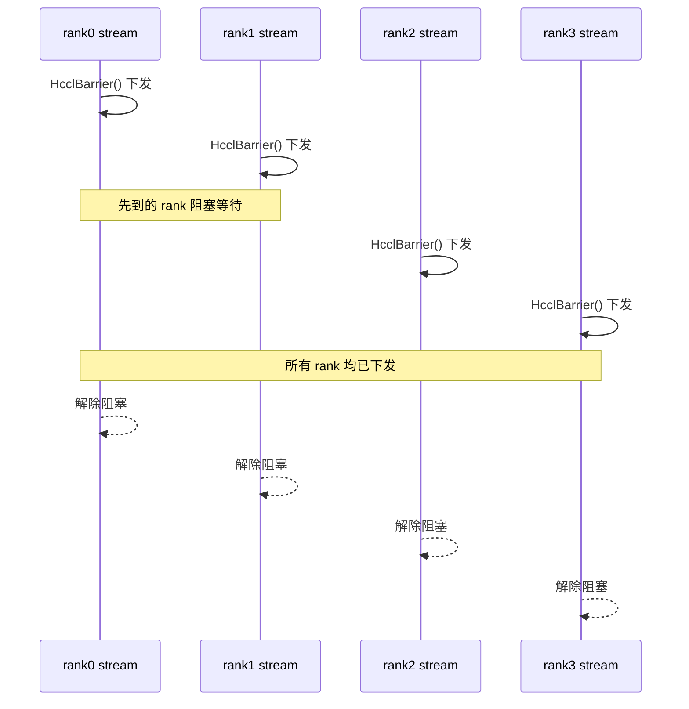
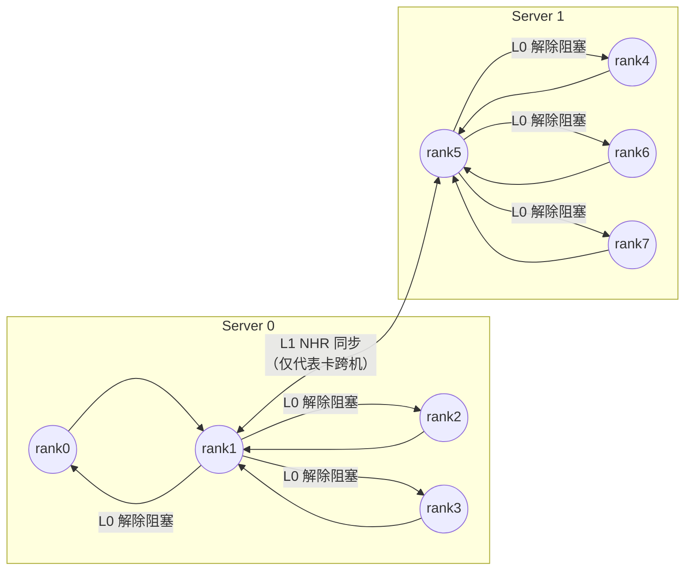
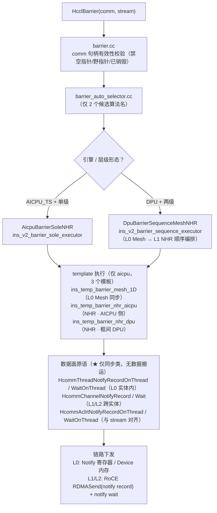

# HcclBarrier 算子解析

> **深度参考** · 前置阅读：[《集合通信》第 1 章（语义）与第 4 章（AG/RS/AlltoAll）](/通信与昇腾/01-Collective语义与代价模型.md)。本篇为参考手册体例，检索导向；事实基线见文首引用块。

> 代码基线：`hccl/src/ops/barrier/`（950/A5 路径）。
> 参数与约束以 **`hcomm/docs/zh/api_ref/comm_mgr_c/HcclBarrier.md`** 为准——⚠️ Barrier 的 API 文档在 **hcomm 仓的通信域管理接口**下，而非 hccl 仓的集合通信算子接口下。
> **Barrier 是唯一无数据负载（纯同步）的算子**：无 aiv/ccu 模板、无 op_graph、只有 3 个 AICPU 模板。

## 1. 算子概述

**功能**：将指定通信域内**所有 rank 的 stream 阻塞**，直到**所有 rank 都下发执行该操作**为止。

**函数原型**（**无 buffer、无 count、无 dataType**——全 HCCL 最简原型）：

```c
HcclResult HcclBarrier(HcclComm comm, aclrtStream stream)
```

| 参数 | 输入/输出 | 描述 |
| --- | --- | --- |
| `comm` | 输入 | 集合通信操作所在的通信域（`HcclComm` 类型） |
| `stream` | 输入 | 本 rank 所使用的 stream |

**返回值**：`HcclResult`——接口成功返回 `HCCL_SUCCESS`，其他失败。



## 2. 产品支持情况

| 产品 | 支持 |
| --- | --- |
| Ascend 950PR&950DT 系列 | ✅ 支持 |
| Atlas A3 系列 | ✅ 支持 |
| Atlas A2 系列 | ✅ 支持 |
| **Atlas 推理系列（300I Duo）** | ❌ **不支持** |
| Atlas 训练系列 | ✅ 支持 |

> **Barrier 是唯一在 Atlas 推理系列上不支持的算子**——其余 12 个算子（AllReduce/AllGather/…/Send/Recv/BatchSendRecv）在 300I Duo 上均支持（虽有单 Server 与卡数限制）。

## 3. 约束说明

- `comm` 必须为**有效的通信域句柄**（由通信域创建接口获得，调用期间保持有效）。**禁止传入空指针、野指针或已销毁的句柄**
- 通用约束：通信算子需串行下发，不允许乱序、多线程并发下发，不支持线程重入；同一通信域下发线程需相同 Context

## 4. 分级同步编排（L0/L1/L2）

Barrier 虽无数据负载，但**同步信号仍需按层级传播**——这是它有 `Sequence` 编排与 L0/L1 两套模板的原因：

| 阶段 | 层级 | 操作 | 模板 |
| --- | --- | --- | --- |
| 阶段一 | **L0** | Server 内同步（Mesh 形态汇聚到本 Server 代表卡） | `ins_temp_barrier_mesh_1D` |
| 阶段二 | **L1** | Server 间同步（NHR 形态跨 Server 传播） | `ins_temp_barrier_nhr_dpu` |
| 阶段三 | **L0** | Server 内广播解除阻塞 | `ins_temp_barrier_nhr_aicpu` |



> **为什么分层**：如果每个 rank 都与其他所有 rank 直接同步，需要 $O(p^2)$ 个 notify 信号；分层后 L0 内用 Mesh 汇聚（p₀ 个信号/Server）、L1 只在代表卡间用 NHR（⌈log₂p₁⌉ 步），总信号量降为 $O(p_0 \cdot serverNum + serverNum \cdot log)$。这与集合通信的分级原理完全一致——**同步也是一种通信**。

## 5. 实现流程图（真实代码路径）



> **原语使用的独特性**：Barrier 是**唯一不使用任何数据搬运原语**（`LocalCopy`/`Write`/`Read`/`BatchTransfer`）的算子——只用 Notify 族与 Fence/Drain。这使其成为理解 HCCL 同步机制的最纯粹样本。

## 6. 代码结构（实测文件清单）

```
barrier/
├── barrier.cc / .h
├── selector/barrier_auto_selector.cc / .h        # 2 个算法名
├── algorithm/
│   ├── executor/                                  # 2 种执行器
│   │   ├── ins_v2_barrier_sole_executor.cc / .h        # Sole（单级 NHR）
│   │   └── ins_v2_barrier_sequence_executor.cc / .h    # Sequence（L0 Mesh → L1 NHR）
│   └── template/
│       └── aicpu/                                 # ★ 仅 aicpu，3 个模板
│           ├── ins_temp_barrier_mesh_1D.cc / .h        # L0 Mesh 同步
│           ├── ins_temp_barrier_nhr_aicpu.cc / .h      # NHR（AICPU 侧）
│           └── ins_temp_barrier_nhr_dpu.cc / .h        # NHR（框间 DPU）
└── ★ 无 op_graph/ 目录 · 无 aiv/ · 无 ccu/
```

> **结构特殊性**：
> - **仅 `aicpu/` 模板目录**——Barrier 不支持 AIV 与 CCU 引擎（纯同步无数据搬运，AIV 的低时延优势与 CCU 的高带宽优势均无用武之地）
> - **无 `op_graph/`**——不注册进 GE 图模式（与 Scatter、BatchSendRecv 同）
> - **`nhr_aicpu` 与 `nhr_dpu` 两套 NHR 模板**——分别对应 AICPU 侧执行与框间 DPU 侧执行

## 7. 可选算法名（selector 实测，2 个）

| 引擎前缀 | 算法名 | 编排 | 执行器 | 层级形态 |
| --- | --- | --- | --- | --- |
| `Aicpu` | `AicpuBarrierSoleNHR` | **Sole** | `ins_v2_barrier_sole_executor` | 单级（纯 L0 或扁平 NHR） |
| `Dpu` | `DpuBarrierSequenceMeshNHR` | **Sequence** | `ins_v2_barrier_sequence_executor` | 两级（**L0 Mesh → L1 NHR**） |

> **算法名直接暴露分级结构**：`SequenceMeshNHR` = Sequence 编排 + L0 Mesh + L1 NHR——与 AllReduce 的 `SequenceMeshConcurNHR` 同一命名规则，见 [../algorithms/算法组合.md](/通信与昇腾/参考手册/算法参考/算法组合.md)。

## 8. 实现要点

| 要点 | 说明 |
| --- | --- |
| **API 归属特殊** | Barrier 的 API 参考文档在 **hcomm 仓 `api_ref/comm_mgr_c/`**（通信域管理 C 接口）下，而非 hccl 仓 `api_ref/comm_op_interface/`（集合通信算子接口）下——反映其"通信域级同步原语"而非"数据通信算子"的定位 |
| **纯同步、零数据** | 无 sendBuf/recvBuf/count/dataType/op 参数；实现上只调用 Notify 族原语 |
| **`Dpu` 前缀映射 HOSTCPU** | `alg_parse.cc:894` 中 `{"Dpu", OpExecuteConfig::HOSTCPU}`——DPU 路径即 Host CPU 侧数据处理单元路径 |
| **同步语义的两种 Notify** | L0 用 `ThreadNotify`（同一通信实体内，Notify 寄存器/Device 内存）；L1/L2 用 `ChannelNotify`（跨通信实体，经 Channel 随路 notify）——Barrier 同时使用两者，是分级同步机制的完整样本 |
| **与 aclrt stream 的对齐** | `HcommAclrtNotifyRecordOnThread` / `HcommAclrtNotifyWaitOnThread` 用于把 Barrier 的完成与用户 stream 语义对齐（"阻塞 stream 直到所有 rank 都下发"） |
| **典型用途** | ① 通信域初始化后的全卡对齐；② 性能测试中排除下发时延差异（如 hccl_test 每轮迭代前 Barrier）；③ 故障诊断中确认所有 rank 存活；④ 确定性计算前的状态同步 |
| **DistributeBarrier 的关系** | MC2 的 `DistributeBarrier` / `DistributeBarrierExtend` 是**通算融合场景**的屏障算子（在 GE 图中使用），与 `HcclBarrier`（通信域管理接口）不是同一层的东西 |

## 9. 参考资料

- **`hcomm/docs/zh/api_ref/comm_mgr_c/HcclBarrier.md`**：功能说明、函数原型、产品支持（300I Duo 不支持）、约束（本文 §1-§3 来源）
- `hcomm/docs/zh/api_ref/comm_mgr_c/group_call.md`、`comm_mgmt.md`：通信域管理与组调用
- `hccl/docs/zh/architecture/architecture-brief.md` §2.5：ThreadNotify 与 ChannelNotify 同步机制
- `hcomm/docs/zh/comm_op_dev_guide/prog_models_concepts/concurrency_model.md`：Thread 抽象与不同引擎下的同步实现
- `hcomm/include/hcomm_primitives.h`：`HcommThreadNotifyRecordOnThread`/`WaitOnThread`、`HcommChannelNotifyRecord`/`Wait`、`HcommAclrtNotifyRecordOnThread`/`WaitOnThread`、`HcommFenceOnThread`、`HcommChannelDrainOnThread`
- `hccl/src/ops/barrier/`：实现（2 执行器 + 3 AICPU 模板）
- `hccl/src/common/alg_parse.cc:894`：`Dpu` → `OpExecuteConfig::HOSTCPU` 映射
- [../algorithms/算法组合.md](/通信与昇腾/参考手册/算法参考/算法组合.md)：Sequence 编排详解；[../algorithms/nhr.md](/通信与昇腾/参考手册/算法参考/nhr.md)、[../algorithms/fullmesh.md](/通信与昇腾/参考手册/算法参考/fullmesh.md)
- [../03_L0L1L2分级通信实现原理.md](/通信与昇腾/参考手册/总览/L0-L1-L2分级原理.md) §3.2：同步机制的层级差异
- ../../mc2/operators/distribute_barrier.md：通算融合场景的屏障算子

