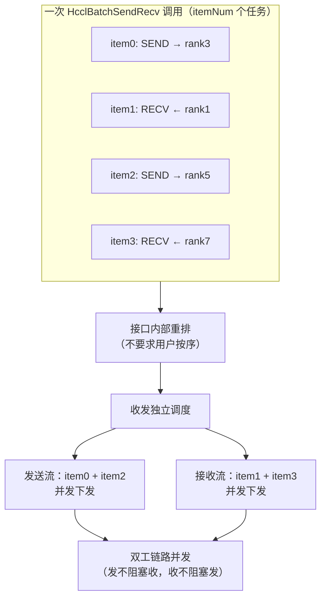
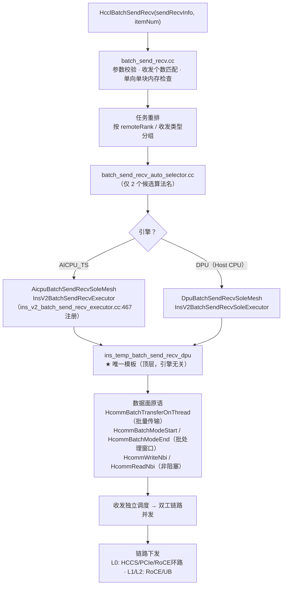

# HcclBatchSendRecv 算子解析

> **深度参考** · 前置阅读：[《集合通信》第 1 章（语义）与第 4 章（AG/RS/AlltoAll）](/通信与昇腾/01-collective-semantics-cost.md)。本篇为参考手册体例，检索导向；事实基线见文首引用块。

> 代码基线：`hccl/src/ops/batch_send_recv/`（950/A5 路径）。
> 参数与约束以 `hccl/docs/zh/api_ref/comm_op_interface/HcclBatchSendRecv.md` 为准。
> **BatchSendRecv 是结构最精简的算子**：2 个执行器、1 个顶层模板、无 aicpu/aiv/ccu 子目录、无 op_graph。

## 1. 算子概述

**功能**：**异步批量点对点通信**操作接口，调用一次接口可以完成本 rank 上的**多个收发任务**，本 rank 发送和接收之间是**异步**的，发送和接收任务之间**不会相互阻塞**。


> 图源：`hccl/docs/zh/api_ref/comm_op_interface/figures/send_recv.png`

**函数原型**：

```c
HcclResult HcclBatchSendRecv(HcclSendRecvItem *sendRecvInfo, uint32_t itemNum,
                             HcclComm comm, aclrtStream stream)
```

| 参数 | 输入/输出 | 描述 |
| --- | --- | --- |
| `sendRecvInfo` | 输入 | **任务项数组**（`HcclSendRecvItem`），描述本 rank 的全部收发任务 |
| `itemNum` | 输入 | 任务项个数 |
| `comm` / `stream` | 输入 | 通信域 / 本 rank 的 stream |

**`HcclSendRecvItem` 结构**（`hcomm/docs/zh/api_ref/comm_mgr_c/data_type_definition/HcclSendRecvItem.md`）：

```c
typedef struct HcclSendRecvItemDef {
    HcclSendRecvType sendRecvType;   // 标识当前任务类型是发送还是接收（HCCL_SEND / HCCL_RECV）
    void *buf;                       // 数据发送/接收的 buffer 地址
    uint64_t count;                  // 发送/接收数据的个数
    HcclDataType dataType;           // 发送/接收数据的数据类型
    uint32_t remoteRank;             // 通信域内数据接收/发送端的 rank 编号
} HcclSendRecvItem;
```

## 2. 两个核心特征（官方口径）

| 特征 | 说明 |
| --- | --- |
| **① 内部顺序重排** | 接口内部会对批量数据收发顺序进行**重排**，所以**不严格要求单次接口调用中批量收发的任务顺序**，但需要确保**一次接口调用中的数据发送与数据接收操作个数完全匹配** |
| **② 收发独立调度** | 收发过程**独立调度执行，收发不相互阻塞**，从而实现**双工链路并发** |



> **与 Send/Recv 的本质差异**：Send/Recv 是**同步阻塞**——调用 `HcclSend` 后必须等配对的 `HcclRecv` 完成才能调下一个接口，因此两端需错开调用顺序避免死锁。BatchSendRecv 把多个收发任务打包成一次调用，**卡内收发异步**，天然规避死锁。

## 3. 约束说明

| 约束 | 说明 |
| --- | --- |
| **"异步"的边界** | **"异步"是指同一张卡上的接收和发送任务是异步的，不会相互阻塞。但是在卡间，收发任务依旧是同步的**——因此卡间的收发任务也同 `HcclSend`、`HcclRecv` 一样，**必须是一一对应的** |
| **单向单块内存** | 单次接口调用下，**两个 rank 之间单向数据流仅支持传递一块内存数据**，避免收发过程中混淆多块内存数据的收发地址 |
| **收发个数匹配** | 一次接口调用中的数据发送与数据接收操作**个数完全匹配** |
| **Atlas A2 大规模集群** | **ranksize > 500** 时使用此接口，**并发执行数不能超过 3 个** |
| **Atlas 200T A2 Box16 异构子框** | 若 Server 内卡间出现建链失败（错误码 **EI0010**），需配置 `HCCL_INTRA_ROCE_ENABLE=1`、`HCCL_INTRA_PCIE_ENABLE=0`，让 Server 内采用 **RoCE 环路**进行多卡间通信（需确保 Server 上存在 RoCE 网卡，且具有 send/recv 收发关系的设备之间 RDMA 链路互通） |
| **通用** | 串行下发、不允许乱序/多线程并发、不支持线程重入；同一通信域下发线程需相同 Context |

```bash
# Atlas 200T A2 Box16 异构子框 Server 内建链失败（EI0010）的处置
export HCCL_INTRA_ROCE_ENABLE=1
export HCCL_INTRA_PCIE_ENABLE=0
```

## 4. 实现流程图（真实代码路径）



## 5. 代码结构（实测文件清单）

```
batch_send_recv/
├── batch_send_recv.cc / .h
├── selector/batch_send_recv_auto_selector.cc / .h   # 2 个算法名
├── algorithm/
│   ├── executor/                                    # 2 种执行器
│   │   ├── ins_v2_batch_send_recv_executor.cc / .h       # AICPU 路径（:467 注册）
│   │   └── ins_v2_batch_send_recv_sole_executor.cc / .h  # DPU Sole 路径
│   └── template/
│       └── ins_temp_batch_send_recv_dpu.cc / .h     # ★ 唯一模板（顶层，无引擎子目录）
└── ★ 无 op_graph/ 目录
```

> **全算子最精简结构**：无 `aicpu/`、`aiv/`、`ccu/`、`host_nic/` 任何子目录，只有一个顶层 DPU 模板；无 GE 图模式注册。

## 6. 可选算法名（selector 实测，2 个）

| 引擎前缀 | 算法名 | 执行器 |
| --- | --- | --- |
| `Aicpu` | `AicpuBatchSendRecvSoleMesh` | `InsV2BatchSendRecvExecutor` |
| `Dpu` | `DpuBatchSendRecvSoleMesh` | `InsV2BatchSendRecvSoleExecutor` |

> 无 `Aiv*`（BatchSendRecv **不在** AIV 展开模式支持列表内——列表中只有 Send、Recv，没有 BatchSendRecv 的 AIV 支持；但 `HCCL_OP_EXPANSION_MODE` 的 AI_CPU/AICPU_TS 配置项**明确包含 BatchSendRecv**）。无 `CcuMS*`/`CcuSched*`。

## 7. 实现要点

| 要点 | 说明 |
| --- | --- |
| **批量原语是性能关键** | `HcommBatchTransferOnThread` 一次提交多笔传输 + `HcommBatchModeStart/End` 批处理窗口，摊薄下发开销——这是"收发独立调度、双工并发"的实现基础 |
| **非阻塞下发** | 使用 `HcommWriteNbi` / `HcommReadNbi`（Nbi = Non-Blocking Issue），下发即返回，配合 `HcommChannelDrainOnThread` 排空完成语义 |
| **无分级编排** | 与 Send/Recv 同——点对点无 L0/L1/L2 三阶段 |
| **A2 大规模并发限制** | ranksize > 500 时并发执行数 ≤ 3——大规模下批量任务过多会耗尽链路/同步资源 |
| **Box16 异构子框的 RoCE 环路** | Server 内卡间原本走 PCIe，建链失败（EI0010）时改走 RoCE 环路——这是 L0 层协议可切换的实例（PCIe → RoCE） |
| **PP 并行的主力接口** | 流水并行下每个 micro-batch 需与上下游同时收发，BatchSendRecv 的双工并发正好匹配；官方示例 `examples/01_point_to_point/02_batch_send_recv_ring` 用它实现 **Ring 环状通信** |
| **EP 场景** | MoE Dispatch/Combine 的定向 token 收发亦可用批量点对点表达 |

## 8. 与 Send/Recv 的对比

| | **Send / Recv** | **BatchSendRecv** |
| --- | --- | --- |
| 调用粒度 | 一次一个方向 | 一次多个收发任务 |
| 卡内收发 | **同步阻塞**（Send 返回前不能调下一个） | **异步不阻塞** |
| 卡间收发 | 同步，必须配对 | **同步，必须一一对应**（相同） |
| 任务顺序 | 需严格保序下发 | **内部重排**，不要求用户按序 |
| 死锁风险 | 有（两端需错开调用顺序） | 无（打包一次调用） |
| 双工并发 | 否 | **是** |
| 执行器数 | 4（三代并存） | 2 |
| 模板 | `ins_temp_*_dpu` + `host_nic/` + `aiv/kernel/` | 仅 `ins_temp_batch_send_recv_dpu` |
| op_graph | ✅ | ❌ |
| AIV 支持 | ✅ | ❌ |
| 单向单块内存约束 | — | ✅ 两 rank 间单向仅一块内存 |

## 9. 参考资料

- `hccl/docs/zh/api_ref/comm_op_interface/HcclBatchSendRecv.md`：两个核心特征、"异步"边界、A2 并发限制、Box16 EI0010 处置（本文 §2-§3 来源）
- `hccl/docs/zh/api_ref/comm_op_interface/p2p_comm.md`：点对点通信总述
- `hccl/docs/zh/user_guide/api_comm_impl.md`：BatchSendRecv 语义与 Ring 环状通信示例
- `hcomm/docs/zh/api_ref/comm_mgr_c/data_type_definition/HcclSendRecvItem.md`：`HcclSendRecvItem` 结构定义
- `hcomm/docs/zh/api_ref/comm_mgr_c/data_type_definition/HcclSendRecvType.md`：`HCCL_SEND` / `HCCL_RECV`
- `hccl/docs/zh/user_guide/hccl_env/HCCL_INTRA_ROCE_ENABLE.md`、`HCCL_INTRA_PCIE_ENABLE.md`：Server 内链路协议切换
- `hccl/src/ops/batch_send_recv/`：实现（`ins_v2_batch_send_recv_executor.cc:467` 注册）
- `hcomm/include/hcomm_primitives.h`：`HcommBatchTransferOnThread`、`HcommBatchModeStart/End`、`HcommWriteNbi`/`HcommReadNbi`、`HcommChannelDrainOnThread`
- [send.md](/通信与昇腾/参考手册/算子参考/send.md)、[recv.md](/通信与昇腾/参考手册/算子参考/recv.md)：单发单收版本
- 层级原理：[../03_L0L1L2分级通信实现原理.md](/通信与昇腾/参考手册/总览/l0l1l2-principle.md)

