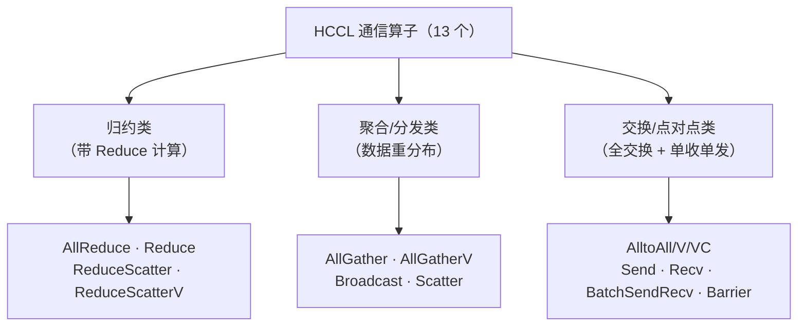

# operators：通信算子解析

> **深度参考** · 前置阅读：[《集合通信》第 1 章（语义）与第 4 章（AG/RS/AlltoAll）](/通信与昇腾/01-collective-semantics-cost.md)。本篇为参考手册体例，检索导向；事实基线见文首引用块。

> **算子做什么**（语义层）。本目录逐一解析 HCCL 的 13 个通信算子：准确的功能描述与函数原型、产品支持与数据类型、约束说明、分级通信编排、差异化实现流程、实测文件清单、可选算法名。
>
> 算子是通信能力的**对外语义入口**（L1，`hccl.h`），向下经 [../algorithms/](/通信与昇腾/参考手册/算法参考/) 选择算法、由 [../engine/](/通信与昇腾/参考手册/通信引擎/) 执行、经 [../comm/](/通信与昇腾/参考手册/协议与传输/) 搬运。算子全景对比见 [../02_HCCL算子与算法总览.md](/通信与昇腾/参考手册/总览/ops-algos-overview.md)。
>
> 事实来源（可信度：代码 > 仓内文档 > 社区资料）：
> `hccl/include/hccl.h`（算子 API）、`hccl/src/ops/<op>/`（13 个算子的 selector/executor/template/op_graph 实测）、`hccl/docs/zh/api_ref/comm_op_interface/`（16 个 API 文档 + 官方语义图）、`hccl/docs/zh/user_guide/api_comm_impl.md`（集合/点对点通信语义）。

---

## 1. 算子三大类

| 分类 | 算子 | 语义特征 |
| --- | --- | --- |
| **归约类** | AllReduce、Reduce、ReduceScatter、ReduceScatterV | 含归约计算（sum/prod/max/min），受确定性计算约束 |
| **聚合/分发类** | AllGather、AllGatherV、Broadcast、Scatter | 数据重分布，无归约；Broadcast/Scatter 有 root 节点 |
| **交换/点对点类** | AlltoAll/V/VC、Send、Recv、BatchSendRecv、Barrier | 全交换或单收单发；Barrier 纯同步零数据 |

---

## 2. 每篇文档的统一结构

每个算子文档均含以下部分（基于**真实代码路径**实测）：

| 部分 | 内容 |
| --- | --- |
| **功能描述与函数原型** | 准确语义 + 逐参数表 |
| **产品支持与数据类型** | 各产品（950/A3/A2/910/300I Duo）支持度、数据类型矩阵 |
| **约束说明** | root 节点、对称组网、确定性、零拷贝等约束 |
| **分级通信编排** | L0/L1/L2 阶段表 + 官方流程图 |
| **差异化实现流程图** | 基于真实代码路径的实现流程（mermaid） |
| **实测文件清单** | 执行器/模板/kernel 逐个列出（`hccl/src/ops/<op>/`） |
| **可选算法名** | 按引擎（Aicpu/Aiv/CcuMS/CcuSched）与编排分组 |
| **实现要点 + 上层消费方** | 关键实现细节、被哪些 mc2/ep 算子消费 |

---

## 3. 文档索引

### 3.1 归约类

| 文档 | 算子 | 要点 |
| --- | --- | --- |
| [all_reduce.md](/通信与昇腾/参考手册/算子参考/all_reduce.md) | **AllReduce** | 11 执行器 / **38 算法名**（全算子最多）；梯度同步主力；三阶段（L0 RS → L1 AR → L0 AG） |
| [reduce.md](/通信与昇腾/参考手册/算子参考/reduce.md) | **Reduce** | ★ 唯一 **3D OmniPipe** 编排；结果仅发 root |
| [reduce_scatter.md](/通信与昇腾/参考手册/算子参考/reduce_scatter.md) | **ReduceScatter** | 12 AICPU 模板 / hifloat8 / 保序；先层间后层内保证数据块连续 |
| [reduce_scatter_v.md](/通信与昇腾/参考手册/算子参考/reduce_scatter_v.md) | **ReduceScatterV** | 变长（各 rank 不同数据量）；仅 Sole 编排 |

### 3.2 聚合/分发类

| 文档 | 算子 | 要点 |
| --- | --- | --- |
| [all_gather.md](/通信与昇腾/参考手册/算子参考/all_gather.md) | **AllGather** | **27 算法名**；先层内后层间保证数据块连续 |
| [all_gather_v.md](/通信与昇腾/参考手册/算子参考/all_gather_v.md) | **AllGatherV** | 变长；仅 Sole 编排 |
| [broadcast.md](/通信与昇腾/参考手册/算子参考/broadcast.md) | **Broadcast** | 单一 `buf` **原地语义**；三阶段（root 先 Server 内散开 → 跨机广播 → 机内聚合） |
| [scatter.md](/通信与昇腾/参考手册/算子参考/scatter.md) | **Scatter** | ★ 两套执行器体系并存 / L1 算法白名单（仅 Ring/NHR/NB）/ 无 op_graph |

### 3.3 交换/点对点类

| 文档 | 算子 | 要点 |
| --- | --- | --- |
| [all_to_all_v.md](/通信与昇腾/参考手册/算子参考/all_to_all_v.md) | **AlltoAll / V / VC** | 一目录三 API 三 selector / ★ `hier/` 分级阶段注册表 / Pairwise / 分组 Full Mesh |
| [send.md](/通信与昇腾/参考手册/算子参考/send.md) | **Send** | ★ 按 Endpoint 位置动态选算法 / `host_nic/`；与 Recv 配对保序 |
| [recv.md](/通信与昇腾/参考手册/算子参考/recv.md) | **Recv** | 与 Send 对称 |
| [batch_send_recv.md](/通信与昇腾/参考手册/算子参考/batch_send_recv.md) | **BatchSendRecv** | 异步批量 / 内部重排收发顺序 / 双工并发 |
| [barrier.md](/通信与昇腾/参考手册/算子参考/barrier.md) | **Barrier** | ★ 纯同步零数据 / API 文档在 hcomm 仓 / 300I Duo 不支持 |

---

## 4. 算子 × 算法名数量（实现复杂度）

各算子可选算法名数量（`hccl/src/ops/*/selector/*.cc` 实测统计）——直接反映算子实现复杂度：

| 算子 | 算法名数 | 算子 | 算法名数 |
| --- | --- | --- | --- |
| AllReduce | **38** | Broadcast | 19 |
| ReduceScatter | **33** | Scatter | 15 |
| AlltoAll 族 | **29** | Send / Recv | 3 |
| AllGather | **27** | AllGatherV / ReduceScatterV | 2 |
| Reduce | 20 | BatchSendRecv / Barrier | 2 |

> 算法名 = **引擎前缀 + 编排 + 拓扑**（如 `CcuSchedAllReduceParallelMeshNHR`），详见 [../algorithms/algo_selector.md](/通信与昇腾/参考手册/算法参考/algo_selector.md)。

---

## 5. 官方语义示意图

12 个算子的官方语义示意图见 ../assets/operators/（图库）：allgather/allgatherv/allreduce/alltoall/alltoallv/alltoallvc/broadcast/reduce/reducescatter/reducescatterv/scatter/send_recv。

---

## 6. 上层消费方

| 消费方 | 关系 |
| --- | --- |
| ../../mc2/ | **通算融合算子**——以 HCCL 算子为通信内核（MatmulAllReduce 族消费 AllReduce、AllGatherMatmul 族消费 AllGather、AlltoAll 融合族消费 AlltoAllV） |
| ../../ep/ | **专家并行通信算子**——以 AlltoAllv 为通信内核（MoeDistributeDispatch/Combine 族、MegaMoe） |

---

## 7. 参考资料

- `hccl/docs/zh/api_ref/comm_op_interface/`：16 个算子 API 文档（`HcclAllReduce.md` 等）+ 官方语义图 + `collective_comm.md`/`p2p_comm.md`
- `hccl/docs/zh/user_guide/api_comm_impl.md`：集合通信与点对点通信语义
- `hccl/include/hccl.h`：算子 API 原型
- `hccl/src/ops/<op>/`：13 个算子的 selector/executor/template/op_graph 实测
- `hccl/docs/zh/user_guide/comm_ops_support_list/`：各产品算子支持度（见 [../reference/support_build.md](/通信与昇腾/参考手册/运行与约束/support_build.md)）
- 关联：[../02_HCCL算子与算法总览.md](/通信与昇腾/参考手册/总览/ops-algos-overview.md)（算子全景对比）、[../algorithms/](/通信与昇腾/参考手册/算法参考/)（算法编排）、[../engine/](/通信与昇腾/参考手册/通信引擎/)（引擎执行）、[../communicator/](/通信与昇腾/参考手册/通信域/)（通信域）

