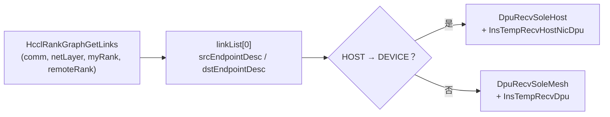
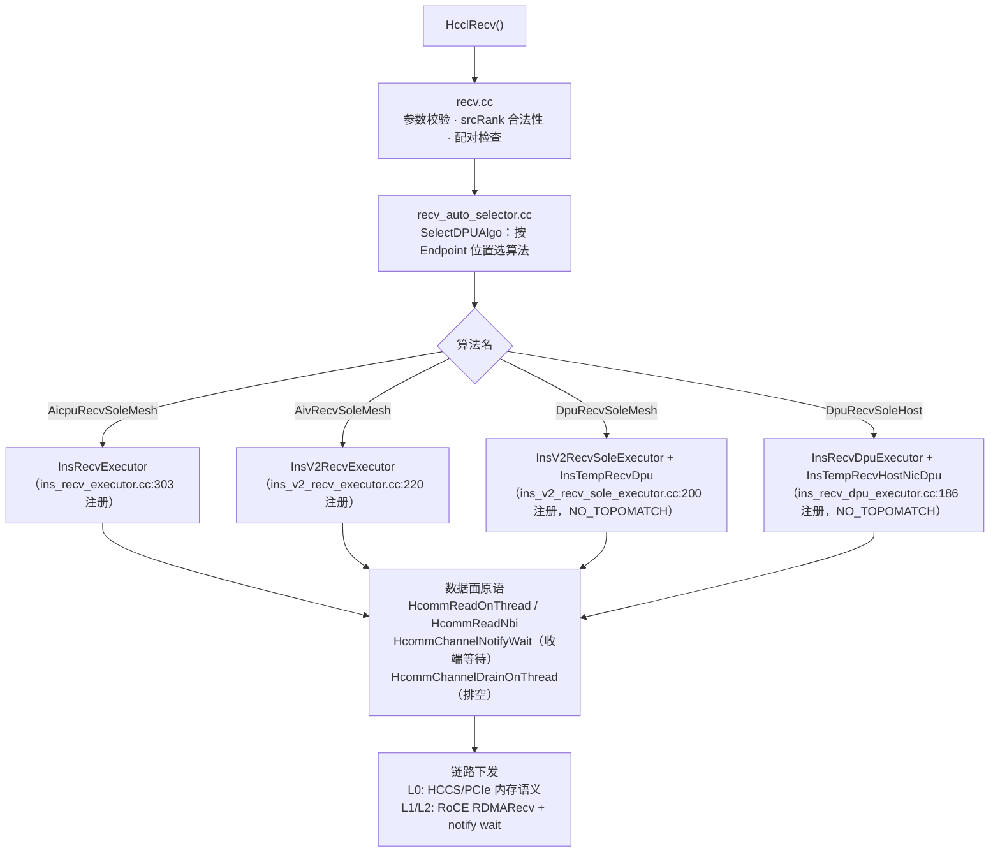

# HcclRecv 算子解析

> **深度参考** · 前置阅读：[《集合通信》第 1 章（语义）与第 4 章（AG/RS/AlltoAll）](/通信与昇腾/01-collective-semantics-cost.md)。本篇为参考手册体例，检索导向；事实基线见文首引用块。

> 代码基线：`hccl/src/ops/recv/`（950/A5 路径）+ `hcomm/src/legacy/ascend910/algorithm/base/alg_template/temp_send_recv/send_receive.cc`（910/A2/A3 路径，Send/Recv 共用一个模板）。
> 参数与约束以 `hccl/docs/zh/api_ref/comm_op_interface/HcclRecv.md` 为准。
> **Recv 与 Send 结构完全对称**，同样按 Endpoint 位置动态选算法、同样有 `host_nic/` 模板目录。

## 1. 算子概述

**功能**：点对点通信 Receive 操作接口，**从源节点接收数据到当前节点的指定位置上**。


> 图源：`hccl/docs/zh/api_ref/comm_op_interface/figures/send_recv.png`

**函数原型**：

```c
HcclResult HcclRecv(void *recvBuf, uint64_t count, HcclDataType dataType,
                    uint32_t srcRank, HcclComm comm, aclrtStream stream)
```

| 参数 | 输入/输出 | 描述 |
| --- | --- | --- |
| `recvBuf` | 输出 | 接收数据的目的 buffer |
| `count` | 输入 | 数据个数（**需与对端 Send 的 count 匹配**） |
| `dataType` | 输入 | 数据类型 |
| `srcRank` | 输入 | **源 rank id**（对应 Send 的 `destRank`） |
| `comm` / `stream` | 输入 | 通信域 / 本 rank 的 stream |

## 2. 约束说明

| 约束 | 说明 |
| --- | --- |
| **同步调用 + 严格配对** | `HcclSend` 与 `HcclRecv` 采用**同步调用方式**，且**必须配对使用**——一个进程调用 `HcclSend` 后，需要等到与之配对的 `HcclRecv` 接收数据后，才可以进行下一个接口调用 |
| **严格保序下发** | 需严格保序下发并配对使用；收发两端需完成同步后才能进行数据收发，数据收发完成后才能执行后续算子任务 |
| **通用** | 串行下发、不允许乱序/多线程并发、不支持线程重入；同一通信域下发线程需相同 Context |

### 2.1 配对调用范式（官方示例）

```c
if (rankId == 0) {
    uint32_t destRank = 1;
    uint32_t srcRank = 1;
    HcclSend(sendBuf, count, dataType, destRank, hcclComm, stream);
    HcclRecv(recvBuf, count, dataType, srcRank, hcclComm, stream);
}
if (rankId == 1) {
    uint32_t srcRank = 0;
    uint32_t destRank = 0;
    HcclRecv(recvBuf, count, dataType, srcRank, hcclComm, stream);
    HcclSend(sendBuf, count, dataType, destRank, hcclComm, stream);
}
```

> ⚠️ **注意两个 rank 的调用顺序相反**（rank0 先 Send 后 Recv，rank1 先 Recv 后 Send）——因为 Send/Recv 是**同步阻塞**的，若两端都先 Send 则会死锁。这正是 `HcclBatchSendRecv` 存在的理由（同卡内收发异步、不互相阻塞）。

## 3. 算法选择：按 Endpoint 位置动态判定

与 Send 完全对称（`recv_auto_selector.cc` `SelectDPUAlgo`）：查询 RankGraph 链路，从最高 netLayer 向下遍历，取 `linkList[0]` 的两端 `EndpointDesc`，按 `locType` 判定：

| 本端 locType | 对端 locType | 算法名 |
| --- | --- | --- |
| HOST | DEVICE | `DpuRecvSoleHost` |
| 其他组合 | 其他组合 | `DpuRecvSoleMesh`（默认） |



## 4. 实现流程图（真实代码路径）



## 5. 代码结构（实测文件清单）

```
recv/
├── recv.cc / .h
├── selector/recv_auto_selector.cc / .h             # SelectDPUAlgo：Endpoint 位置判定
├── algorithm/
│   ├── executor/                                   # 4 种执行器（三代并存）
│   │   ├── ins_recv_executor.cc / .h               # 第一代（AicpuRecvSoleMesh，:303 注册）
│   │   ├── ins_recv_dpu_executor.cc / .h           # DPU 代（DpuRecvSoleHost，:186 注册 NO_TOPOMATCH）
│   │   ├── ins_v2_recv_executor.cc / .h            # ins_v2（AivRecvSoleMesh，:220 注册）
│   │   └── ins_v2_recv_sole_executor.cc / .h       # ins_v2 Sole（DpuRecvSoleMesh，:200 注册 NO_TOPOMATCH）
│   └── template/
│       ├── ins_temp_recv_dpu.cc / .h               # ★ 顶层模板（引擎无关）
│       ├── host_nic/                               # ★ Host NIC 专用模板目录（Send/Recv 独有）
│       │   └── ins_temp_recv_host_nic_dpu.cc / .h
│       └── aiv/kernel/
│           ├── aiv_recv_mesh_1D.h
│           └── aiv_recv_op.h
│       # ★ 无 aicpu/ 与 ccu/ 模板目录
└── op_graph/recv_proto.cc
```

> **与 Send 目录结构逐文件对称**（仅文件名 send↔recv 替换），包括"无 aicpu/ccu 模板目录、有 host_nic 目录、AIV 为 header-only kernel"三个特征。

## 6. 可选算法名（selector 实测，4 个）

| 引擎前缀 | 算法名 | 执行器 | 模板 | 触发条件 |
| --- | --- | --- | --- | --- |
| `Aicpu` | `AicpuRecvSoleMesh` | `InsRecvExecutor` | — | AICPU_TS 引擎 |
| `Aiv` | `AivRecvSoleMesh` | `InsV2RecvExecutor` | `aiv_recv_mesh_1D.h` | AIV 引擎（低时延） |
| `Dpu` | `DpuRecvSoleMesh` | `InsV2RecvSoleExecutor` | `InsTempRecvDpu` | **默认**；Device NIC ↔ Device NIC |
| `Dpu` | `DpuRecvSoleHost` | `InsRecvDpuExecutor` | `InsTempRecvHostNicDpu` | **本端 HOST + 对端 DEVICE** |

## 7. 实现要点

| 要点 | 说明 |
| --- | --- |
| **无分级编排** | 与 Send 同——点对点无 L0/L1/L2 三阶段，直接按 rank 对建链收发；执行器用 `REGISTER_EXECUTOR_IMPL_NO_TOPOMATCH` 注册 |
| **910 路径 Send/Recv 共用模板** | `temp_send_recv/send_receive.cc` 是**唯一文件**——910/A2/A3 路径把 Send 与 Recv 实现在同一个模板中（收发是同一链路的两侧） |
| **收端原语差异** | Send 用 `Write`/`WriteWithNotify`/`ChannelNotifyRecord`（主动推）；Recv 用 `Read`/`ReadNbi`/`ChannelNotifyWait`/`ChannelDrain`（等待 + 拉取 + 排空） |
| **Host NIC 场景** | `DpuRecvSoleHost` 用于本端走主机网卡接收（异构链路、借轨场景） |
| **PP 并行场景** | 流水并行下接收上游 rank 的激活值——与 Send 配对使用 |
| **AIV 支持** | Recv 在 AIV 展开模式的支持列表内 |
| **死锁风险** | 同步阻塞语义要求两端调用顺序错开（见 §2.1）；需要真并发时用 `HcclBatchSendRecv` |

## 8. 参考资料

- `hccl/docs/zh/api_ref/comm_op_interface/HcclRecv.md`：参数与"同步调用 + 必须配对"约束
- `hccl/docs/zh/api_ref/comm_op_interface/p2p_comm.md`：点对点通信总述
- `hccl/docs/zh/user_guide/api_comm_impl.md`：Send/Receive 语义与配对调用代码示例（本文 §2.1 来源）
- `hccl/src/ops/recv/selector/recv_auto_selector.cc`：`SelectDPUAlgo` Endpoint 位置判定
- `hccl/src/ops/recv/algorithm/executor/*.cc`：4 个执行器与注册宏（`:186`、`:200`、`:220`、`:303`）
- `hcomm/src/legacy/ascend910/algorithm/base/alg_template/temp_send_recv/send_receive.cc`：910 路径 Send/Recv 共用模板
- `hcomm/include/hcomm_primitives.h`：`HcommReadOnThread`/`HcommReadNbi`/`HcommChannelNotifyWait`/`HcommChannelDrainOnThread`
- [send.md](/通信与昇腾/参考手册/算子参考/send.md)：配对的发送算子；[batch_send_recv.md](/通信与昇腾/参考手册/算子参考/batch_send_recv.md)：异步批量版本
- 层级原理：[../03_L0L1L2分级通信实现原理.md](/通信与昇腾/参考手册/总览/l0l1l2-principle.md)

