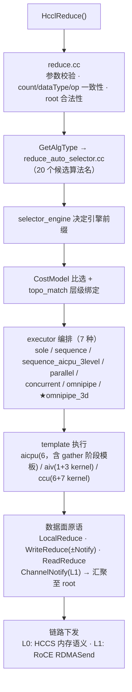

# HcclReduce 算子解析

> **深度参考** · 前置阅读：[《集合通信》第 1 章（语义）与第 4 章（AG/RS/AlltoAll）](/通信与昇腾/01-Collective语义与代价模型.md)。本篇为参考手册体例，检索导向；事实基线见文首引用块。

> 代码基线：`hccl/src/ops/reduce/`（950/A5 路径）+ `hcomm/src/legacy/ascend910/algorithm/base/alg_template/temp_reduce/`、`temp_gather/`（910/A2/A3 路径）。
> 参数与约束以 `hccl/docs/zh/api_ref/comm_op_interface/HcclReduce.md` 为准。
> **Reduce 是唯一拥有 3D OmniPipe 执行器的算子**。

## 1. 算子概述

**功能**：将所有 rank 的数据相加（或其他归约操作）后，再把结果发送到 **root 节点**的指定位置上。


> 图源：`hccl/docs/zh/api_ref/comm_op_interface/figures/reduce.png`

**函数原型**（比 AllReduce 多一个 `root` 参数）：

```c
HcclResult HcclReduce(void *sendBuf, void *recvBuf, uint64_t count, HcclDataType dataType,
                      HcclReduceOp op, uint32_t root, HcclComm comm, aclrtStream stream)
```

| 参数 | 输入/输出 | 描述 |
| --- | --- | --- |
| `sendBuf` | 输入 | 源数据 buffer 地址 |
| `recvBuf` | 输出 | 目的 buffer——**仅 root 节点的输出有效** |
| `count` | 输入 | 参与归约的数据个数 |
| `dataType` | 输入 | 数据类型 |
| `op` | 输入 | 归约操作类型（sum/prod/max/min） |
| `root` | 输入 | **根节点 rank id**（AllReduce 无此参数） |
| `comm` / `stream` | 输入 | 通信域 / 本 rank 的 stream |

> **与 AllReduce 的唯一语义差异**：结果只发 root，不广播回所有 rank。因此 Reduce = AllReduce 去掉最后的 AllGather 阶段（换成 Gather）。

## 2. 约束说明

- 所有 rank 的 `count`、`dataType`、`op` 均应相同
- 输入输出地址按数据类型对齐：int8→1 Byte；int16/float16/bfp16→2 Byte；int32/float32→4 Byte；int64/uint64/float64→8 Byte
- 通信算子需串行下发，不允许乱序、多线程并发下发，不支持线程重入；同一通信域下发线程需相同 Context
- AIV 展开模式下 Reduce/AllReduce 支持数据类型：int8、int16、int32、int64、float16、float32、bfp16

## 3. 分级通信编排（L0/L1/L2）

| 阶段 | 层级 | 操作 | 说明 |
| --- | --- | --- | --- |
| 阶段一 | **L0** | Server 内 ReduceScatter | 先在 Server 内归约，降低跨机数据量 |
| 阶段二 | **L1** | Server 间 Reduce | 跨机归约到 root 所在 Server |
| 阶段三 | **L0** | **Server 内 Gather** | **结果仅发送到 root 节点的输出 buffer** |

> **官方特别说明**：**HCCL 未提供 Gather 算子**。Gather 操作与 AllGather 操作的区别是**仅将结果发送到 root 节点**的输出 buffer。因此 Gather 作为 Reduce 的**内部阶段**存在，代码落点为 `temp_gather/`（910 路径）与 `ins_temp_gather_*`（950 路径）。


## 4. 实现流程图（真实代码路径）



## 5. 代码结构（实测文件清单）

```
reduce/
├── reduce.cc / .h
├── selector/reduce_auto_selector.cc / .h           # 20 个算法名
├── algorithm/
│   ├── executor/                                   # 7 种执行器
│   │   ├── reduce_sole_executor.cc                          # 注意：无 ins_v2_ 前缀
│   │   ├── reduce_sequence_executor.cc                      # 无 ins_v2_ 前缀
│   │   ├── reduce_sequence_executor_aicpu_3level.cc         # 三级拓扑（无 ins_v2_ 前缀）
│   │   ├── reduce_parallel_executor.cc                      # 无 ins_v2_ 前缀
│   │   ├── ins_v2_reduce_concurrent_executor.cc             # 有 ins_v2_ 前缀
│   │   ├── ins_v2_reduce_omnipipe_executor.cc
│   │   └── ins_v2_reduce_omnipipe_3d_executor.cc            # ★ 3D OmniPipe（全 HCCL 唯一）
│   └── template/
│       ├── aicpu/                                  # 6 个模板
│       │   ├── reduce_mesh_1D.cc
│       │   ├── reduce_mesh_1D_two_shot.cc
│       │   ├── reduce_nhr.cc
│       │   ├── reduce_aicpu_reduce_nhr.cc                   # NHR + AICPU 侧归约
│       │   ├── ins_temp_gather_mesh_1D_intra.cc             # ★ 阶段模板：框内 Gather
│       │   └── ins_temp_gather_dpu_inter.cc                 # ★ 阶段模板：框间 Gather（DPU）
│       ├── aiv/
│       │   ├── aiv_temp_reduce_mesh_1D.cc
│       │   └── kernel/aiv_reduce_mesh_1d.h、aiv_reduce_op.h
│       └── ccu/                                    # 6 模板 + 7 kernel
│           ├── ccu_temp_reduce_mesh_1D.cc / _mem2mem.cc / _twoshot_mem2mem.cc
│           ├── ccu_temp_reduce_nhr_1D_mem2mem.cc
│           ├── ccu_temp_gather_omnipipe_mesh_1d_mem2mem.cc  # ★ Gather 流水模板
│           ├── ccu_temp_gather_omnipipe_nhr1d_mem2mem.cc    # ★ Gather 流水 NHR
│           └── kernel/ccu_kernel_reduce_*.cc、ccu_kernel_gather_omnipipe_*.cc
└── op_graph/reduce_proto.cc
```

> **命名不一致提示**：Reduce 的 4 个执行器**无 `ins_v2_` 前缀**（`reduce_sole_executor.cc` 等），而 concurrent/omnipipe 3 个**有前缀**——反映了不同批次的代码演进，阅读时需注意。

## 6. 可选算法名（selector 实测，20 个）

| 引擎 | 编排 | 算法名 |
| --- | --- | --- |
| **AICPU_TS** | Sole | `AicpuReduceSoleMesh`、`SoleMeshTwoShot`、`SoleNHR` |
| | Parallel | `AicpuReduceParallelMeshNHR`、`ParallelMeshNHRMultiJetty`、`ParallelNHRNHR` |
| | PipeLine | `AicpuReducePipeLineMeshNHR` |
| | Concur | `AicpuReduceConcurMeshNHR` |
| **CCU_MS** | Sole / PipeLine | `CcuMSReduceSoleMesh`、`CcuMSReducePipeLineMeshNHR` |
| **CCU_SCHED** | Sole / Parallel / PipeLine | `CcuSchedReduceSoleMesh`、`SoleMeshTwoShot`、`SoleNHR`、`ParallelMeshNHR`、`ParallelMeshNHRMultiJetty`、`PipeLineMeshNHR` |
| **AIV** | Sole | `AivReduceSoleMesh` |

## 7. 实现要点

| 要点 | 说明 |
| --- | --- |
| **唯一 3D OmniPipe** | `ins_v2_reduce_omnipipe_3d_executor.cc`——Reduce 沿 X/Y/Z 三维铺流水阶段（对比 AllReduce/AllGather/ReduceScatter/Scatter/Broadcast 最多 2D）。原因：Reduce 的三阶段编排（L0 RS → L1 Reduce → L0 Gather）天然需要三维切片 |
| **Gather 是内部阶段而非独立算子** | HCCL 不提供 `HcclGather` API；Gather 以阶段模板形式存在（`ins_temp_gather_mesh_1D_intra`、`ins_temp_gather_dpu_inter`、`ccu_temp_gather_omnipipe_*`；910 路径 `gather_mesh.cc`、`gather_ring.cc`、`gather_star.cc`） |
| **Star 算法的两个落点之一** | `gather_star.cc`——Gather 语义（所有 rank 一步发给 root）天然匹配 Star，见 [../algorithms/star.md](/通信与昇腾/参考手册/算法参考/star.md) |
| **910 路径模板最少** | `temp_reduce/` 仅 3 个（`reduce_nhr_oneshot`、`reduce_recursive_hd`、`reduce_ring`）——Reduce 使用频率远低于 AllReduce |
| **CCU_SCHED 回退** | 单机 Reduce 数据量超阈值时自动切换 AI_CPU 模式（与 AllReduce/ReduceScatter 同规则） |
| **保序不支持** | Reduce 无 `order_preserved` 执行器（仅 AllReduce/ReduceScatter 支持严格保序） |

## 8. 上层消费方

| 上层算子 | 说明 |
| --- | --- |
| `MatmulAllReduce` 族 | 内部可能以 Reduce + Broadcast 组合实现 AllReduce（910 路径 `all_reduce_reduce_broadcast.cc`） |
| `MoeDistributeCombine` 族 | EP Combine 的加权归约到指定 rank |
| `MoeUpdateExpert` | 专家统计量归约 |

## 9. 参考资料

- `hccl/docs/zh/api_ref/comm_op_interface/HcclReduce.md`：参数（含 `root`）与约束
- `hccl/docs/zh/user_guide/api_comm_impl.md`：Reduce 语义与"HCCL 未提供 Gather 算子"说明（本文 §3 来源）
- `hccl/docs/zh/user_guide/coll_algo_intro/algo_intro.md`：Reduce 三阶段分级编排表
- `hccl/docs/zh/rfcs/0003-executor-template-refactor.md`：OmniPipe 2D/3D 维度排布
- `hccl/src/ops/reduce/`：950/A5 路径实现
- `hcomm/src/legacy/ascend910/algorithm/base/alg_template/temp_reduce/`、`temp_gather/`：910/A2/A3 路径
- [all_reduce.md](/通信与昇腾/参考手册/算子参考/all_reduce.md)：无 root 的对应算子；[../algorithms/star.md](/通信与昇腾/参考手册/算法参考/star.md)：Gather 的星型实现
- 算法详解：[../algorithms/](/通信与昇腾/参考手册/算法参考/)；层级原理：[../03_L0L1L2分级通信实现原理.md](/通信与昇腾/参考手册/总览/L0-L1-L2分级原理.md)

