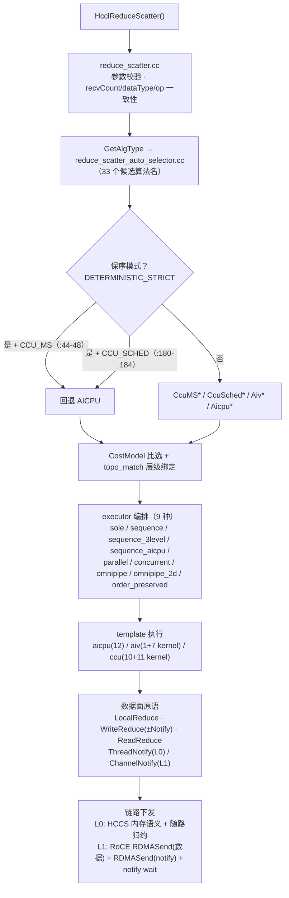

# HcclReduceScatter 算子解析

> **深度参考** · 前置阅读：[《集合通信》第 1 章（语义）与第 4 章（AG/RS/AlltoAll）](/通信与昇腾/01-Collective语义与代价模型.md)。本篇为参考手册体例，检索导向；事实基线见文首引用块。

> 代码基线：`hccl/src/ops/reduce_scatter/`（950/A5 路径）+ `hcomm/src/legacy/ascend910/algorithm/base/alg_template/temp_reduce_scatter/`（910/A2/A3 路径，27 个模板）。
> 参数与约束以 `hccl/docs/zh/api_ref/comm_op_interface/HcclReduceScatter.md` 为准。
> **ReduceScatter 是 HCCL 算法变体最多的算子**：9 种执行器、33 个可选算法名、12 个 AICPU 模板。

## 1. 算子概述

**功能**：将通信域内所有 rank 的输入数据**均分成 rank size 份**，然后分别取每个 rank 的 rank size 之一份数据进行归约操作（如 sum、prod、max、min），最后将结果**按照编号分散到各个 rank 的输出 buffer**。


> 图源：`hccl/docs/zh/api_ref/comm_op_interface/figures/reducescatter.png`

**函数原型**（注意是 `recvCount` 而非 `count`）：

```c
HcclResult HcclReduceScatter(void *sendBuf, void *recvBuf, uint64_t recvCount, HcclDataType dataType,
                             HcclReduceOp op, HcclComm comm, aclrtStream stream)
```

| 参数 | 输入/输出 | 描述 |
| --- | --- | --- |
| `sendBuf` | 输入 | 源数据 buffer 地址（长度为 `recvCount × rankSize`） |
| `recvBuf` | 输出 | 目的 buffer，接收本 rank 编号对应的归约结果（长度为 `recvCount`） |
| `recvCount` | 输入 | **每个 rank 输出**的数据个数 |
| `dataType` | 输入 | 数据类型 |
| `op` | 输入 | 归约操作类型 |
| `comm` / `stream` | 输入 | 通信域 / 本 rank 的 stream |

> **通信量特征**：每卡输出仅为输入的 1/rankSize——ReduceScatter 是**降低跨机数据量**的关键算子，因此被 AllReduce 用作第一阶段（见 [all_reduce.md §4](/通信与昇腾/参考手册/算子参考/all_reduce.md)）。

## 2. 产品支持与数据类型

| 产品 | 数据类型 | 备注 |
| --- | --- | --- |
| Ascend 950PR&950DT | int8、int16、int32、int64、uint64、float16、float32、float64、bfp16、**hifloat8** | **唯一支持 hif8 的算子**（AIV kernel `aiv_reduce_scatter_mesh_1d_hif8.h`） |
| Atlas A3 / A2 | int8、int16、int32、int64、float16、float32、bfp16 | A2 的 int64 性能有劣化 |
| Atlas 推理系列（300I Duo） | int8、int16、int32、float16、float32 | **仅单 Server，最大 16 张卡（32 NPU）** |
| Atlas 训练系列 | int8、int32、int64、float16、float32 | — |

操作类型：sum、prod、max、min（950/A3/A2 的 prod 不支持 int16、bfp16）。

## 3. 约束说明

- 所有 rank 的 `recvCount`、`dataType`、`op` 均应相同
- 输入输出地址按数据类型对齐：int8、**hifloat8**→1 Byte；int16/float16/bfp16→2 Byte；int32/float32→4 Byte；int64/uint64/float64→8 Byte
- 通信算子需串行下发，不允许乱序、多线程并发下发，不支持线程重入；同一通信域内下发线程需使用相同 Context
- ⚠️ **对称内存污染**：注册对称内存时，部分算法会在 `sendBuf` 上就地完成归约（read+reduce），导致 sendBuf 数据被修改；调用后不可再作为原始输入使用，需保留请提前备份

## 4. 分级通信编排（L0/L1/L2）

| 阶段 | 层级 | 操作 | 为什么这个顺序 |
| --- | --- | --- | --- |
| 阶段一 | **L1** | Server 间 ReduceScatter | **先层间后层内**——保证 Server 间通信数据块的**连续性** |
| 阶段二 | **L0** | Server 内 ReduceScatter | 再在 Server 内完成剩余归约 |


> 图源：`hccl/docs/zh/user_guide/coll_algo_intro/figures/reduce_scatter_hierarchical_flow.png`
> 官方说明：ReduceScatter 算子要求**第 i 个 rank 最终得到第 i 份归约结果**，为了保证 Server 间通信数据块的连续性，首先在 Server 间执行 ReduceScatter，再在 Server 内执行。

> **与 AllGather 的顺序相反**：AllGather 是"先层内后层间"，ReduceScatter 是"先层间后层内"——两者都为了同一个目标：**让跨机传输的数据块地址连续**。

## 5. 实现流程图（真实代码路径）



## 6. 代码结构（实测文件清单）

```
reduce_scatter/
├── reduce_scatter.cc / .h
├── selector/reduce_scatter_auto_selector.cc / .h   # 33 个算法名；保序回退（:44-48, :180-184）
│                                                   # .h:19 注释对齐 SelectCcuScheduleAlgo 的 16p/2框 触发条件
├── algorithm/
│   ├── executor/                                   # 9 种执行器
│   │   ├── ins_v2_reduce_scatter_sole_executor.cc
│   │   ├── ins_v2_reduce_scatter_sequence_executor.cc
│   │   ├── ins_v2_reduce_scatter_sequence_executor_3level.cc      # 三级拓扑
│   │   ├── ins_v2_reduce_scatter_sequence_executor_aicpu.cc
│   │   ├── ins_reduce_scatter_parallel_executor.cc                # 注意：无 ins_v2_ 前缀
│   │   ├── ins_reduce_scatter_concurrent_executor.cc              # 注意：无 ins_v2_ 前缀
│   │   ├── ins_v2_reduce_scatter_omnipipe_executor.cc
│   │   ├── ins_v2_reduce_scatter_omnipipe_2d_executor.cc
│   │   └── ins_v2_reduce_scatter_order_preserved_executor.cc      # 严格保序
│   └── template/
│       ├── aicpu/                                  # 12 个模板（全算子最多）
│       │   ├── ins_temp_reduce_scatter_mesh_1D.cc
│       │   ├── ins_temp_reduce_scatter_mesh_1D_meshchunk.cc       # 分块 Mesh
│       │   ├── ins_temp_reduce_scatter_mesh_1D_Z_axis_detour.cc   # CLOS Z 轴绕路
│       │   ├── ins_temp_reduce_scatter_mesh_1d_dpu.cc             # 框间（DPU）
│       │   ├── ins_temp_reduce_scatter_nhr.cc
│       │   ├── ins_temp_reduce_scatter_aicpu_reduce_nhr.cc        # NHR + AICPU 归约
│       │   ├── ins_temp_reduce_scatter_aicpu_reduce_nhr_pcie.cc   # PCIe 链路变体
│       │   ├── ins_temp_reduce_scatter_omnipipe_mesh_1D.cc        # 流水 Mesh
│       │   ├── ins_temp_reduce_scatter_omnipipe_mesh_1d_dpu.cc    # 流水框间 Mesh
│       │   ├── ins_temp_reduce_scatter_omnipipe_nhr.cc            # 流水 NHR
│       │   ├── ins_temp_reduce_scatter_order_preserved_group.cc   # 保序：分组
│       │   └── ins_temp_reduce_scatter_order_preserved_level1.cc  # 保序：L1 层级
│       ├── aiv/
│       │   ├── aiv_temp_reduce_scatter_mesh_1D.cc
│       │   └── kernel/aiv_reduce_scatter_mesh_1d.h
│       │            aiv_reduce_scatter_mesh_1d_bigdata.h          # 大数据量专用
│       │            aiv_reduce_scatter_mesh_1d_hif8.h             # hifloat8 专用
│       │            aiv_reduce_scatter_mesh_1d_corectrl.h         # 控核（Vector Core 数配置）
│       │            aiv_reduce_scatter_local_tree.h               # 本地树形归约
│       │            aiv_reduce_scatter_local_tree_corectrl.h
│       │            aiv_rs_mesh_1d_superkernel.h
│       │            aiv_reduce_scatter_op.h
│       └── ccu/                                    # 10 模板 + 11 kernel
│           ├── ccu_temp_reduce_scatter_mesh_1D.cc / _mem2mem.cc / _2die_mem2mem.cc
│           ├── ccu_temp_reduce_scatter_mesh2die.cc
│           ├── ccu_temp_reduce_scatter_nhr_1D_mem2mem.cc
│           ├── ccu_temp_reduce_scatter_nhr_1D_multi_jetty_mem2mem.cc
│           ├── ccu_temp_reduce_scatter_concurrent_mesh_nhr.cc
│           ├── ccu_temp_reduce_scatter_omnipipe_mesh1d.cc / _mesh1d_mem2mem.cc / _nhr1d_mem2mem.cc
│           └── kernel/ccu_kernel_reduce_scatter_*.cc
└── op_graph/reduce_scatter_proto.cc
```

## 7. 可选算法名（selector 实测，33 个）

| 引擎 | 编排 | 算法名 |
| --- | --- | --- |
| **AICPU_TS** | Sole | `AicpuReduceScatterSoleMesh`、`SoleMeshChunk`、`SoleMeshConcur`、`SoleNHR`、`SoleNHRAicpuReduce`、`SoleNHRMultiLink` |
| | Sequence | `SequenceMeshConcurNHR`、`SequenceMeshConcurNHRNHR`、`SequenceMeshNHRAicpuReduce` |
| | Parallel | `ParallelMeshNHR`、`ParallelMeshNHRMultiJetty` |
| | PipeLine | `PipeLineMeshNHR`、`PipeLineMeshNHRMesh` |
| | Concur | `ConcurMeshNHR` |
| **CCU_MS** | Sole/Seq/Pipe/Concur | `CcuMSReduceScatterSoleMesh`、`SoleMesh2Die`、`SoleMeshConcur`、`PipeLineMeshNHR`、`ConcurMeshNHRMultiLink` |
| **CCU_SCHED** | Sole/Seq/Para/Pipe/Concur | `CcuSchedReduceScatterSoleMesh`、`SoleMesh2Die`、`SoleNHR`、`SoleNHRMultiLink`、`SequenceMeshMesh`、`ParallelMeshNHR`、`ParallelMeshNHRMultiLink`、`PipeLineMeshNHR`、`ConcurMeshNHRMultiLink` |
| **AIV** | Sole | `AivReduceScatterSoleMesh` |

## 8. 实现要点

| 要点 | 说明 |
| --- | --- |
| **模板变体最丰富** | 910 路径 27 个模板：`_slim_ring`（精简环）、`_unified_march`（统一步进）、`_plant_local_reduce`(+`_combine`)（植入式本地归约）、`_mesh_atomic`（原子归约）、`_mesh_mix`(+`_single_stream`)（混合链路）、`_hccs_sio`（HCCS+SIO 双链路）、`_hd_stage`（HD 分阶段）、`aligned_*_double_ring`(+`_with_serial_local_copy`)（对齐双环） |
| **保序（确定性计算）** | 唯一与 AllReduce 并列支持 `order_preserved` 执行器的算子；有**两个专用保序模板**（`_order_preserved_group` 分组保序、`_order_preserved_level1` L1 层级保序）；对应 RFC 0001 `add-batch-invariant-reducescatter`（批量不变性 ReduceScatter） |
| **hifloat8 支持** | 全 HCCL 唯一 hif8 模板（`aiv_reduce_scatter_mesh_1d_hif8.h`），AIV 引擎专属 |
| **控核能力** | AIV 模式下支持配置 Vector Core 核数（`_corectrl` 模板），建议按计算/通信算子并发情况配置 |
| **A3 的 L2 Pipeline** | 超节点间 AG/RS 的 Pipeline 仅单算子模式且开启零拷贝时可用 |
| **CCU_SCHED 16p/2框 触发** | `reduce_scatter_auto_selector.h:19` 注释说明与 `SelectCcuScheduleAlgo` 的 16p/2框 触发条件对齐 |
| **AHC 支持** | 仅 RS/AG/AR 三算子支持 AHC（`reduce_scatter_ahc.cc`、`_ahc_broke.cc`），仅 Atlas A3 |

## 9. 上层消费方

| 上层算子 | 说明 |
| --- | --- |
| `MatmulReduceScatter` / `MatmulReduceScatterV2` | Matmul + ReduceScatter 融合（TP 场景主力） |
| `QuantReduceScatter` | 量化 ReduceScatter |
| `BatchMatMulReduceScatterAlltoAll` | 三段融合 |
| `MoeDistributeCombine` 族 | EP Combine 的归约散布语义 |

详见 ../../mc2/operators/、../../ep/operators/。

## 10. 参考资料

- `hccl/docs/zh/api_ref/comm_op_interface/HcclReduceScatter.md`：参数、数据类型（含 hifloat8）、约束
- `hccl/docs/zh/user_guide/coll_algo_intro/hierarchical_comm_principle.md`：ReduceScatter 分级流程图（本文 §4 来源）
- `hccl/docs/zh/rfcs/0001-add-batch-invariant-reducescatter.md`：批量不变性 ReduceScatter（保序）
- `hccl/src/ops/reduce_scatter/`：950/A5 路径实现
- `hcomm/src/legacy/ascend910/algorithm/base/alg_template/temp_reduce_scatter/`：910/A2/A3 路径 27 个模板
- [reduce_scatter_v.md](/通信与昇腾/参考手册/算子参考/reduce_scatter_v.md)：变长版本；[all_reduce.md](/通信与昇腾/参考手册/算子参考/all_reduce.md)：以 RS 为第一阶段的组合算子
- 算法详解：[../algorithms/](/通信与昇腾/参考手册/算法参考/)；层级原理：[../03_L0L1L2分级通信实现原理.md](/通信与昇腾/参考手册/总览/L0-L1-L2分级原理.md)

