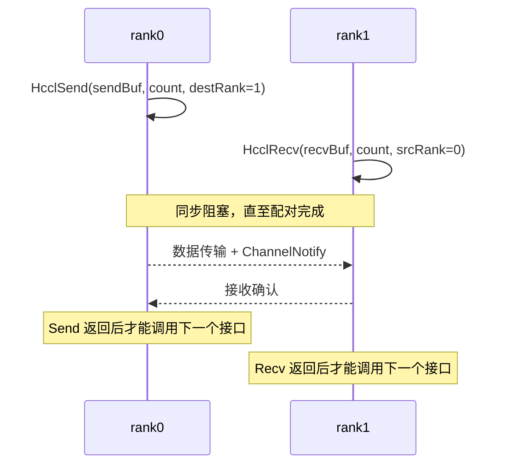
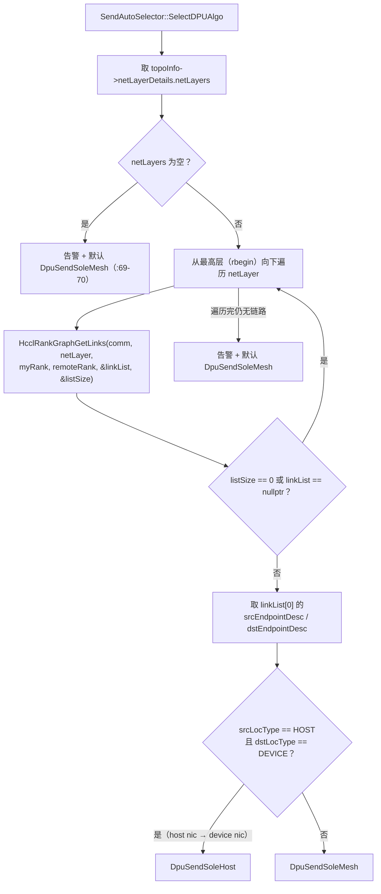
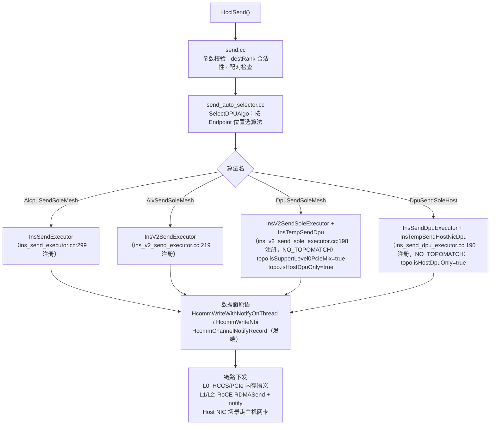

# HcclSend 算子解析

> **深度参考** · 前置阅读：[《集合通信》第 1 章（语义）与第 4 章（AG/RS/AlltoAll）](/通信与昇腾/01-collective-semantics-cost.md)。本篇为参考手册体例，检索导向；事实基线见文首引用块。

> 代码基线：`hccl/src/ops/send/`（950/A5 路径）+ `hcomm/src/legacy/ascend910/algorithm/base/alg_template/temp_send_recv/send_receive.cc`（910/A2/A3 路径）。
> 参数与约束以 `hccl/docs/zh/api_ref/comm_op_interface/HcclSend.md` 为准。
> **Send 是唯一按"本端/对端 Endpoint 位置"动态选算法的算子**（HOST NIC ↔ DEVICE NIC 判定），也是唯一有 `host_nic/` 模板目录的算子之一。

## 1. 算子概述

**功能**：点对点通信 Send 操作接口，将**当前节点指定位置的数据发送至目的节点**。


> 图源：`hccl/docs/zh/api_ref/comm_op_interface/figures/send_recv.png`

**函数原型**：

```c
HcclResult HcclSend(void *sendBuf, uint64_t count, HcclDataType dataType,
                    uint32_t destRank, HcclComm comm, aclrtStream stream)
```

| 参数 | 输入/输出 | 描述 |
| --- | --- | --- |
| `sendBuf` | 输入 | 待发送数据 buffer |
| `count` | 输入 | 数据个数 |
| `dataType` | 输入 | 数据类型 |
| `destRank` | 输入 | **目的 rank id**（集合通信算子无此参数） |
| `comm` / `stream` | 输入 | 通信域 / 本 rank 的 stream |

## 2. 约束说明

| 约束 | 说明 |
| --- | --- |
| **同步调用 + 严格配对** | `HcclSend` 与 `HcclRecv` 采用**同步调用方式**，且**必须配对使用**——一个进程调用 `HcclSend` 后，需要等到与之配对的 `HcclRecv` 接收数据后，才可以进行下一个接口调用 |
| **严格保序下发** | 需严格保序下发并配对使用；收发两端需完成同步后才能进行数据收发，数据收发完成后才能执行后续算子任务 |
| **通用** | 串行下发、不允许乱序/多线程并发、不支持线程重入；同一通信域下发线程需相同 Context |



> **与 BatchSendRecv 的关键差异**：Send/Recv 是**同步阻塞 + 严格保序**；BatchSendRecv 是**同卡内收发异步不互相阻塞 + 内部重排顺序**，适合双工链路并发。PP（流水并行）场景多用 BatchSendRecv。

## 3. 算法选择：按 Endpoint 位置动态判定（Send 独有）

Send/Recv 的 selector **不按数据量/rank 数比选**，而是**查询 RankGraph 链路，按本端与对端 Endpoint 的物理位置选择算法**（`send_auto_selector.cc:55-110` `SelectDPUAlgo`）：



> **这是 HCCL 中唯一在 selector 里直接调用 RankGraph 查询接口（`HcclRankGraphGetLinks`）的算子**——因为点对点的链路形态**逐对（per-pair）不同**，无法像集合通信那样按通信域整体拓扑决策。`EndpointLocType` 定义见 `hcomm/include/hcomm_res_defs.h`（`ENDPOINT_LOC_TYPE_DEVICE=0`、`ENDPOINT_LOC_TYPE_HOST=1`）。

## 4. 实现流程图（真实代码路径）



> **`REGISTER_EXECUTOR_IMPL_NO_TOPOMATCH`**：Send/Recv 的 DPU 执行器用**无拓扑匹配**的注册宏——因为点对点不涉及层级拓扑编排（无 L0/L1/L2 分级），直接按 rank 对建链收发。

## 5. 代码结构（实测文件清单）

```
send/
├── send.cc / .h
├── selector/send_auto_selector.cc / .h             # SelectDPUAlgo：Endpoint 位置判定（:55-110）
├── algorithm/
│   ├── executor/                                   # 4 种执行器（三代并存）
│   │   ├── ins_send_executor.cc / .h               # 第一代（AicpuSendSoleMesh，:299 注册）
│   │   ├── ins_send_dpu_executor.cc / .h           # DPU 代（DpuSendSoleHost，:190 注册 NO_TOPOMATCH）
│   │   ├── ins_v2_send_executor.cc / .h            # ins_v2（AivSendSoleMesh，:219 注册）
│   │   └── ins_v2_send_sole_executor.cc / .h       # ins_v2 Sole（DpuSendSoleMesh，:198 注册 NO_TOPOMATCH）
│   └── template/
│       ├── ins_temp_send_dpu.cc / .h               # ★ 顶层模板（引擎无关）
│       ├── host_nic/                               # ★ Host NIC 专用模板目录（Send/Recv 独有）
│       │   └── ins_temp_send_host_nic_dpu.cc / .h
│       └── aiv/kernel/
│           ├── aiv_send_mesh_1D.h
│           └── aiv_send_op.h
│       # ★ 无 aicpu/ 与 ccu/ 模板目录
└── op_graph/send_proto.cc
```

> **结构特殊性**：
> - **无 `aicpu/` 模板目录**——AICPU 路径直接用顶层 `ins_temp_send_dpu.cc`
> - **无 `ccu/` 模板目录**——Send 不支持 CCU 引擎（CCU 面向集合通信的批量搬运，点对点无收益）
> - **有 `host_nic/` 目录**——全 HCCL 仅 Send/Recv 有，对应 `DpuSendSoleHost`（本端 Host 网卡 → 对端 Device 网卡）
> - **只有 kernel 头文件无 .cc**——AIV 路径是 header-only 的 Vector Core kernel

## 6. 可选算法名（selector 实测，4 个）

| 引擎前缀 | 算法名 | 执行器 | 模板 | 触发条件 |
| --- | --- | --- | --- | --- |
| `Aicpu` | `AicpuSendSoleMesh` | `InsSendExecutor` | — | AICPU_TS 引擎 |
| `Aiv` | `AivSendSoleMesh` | `InsV2SendExecutor` | `aiv_send_mesh_1D.h` | AIV 引擎（低时延） |
| `Dpu` | `DpuSendSoleMesh` | `InsV2SendSoleExecutor` | `InsTempSendDpu` | **默认**；Device NIC ↔ Device NIC |
| `Dpu` | `DpuSendSoleHost` | `InsSendDpuExecutor` | `InsTempSendHostNicDpu` | **本端 HOST + 对端 DEVICE** |

> **`Dpu` 前缀映射到 `OpExecuteConfig::HOSTCPU`**（`alg_parse.cc:894`），字符串映射 `{"dpu", "Dpu"}`（`alg_parse.cc:23`）——DPU 路径即 Host CPU 侧的数据处理单元路径。

## 7. 实现要点

| 要点 | 说明 |
| --- | --- |
| **无分级编排** | Send/Recv 是点对点，**没有 L0/L1/L2 三阶段编排**——直接按 rank 对查到链路后一次收发。这是它与所有集合通信算子的根本差异 |
| **三代执行器并存** | `ins_send_executor`（第一代）、`ins_send_dpu_executor`（DPU 代）、`ins_v2_send_executor` + `ins_v2_send_sole_executor`（ins_v2 代）——4 个执行器对应 4 个算法名，一一映射 |
| **Host NIC 场景** | `DpuSendSoleHost` 用于本端走**主机网卡**、对端走 Device 网卡的异构链路（如 Host 侧参与的通信、借轨场景） |
| **PCIe 混合拓扑支持** | `DpuSendSoleMesh` 注册时设 `topo.isSupportLevel0PcieMix = true`——支持标卡 PCIe 混合链路，配套 `op_common/algorithm/topo_match/topo_match_pcie_mix.cc` |
| **`isHostDpuOnly`** | 两个 DPU 算法名均设 `topo.isHostDpuOnly = true`，限定只走 Host DPU 路径 |
| **PP 并行场景** | 流水并行（Pipeline Parallelism）下对激活值的数据收发——官方 `api_comm_impl.md` 明确此用途 |
| **AIV 支持** | Send 在 AIV 展开模式的支持列表内（Recv 亦在） |

## 8. 参考资料

- `hccl/docs/zh/api_ref/comm_op_interface/HcclSend.md`：参数与"同步调用 + 必须配对"约束
- `hccl/docs/zh/api_ref/comm_op_interface/p2p_comm.md`：点对点通信总述
- `hccl/docs/zh/user_guide/api_comm_impl.md`：Send/Receive 语义、PP 场景用途与代码示例
- `hccl/src/ops/send/selector/send_auto_selector.cc:55-110`：**`SelectDPUAlgo` 的 Endpoint 位置判定逻辑**（本文 §3 来源）
- `hccl/src/ops/send/algorithm/executor/*.cc`：4 个执行器与注册宏（`:190`、`:198`、`:219`、`:299`）
- `hccl/src/common/alg_parse.cc:23,894,1029`：`Dpu` 前缀与 `OpExecuteConfig::HOSTCPU` 映射
- `hcomm/include/hcomm_res_defs.h`：`EndpointLocType`（DEVICE=0 / HOST=1）
- `hcomm/include/hccl/hccl_rank_graph.h`：`HcclRankGraphGetLinks` 与 `EndpointDesc`
- [recv.md](/通信与昇腾/参考手册/算子参考/recv.md)：配对的接收算子；[batch_send_recv.md](/通信与昇腾/参考手册/算子参考/batch_send_recv.md)：异步批量版本
- 层级原理：[../03_L0L1L2分级通信实现原理.md](/通信与昇腾/参考手册/总览/l0l1l2-principle.md)

