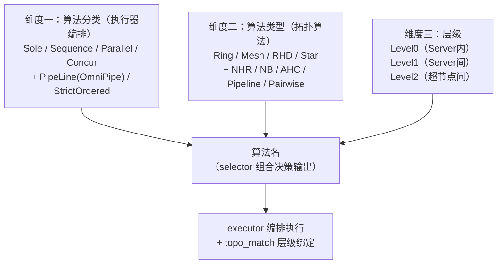
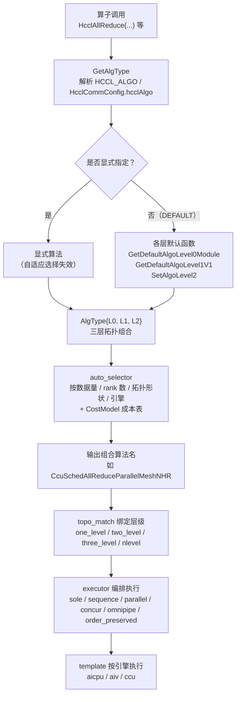

# 算法选择器与算法族总览

> **深度参考** · 前置阅读：[《集合通信》第 2 章（Ring）与第 3 章（Tree/选型）](/通信与昇腾/02-Ring-AllReduce推导.md)。本篇为参考手册体例，检索导向；事实基线见文首引用块。

> HCCL 通信算法解析。枚举来源：`hccl/src/common/alg_type.h`；选择器来源：`hccl/src/ops/*/selector/`、`hccl/src/ops/op_common/selector/`。

## 1. HcclAlgoType 全枚举（13 值）

`hccl/src/common/alg_type.h:21-33`：

| 值 | 枚举 | 含义 | 详见 |
| --- | --- | --- | --- |
| 0 | `HCCL_ALGO_TYPE_DEFAULT` | **默认算法**，配置为此时使用 HCCL 内藏算法选择逻辑 | 本文 §3 |
| 1 | `HCCL_ALGO_TYPE_RING` | 环算法 | [ring.md](/通信与昇腾/参考手册/算法参考/ring.md) |
| 2 | `HCCL_ALGO_TYPE_PIPELINE` | 分级流水算法 | [pipeline.md](/通信与昇腾/参考手册/算法参考/pipeline.md) |
| 3 | `HCCL_ALGO_TYPE_FULLMESH` | 全互联 Mesh | [fullmesh.md](/通信与昇腾/参考手册/算法参考/fullmesh.md) |
| 4 | `HCCL_ALGO_TYPE_HDR` | 递归二分-倍增（官方文档称 RHD，配置串 `H-D`） | [hdr.md](/通信与昇腾/参考手册/算法参考/RHD递归倍增.md) |
| 5 | `HCCL_ALGO_TYPE_PAIRWISE` | 逐对通信（仅 AlltoAll 族） | [pairwise.md](/通信与昇腾/参考手册/算法参考/pairwise.md) |
| 6 | `HCCL_ALGO_TYPE_NHR` | 非均衡层次环（自研） | [nhr.md](/通信与昇腾/参考手册/算法参考/nhr.md) |
| 7 | `HCCL_ALGO_TYPE_NHR_V1` | NHR 上一代（逐步停用） | [nhr.md](/通信与昇腾/参考手册/算法参考/nhr.md) |
| 8 | `HCCL_ALGO_TYPE_NB` | 非均匀 Bruck（自研） | [nb.md](/通信与昇腾/参考手册/算法参考/nb.md) |
| 9 | `HCCL_ALGO_TYPE_NULL` | 空算法（名称映射 `"null"`，对应 `*_RESERVED`） | — |
| 10 | `HCCL_ALGO_TYPE_NA` | 不适用（L0 仅支持配置 NA） | — |
| 11 | `HCCL_ALGO_TYPE_AHC` | 非对称层次化拼接（仅 RS/AG/AR，仅 A3） | [ahc.md](/通信与昇腾/参考手册/算法参考/ahc.md) |
| 12 | `HCCL_ALGO_TYPE_AHC_BROKE` | AHC 断链变体 | [ahc.md](/通信与昇腾/参考手册/算法参考/ahc.md) |

> **Star 不在此枚举中**——它只以层级拓扑枚举 `ALG_LEVEL0_NP_STAR` / `ALG_LEVEL1_STAR` 形式存在，见 [star.md](/通信与昇腾/参考手册/算法参考/star.md)。

## 2. 算法方案 = 三维组合



| 维度 | 权威文档 |
| --- | --- |
| 算法分类（执行器编排） | [combination.md](/通信与昇腾/参考手册/算法参考/算法组合.md) |
| 算法类型（拓扑算法） | 各算法篇（[ring](/通信与昇腾/参考手册/算法参考/ring.md) / [fullmesh](/通信与昇腾/参考手册/算法参考/fullmesh.md) / [hdr](/通信与昇腾/参考手册/算法参考/RHD递归倍增.md) / [star](/通信与昇腾/参考手册/算法参考/star.md) / [nhr](/通信与昇腾/参考手册/算法参考/nhr.md) / [nb](/通信与昇腾/参考手册/算法参考/nb.md) / [ahc](/通信与昇腾/参考手册/算法参考/ahc.md) / [pipeline](/通信与昇腾/参考手册/算法参考/pipeline.md) / [pairwise](/通信与昇腾/参考手册/算法参考/pairwise.md)） |
| 层级（L0/L1/L2） | [algo_level_matrix.md](/通信与昇腾/参考手册/算法参考/分层矩阵.md)、[../03_L0L1L2分级通信实现原理.md](/通信与昇腾/参考手册/总览/L0-L1-L2分级原理.md) |

## 3. 选择机制全流程



### 3.1 优先级

| 优先级 | 配置来源 | 说明 |
| --- | --- | --- |
| **1（最高）** | `HcclCommConfig` 的 `hcclAlgo` 参数 | **通信域粒度**，优先于环境变量 |
| 2 | 环境变量 `HCCL_ALGO` | 经 `alg_env_config` / `alg_parse` 解析 |
| 3 | `HCCL_ALGO_TYPE_DEFAULT` | 走 auto_selector 自适应选择 |
| — | `src/算法插件.md/`（RFC 0002） | 算法插件机制，可注入自定义选择逻辑 |

### 3.2 引擎回退规则（selector 内置）

| 触发条件 | 回退行为 | 代码位置 |
| --- | --- | --- |
| `DETERMINISTIC_STRICT`（严格确定性）+ CCU_MS | 回退 **AICPU** | `all_reduce_auto_selector.cc:54-57`、`reduce_scatter_auto_selector.cc:44-48` |
| `DETERMINISTIC_STRICT` + CCU_SCHED | 回退 **AICPU** | `all_reduce_auto_selector.cc:199-202`、`reduce_scatter_auto_selector.cc:180-184` |
| CCU 资源不足 | 自动切换 **AI_CPU** 模式 | `HCCL_OP_EXPANSION_MODE.md` |
| CCU_SCHED + 单机 AR/RS/Reduce 数据量超阈值 | 自动切换 **AI_CPU**（阈值非固定，随算子模式与网络规模调整） | `HCCL_OP_EXPANSION_MODE.md` |
| CCU_SCHED + PCIe 链路域 | 回退 **AICPU_TS**（>8 卡再回退 AIV） | `communicator_impl.cc:2905` 相关 |
| 标卡环境配置 CCU_MS | **直接拦截报错** | `communicator_impl.cc:2905` |
| CCU 多级 MESH_1D | 不支持（告警） | `reduce_scatter_v_auto_selector.cc:119` |
| 910_93 的 L1 H-D_R 结果 | 替换为 **NHR** | `GetDefaultAlgoLevel1V1` |
| Scatter 的 L1 非 Ring/NHR/NB 算法 | 重定向为 **Ring** | `scatter.cc:652` |

## 4. 算法名 = 引擎前缀 + 编排 + 拓扑

selector 输出的算法名自带完整信息，可直接反解：

```
CcuSched AllReduce Parallel Mesh NHR
└──┬───┘ └───┬────┘ └───┬───┘ └┬─┘ └┬┘
 引擎      算子      编排方式  L0拓扑 L1算法
```

| 前缀 | 引擎（`OpExecuteConfig`） | 数据通路 |
| --- | --- | --- |
| `Aicpu*` | `AICPU_TS = 2` | AICPU 下发 Task 描述符，TS 调度 |
| `Aiv*` | `AIV = 3` / `AIV_ONLY = 4` | Vector Core 直接执行 |
| `CcuMS*` | `CCU_MS = 5` | CCU + **CcuBuffer** 中转（仅单机） |
| `CcuSched*` | `CCU_SCHED = 6` | CCU 作调度器下发 **UB WQE**，片上内存直传 |

## 5. 算法 × 算子实现矩阵（代码实测）

### 5.1 910/A2/A3 路径（`hcomm/src/legacy/ascend910/algorithm/base/alg_template/`）

✅ = 有独立模板文件；— = 无

| 算法 | AllReduce | ReduceScatter | AllGather | Broadcast | Scatter | Reduce | Gather | AlltoAll | AlltoAllV |
| --- | --- | --- | --- | --- | --- | --- | --- | --- | --- |
| **Ring** | ✅ `all_reduce_ring` | ✅ `reduce_scatter_ring`<br/>`_slim_ring`<br/>`_ring_concurrent_direct`<br/>`aligned_*_double_ring`(×2) | ✅ `all_gather_ring`<br/>`_ring_direct`<br/>`_ring_concurrent_direct`<br/>`_slim_ring`<br/>`aligned_*_double_ring` | ✅ `broadcast_ring` | ✅ `scatter_ring`<br/>`_ring_direct`<br/>`_ring_concurrent_direct`<br/>`_double_ring_direct`<br/>`multi_root_scatter_ring` | ✅ `reduce_ring` | ✅ `gather_ring` | — | — |
| **Mesh** | ✅ `all_reduce_mesh_oneshot`<br/>`_chunk_mesh`<br/>`_mesh_opbase` | ✅ `reduce_scatter_mesh`<br/>`_mesh_atomic`(×2)<br/>`_mesh_mix`(×2)<br/>`_hccs_sio` | ✅ `all_gather_mesh`<br/>`_mesh_direct`<br/>`_mesh_atomic`<br/>`_mesh_mix`<br/>`_hccs_sio` | — | ✅ `scatter_mesh` | — | ✅ `gather_mesh` | — | ✅ `alltoallv_direct_fullmesh`<br/>`alltoallv_staged_mesh` |
| **RHD/HDR** | ✅ `all_reduce_recursive_hd`<br/>`_doubling`(×3)<br/>`_hd_optim` | ✅ `reduce_scatter_recursive_hd`<br/>`_halving_doubling`<br/>`_hd_stage` | ✅ `all_gather_recursive_hd`<br/>`_halving_doubling`<br/>`_hd_stage` | ✅ `bcast_recursive_halvingdoubling` | — | ✅ `reduce_recursive_hd` | — | — | — |
| **Star** | — | — | — | ✅ `broadcast_star` | — | — | ✅ `gather_star` | — | — |
| **NHR** | ✅ `all_reduce_nhr`<br/>`_nhr_oneshot` | ✅ `reduce_scatter_nhr` | ✅ `all_gather_nhr` | ✅ `broadcast_nhr`<br/>`_nhr_oneshot` | ✅ `scatter_nhr` | ✅ `reduce_nhr_oneshot` | — | — | — |
| **NHR_V1** | ✅ `all_reduce_nhr_v1` | ✅ `reduce_scatter_nhr_v1` | ✅ `all_gather_nhr_v1` | ✅ `broadcast_nhr_v1` | — | — | — | — | — |
| **NB** | ✅ `all_reduce_nb` | ✅ `reduce_scatter_nb` | ✅ `all_gather_nb` | ✅ `broadcast_nb`<br/>`_nb_binary` | ✅ `scatter_nb` | — | — | — | — |
| **AHC** | ✅ `all_reduce_ahc` | ✅ `reduce_scatter_ahc` | ✅ `all_gather_ahc` | — | — | — | — | — | — |
| **AHC_BROKE** | ✅ `all_reduce_ahc_broke` | ✅ `reduce_scatter_ahc_broke` | ✅ `all_gather_ahc_broke` | — | — | — | — | — | — |
| **Pipeline** | ✅ `_graph_pipeline`<br/>`_opbase_pipeline`<br/>`_multi_deter_pipeline` | ✅ `_pipeline`<br/>`_graph_pipeline`<br/>`_multi_deter_pipeline`<br/>`reduce_scatter_v_pipeline` | ✅ `_pipeline`<br/>`_graph_pipeline`<br/>`all_gather_v_pipeline`<br/>`_v_graph_pipeline` | — | — | — | — | ✅ `allltoall_pipeline_base`<br/>`_mesh_pairwise_ccl_enough`<br/>`_mesh_pairwise_ping_pong` | ✅ `alltoallv_continuous_pipeline` |
| **Pairwise** | — | — | — | — | — | — | — | ✅（经 pipeline_mesh_pairwise） | ✅ `alltoallv_pairwise`<br/>`alltoallv_staged_pairwise` |

**其他专用模板**（非上述算法族）：

| 模板 | 算子 | 用途 |
| --- | --- | --- |
| `all_reduce_local_reduce.cc`、`all_reduce_local_reduce_bcast.cc` | AllReduce | 本地归约 + 广播 |
| `all_reduce_reduce_broadcast.cc` | AllReduce | Reduce + Broadcast 组合实现 |
| `reduce_scatter_plant_local_reduce.cc`、`_plant_local_reduce_combine.cc` | ReduceScatter | 植入式本地归约（plant = 就地） |
| `reduce_scatter_unified_march.cc`、`all_gather_unified_march.cc` | RS / AG | 统一步进（unified march）实现 |
| `alltoall_symmetric_memory.cc` | AlltoAll | **对称内存**路径（零拷贝） |
| `alltoallv_staged_base.cc`、`_staged_calculator.cc` | AlltoAllV | 分级中转（staged）基类与计算器 |
| `alltoallv_for_310p.cc` | AlltoAllV | Atlas 300I Duo 专用 |
| `send_receive.cc` | Send/Recv | 点对点 |

### 5.2 950/A5 路径（`hccl/src/ops/*/algorithm/复盘写作模板.md/`）

| 算法/形态 | 文件数（实测） | 说明 |
| --- | --- | --- |
| `mesh_1D` | **120** | 绝对主力（aicpu / aiv / ccu 三引擎全覆盖） |
| `mem2mem` | **114** | CCU 片上内存到片上内存直传（CCU_SCHED） |
| `nhr` | **110** | 与 Mesh 并列的主力 |
| `omnipipe` | **87** | 流水编排（含 2d / 3d） |
| `2die` | **36** | A3 每 NPU 含 2 Die 的跨 Die 形态 |
| `multi_jetty` | **20** | 多 Jetty（CLOS 多端口并发） |
| `order_preserved` | **8** | 严格保序（确定性计算） |
| `ring` | **6** | 仅 Scatter 保留 |
| `Z_axis_detour` | **6** | CLOS Z 轴绕路 |
| `one_shot` / `two_shot` | 6 / 10 | 一步直达 / 两步收发 |
| `pairwise` | **2** | 仅 AlltoAllV |
| `hif8` | **1** | ReduceScatter 的 hifloat8 数据类型（AIV kernel） |

### 5.3 各算子可选算法名数量（selector 实测）

| 算子 | 算法名数 | 算子 | 算法名数 |
| --- | --- | --- | --- |
| **AllReduce** | **38** | Broadcast | 19 |
| **ReduceScatter** | **33** | Scatter | 15 |
| **AlltoAll 族** | **29** | Send / Recv | 3 |
| **AllGather** | **27** | AllGatherV / ReduceScatterV | 2 |
| Reduce | 20 | BatchSendRecv / Barrier | 2 |

> 算法名数量直接反映算子实现复杂度：AllReduce 是梯度同步主力，覆盖全部编排方式与引擎；变长算子（AGV/RSV）仅 Sole 编排；点对点算子无算法选择空间。

## 6. selector 组件构成（`hccl/src/ops/op_common/selector/`）

| 文件 | 职责 |
| --- | --- |
| `auto_selector_base.cc` / `.h` | **各算子 auto_selector 的公共基类** |
| `selector_engine.cc` / `.h` | **引擎选择**（决定 Aicpu/Aiv/CcuMS/CcuSched 前缀） |
| `cost_model.cc` / `.h` | **成本模型**（α–β 模型实现，Parallel 编排对两维带宽做 MAX 聚合） |
| `cost_table.cc` / `.h` | **成本表**（实测数据驱动的算法比选） |
| `alg_attrs.h`、`alg_attrs_registry.cc` / `.h` | **算法属性与注册表**（每个算法名的能力标签） |
| `algo_name_mapper.cc` / `.h` | **算法名映射**（字符串 ↔ 枚举） |
| `execute_selector.cc` / `.h` | 执行选择入口 |
| `selector_registry.cc` / `.h` | selector 注册表 |
| `hccl_algo_dims.h` | 算法维度定义 |
| `inc/hccl_tuner_plugin.h` | **Tuner 插件接口**（RFC 0002 算法插件机制） |

配套：`hccl/src/common/alg_parse.cc`（`HCCL_ALGO` 字符串解析，7 种 ExecutorType）、`alg_env_config.cc`（环境变量）、`hccl/src/ops/op_common/algorithm/executor/registry/coll_alg_v2_exec_registry.cc`（执行器注册）、`algorithm/复盘写作模板.md/registry/alg_v2_template_register.cc`（模板注册）。

## 7. 代码位置

| 路径 | 内容 |
| --- | --- |
| `hccl/src/common/alg_type.h` | `HcclAlgoType`（13 值）、`AlgTypeLevel0/1/2` 三层枚举、`TagAlgType` 组合结构、名称映射表 |
| `hccl/src/common/alg_parse.cc` / `.h` | ExecutorType 与算法名解析（sole/sequence/parallel/pipeline/concur/strictordered/omnipipe）；`candidateEngineNames` 重载（:106） |
| `hccl/src/common/alg_env_config.cc` / `.h` | `HCCL_ALGO` 等环境变量解析、CCU_MS/CCU_SCHED 模式判定（:862-870,1218） |
| `hccl/src/ops/*/selector/<op>_auto_selector.cc` | 各算子自适应选择（13 个算子；AlltoAll 族有 3 个 selector） |
| `hccl/src/ops/op_common/selector/` | 公共选择组件（见 §6） |
| `hccl/src/ops/op_common/algorithm/topo_match/` | 15 个文件：13 个层级拓扑匹配器 + 2 个基类 |
| `hccl/src/ops/op_common/topo_info/` | `topo.cc`、`topo_host.cc`、`physical_level*.cc`（拓扑信息生成与层级归一化） |
| `hccl/src/算法插件.md/` | 算法插件机制（RFC 0002） |
| `hcomm/src/legacy/ascend910/algorithm/impl/alg_configurator.cc` | 910 系列层级算法配置（`SetAlgoLevel0StandardCard` 等） |
| `hcomm/src/legacy/ascend910/algorithm/impl/topo_matcher.cc` / `.h` | 910 系列拓扑匹配 |

## 8. 参考资料

- `hccl/src/common/alg_type.h`：`HcclAlgoType` 与分层拓扑枚举（本文 §1 来源）
- `hccl/docs/zh/user_guide/coll_algo_intro/algo_intro.md`：各算法特点与适用场景权威描述
- `hccl/docs/zh/user_guide/hccl_env/HCCL_ALGO.md`：配置语法与各产品支持
- `hccl/docs/zh/user_guide/hccl_env/inter_server_algo_support.md`、`inter_superpod_algo_support.md`：按产品的算子支持度
- `hccl/docs/zh/user_guide/hccl_env/HCCL_OP_EXPANSION_MODE.md`：引擎展开模式与回退规则
- `hccl/docs/zh/rfcs/0002-HCCL-ALGO-Plugin.md`：算法插件机制与拓扑感知选择
- `hccl/docs/zh/rfcs/0003-executor-template-refactor.md`：执行器编排与算法树重构
- `hccl/docs/zh/architecture/architecture-brief.md`：算法/协议/执行模式总览
- [combination.md](/通信与昇腾/参考手册/算法参考/算法组合.md)：执行器编排详解
- [algo_level_matrix.md](/通信与昇腾/参考手册/算法参考/分层矩阵.md)：L0/L1/L2 分层选择矩阵
- [../03_L0L1L2分级通信实现原理.md](/通信与昇腾/参考手册/总览/L0-L1-L2分级原理.md)：层级实现原理与引擎/协议映射

