# 算法分类与组合（执行器编排 × 算法类型 × 层级）

> **深度参考** · 前置阅读：[《集合通信》第 2 章（Ring）与第 3 章（Tree/选型）](/通信与昇腾/02-ring-allreduce.md)。本篇为参考手册体例，检索导向；事实基线见文首引用块。

> HCCL 通信算法解析。HCCL 的一次算法方案 = **算法分类（执行器编排方式）× 算法类型（拓扑算法）× 层级** 三个维度的组合。selector 选出的算法名即组合结果，如 `CcuSchedAllReduceParallelMeshNHR` = Parallel 编排 + Mesh 拓扑 + NHR 算法。
>
> **"算法组合"的核心视角**：一次算子执行 = 对 **L0/L1/L2 三层算法的一种组合**——同一算子在不同层级跑不同子算法，再由某种**组合方式**（串行 Sequence / 并行 Parallel / **流水 PipeLine** / 并发 Concur）拼接成完整通信。**Pipeline 即"流水组合"**（L0 Mesh + L1 Ring 流水并行），是一种组合方式而非孤立算法类型。逐算子的 L0/L1/L2 组合总表与组合方式详见下文 **§3 分层算法组合**。
>
> 层级（L0/L1/L2）的实现原理见 [../03_L0L1L2分级通信实现原理.md](/通信与昇腾/参考手册/总览/l0l1l2-principle.md)；各算子的分层默认选择见 [algo_level_matrix.md](/通信与昇腾/参考手册/算法参考/algo_level_matrix.md)；算法名全量与选择机制见 [algo_selector.md](/通信与昇腾/参考手册/算法参考/algo_selector.md)。

## 1. 三维组合模型总览

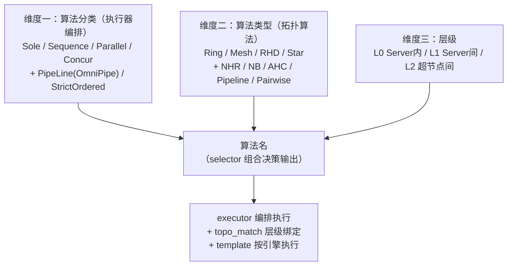

**算法名自带完整信息**：

```
CcuSched AllReduce Parallel Mesh NHR
└──┬───┘ └───┬────┘ └───┬───┘ └┬─┘ └┬┘
 引擎      算子      编排方式  L0拓扑 L1算法
```

| 引擎前缀 | `OpExecuteConfig`（`alg_param.h:133-145`） | 数据通路 |
| --- | --- | --- |
| `Aicpu*` | `AICPU_TS = 2` | AICPU 下发 Task 描述符，TS 调度 |
| `Aiv*` | `AIV = 3` / `AIV_ONLY = 4` | Vector Core 直接执行 |
| `CcuMS*` | `CCU_MS = 5` | CCU + **CcuBuffer** 中转（仅单机） |
| `CcuSched*` | `CCU_SCHED = 6` | CCU 作调度器下发 **UB WQE**，片上内存直传 |
| `Dpu*` | `HOSTCPU = 8`（`alg_parse.cc:894`） | Host CPU 侧 DPU 路径（Send/Recv/BatchSendRecv/Barrier） |

## 2. 组合模型

### 2.1 维度一：算法分类——执行器编排方式

每个命令字（AllGather/AllReduce/Broadcast/Reduce/ReduceScatter/Scatter）按执行器编排方式分类（RFC 0003：5 种常见编排；`alg_parse.cc` 实际支持 7 种 ExecutorType：sole/sequence/parallel/pipeline/concur/strictordered/omnipipe）：

| 编排方式 | 执行器文件 | 语义 | 典型算法名 |
| --- | --- | --- | --- |
| **Sole** | `ins_v2_<op>_sole_executor` | 单算法一次跑完 | `SoleMesh`、`SoleMeshOneShot` |
| **Sequence** | `ins_v2_<op>_sequence_executor` | 串行执行一组算法 | `SequenceMesh2Die`、`SequenceMeshMesh` |
| **Parallel** | `ins_v2_<op>_parallel_executor` | 两维度（层内/层间）并行 | `ParallelMeshNHR` |
| **Concur** | `ins_v2_<op>_concurrent_executor` | 同层内多算法/多链路并发 | `ConcurMeshNHRMultiLink` |
| **PipeLine**（OmniPipe） | `ins_v2_<op>_omnipipe_executor` | 数据切片沿阶段流水 | `PipeLineMeshNHR` |
| **StrictOrdered** | `ins_v2_<op>_order_preserved_executor` | 严格保序执行 | `OrderPreserved*` |

#### 2.1.1 Sole（单算法执行器）

**执行语义**：一个算法模板一次执行完成整个算子语义。CCL Buffer 不分区，整块作为 cclIn 交给模板使用；数据量超过单次容量时按 `loopTimes` 分批循环（尾块单独计算长度）。执行路径：`Orchestrate` → `OrchestrateLoop` → 单模板 `KernelRun`。

**变体**（模板不同、编排不变）：`TwoShotSole`（Mesh 两步收发）、`SoleMesh2Die`（跨 Die）、`SoleMeshOneShot`（一步直达）、`SoleMeshConcur`（单算法编排 + Concur 模板变体）。

**适用场景**：数据量小或拓扑规整（单层即可完成）的场景；也是未指定编排方式时的默认形态（`HCCL_ALGO` 中 `name` 简写等价 `sole{name}`，见 alg_parse.cc:288-294）。

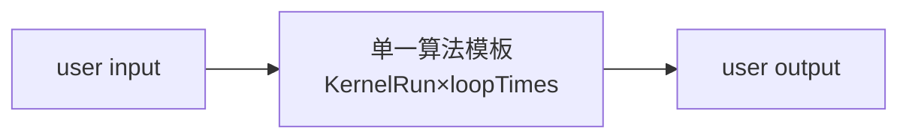

#### 2.1.2 Sequence（顺序执行器）

**执行语义**：串行执行一组算法模板（当前仅支持配置 2 或 3 级；实现上可挂 4 个模板实例 `InsAlgTemplate0~3`），**前级输出即后级输入**。以 AllReduce 四阶段为例（`ins_v2_all_reduce_sequence_executor.cc`）：

1. 框内 ReduceScatter：`ReduceScatterMesh1D`（Level0 拓扑），user input → CCL-OUT
2. 框间 ReduceScatter：`ReduceScatterMesh1dDpu`（Level1 拓扑），CCL-OUT → CCL-OUT
3. 框间 AllGather：`AllGatherNhrDPU`（Level1 拓扑），CCL-OUT → CCL-OUT
4. 框内 AllGather：`AllGatherMesh1D`（Level0 拓扑），CCL-OUT → user output

CCL Buffer 对半分为 **ccl-in/ccl-out** 两区：ccl-in 作模板工作缓冲，ccl-out 作阶段间传递缓冲，阶段间数据交接全部通过 `BufferType::HCCL_BUFFER` 显式声明。变体：`sequence_executor_aicpu`（AICPU 引擎）、`sequence_executor_aicpu_3level`（三级拓扑）。

**适用场景**：层间强依赖的多层级拓扑（先层内归约、再层间汇聚、逐层回填），前一阶段产物作为后一阶段输入时天然匹配。

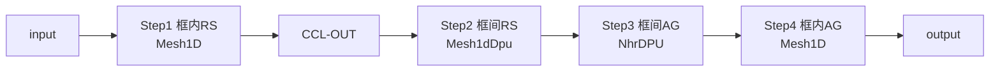

#### 2.1.3 Parallel（两维度并行执行器）

**执行语义**：把数据按比例切分，**层内（intra）/层间（inter）两个维度同一时刻并行**执行各自算法模板（4 个模板实例：两维 × RS/AG 两阶段），两维各自消化自己那份数据。数据切分比例由 `CalcParallelDataSplitRatio`（`REDUCE_SCATTER_WITH_LOCAL_REDUCE` 模式，支持 `multipleDimensionSplitRatio` 用户干预）计算；成本模型对两维带宽做 MAX 聚合。

**线程模型**（`ins_v2_all_reduce_parallel_executor.cc:37-39`）：`main(0)` 总调度 + `intra main(1)` 层内主线程 + `inter main(2)` 层间主线程 + 层内/层间各自的 slave 线程组（`INTRA_SLAVE_START_IDX=3`、`INTER_SLAVE_OFFSET=4`），线程数 = 两维 slave 之和 + 4。

**适用场景**：矩形拓扑（层内层间规模相当）、大数据量——selector 注释"矩形场景大数据量，用 Parallel 并行算法"（`all_reduce_auto_selector.cc:310`），两维链路带宽同时吃满。

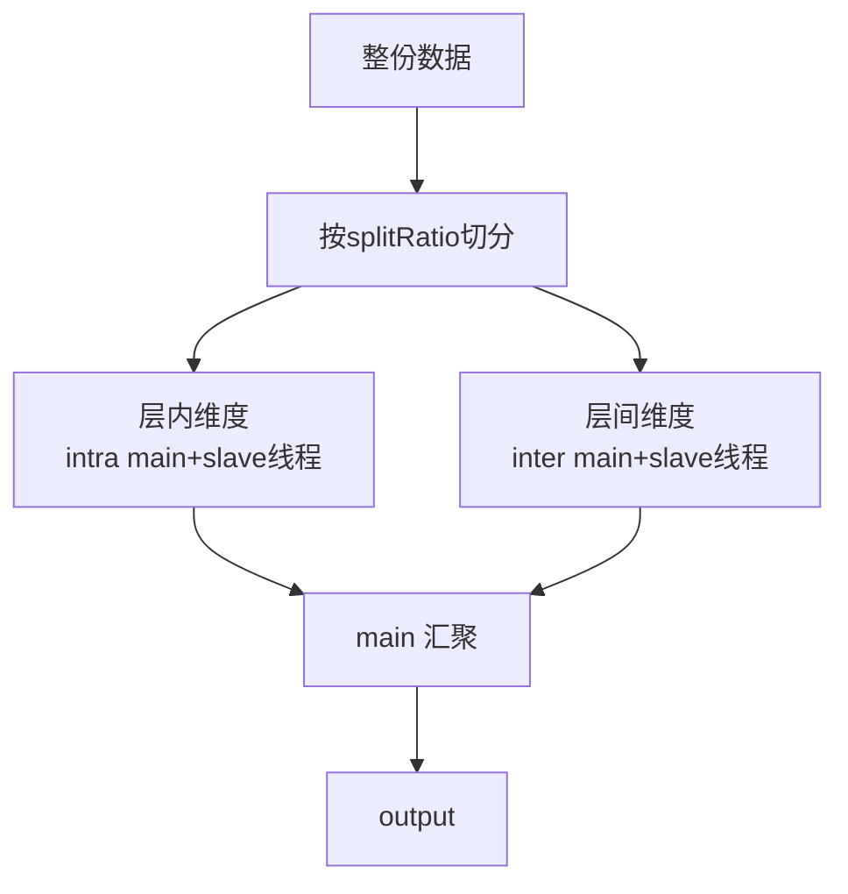

#### 2.1.4 Concur（并发执行器）

**执行语义**：**同一层次内并行执行多个不同算法**（或多链路副本），与 Parallel 的区别：Parallel 切数据到两个拓扑维度，Concur 不分层、在单层内并发多个算法/链路实例。典型实现：`SoleMeshConcur`（Mesh 与 NHR 两算法并发跑同一份数据）、`ConcurMeshNHRMultiLink`（NHR 多链路并发）、`MeshMultiJetty`/`MeshConcur`（多 Jetty、CLOS Z 轴绕路，`CLOS_PORT_NUM=4` 四端口）。

**适用场景**：物理链路多（HCCS 多平面、CLOS 多端口、多 Jetty）而单算法吃不满链路的场景，用多份算法实例把链路利用率打满；对多路径组网（见 [networking/multi_plane.md](/通信与昇腾/参考手册/组网形态/multi_plane.md)）收益明显。

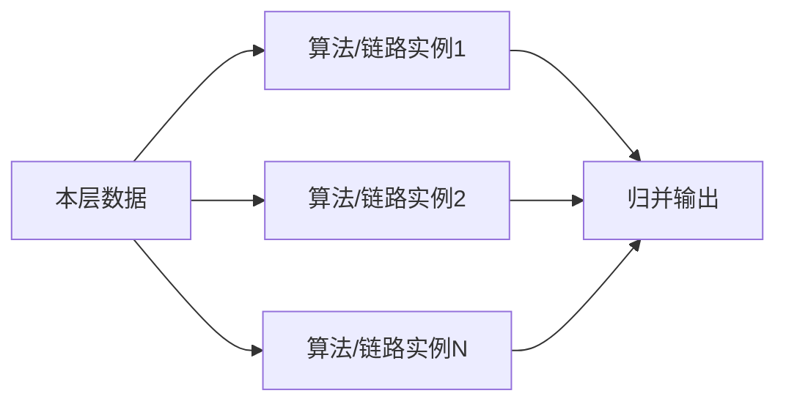

#### 2.1.5 PipeLine / OmniPipe（流水线执行器）

**执行语义**：数据按切片（slice）沿算法阶段**流水推进**：阶段 k 处理第 i 片的同时，阶段 k+1 处理第 i-1 片，收发与计算重叠。切片布局由 `omnipipe_data_slice_calc.h` 统一计算（`OmniPipeSliceParam`/`OmniPipeScratchParam`，含 `outerStepNum/innerStepNum/levelAlgType` 等）；执行器持有两组模板：`InsRsAlgTemplateX/Y/Z`（归约段）与 `InsAgAlgTemplateX/Y/Z`（聚合段），按 2D/3D 维度排布流水（`omnipipe_executor` / `omnipipe_2d_executor`，Reduce 算子另有 `omnipipe_3d`）。RFC 0003 将其执行策略归为 OMNIPIPE（流水交叉）。

**与算法类型 PIPELINE 的区别**：`HCCL_ALGO_TYPE_PIPELINE` 是 Server 间/超节点间可选的**算法类型**（[pipeline.md](/通信与昇腾/参考手册/算法参考/pipeline.md)）；OmniPipe 是**执行器编排**——任何算法类型都可能被编排进流水阶段。

**适用场景**：大数据量（切片填充流水深度）、多层级（2D/3D 模板沿 X/Y/Z 维度铺阶段）场景，隐藏层间时延。

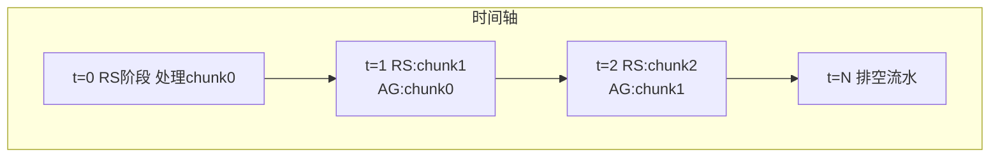

#### 2.1.6 StrictOrdered（严格保序执行器）

**执行语义**：按确定性顺序执行算法阶段，保证同一输入在任意运行下产生字节级一致的通信顺序与归约顺序（确定性计算）。执行器为 `order_preserved_executor` 系列。约束：Atlas A2 系列产品严格确定性计算的保序场景下不建议配置 `HCCL_ALGO` 环境变量（会打破默认保序选择，见 HCCL_ALGO.md 使用约束）。

**适用场景**：严格确定性计算（如重复训练需 bit 级一致）场景。

### 2.2 维度二：算法类型——拓扑算法

| 类型 | 通信模式 | 复杂度 | 详见 |
| --- | --- | --- | --- |
| **Ring**（环） | 首尾相连分块轮转 | 线性步数，带宽满载 | [ring.md](/通信与昇腾/参考手册/算法参考/ring.md) |
| **Mesh**（网状/FullMesh） | 两两直连一步直达 | 常数步，小消息低时延 | [fullmesh.md](/通信与昇腾/参考手册/算法参考/fullmesh.md) |
| **RHD**（递归二分-倍增） | 逐级折半/倍增配对 | 对数步数 | [hdr.md](/通信与昇腾/参考手册/算法参考/hdr.md) |
| **Star**（星型） | 根 rank 汇聚分发 | 1 跳到根，根为热点 | [star.md](/通信与昇腾/参考手册/算法参考/star.md) |

自研扩展：[NHR](/通信与昇腾/参考手册/算法参考/nhr.md)（非均衡层次环）、[NB](/通信与昇腾/参考手册/算法参考/nb.md)（非均匀 Bruck）、[AHC](/通信与昇腾/参考手册/算法参考/ahc.md)（层次化拼接）、[Pairwise](/通信与昇腾/参考手册/算法参考/pairwise.md)（成对，规避一打多）。

### 2.3 维度三：层级（Level0/1/2）

`AlgType`（alg_type.h）是三层组合结构，每个层次独立选算法：

| 层次 | 含义 | 可选算法（枚举） |
| --- | --- | --- |
| **Level0** | Server 内（节点内） | Ring 系（8P/4P/NP 单双环）、Mesh 系（1P/2P/4P/NP）、HD、Star、Pairwise |
| **Level1** | Server 间（节点间） | Ring、HD、Pipeline、NHR、NHR_V1、NB、AHC、AHC_BROKE、Star |
| **Level2** | 超节点间 | Ring、HD、NHR、NB |

例如「节点内 Mesh + 节点间 NHR」即 Level0=Mesh + Level1=NHR；所有层均为 Whole Ring 时退化为单一大环。

### 2.4 组合结果：selector 算法名

`auto_selector`（`src/ops/*/selector/`）按数据量、rank 数、层级拓扑挑选组合，输出算法名：

```
CcuSchedAllReduceParallelMeshNHR   = Parallel 编排 + Mesh 拓扑 + NHR 算法
CcuMSAllReduceSequenceMesh2Die     = Sequence 编排 + Mesh2Die 拓扑
CcuMSAllReduceConcurMeshNHRMultiLink = Concur 编排 + Mesh + NHR 多链路
```

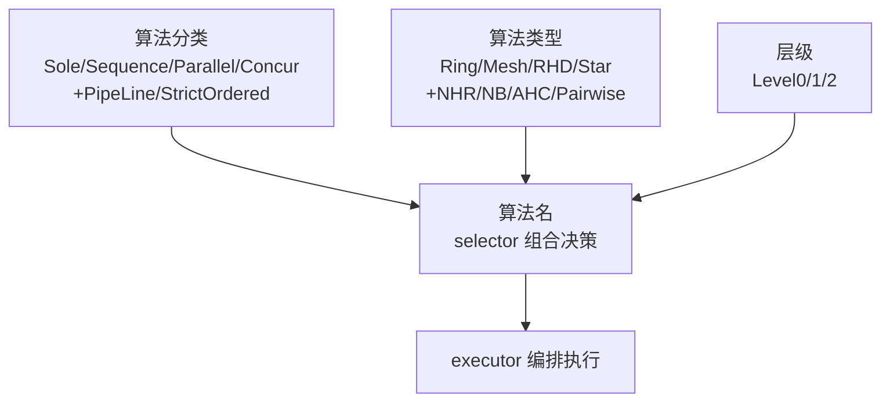

### 2.5 配置语法（HCCL_ALGO）

```bash
# 950 系列：ExecutorType{level算法} 显式组合
export HCCL_ALGO="sequence{mesh,nhr}"              # Sequence 编排：level0=Mesh, level1=NHR
export HCCL_ALGO="not(parallel{mesh,nhr})"         # 禁用 mesh+nhr 的 Parallel 组合
# A2/A3/910 系列：level0 固定 NA，仅配 level1/level2 算法
export HCCL_ALGO="level0:NA;level1:NHR"
export HCCL_ALGO="allreduce=level0:NA;level1:ring" # 按算子配置
```

显式指定后自适应选择（[algo_selector.md](/通信与昇腾/参考手册/算法参考/algo_selector.md)）不再生效；`HcclCommConfig` 的 `hcclAlgo` 参数（通信域粒度）优先于环境变量。

## 3. 分层算法组合（L0/L1/L2 逐算子组合）

> 这是"算法组合"最核心的视角：**一次算子执行 = 对 L0/L1/L2 三层算法的一种组合**。同一个算子（如 AllReduce）在不同层级跑不同的子算法，再由某种**组合方式**（串行/并行/流水/并发）把三层拼接成完整通信。**Pipeline 正是其中一种组合方式**（L0 与 L1 算法流水并行），而非孤立的算法类型。

### 3.1 组合概念

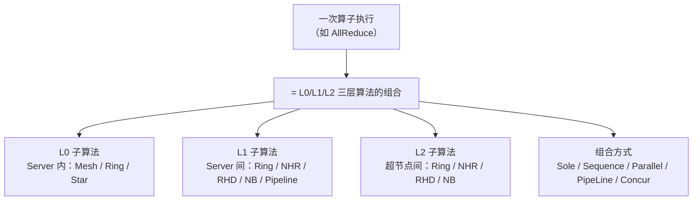

| 组合要素 | 含义 |
| --- | --- |
| **各层子算法** | L0/L1/L2 每层独立选一个拓扑算法（Ring/Mesh/NHR/...），见 §2.3 与 [algo_level_matrix.md](/通信与昇腾/参考手册/算法参考/algo_level_matrix.md) |
| **组合方式** | 三层子算法**如何拼接执行**：串行 / 并行 / 流水 / 并发（即执行器编排，见 §2.1） |
| **组合结果** | selector 输出的算法名（如 `ParallelMeshNHR` = Parallel 组合 + L0 Mesh + L1 NHR） |

### 3.2 五种组合方式（Pipeline 是其中之一）

**组合方式 = 执行器编排**，决定 L0/L1/L2 子算法如何拼接：

| 组合方式 | 如何组合 L0/L1/L2 | 执行器 | 算法名示例 | 详解 |
| --- | --- | --- | --- | --- |
| **Sole（单算法）** | 单一算法/单层一次跑完（不跨层组合） | `sole_executor` | `SoleMesh`、`SoleMeshOneShot` | §2.1.1 |
| **Sequence（串行组合）** | L0→L1→L2 **顺序**执行，前级输出即后级输入 | `sequence_executor` | `SequenceMesh2Die`、`SequenceMeshMesh` | §2.1.2 |
| **Parallel（并行组合）** | 数据切分到**层内/层间两维并行**，各维跑各自子算法 | `parallel_executor` | `ParallelMeshNHR` | §2.1.3 |
| **PipeLine（流水组合）** | L0/L1 子算法**流水并行**、分块重叠（**Pipeline 算法即此组合**） | `omnipipe_executor` | `PipeLineMeshNHR` | §2.1.5、§3.4 |
| **Concur（并发组合）** | **同层内**多算法/多链路并发（不跨层切数据） | `concurrent_executor` | `ConcurMeshNHRMultiLink` | §2.1.4 |

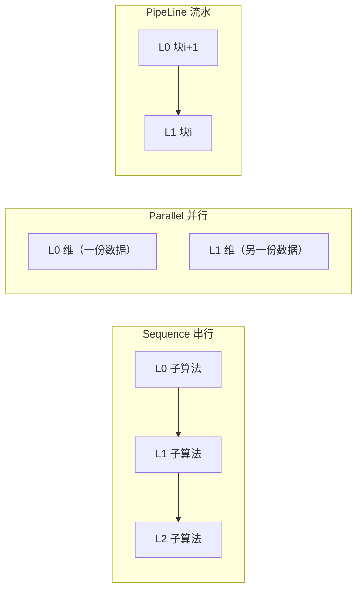

> **关键澄清**：[pipeline.md](/通信与昇腾/参考手册/算法参考/pipeline.md) 的 **算法类型 PIPELINE**（`HCCL_ALGO_TYPE_PIPELINE`）本质就是"L0 Mesh + L1 Ring 的**流水组合**"——它是一种**组合**，与 Sequence/Parallel/Concur 并列；而 **执行器编排 PipeLine/OmniPipe** 是更通用的流水容器（任何子算法都可被编排进流水阶段）。两者的辨析见 [pipeline.md §6](/通信与昇腾/参考手册/算法参考/pipeline.md)。

### 3.3 逐算子 L0/L1/L2 组合总表

各算子的分级组合（Atlas A2 单算子模式两级拓扑，`algo_intro.md` 权威表）——**每个算子对 L0/L1 的组合方式不同**：

| 算子 | 阶段一 | 阶段二 | 阶段三 | 组合逻辑 |
| --- | --- | --- | --- | --- |
| **AllReduce** | L0 内 RS | L1 间 AR | L0 内 AG | 大数据量阶段放高带宽的 Server 内（RS+AR+AG 三段组合） |
| **ReduceScatter** | L1 间 RS | L0 内 RS | — | 先层间后层内：保证 Server 间数据块**连续** |
| **ReduceScatterV** | L1 间 RSV | L0 内 RSV | — | 同 RS |
| **AllGather** | L0 内 AG | L1 间 AG | — | 先层内后层间：保证 Server 间数据块**连续** |
| **AllGatherV** | L0 内 AGV | L1 间 AGV | — | 同 AG |
| **Broadcast** | L0 内 Scatter | L1 间 Broadcast | L0 内 AG | root 先在 Server 内散开 → 跨机广播 → 机内聚合 |
| **Reduce** | L0 内 RS | L1 间 Reduce | L0 内 Gather | 结果仅发 root（Gather 非 AllGather） |
| **Scatter** | L1 间 Scatter | L0 内 Scatter | — | 先层间后层内 |
| **AlltoAll / V / VC** | L0 内 A2A | L1 间 A2A | — | 两级各自全交换 |

> **组合规律**：归约/散布类（RS/Scatter）**先层间后层内**（保证 Server 间数据块连续）；聚合类（AG）**先层内后层间**；AllReduce 把大数据量阶段放高带宽的 Server 内。

三级拓扑（L0+L1+L2）的组合扩展——950 的 **Sequence 执行器四级实例**（AllReduce）：

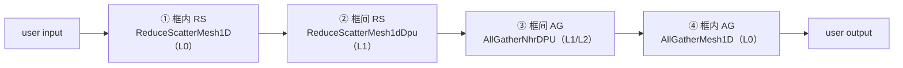

> 即 `L0 Mesh → L1 Mesh → L1/L2 NHR → L0 Mesh` 的四段串行组合（CCL Buffer 对半分 ccl-in/ccl-out 作阶段间传递）。各算子分级编排的完整表见 [algo_level_matrix.md §5](/通信与昇腾/参考手册/算法参考/algo_level_matrix.md)。

### 3.4 Pipeline 组合示例（L0 Mesh + L1 Ring 流水并行）

Pipeline 是"流水组合"的典型：以 AllGather 为例，**L1（Server 间）用 Ring、L0（Server 内）用 FullMesh**，两层链路**并发**：

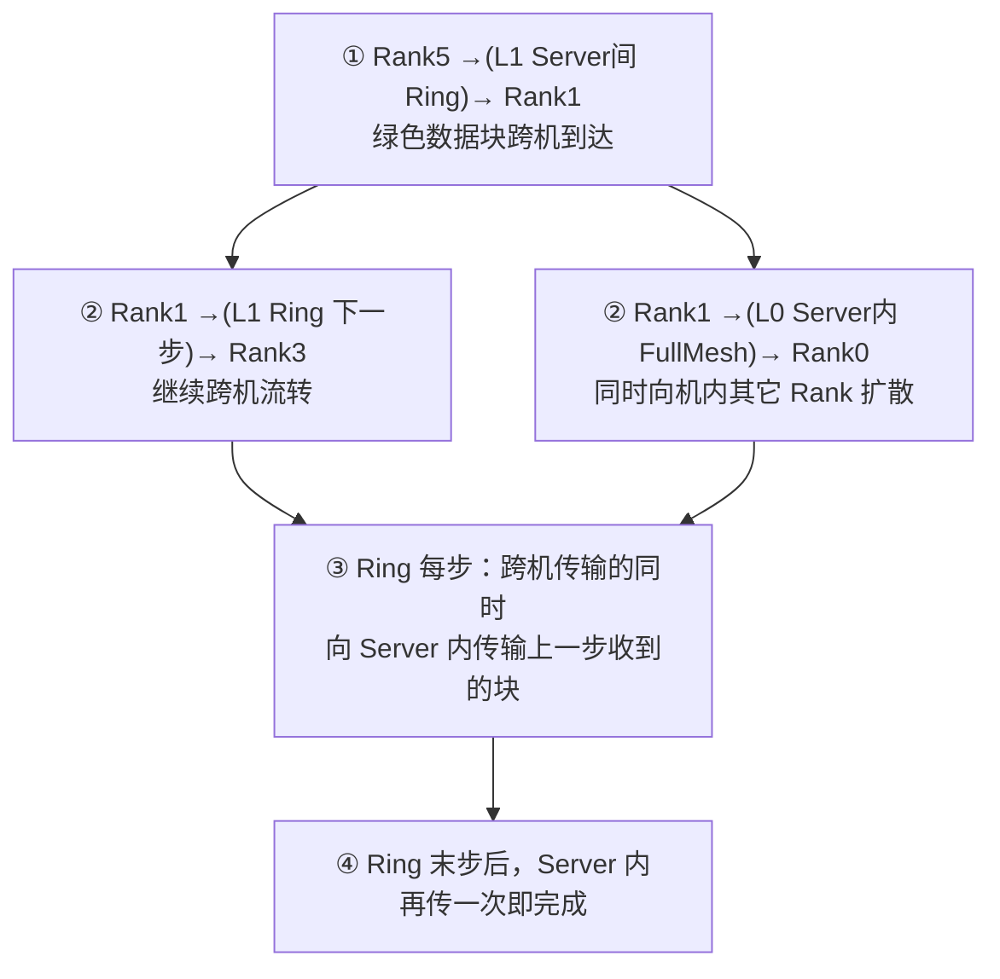

| 组合特征 | 说明 |
| --- | --- |
| **两层并发** | L1 Ring 与 L0 Mesh **同时**用各自链路（相对纯分级算法的核心优势——纯分级时 Server 间传输时 Server 内链路空闲） |
| **流水吸收** | L0 传输**隐藏在 L1 Ring 的每一步中**；初始块的 Server 内传输藏在 Ring 第一步 |
| **耗时** | 每步取 inter/intra 的 **MAX**（两维并行，慢者决定节拍），见 [pipeline.md §3](/通信与昇腾/参考手册/算法参考/pipeline.md) |
| **算法名** | `PipeLineMeshNHR`（流水组合 + L0 Mesh + L1 NHR）、`HCCL_ALGO="level1:pipeline"` |

> 完整的 Pipeline 数据块流转、Rank0 视角任务编排、双链路 α–β 耗时公式见 [pipeline.md](/通信与昇腾/参考手册/算法参考/pipeline.md)。

### 3.5 组合算法名解构

selector 输出的算法名 = **引擎前缀 + 组合方式 + 各层子算法**：

```
CcuSched AllReduce Parallel Mesh NHR
└──┬───┘ └───┬────┘ └───┬───┘ └┬─┘ └┬┘
  引擎      算子      组合方式  L0子算法 L1子算法
```

| 算法名 | 组合解读 |
| --- | --- |
| `ParallelMeshNHR` | Parallel 并行组合：L0=Mesh，L1=NHR |
| `PipeLineMeshNHR` | PipeLine 流水组合：L0=Mesh，L1=NHR |
| `SequenceMesh2Die` | Sequence 串行组合：跨 Die 的 Mesh 分段 |
| `ConcurMeshNHRMultiLink` | Concur 并发组合：Mesh+NHR 多链路并发 |
| `AicpuAllReduceSoleNHR` | Sole 单算法：L1=NHR（AICPU 引擎） |

## 代码位置

`hccl/src/ops/<op>/algorithm/executor/`（各编排执行器，文件名即编排类型）；`hccl/src/common/alg_parse.cc`（ExecutorType 字符串映射，7 种）；`hccl/src/common/alg_type.h`（TagAlgType 三层结构、各层枚举）；`alg_env_config.cc`（HCCL_ALGO 解析）；`src/ops/*/selector/`（auto_selector 组合决策）；`src/ops/op_common/omnipipe_data_slice_calc.h`（流水切片计算）

## 参考资料

- `hccl/docs/zh/rfcs/0003-executor-template-refactor.md`：执行器编排方式权威口径（5 种常见编排）与算法树重构方案
- `hccl/src/common/alg_parse.cc`：ExecutorType 与算法名解析（sole/sequence/parallel/pipeline/concur/strictordered/omnipipe）
- `hccl/src/ops/all_reduce/algorithm/executor/`：各编排执行器实现（线程模型、模板编排、数据流）
- `hccl/docs/zh/user_guide/hccl_env/HCCL_ALGO.md`：ExecutorType 配置语法与各产品支持
- `hccl/docs/zh/architecture/architecture-brief.md`：通信算法族（Ring、Mesh、RHD、Star + 自研）

