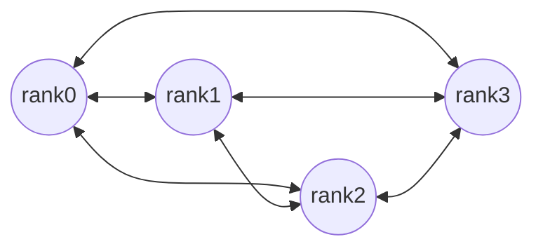

# Mesh / FullMesh（全互联算法）

> **深度参考** · 前置阅读：[《集合通信》第 2 章（Ring）与第 3 章（Tree/选型）](/通信与昇腾/02-ring-allreduce.md)。本篇为参考手册体例，检索导向；事实基线见文首引用块。

> HCCL 通信算法解析。枚举：`HCCL_ALGO_TYPE_FULLMESH`（`hccl/src/common/alg_type.h:24`）；层级枚举 `ALG_LEVEL0_1P_MESH` / `2P_MESH` / `4P_MESH` / `NP_MESH`（名称映射为 `"fullmesh"`）。
> 权威描述：`hccl/docs/zh/user_guide/coll_algo_intro/Mesh.md`。

## 1. 算法描述

Mesh 是 **FullMesh 互联拓扑内的基础算法**，是 NPU 之间的**全连接**——任意两个 NPU 之间可以直接进行数据收发。


> 图源：`hccl/docs/zh/user_guide/coll_algo_intro/figures/mesh.png`

以 AllReduce 为例：**每个 NPU 并发地使用多路 HCCS 链路从对端读取或者写入数据，使双工互联链路的双向带宽同时得到利用。**


> 图源：`hccl/docs/zh/user_guide/coll_algo_intro/figures/mesh_algo_principle.png`



> **与 Ring 的本质区别**：Ring 每卡只连左右邻居（p−1 步），Mesh 两两直连（**1~2 步**）。Mesh 用链路数量换步数，是 L0（Server 内 HCCS 直连）的天然选择。

## 2. 复杂度与特点

| 项 | 值 |
| --- | --- |
| **时间复杂度** | **O(1)**（常数步，与 rank 数无关） |
| **通信步数** | ReduceScatter/AllGather 各 1 步；AllReduce 2 步（OneShot 可 1 步） |
| **链路利用** | 并发使用多路 HCCS 链路，**双工双向带宽同时利用** |
| **时延** | 最低（无多跳累积） |
| **约束** | 规模增大时资源开销（链路/交换/同步）急剧上升，无法组成大规模全连接 |

## 3. 耗时计算（α–β 模型）

| 操作 | 耗时 |
| --- | --- |
| Scatter | $\alpha+\frac{1}{p}n\beta$ |
| Gather | $\alpha+\frac{1}{p}n\beta$ |
| Broadcast | Scatter + AllGather：$2\alpha+\frac{2}{p}n\beta$ |
| Reduce | ReduceScatter + Gather：$2\alpha+\frac{2}{p}n\beta+\frac{p-1}{p}n\gamma$ |
| ReduceScatter | $\alpha+\frac{1}{p}n\beta+\frac{p-1}{p}n\gamma$ |
| AllGather | $\alpha+\frac{1}{p}n\beta$ |
| **AllReduce** | ReduceScatter + AllGather：$2\alpha+\frac{2}{p}n\beta+\frac{p-1}{p}n\gamma$ |

> 对比 Ring 的 AllReduce $2(p-1)\alpha+2\frac{p-1}{p}n\beta+\frac{p-1}{p}n\gamma$：**α 项从 2(p−1) 降到 2**，这是 Mesh 低时延的数学根源。

## 4. 适用场景

- **L0（Server 内）小数据量、低时延**首选——官方口径：Server 内支持 Mesh、Ring、Double-Ring、Star，按硬件拓扑自动选择，**用户无须配置也不支持配置**
- 规模增大后（如 4K rank）Mesh 无法组成全连接，需换 RHD/NHR/NB（见 [hdr.md](/通信与昇腾/参考手册/算法参考/hdr.md)、[nhr.md](/通信与昇腾/参考手册/算法参考/nhr.md)）
- **分组 Full Mesh**（特殊算法）：仅 Atlas A3 的 AlltoAll/AlltoAllV/AlltoAllVC，集群规模较大时以一定并发度分多组完成——超节点内并发度高、时延小，超节点间并发度低（规避"一打多"）。**不支持 HCCL_ALGO 配置**

## 5. 层级与算子支持

| 层级 | 枚举 | 说明 |
| --- | --- | --- |
| **L0** | `ALG_LEVEL0_1P_MESH` / `2P_MESH` / `4P_MESH`（3 个固定 stream）/ `NP_MESH`（服务器内 3~8p 组 Mesh） | 910B（HCCS 使能、非多 Module 异卡数）默认 `NP_MESH`；标卡 2 卡用 `2P_MESH` |
| **L1 / L2** | 无独立 Mesh 枚举 | Server 间通常不用全互联（链路成本高），但 950 的 `Mesh1dDpu` 模板用于框间阶段 |

L0 形状细分（`hccl/src/ops/op_common/inc/alg_param.h:156-167`）：

```cpp
enum class Level0Shape    { CLOS = 0, MESH_1D = 1, MESH_1D_CLOS = 2 };
enum class Level0MeshType { NOT_MESH = 0, SINGLE_DIE = 1, TWO_DIE_REGULAR = 2, TWO_DIE_NOT_REGULAR = 3 };
```

## 6. 950/A5 路径的 Mesh 算法名（selector 实测）

950 系列 selector 按拓扑与数据量输出 Mesh 系算法名（前缀即引擎，见 [../03_L0L1L2分级通信实现原理.md §7.4](/通信与昇腾/参考手册/总览/l0l1l2-principle.md)）：

| 算法名 | 编排 | 选择条件 |
| --- | --- | --- |
| `*SoleMeshOneShot` | Sole | 小数据量**一步直达** |
| `*SoleMeshTwoShot` | Sole | 中数据量**两步收发**（RS + AG） |
| `*SoleMesh` / `*SoleMeshChunk` | Sole | 常规 / 分块 |
| `*SoleMesh2Die` | Sole | 跨 Die（A3 每 NPU 含 2 Die） |
| `*SoleMeshConcur` | Sole + Concur 模板 | 单算法编排 + 并发模板变体 |
| `*SequenceMesh2Die` / `*SequenceMeshMesh` | Sequence | 跨 Die / 两级 Mesh 顺序编排 |
| `*ConcurMeshNHRMultiLink` | Concur | Mesh 与 NHR 多链路并发 |
| `*ParallelMeshNHR` | Parallel | **矩形拓扑大数据量**（层内层间并行） |
| `*PipeLineMeshNHR` | PipeLine | 流水编排 |
| `*SoleMeshMultiJetty` | Sole | 多 Jetty（CLOS 多端口，`CLOS_PORT_NUM=4`） |
| `*SoleMeshSingleChannel` | Sole | 单通道（AlltoAll 族） |

## 7. 代码位置

| 路径 | 内容 |
| --- | --- |
| **910/A2/A3 路径**（`hcomm/src/legacy/ascend910/algorithm/base/alg_template/`） | |
| `temp_all_reduce/all_reduce_mesh_oneshot.cc`、`all_reduce_chunk_mesh.cc`、`all_reduce_mesh_opbase.cc` | AllReduce Mesh（一步直达 / 分块 / opbase） |
| `temp_all_reduce/inc_all_reduce_deter/all_reduce_chunk_mesh_pub.h` | 确定性计算分块 Mesh |
| `temp_reduce_scatter/reduce_scatter_mesh.cc`、`_mesh_atomic.cc`、`_mesh_atomic_opbase.cc`、`_mesh_mix.cc`、`_mesh_mix_single_stream.cc`、`_hccs_sio.cc` | ReduceScatter Mesh 族（原子归约 / 混合链路 / 单 stream / HCCS+SIO） |
| `temp_all_gather/all_gather_mesh.cc`、`_mesh_direct.cc`、`_mesh_atomic.cc`、`_mesh_mix.cc`、`_hccs_sio.cc` | AllGather Mesh 族 |
| `temp_scatter/scatter_mesh.cc`、`temp_gather/gather_mesh.cc` | Scatter / Gather Mesh |
| `temp_alltoallv/alltoallv_direct_fullmesh.cc`、`alltoallv_staged_mesh.cc` | AlltoAllV 直连全互联 / 分级 Mesh |
| **950/A5 路径**（`hccl/src/ops/*/algorithm/template/`） | |
| `*/aicpu/ins_temp_*_mesh_1D*.cc`（含 `_Z_axis_detour`、`_meshchunk`、`_dpu`、`_intra`、`_one_shot`、`_two_shot`） | AICPU 引擎 Mesh1D 模板 |
| `*/aiv/aiv_temp_*_mesh_1D*.cc` + `*/aiv/kernel/aiv_*_mesh_1d*.h`（含 `_superkernel.h`、`_hif8.h`） | AIV 引擎 Mesh1D 模板与 Vector Core kernel |
| `*/ccu/ccu_temp_*_mesh_1D*.cc`（含 `_mem2mem`、`_2die`、`_multi_jetty`）+ `*/ccu/kernel/ccu_kernel_*_mesh1d*.cc` | CCU 引擎 Mesh1D 模板与 CCU kernel |
| `hccl/src/ops/scatter/algorithm/template/scatter_mesh.cc`、`nhr_base.cc` | 950 Scatter Mesh / NHR 基类 |
| `hccl/src/ops/op_common/algorithm/topo_match/topo_match_1d.cc`、`topo_match_ubx_1d.cc` | 1D Mesh 拓扑匹配 |

> 实测：`hccl/src/ops` 下含 `mesh_1D` 的文件 **120 个**、`mem2mem` **114 个**、`2die` **36 个**、`multi_jetty` **20 个**——Mesh 是 950 路径的绝对主力。

## 8. 参考资料

- `hccl/docs/zh/user_guide/coll_algo_intro/Mesh.md`：算法描述、原理图与耗时表（本文主要来源）
- `hccl/docs/zh/user_guide/coll_algo_intro/algo_intro.md`：Server 内算法与分组 Full Mesh 特殊说明
- `hccl/docs/zh/user_guide/coll_algo_intro/RHD.md`：Mesh 在大规模下的局限与 RHD 的动机
- `hccl/src/common/alg_type.h`：`ALG_LEVEL0_*_MESH` 枚举与 `"fullmesh"` 名称映射
- [algo_level_matrix.md](/通信与昇腾/参考手册/算法参考/algo_level_matrix.md)：L0 默认选择规则
- [combination.md](/通信与昇腾/参考手册/算法参考/combination.md)：Mesh 与各执行器编排的组合

