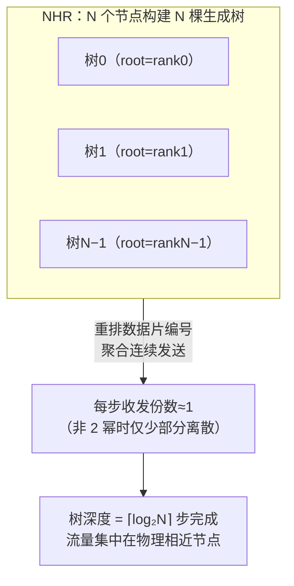

# NHR（Nonuniform Hierarchical Ring，非均衡层次环）

> **深度参考** · 前置阅读：[《集合通信》第 2 章（Ring）与第 3 章（Tree/选型）](/通信与昇腾/02-ring-allreduce.md)。本篇为参考手册体例，检索导向；事实基线见文首引用块。

> HCCL 通信算法解析。枚举：`HCCL_ALGO_TYPE_NHR` / `HCCL_ALGO_TYPE_NHR_V1`（`hccl/src/common/alg_type.h:27-28`）；层级枚举 `ALG_LEVEL1_NHR`、`ALG_LEVEL1_NHR_V1`、`ALG_LEVEL2_NHR`（名称映射 `"NHR"` / `"NHR_V1"`）。
> 权威描述：`hccl/docs/zh/user_guide/coll_algo_intro/NHR.md`。
> **全称纠正**：NHR = **Nonuniform Hierarchical Ring（非均衡的层次环）**，昇腾自研算法。

## 1. 算法描述与动机

**为什么需要 NHR**（官方原文动机，三个已有算法的缺陷）：

| 已有算法 | 缺陷 |
| --- | --- |
| **Ring** | 通信步数与通信节点规模**呈正相关**，规模大时容易出现较大延迟；切分数据块的方式对**小数据包场景不友好**，更适合大数据包传输 |
| **RHD** | 集群规模**不是 2 的整数次幂**时，会引入额外的通信步数和开销，产生 **"N−1 规模集群下的通信性能比 N 规模集群还差"** 的现象 |
| **RHD** | 每个通信阶段的**对象在变化 → 通信链路也变化**，大流量场景可能引起**交换机流量冲突**，导致带宽下降 |

**NHR 的核心思想**：对 N 个节点构建 **N 棵生成树**，通过 N 个生成树构建出最优通信关系。

| 特性 | 说明 |
| --- | --- |
| 树深度（= 通信步数） | $\lceil log_2 N\rceil$ |
| 数据片重排 | 通过**重排数据片编号聚合发送**，保证通信算法的理论性能最优 |
| 流量局部性 | 最大通信流量集中在**物理位置相近的节点之间**，有效利用物理距离带来的性能优势，**减少流量冲突** |
| 规模无关性 | **无论集群规模是否是 2 的幂次**，NHR 都能充分利用链路资源 |
| 小包优化 | 小数据包通信场景进一步优化：**N 个节点仅构建 1 棵树**，减少网络中数据包数量和芯片并发执行的任务数，提升通信效率 |

### 1.1 rank size 为 2 的整数次幂（以 4 rank 为例）

过程中**每一步的收发数据份数均为 1**，因为地址连续的数据切片能够被连续发送。


> 图源：`hccl/docs/zh/user_guide/coll_algo_intro/figures/nhr_algo_4rank_flow.png`

### 1.2 rank size 不是 2 的整数次幂（以 5 rank 为例）

**大部分的数据切片可以连续收发，只有少部分卡间的数据切片是离散的**——这正是"非均衡（Nonuniform）"的含义。


> 图源：`hccl/docs/zh/user_guide/coll_algo_intro/figures/nhr_algo_5rank_flow.png`



## 2. 复杂度与特点

| 项 | 值 |
| --- | --- |
| **时间复杂度** | $O(\lceil log_2 N\rceil)$——**2 的整数次幂与非 2 的整数次幂均如此** |
| **通信次数** | $\lceil log_2 p\rceil$ |
| **每步数据量** | ReduceScatter 第一步交换 n/2，**每次通信数据量减半**，最后一步交换 1 份；AllGather 收发关系完全相反 |
| **时延** | 相对低 |
| **拓扑适配** | 同样适用于"星型"或"胖树"拓扑互联 |
| **相对 RHD 的优势** | 非 2 幂无额外开销；链路稳定不引起交换机流量冲突 |

## 3. 耗时计算（α–β 模型）

| 操作 | 耗时 |
| --- | --- |
| ReduceScatter | $\lceil log_2 p\rceil\alpha+\frac{p-1}{p}n\beta+\frac{p-1}{p}n\gamma$ |
| AllGather | 同 ReduceScatter，无 γ 部分：$\lceil log_2 p\rceil\alpha+\frac{p-1}{p}n\beta$ |
| **AllReduce** | ReduceScatter + AllGather：$2\lceil log_2 p\rceil\alpha+2\frac{p-1}{p}n\beta+\frac{p-1}{p}n\gamma$ |
| Scatter | $\lceil log_2 p\rceil\alpha+\frac{p-1}{p}n\beta$ |
| Broadcast | Scatter + AllGather：$2\lceil log_2 p\rceil\alpha+2\frac{p-1}{p}n\beta$ |

> **对比 RHD 非 2 幂的 AllReduce** $(2\lfloor log(p)\rfloor+2)\alpha+(2\frac{p'-1}{p'}+2)n\beta+(\frac{p'-1}{p'}+1)n\gamma$：NHR 少了"合并 part1 + 恢复 part1"的两次额外 n 量级通信（$\alpha$ 项少 2、$\beta$ 项少约 2n），这就是"N−1 规模不再比 N 规模差"的数学体现。

## 4. 适用场景（官方口径）

适合**通信域内 Server 个数较多且 Pipeline 算法不适用**的场景。

| 产品 | NHR 地位 |
| --- | --- |
| **950PR&950DT** | **唯一的自适应算法**（Ring/H-D_R 均由 NHR 自动接管） |
| **Atlas A3** | L2 默认算法；**NHR-HCF** 处理非对称超节点 |
| **910_93** | L1 的 H-D_R 结果被替换为 NHR |

### 4.1 NHR-HCF（NHR Highest Common Factor，最大公约数算法）

| 项 | 说明 |
| --- | --- |
| 适用产品 | **仅 Atlas A3 系列** |
| 生效条件 | 超节点间 **Server 数不一致但 Server 内卡数一致**时**默认生效** |
| 可否配置 | **不支持** `HCCL_ALGO` 配置 |
| 原理 | 通过计算超节点间 Server 数的**最大公约数**，将通信域切分为多个**对称分布的逻辑超节点**，并基于新的逻辑拓扑形态选择通信算法 |
| 收益场景 | "超节点间 Server 数的**最大公约数大于 1**"时相对收益更好 |
| 代码关联 | `hcomm/src/coll_communicator_mgr/rank_graph/rank_graph_builder/updater_for_64_plus_1.cc`、`alg_param.h:264 multiSuperPodDiffServerNumMode`（超节点间 Server 数不一致） |

## 5. 层级与算子支持

| 层级 | 枚举 | 说明 |
| --- | --- | --- |
| **L0** | 无独立 NHR 枚举 | 但 950 的 `Mesh1dDpu`/`NhrDPU` 模板用于框内/框间阶段拼接 |
| **L1** | `ALG_LEVEL1_NHR`、`ALG_LEVEL1_NHR_V1` | NHR_V1 为上一代实现，**逐步停用，建议用 NHR** |
| **L2** | `ALG_LEVEL2_NHR` | **代码 default 分支选 NHR**（`scatter.cc` `SetAlgoLevel2` 注释"Level2默认选择NHR算法"） |

算子支持度（`inter_server_algo_support.md`）：

| 产品 | 支持 NHR 的算子 |
| --- | --- |
| **950PR&950DT** | RS、AG、AR、Bcast、Reduce、Scatter（**唯一自适应算法**） |
| Atlas A3 / A2 | RS、AG、AR、Bcast、RSV、Scatter、AGV |
| Atlas 训练系列 | RS、AG、AR、Bcast |
| **NHR_V1** | A2 / Atlas 训练系列：RS、AG、AR、Bcast（逐步停用） |

## 6. 代码位置

### 6.1 910/A2/A3 路径（`hcomm/src/legacy/ascend910/algorithm/base/alg_template/`）

| 文件 | 内容 |
| --- | --- |
| `nonuniform_hierarchical_ring_base.cc` / `.h` / `_pub.h` | **NHR 算法基类**（N 棵生成树构造、数据片重排） |
| `nonuniform_hierarchical_ring_v1_base.cc` / `.h` / `_pub.h` | **NHR_V1 基类**（上一代） |
| `temp_all_reduce/all_reduce_nhr.cc`、`all_reduce_nhr_oneshot.cc` | AllReduce NHR（含一步直达） |
| `temp_reduce_scatter/reduce_scatter_nhr.cc`、`reduce_scatter_nhr_v1.cc` | ReduceScatter NHR / NHR_V1 |
| `temp_all_gather/all_gather_nhr.cc`、`all_gather_nhr_v1.cc` | AllGather NHR / NHR_V1 |
| `temp_broadcast/broadcast_nhr.cc`、`broadcast_nhr_oneshot.cc`、`broadcast_nhr_v1.cc` | Broadcast NHR 族 |
| `temp_scatter/scatter_nhr.cc` | Scatter NHR |
| `temp_reduce/reduce_nhr_oneshot.cc` | Reduce NHR 一步直达 |

### 6.2 950/A5 路径（`hccl/src/ops/`）

| 文件 | 内容 |
| --- | --- |
| `*/algorithm/template/aicpu/ins_temp_all_gather_nhr.cc`、`ins_temp_all_gather_nhr_dpu.cc` | AllGather NHR（AICPU / DPU 框间） |
| `*/aicpu/ins_temp_all_reduce_nhr.cc`、`ins_temp_all_reduce_aicpu_reduce_nhr.cc` | AllReduce NHR（含 AICPU 归约） |
| `*/aicpu/ins_temp_reduce_scatter_nhr.cc`、`ins_temp_reduce_scatter_aicpu_reduce_nhr.cc`（+`_pcie`） | ReduceScatter NHR（含 PCIe 变体） |
| `*/aicpu/ins_temp_scatter_nhr.cc`、`ins_temp_scatter_nhr_dpu_inter_node.cc` | Scatter NHR（跨节点 DPU） |
| `*/aicpu/reduce_nhr.cc`、`reduce_aicpu_reduce_nhr.cc` | Reduce NHR |
| `*/aicpu/ins_temp_barrier_nhr_aicpu.cc`、`ins_temp_barrier_nhr_dpu.cc` | Barrier NHR |
| `*/aicpu/ins_temp_*_omnipipe_nhr*.cc` | NHR 的 OmniPipe 流水变体 |
| `*/ccu/ccu_temp_*_nhr_1D_mem2mem.cc`、`*_nhr_mem2mem_1D_multi_jetty.cc` + `*/ccu/kernel/ccu_kernel_*_nhr1d*.cc` | CCU 引擎 NHR（mem2mem / 多 Jetty） |
| `*/ccu/ccu_temp_*_concurrent_mesh_nhr.cc` | **Mesh + NHR 并发**模板（Concur 编排） |
| `scatter/algorithm/template/scatter_nhr.cc`、`nhr_base.cc` | 950 Scatter NHR 与基类 |
| `op_common/algorithm/template/wrapper/dpu_alg_nhr_opt_wrapper.cc` | **NHR 优化包装器**（DPU 路径） |
| `*/selector/*_auto_selector.cc` | `Aicpu*SoleNHR`、`*SoleNHRMultiLink`、`*ParallelMeshNHR`、`*PipeLineMeshNHR`、`*ConcurMeshNHRMultiLink`、`*SequenceMeshConcurNHR(NHR)` 等算法名 |

> 实测：`hccl/src/ops` 下含 `nhr` 的文件 **110 个**——NHR 是 950 路径与 Mesh 并列的两大主力算法。

### 6.3 NHR 在算法名中的组合形态

| 算法名模式 | 含义 |
| --- | --- |
| `SoleNHR` | 单算法 NHR 一次跑完 |
| `SoleNHRMultiLink` | NHR 多链路（多 plane / 多 Jetty） |
| `SoleNHRAicpuReduce` | NHR 通信 + AICPU 侧归约 |
| `ParallelMeshNHR` | **L0 Mesh × L1 NHR 两维并行**（矩形拓扑大数据量） |
| `ParallelNHRNHR` | L0 NHR × L1 NHR 两维并行 |
| `PipeLineMeshNHR` / `PipeLineMeshNHRNHR` | Mesh + NHR 流水编排（三级） |
| `ConcurMeshNHRMultiLink` | Mesh 与 NHR 多链路**并发** |
| `SequenceMeshConcurNHR` | 顺序编排中嵌入 Mesh+NHR 并发阶段 |
| `AllGatherNhrDPU` | 框间（DPU）AllGather NHR 阶段 |

## 7. 配置

```bash
export HCCL_ALGO="level0:NA;level1:NHR"
export HCCL_ALGO="allreduce=level0:NA;level1:NHR"
# 950 系列：执行器编排 + 层级算法
export HCCL_ALGO="parallel{mesh,nhr}"
export HCCL_ALGO="sequence{mesh,nhr}"
export HCCL_ALGO="not(parallel{mesh,nhr})"    # 禁用该组合
```

## 8. 参考资料

- `hccl/docs/zh/user_guide/coll_algo_intro/NHR.md`：算法描述、4/5 rank 流程图与耗时表（本文主要来源）
- `hccl/docs/zh/user_guide/coll_algo_intro/algo_intro.md`：适用场景与 NHR-HCF 特殊说明
- `hccl/docs/zh/user_guide/hccl_env/HCCL_ALGO.md`、`inter_server_algo_support.md`、`inter_superpod_algo_support.md`
- `hcomm/src/legacy/ascend910/algorithm/base/alg_template/nonuniform_hierarchical_ring_base.h`：NHR 基类实现
- `hccl/src/ops/op_common/algorithm/template/wrapper/dpu_alg_nhr_opt_wrapper.cc`：950 NHR 优化
- [hdr.md](/通信与昇腾/参考手册/算法参考/hdr.md)：NHR 改进的对象；[nb.md](/通信与昇腾/参考手册/算法参考/nb.md)：同为对数复杂度的另一自研路线
- [algo_level_matrix.md](/通信与昇腾/参考手册/算法参考/algo_level_matrix.md)：L1/L2 默认选择与产品支持度

