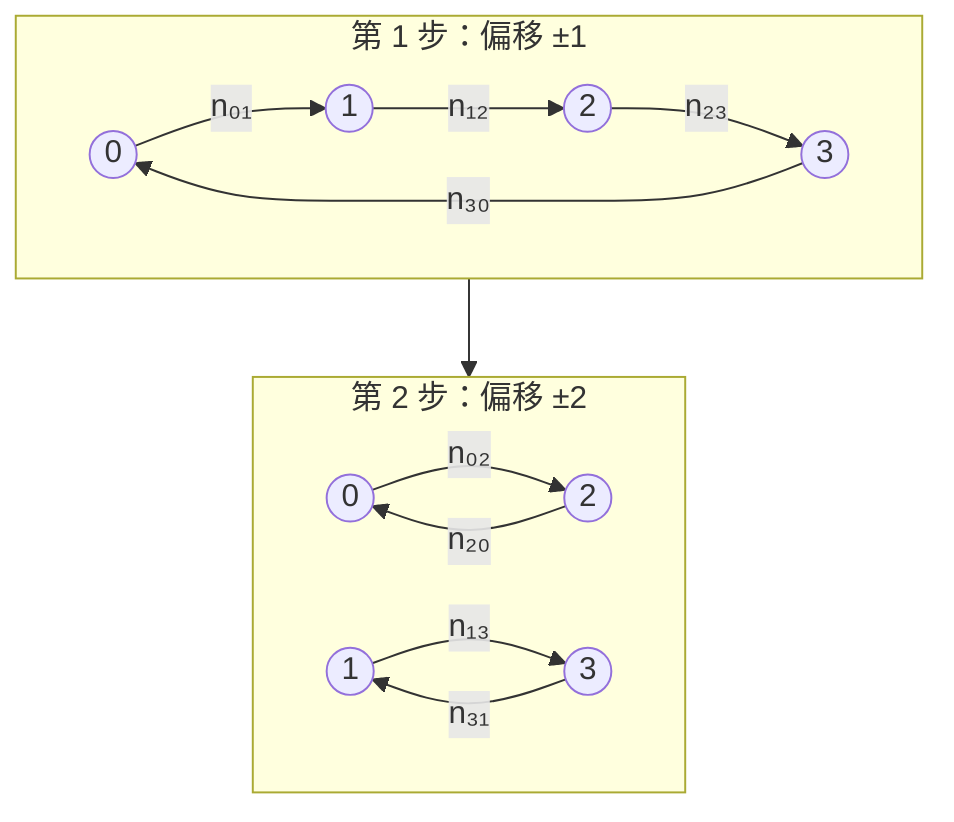

# Pairwise（逐对通信算法）

> **深度参考** · 前置阅读：[《集合通信》第 2 章（Ring）与第 3 章（Tree/选型）](/通信与昇腾/02-ring-allreduce.md)。本篇为参考手册体例，检索导向；事实基线见文首引用块。

> HCCL 通信算法解析。枚举：`HCCL_ALGO_TYPE_PAIRWISE`（`hccl/src/common/alg_type.h:26`）；层级枚举 `ALG_LEVEL0_PAIRWISE`（名称映射 `"pairwise"`）。
> 权威描述：`hccl/docs/zh/user_guide/coll_algo_intro/Pairwise.md`。

## 1. 算法描述与动机

### 1.1 问题：Mesh 做 AllToAll 的"多打多"

通常每个节点只有一个 RDMA 网口。如果在 RDMA 链路上使用 **Mesh 算法完成 AllToAll**，存在同时从多个节点接收数据、向多个节点发送数据的**"多打多"问题**——多个流在同一条链路上肆意争抢资源，**可能反而导致整体性能下降**。

### 1.2 解决：Mesh 的分步执行版本

**Pairwise 算法是 Mesh 算法的分步执行版本**，通过合理的规划，将通信分解成多个步骤，**每一步只从一个节点接收数据、向一个节点发送数据**。

对于 rankid 为 i 的节点：

| 步骤 | 接收来源 | 发送目标 |
| --- | --- | --- |
| 第 1 步 | 节点 i−1 | 节点 i+1 |
| 第 2 步 | 节点 i−2 | 节点 i+2 |
| 第 k 步 | 节点 i−k | 节点 i+k |
| … | 以此类推 | 以此类推 |


> 图源：`hccl/docs/zh/user_guide/coll_algo_intro/figures/pairwise.png`



> **关键**：每一步全网所有节点**同时**收发，但每个节点在该步**只有 1 个发送对端 + 1 个接收对端**——链路不争抢，这就是"规避一打多"的实现方式。

### 1.3 与 Mesh / Ring 的关系

| 算法 | 每步对端数 | 步数 | 定位 |
| --- | --- | --- | --- |
| **Mesh** | p−1 个（同时向所有对端收发） | 1 | 一步直达，但 RDMA 链路上"多打多" |
| **Pairwise** | **1 个**（严格逐对） | p−1 | **Mesh 的分步执行版本** |
| **Ring** | 1 个（固定左右手卡） | p−1 | 步数同 Pairwise，但对端**固定**；Pairwise 对端按偏移 k **轮转** |

> Pairwise 与 Ring 都是 p−1 步、每步 1 对端，区别在于：Ring 的对端永远是左右邻居（数据需多跳累积），Pairwise 的对端按 k 递增轮转（**每步都是直达目标 rank**，无多跳）。因此 Pairwise 天然适配 AlltoAll 的"每 rank 都要给每 rank 发一份"语义。

## 2. 复杂度与特点

| 项 | 值 |
| --- | --- |
| **时间复杂度** | 线性（p−1 步） |
| **通信步数** | 较多 |
| **时延** | 相对**高** |
| **核心优势** | **避免网络中出现"一打多"现象**（指一个 rank 通过同一个端口给多个 rank 发送数据） |
| **每步并发度** | 全网 p 个节点同时各收发 1 笔，链路无争抢 |

## 3. 耗时计算（α–β 模型，非均匀数据量版）

Pairwise 的耗时公式与其他算法不同——它显式建模了**每对 rank 间不等长的数据量** $n_{ij}$（这正是 AlltoAllV 变长语义所需）：

定义节点 i 需要给节点 j 发送的数据大小为 $n_{ij}$。

| 粒度 | 耗时 |
| --- | --- |
| **第 k 步** | 节点 i 发送大小为 $n_{i,i+k}$ 的数据给节点 i+k，则第 k 步耗时为：$\alpha+\beta\cdot\max_i(n_{i,i+k})$ |
| **整个 Pairwise** | $(p-1)\alpha+\beta\cdot\sum_k\max_i(n_{i,i+k})$ |

> **公式解读**：每步耗时由该步**最慢的那一对**决定（$\max_i$），因此 Pairwise 的性能对**数据量倾斜敏感**——若某步中存在一个特别大的 $n_{i,i+k}$，该步整体被拖慢。这是 EP（专家并行）场景下 AlltoAllV 负载不均衡时 Pairwise 性能波动的数学根源。

## 4. 适用场景（官方口径）

| 项 | 说明 |
| --- | --- |
| **适用算子** | **仅用于 AlltoAll、AlltoAllV 与 AlltoAllVC 三个算子** |
| **适用场景** | 通信**数据量较大**、需要**规避网络一打多现象**的场景 |
| **产品支持** | Atlas A3 与 Atlas A2 的 AlltoAll 族；950PR&950DT 与 Atlas 训练系列不支持 |
| **回退关系** | **CP 算法**（仅 A2 的 AlltoAllV，单算子模式）**不支持时回退 Pairwise** |

### 4.1 相关特殊算法：分组 Full Mesh

| 项 | 说明 |
| --- | --- |
| 适用 | **仅 Atlas A3** 的 AlltoAll / AlltoAllV / AlltoAllVC |
| 原理 | 集群规模较大时，以一定的**并发度分多组**完成通信——**超节点内并发度高、时延小；超节点间并发度低、时延相对较高（以避免网络中出现一打多现象）** |
| 配置 | **不支持** `HCCL_ALGO` 配置 |
| 与 Pairwise 关系 | 两者都为规避"一打多"，但分组 Full Mesh 是**分组内 Mesh + 组间低并发**的折中，Pairwise 是**严格逐对** |

## 5. 层级支持

| 层级 | 枚举 | 说明 |
| --- | --- | --- |
| **L0** | `ALG_LEVEL0_PAIRWISE` | 唯一有 Pairwise 枚举的层级 |
| **L1 / L2** | 无独立枚举 | 但 `inter_server_algo_support.md` 中 Pairwise 列在 Server 间支持列表（A2/A3 的 AlltoAll 族）——通过算子模板而非层级枚举生效 |

## 6. 代码位置

| 路径 | 内容 |
| --- | --- |
| `hccl/src/ops/all_to_all_v/algorithm/template/aicpu/ins_temp_all_to_all_v_pairwise.cc` / `.h` | **950/A5 路径 AlltoAllV Pairwise 模板**（hccl 仓唯一 Pairwise 模板） |
| `hcomm/src/legacy/ascend910/algorithm/base/alg_template/temp_alltoallv/alltoallv_pairwise.cc` | AlltoAllV Pairwise（910/A2/A3 路径） |
| `.../temp_alltoallv/alltoallv_staged_pairwise.cc` | **AlltoAllV 分级 Pairwise**（staged = 经 CCL Buffer 中转） |
| `.../temp_alltoall/allltoall_pipeline_mesh_pairwise_ccl_enough.cc` | **Mesh + Pairwise 流水（CCL Buffer 充足）** |
| `.../temp_alltoall/allltoall_pipeline_mesh_pairwise_ping_pong.cc` | **Mesh + Pairwise 流水（乒乓缓冲）** |
| `hccl/src/common/alg_type.h:26,49` | `HCCL_ALGO_TYPE_PAIRWISE`、`ALG_LEVEL0_PAIRWISE` |
| `hccl/src/ops/all_to_all_v/selector/alltoall_auto_selector.cc`、`alltoallv_auto_selector.cc`、`alltoallvc_auto_selector.cc` | 输出 `AicpuAllToAllSolePairwise`、`AicpuAllToAllVSolePairwise`、`AicpuAllToAllVCSolePairwise` |

> **注意**：Pairwise 在 hccl 仓只有 **2 个文件**（对比 mesh_1D 的 120 个、nhr 的 110 个）——与其"仅 3 个 AlltoAll 算子使用"的窄适用范围一致。

### 6.1 Pairwise 在算法名中的形态

| 算法名 | 引擎 | 说明 |
| --- | --- | --- |
| `AicpuAllToAllSolePairwise` | AICPU_TS | AlltoAll 逐对 |
| `AicpuAllToAllVSolePairwise` | AICPU_TS | AlltoAllV 逐对 |
| `AicpuAllToAllVCSolePairwise` | AICPU_TS | AlltoAllVC 逐对 |

> 三个 AlltoAll 变体的 Pairwise 均为 **Sole 编排**（单算法一次跑完），无 Sequence/Parallel/Concur 组合——因为 Pairwise 本身就是 p−1 步的完整方案，无需再分层编排。

## 7. 配置

```bash
export HCCL_ALGO="alltoallv=level0:pairwise"
```

> 仅 Atlas A2 / A3 的 AlltoAll 族生效。

## 8. 参考资料

- `hccl/docs/zh/user_guide/coll_algo_intro/Pairwise.md`：算法描述、"多打多"动机与 $n_{ij}$ 耗时表（本文主要来源）
- `hccl/docs/zh/user_guide/coll_algo_intro/algo_intro.md`：适用算子约束（仅 AlltoAll 族）与分组 Full Mesh 特殊说明
- `hccl/docs/zh/user_guide/hccl_env/inter_server_algo_support.md`：A2/A3 的 AlltoAll 族支持 Pairwise；CP 算法回退 Pairwise
- `hccl/src/ops/all_to_all_v/algorithm/template/aicpu/ins_temp_all_to_all_v_pairwise.cc`：950 路径实现
- [fullmesh.md](/通信与昇腾/参考手册/算法参考/fullmesh.md)：Pairwise 是 Mesh 的分步执行版本
- [../operators/all_to_all_v.md](/通信与昇腾/参考手册/算子参考/all_to_all_v.md)：AlltoAll/V/VC 算子解析
- ../ep/01_专家并行通信概述.md：EP Dispatch/Combine 的 AlltoAllv 通信内核

