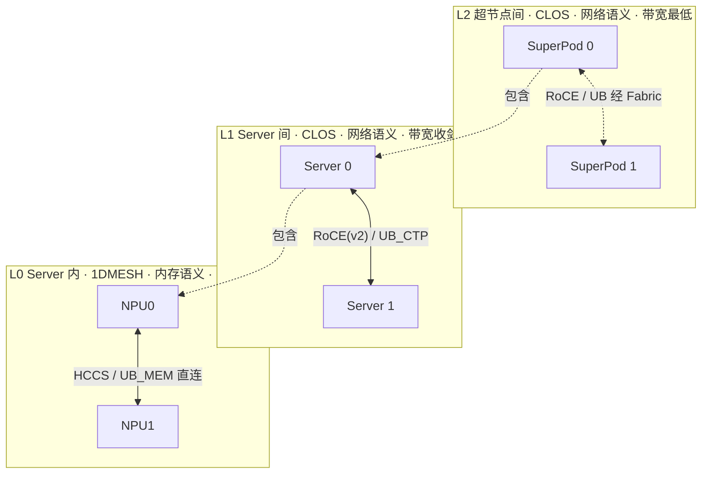

# networking：物理组网形态

> **深度参考** · 前置阅读：[《集合通信》第 5 章｜拓扑、分层与重叠](/通信与昇腾/05-topology-hierarchical-overlap.md)。本篇为参考手册体例，检索导向；事实基线见文首引用块。

> **卡怎么连**（物理层）。本目录收录昇腾集群的各**物理组网形态**细节——从 Server 内直连到跨超节点互联，每种组网对应特定的层级、协议、语义与算法选择。
>
> 集群组网的**总入口与 RankGraph 建模**（基本概念、拓扑模型、配置文件字段映射、五套 rank table 对比）见 [../04_昇腾集群组网总览.md](/通信与昇腾/参考手册/总览/cluster-topology.md)（已上移至根目录，与本目录平级）；本目录是其**物理形态分册**。
>
> 事实来源（可信度：代码 > 仓内文档 > 社区资料）：
> `hcomm/include/hccl/hccl_rank_graph.h`、`hcomm/include/hcomm_res_defs.h`、`hcomm/src/coll_communicator_mgr/rank_graph/`、`hcomm/src/legacy/ascend950/framework/topo/`、`hccl/src/ops/op_common/inc/alg_param.h`、`hccl/docs/zh/user_guide/cluster_info_config/`（A2/A3/A5/910/300I Duo 五套配置）。

---

## 1. 层级模型：L0 / L1 / L2

集群天然分层，通信质量逐层递增而递减（层号越小越快）：

| 层级 | 物理范围 | 典型链路 | 通信语义 | 详见 |
| --- | --- | --- | --- | --- |
| **L0** | Server 内 | HCCS / UB_MEM / PCIe / SIO | 内存语义 | [server_internal.md](/通信与昇腾/参考手册/组网形态/server_internal.md) |
| **L1** | Server 间 | RoCE(v2) / UB_CTP 经交换机 | 网络语义 | [roce_cluster.md](/通信与昇腾/参考手册/组网形态/roce_cluster.md)、[ub_superpod.md](/通信与昇腾/参考手册/组网形态/ub_superpod.md) |
| **L2** | 超节点间 | RoCE / UB 族经 Fabric | 网络语义 | [ub_superpod.md](/通信与昇腾/参考手册/组网形态/ub_superpod.md) |

---

## 2. 六种组网形态

> 图源：`hccl/docs/zh/user_guide/figures/typical_network.png`

| 文档 | 组网 | 层级 / 协议 | 拓扑类型 |
| --- | --- | --- | --- |
| [server_internal.md](/通信与昇腾/参考手册/组网形态/server_internal.md) | **单服务器组网** | **L0** · HCCS/UB_MEM/PCIe/SIO | `1DMESH` |
| [roce_cluster.md](/通信与昇腾/参考手册/组网形态/roce_cluster.md) | **服务器间 RoCE 组网** | **L1** · RoCE(v2) | `CLOS` |
| [ub_superpod.md](/通信与昇腾/参考手册/组网形态/ub_superpod.md) | **UB 超节点组网** | **L1 + L2** · UB_CTP/UB_RTP/UBoE | `CLOS` |
| [multi_plane.md](/通信与昇腾/参考手册/组网形态/multi_plane.md) | **多平面组网** | 跨层 · `plane_id` | `CLOS` |
| [hierarchical.md](/通信与昇腾/参考手册/组网形态/hierarchical.md) | **层次化混合组网** | **L0 × L1 × L2** 组合 | 混合 |
| [board_form_factor.md](/通信与昇腾/参考手册/组网形态/board_form_factor.md) | **整机形态**（与拓扑正交） | — | — |

---

## 3. 文档索引

| 文档 | 内容 |
| --- | --- |
| [server_internal.md](/通信与昇腾/参考手册/组网形态/server_internal.md) | **单服务器组网（L0）**：HCCS/UB_MEM/PCIe/SIO 直连 1DMesh、内存语义、A3 的 2-Die rank 粒度、**DCMI 链路类型探测（9 值）**、`TopoType` 12 值、L0 算法自动选择规则与决策流程图、950 Mesh 族细选、L0 引擎选择、950/A2 配置示例 |
| [roce_cluster.md](/通信与昇腾/参考手册/组网形态/roce_cluster.md) | **服务器间 RoCE 组网（L1）**：以太 RDMA(v2) 经交换机 CLOS、"同号卡"概念、**RoCE Channel 模型（Channel/QP/Notify）**、建链要求、L1 数据面 Profiling 实测形态、L1 算法枚举与默认规则、**CLOS 软件适配（多端口/多 Jetty/Z 轴绕路/多 QP）**、RDMA 调优、故障诊断错误码 |
| [ub_superpod.md](/通信与昇腾/参考手册/组网形态/ub_superpod.md) | **UB 超节点组网（L1 + L2）**：灵衢总线交换设备、**UB 协议族（CTP/RTP/UBoE/MEM）**、HCCP 协议适配层、**CCU + URMA 硬化通路**、`AlgTypeLevel2` 枚举、**非对称难题两专用算法（NHR-HCF/AHC）**、**借轨通信完整机制**、逻辑超节点划分（`HCCL_LOGIC_SUPERPOD_ID`）、A3 超节点 rank table（v1.2）与 950 建模 |
| [multi_plane.md](/通信与昇腾/参考手册/组网形态/multi_plane.md) | **多平面组网**：每卡多网口多对等 Plane、**`plane_id` 配置表达与端口映射约束**、Endpoint 与平面的 RankGraph 关系、带宽聚合与故障隔离、软件适配（`MultiJetty`/`MultiLink` 后缀、20 个 CCU 多 Jetty 模板、Concur 编排）、相关环境变量、诊断与可靠性 |
| [hierarchical.md](/通信与昇腾/参考手册/组网形态/hierarchical.md) | **层次化混合组网**：Module × Server × SuperPod × AZ 多级嵌套、**RFC 0003 的 4 层拓扑权威口径**、旧架构代码膨胀问题与重构收益、嵌套编排的 `AlgoExecDesc` 表达、层级容量常量、**层级信息核心结构（`NetLayerDetails`/`TopoInstDetails`/`PhysicalLevelInfo`）**、`PhysicalLevelView` LOCAL vs GLOBAL、**13 个 topo_match 匹配器**、层级信息流转全链路 |
| [board_form_factor.md](/通信与昇腾/参考手册/组网形态/board_form_factor.md) | **整机形态与 Mainboard ID**（与组网拓扑**正交**维度）：POD / A+K Server / A+X Server / PCIE 标卡 / 装备 / EVB 的 bit[7:5] 编码、**标卡专有逻辑**（判定、L0 算法分支、`TOPO_TYPE_NP_SINGLE_RING`、引擎约束、UB 互通档位）、Server/POD 与组网模型的衔接、排障视角 |

---

## 4. 组网 → 算法 → 引擎映射

| 组网形态 | 生效层级 | 各层典型算法 | 主力引擎 |
| --- | --- | --- | --- |
| 单服务器（8 卡 HCCS） | 仅 **L0** | `8P_RING` / 910B `NP_MESH` / 950 Mesh 族 | AIV、CCU（950）、AICPU_TS |
| 服务器间 RoCE 集群 | **L0 + L1** | L0 按卡数自动；L1 默认 H-D_R / Ring | AICPU_TS、CPU_TS（A2） |
| UB 超节点（A3） | **L0 + L1 + L2** | L2 Ring/H-D_R/NHR/NB，default→NHR；NHR-HCF/AHC | AICPU_TS |
| 950 UB 直连 | **L0 + L1** | `ParallelMeshNHR`、`SoleMesh2Die` 等 | **CCU**（CCU_MS/CCU_SCHED） |
| 多平面 | 跨层 | 多 Jetty / 多 Link 并发 | CCU_SCHED、AICPU_TS |
| 标卡（PCIe） | 仅 **L0** | `NP_SINGLE_RING` / `2P_MESH` | AICPU_TS（CCU_MS 拦截报错） |

> 详见 [../algorithms/algo_level_matrix.md](/通信与昇腾/参考手册/算法参考/algo_level_matrix.md) 与 [../04_昇腾集群组网总览.md §7](/通信与昇腾/参考手册/总览/cluster-topology.md)。

---

## 5. 组网相关可靠性机制

| 机制 | 作用层级 | 详见 |
| --- | --- | --- |
| **借轨通信** | L2（超节点间） | [ub_superpod.md](/通信与昇腾/参考手册/组网形态/ub_superpod.md)、[../reference/reliability_security.md](/通信与昇腾/参考手册/运行与约束/reliability_security.md) |
| **多平面冗余** | L1/L2 | [multi_plane.md](/通信与昇腾/参考手册/组网形态/multi_plane.md) |
| **CLOS Z 轴绕路** | L1 | [roce_cluster.md](/通信与昇腾/参考手册/组网形态/roce_cluster.md) |
| **Server 内链路切换** | L0 | [server_internal.md](/通信与昇腾/参考手册/组网形态/server_internal.md) |

> 图源：`hccl/docs/zh/user_guide/cluster_info_config/figures/comm_connect_a5_example.png`

---

## 6. 参考资料

- `hccl/docs/zh/user_guide/cluster_info_config/`：`rank_table_config_a2.md`（v1.0）、`rank_table_config_a3.md`（v1.2，超节点 + 借轨）、`rank_table_config_a5.md`（v2.0，拓扑文件 + 多平面）、`rank_table_config_910.md`、`rank_table_config_300i_duo.md`、`env_config_info.md`
- `hccl/docs/zh/user_guide/concepts.md`：典型通信组网图与基本概念
- `hcomm/docs/zh/comm_op_dev_guide/prog_models_concepts/topology_model.md`：拓扑模型与查询接口
- `hcomm/docs/zh/rfcs/0001-topology-based-ccl-monitor.md`：拓扑感知的分层分域网络探测
- 关联：[../04_昇腾集群组网总览.md](/通信与昇腾/参考手册/总览/cluster-topology.md)（集群组网总入口/RankGraph 建模）、[../comm/](/通信与昇腾/参考手册/协议与传输/)（协议与传输实现）、[../algorithms/algo_level_matrix.md](/通信与昇腾/参考手册/算法参考/algo_level_matrix.md)（分层算法选择）、[../reference/constraints.md](/通信与昇腾/参考手册/运行与约束/constraints.md)（各产品组网约束）

