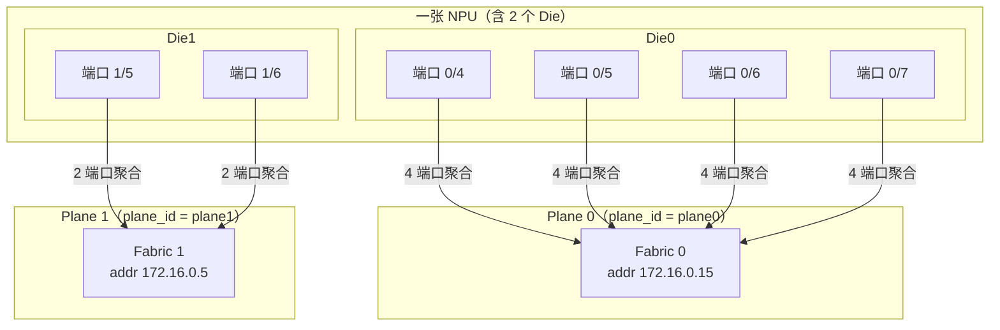
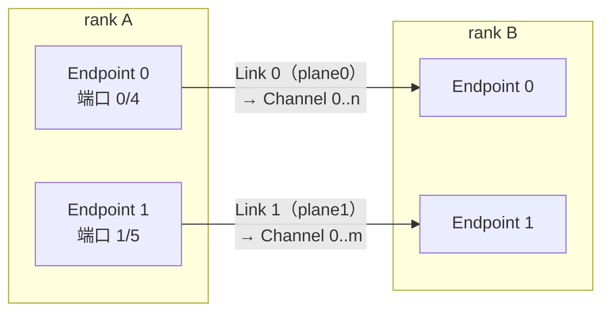
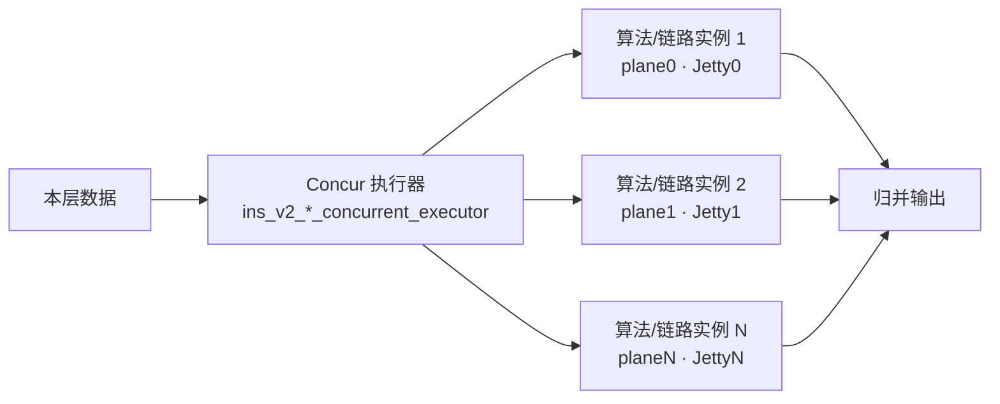

# 多平面组网（multi-plane）

> **深度参考** · 前置阅读：[《集合通信》第 5 章｜拓扑、分层与重叠](/通信与昇腾/05-topology-hierarchical-overlap.md)。本篇为参考手册体例，检索导向；事实基线见文首引用块。

> 昇腾集群组网描述之一。**跨层维度**——每张 NPU 的多个网口分别接入多个对等交换平面（Plane），形成平面维度的物理冗余与带宽聚合。
> 依据：`hccl/docs/zh/user_guide/cluster_info_config/rank_table_config_a5.md`（`plane_id` 字段与多地址多端口配置）、`hccl/docs/zh/architecture/architecture-brief.md`（Endpoint 与 Bonding 语义）、`hccl/src/ops/*/selector/`（`*MultiJetty` / `*MultiLink` 算法名）、`hccl/src/ops/*/algorithm/template/ccu/ccu_temp_*_multi_jetty*.cc`（20 个多 Jetty 模板）。

## 1. 拓扑形态

每张 NPU 提供**多个通信网口（Endpoint）**，分别接入**多个对等的交换平面（Plane）**——每个平面是一套独立 Fabric。



> 上图即 `rank_table_config_a5.md` 的官方示例：**同一 rank 的 `net_layer=1` 有两个 `rank_addr_list` 条目**——`plane0` 绑定 Die0 的 4/5/6/7 号端口（地址 `172.16.0.15`），`plane1` 绑定 Die1 的 5/6 号端口（地址 `172.16.0.5`）。**平面与 Die 亲和**是该示例的关键特征。

## 2. 配置表达：`plane_id` + 多地址多端口

### 2.1 rank table 中的多平面配置（950 v2.0）

```json
{
    "net_layer": 1,                          // Server间连接
    "net_instance_id": "az0",
    "net_type": "CLOS",
    "net_attr": "",
    "rank_addr_list": [
        {
            "addr_type": "IPV4",
            "addr": "172.16.0.15",
            "ports": ["0/4", "0/5", "0/6", "0/7"],   // ★ 一个地址绑定多个端口
            "plane_id": "plane0"                      // ★ 平面 0
        },
        {
            "addr_type": "IPV4",
            "addr": "172.16.0.5",
            "ports": ["1/5", "1/6"],
            "plane_id": "plane1"                      // ★ 平面 1
        }
    ]
}
```

### 2.2 字段约束

| 字段 | 约束 |
| --- | --- |
| `plane_id` | **可选，网络平面 ID，默认值为 `"0"`** |
| `ports` | 必选。`addr` 绑定的端口列表，**一个地址可以绑定到多个端口**，格式 `Die ID/端口ID`，多个端口用 `,` 分隔。**一个端口在同一个网络层次下只能映射到一个地址**；最多支持配置 **16 个端口**，最大字符串长度 32 |
| `rank_addr_list` | 必选。数组长度**不能超过 24**，**每个 Die 需要单独配置** |
| `addr_type` | `EID`（通过 HCCN TOOL 查询）/ `IPv4` / `IPv6`（**后两者只用于 Host 网卡场景**，需配置和 NPU 只有一跳 PCIE-SW 连接的网卡） |

### 2.3 拓扑文件侧的对应表达

拓扑文件的 `edge_list` 中，`local_a_ports` / `local_b_ports` 同样是**端口列表**：

```json
{
    "net_layer": 1, "link_type": "PEER2NET", "protocols": ["UB_CTP"],
    "local_a": 0,
    "local_a_ports": ["0/4","0/5","0/6","0/7","1/5","1/6"],   // ★ 6 个端口跨 2 个 Die
    "topo_instance_id": 0, "topo_type": "CLOS", "position": "DEVICE"
}
```

> **注意拓扑文件不带 `plane_id`**——平面归属只在 rank table 的 `rank_addr_list` 中表达。拓扑文件描述"物理上有哪些端口连到哪一层"，rank table 描述"这些端口如何分组到平面与地址"。

## 3. Endpoint 与平面的关系（RankGraph 视角）

| 概念 | 多平面下的表现 |
| --- | --- |
| **Node** | 一张 NPU（通信实体）——**一个 Node 可有多个 Endpoint** |
| **Endpoint** | Node 的通信设备（**逻辑概念**）。**一个 Endpoint 映射一个物理端口**（可为 Bonding 口，硬件控制，**软件不感知**）；**一个物理端口可被多个 Endpoint 共享** |
| **Edge** | Node 间的连接关系，两端是 Endpoint |
| **Link** | 从 Edge 中提取的两通信实体间**可建链信息**（含两端 Endpoint + 协议）——多平面下同一对 rank 在某 netLayer 上会有**多条 Link** |
| **Channel** | 基于 Link 实例化的真正数据通道——**一对 Endpoint 之间可以建立多个 Channel** |
| **Fabric** | 每个平面是一套独立 Fabric；**同一个网络层次不存在相连的两个 Fabric** |



> **递进关系**：Edge 描述"谁和谁连" → Link 描述"怎么建链" → Channel 描述"怎么通信"。多平面的本质是**同一对 rank 在同一 netLayer 上拥有多条 Link，进而实例化出多组 Channel**。

## 4. 特性

| 特性 | 说明 |
| --- | --- |
| **带宽聚合** | 跨平面并发传输，链路总带宽 = 单平面带宽 × 平面数；单地址绑定多端口（如 4 端口）亦在平面内聚合 |
| **故障隔离** | 单平面链路/交换机故障不影响其余平面，**通信降级不中断** |
| **流量冲突规避** | 多路径分散流量，降低 CLOS 交换机单端口拥塞概率——与 NHR "最大通信流量集中在物理位置相近节点之间，减少流量冲突" 的设计目标互补 |
| **Bonding 透明** | Bonding 口由硬件控制，**软件不感知**——一个 Endpoint 可能包含多个物理口 |
| **Die 亲和** | 官方示例中 plane0 绑 Die0 端口、plane1 绑 Die1 端口——平面划分与 Die 拓扑亲和，避免跨 Die 绕行 |

## 5. 软件适配：多 Jetty / 多 Link 并发

多平面的性能收益需要算法层显式利用。HCCL 通过**算法名后缀**与**专用模板**表达：

### 5.1 算法名后缀

| 后缀 | 含义 | 示例算法名 |
| --- | --- | --- |
| **`MultiJetty`** | 多 Jetty（UB 的多连接实体，对应多平面/多端口并发） | `CcuSchedAllReduceParallelMeshNHRMultiJetty`、`AicpuAllGatherParallelMeshNHRMultiJetty`、`CcuSchedAllToAllSoleMeshMultiJetty`、`AicpuAllToAllSoleMeshMultiJetty`、`CcuSchedBroadcastParallelMeshNHRMultiJetty`、`CcuSchedScatterParallelMeshNHRMultiJetty`、`CcuSchedReduceParallelMeshNHRMultiJetty` |
| **`MultiLink`** | 多链路（多条 Link 并发） | `AicpuAllReduceSoleNHRMultiLink`、`CcuSchedAllReduceSoleNHRMultiLink`、`AicpuAllGatherSoleNHRMultiLink`、`CcuSchedAllGatherSoleNHRMultiLink`、`CcuSchedAllReduceConcurMeshNHRMultiLink`、`CcuMSAllReduceConcurMeshNHRMultiLink`、`CcuSchedAllGatherConcurMeshNHRMultiLink`、`CcuSchedAllToAllSoleMeshMultiLink`、`CcuSchedReduceScatterSoleNHRMultiLink` |

> **`MultiJetty` 与 `MultiLink` 的分工**：`MultiJetty` 多与 **Parallel 编排**搭配（两维并行 + 每维多 Jetty），`MultiLink` 多与 **Sole / Concur 编排**搭配（单算法或并发算法内用多链路）。Jetty 是 UB 协议的连接实体，Link 是 RankGraph 的抽象——两者分别对应"协议层多连接"与"拓扑层多路径"。

### 5.2 专用模板（CCU 引擎，实测 20 个文件）

| 模板 | 算子 |
| --- | --- |
| `ccu_temp_all_reduce_nhr_mem2mem_1D_multi_jetty.cc` + kernel | AllReduce NHR 多 Jetty |
| `ccu_temp_all_gather_nhr_1D_multi_jetty_mem2mem.cc` + kernel | AllGather NHR 多 Jetty |
| `ccu_temp_reduce_scatter_nhr_1D_multi_jetty_mem2mem.cc` + kernel | ReduceScatter NHR 多 Jetty |
| `ccu_temp_all_to_all_mesh1d_multi_jetty.cc` + kernel | AlltoAll Mesh 多 Jetty |
| `ccu_temp_all_to_all_v_mesh_1D_multi_jetty.cc` + kernel | AlltoAllV Mesh 多 Jetty |

> **观察**：多 Jetty 模板**全部在 CCU 引擎下**（`ccu_temp_*`），且**全部搭配 NHR 或 Mesh**——即多平面并发是 950（CCU + UB）路径的能力，910/A2/A3 路径（RoCE + AICPU_TS）通过多 QP（`HCCL_RDMA_QPS_PER_CONNECTION`）实现类似效果。

### 5.3 Concur 编排：多平面的编排层利用

Concur（并发执行器）在**同一层次内并行执行多个不同算法**（或多链路副本），是多平面的编排层载体：

| 典型实现 | 说明 |
| --- | --- |
| `SoleMeshConcur` | Mesh 与 NHR 两算法并发跑同一份数据 |
| `ConcurMeshNHRMultiLink` | **NHR 多链路并发** |
| `MeshMultiJetty` / `MeshConcur` | 多 Jetty、**CLOS Z 轴绕路**（`CLOS_PORT_NUM = 4` 四端口） |

> **适用场景**（`combination.md` 口径）：物理链路多（HCCS 多平面、CLOS 多端口、多 Jetty）而**单算法吃不满链路**的场景，用多份算法实例把链路利用率打满；**对多路径组网收益明显**。



### 5.4 相关环境变量

| 环境变量 | 作用 |
| --- | --- |
| `HCCL_UB_MULTI_CHANNEL_NUM` | UB 多 Channel 数量——直接控制每对 Endpoint 上的 Channel 并发度 |
| `HCCL_RDMA_QPS_PER_CONNECTION` | 每连接的 QP 数（RoCE 侧的多路径并发） |
| `HCCL_MULTI_QP_THRESHOLD` | 启用多 QP 的数据量阈值 |
| `HCCL_ALG_MULTIPLE_DIMENSION_SPLIT_RATIO` | **多维度数据切分比例**——Parallel 编排下用户干预两维（含平面维）的数据分配（`CalcParallelDataSplitRatio` 的 `multipleDimensionSplitRatio`） |

## 6. 诊断与可靠性

| 机制 | 说明 |
| --- | --- |
| **集群链路诊断** | hcomm `experimental/cluster_link_diag` 提供组网链路的探测与可视化 |
| **分层分域探测** | hcomm RFC 0001（`0001-topology-based-ccl-monitor.md`）：面向 RoCE 无损集群的"分层分域最小代价网络探测 + 链路级故障定位"。通过拓扑发现识别 Device、Host、ToR/Leaf 与上层网络域之间的关系，在域内使用可求解的环形路径集合，在相邻域之间按需构造探测任务；再联合 HCCN PingPong 的路径时延/通过率和 RNIC 的 **PFC、CNP 计数器**，输出 **L1 链路指标、L2 路径指标及异常链路候选** |
| **CLOS Z 轴绕路** | `detour_rules.cc` / `detour_service.cc`（hcomm rank_graph_builder）+ `*_Z_axis_detour` 模板（hccl，6 个文件）——Spine 层拥塞时绕路 |
| **借轨通信** | 网卡故障时借用同 NPU 另一 Die 的网卡（`backup_device_ip`）——本质是**Die 维度的平面切换**，见 [ub_superpod.md §5](/通信与昇腾/参考手册/组网形态/ub_superpod.md) |
| **慢卡分析** | `hccl/docs/zh/user_guide/perf_analysis/slow_fast_card_analysis.md`；交换机拥塞丢包分析 `switch_congestion_loss.md` |

## 7. 适用场景

| 场景 | 说明 |
| --- | --- |
| **大规模 RoCE / UB 集群的标准组网** | 多平面 spine-leaf（CLOS）是数据中心标准架构 |
| **EP 通算融合的变长 AllToAllv** | MoE Dispatch/Combine 的变长流量在多平面上负载均衡——`AicpuAllToAllSoleMeshMultiJetty`、`CcuSchedAllToAllVSoleMeshMultiJetty` 等算法名即为此设计 |
| **950 CCU + UB 路径** | 多 Jetty 模板全部在 CCU 引擎下，与 UB 协议的多连接能力配套 |
| **高可用要求场景** | 平面级故障隔离，通信降级不中断 |
| **带宽 hungry 的大数据量算子** | AllReduce / ReduceScatter / AllGather 的 Parallel 编排 + MultiJetty，两维链路带宽同时吃满 |

## 8. 参考资料

- `hccl/docs/zh/user_guide/cluster_info_config/rank_table_config_a5.md`：**`plane_id` 字段定义、多地址多端口配置示例、端口映射约束**（本文 §2 来源）
- `hccl/docs/zh/architecture/architecture-brief.md` §2.2：**Endpoint / Bonding / Edge / Link / Fabric 语义**（本文 §3 来源）
- `hcomm/docs/zh/comm_op_dev_guide/prog_models_concepts/comm_model.md`：**"一对 Endpoint 之间可以建立多个 Channel"**、创建 Channel 时内存信息交换
- `hccl/docs/zh/user_guide/hccl_env/HCCL_UB_MULTI_CHANNEL_NUM.md`、`HCCL_RDMA_QPS_PER_CONNECTION.md`、`HCCL_MULTI_QP_THRESHOLD.md`、`HCCL_ALG_MULTIPLE_DIMENSION_SPLIT_RATIO.md`
- `hccl/docs/zh/user_guide/perf_analysis/switch_congestion_loss.md`、`slow_fast_card_analysis.md`
- `hcomm/docs/zh/rfcs/0001-topology-based-ccl-monitor.md`：分层分域探测、L1 链路 / L2 路径指标、PFC/CNP 计数器
- `hcomm/src/coll_communicator_mgr/rank_graph/rank_graph_builder/detour_rules.cc`、`detour_service.cc`：CLOS 绕路规则
- `hccl/src/ops/*/algorithm/template/ccu/ccu_temp_*_multi_jetty*.cc`：20 个多 Jetty 模板
- `hccl/src/ops/*/algorithm/executor/ins_v2_*_concurrent_executor.cc`：Concur 编排
- `hccl/src/ops/op_common/algorithm/topo_match/topo_match_squeeze_2d.cc`、`topo_match_concurrent.cc`：多路径拓扑匹配
- [04_昇腾集群组网总览.md](/通信与昇腾/参考手册/总览/cluster-topology.md)：RankGraph 模型与配置映射
- [roce_cluster.md](/通信与昇腾/参考手册/组网形态/roce_cluster.md)：CLOS 组网与多 QP；[ub_superpod.md](/通信与昇腾/参考手册/组网形态/ub_superpod.md)：UB Jetty 与借轨
- [../algorithms/combination.md](/通信与昇腾/参考手册/算法参考/combination.md)：Concur / Parallel 编排详解
- [../03_L0L1L2分级通信实现原理.md](/通信与昇腾/参考手册/总览/l0l1l2-principle.md)：Channel / Link / Endpoint 的实现

