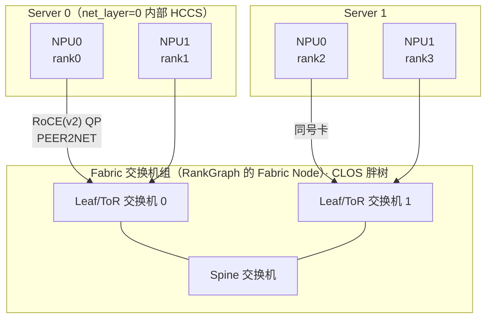
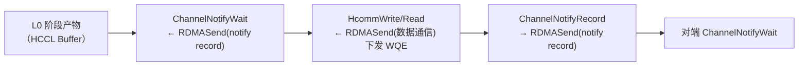
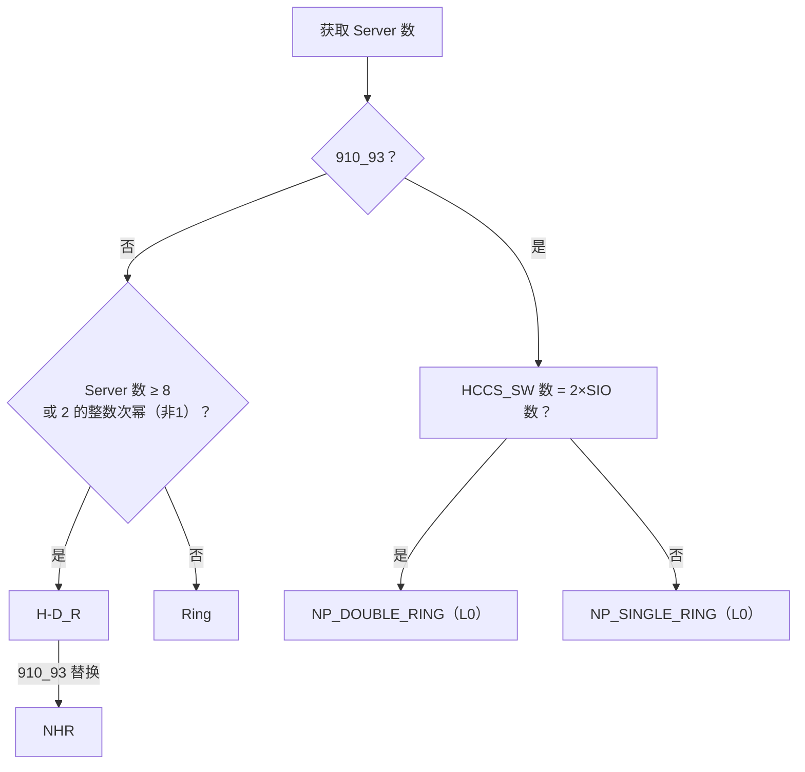

# 服务器间 RoCE 组网（L1 以太 RDMA 集群）

> **深度参考** · 前置阅读：[《集合通信》第 5 章｜拓扑、分层与重叠](/通信与昇腾/05-topology-hierarchical-overlap.md)。本篇为参考手册体例，检索导向；事实基线见文首引用块。

> 昇腾集群组网描述之一。**L1 层级**——跨 Server 经交换机 Fabric，**网络语义**，通道实体为 RoCE QP。
> 依据：`hccl/docs/zh/user_guide/cluster_info_config/rank_table_config_a5.md`（`net_layer=1` / `net_type=CLOS`）、`hcomm/docs/zh/comm_op_dev_guide/prog_models_concepts/comm_model.md`（RoCE Channel 模型）、`hccl/docs/zh/user_guide/perf_analysis/typical_op_behavior.md`（RDMASend + notify 实测）、`hccl/docs/zh/user_guide/hccl_env/`（RDMA 调优环境变量）、`hccl/src/common/alg_type.h:52-64`（`AlgTypeLevel1`）。

## 1. 拓扑形态

跨 Server 通过**以太网 RoCE(v2)**（RDMA over Converged Ethernet）互联：NPU 网卡经交换机组（**Fabric**，CLOS 类拓扑）两两互通。分级网络架构下，**Server 内通过直接连接的电缆互联，Server 间同号卡通过交换机互联**。

> **"同号卡"概念**：Server 间通信优先在**相同 local_id 的卡**之间进行（Server0 的 NPU0 ↔ Server1 的 NPU0）。这是分级网络架构的物理布线约定，也是 Pipeline 算法"Server 间 Ring + Server 内 FullMesh 并发"能成立的前提（见 [../algorithms/pipeline.md](/通信与昇腾/参考手册/算法参考/pipeline.md)）。

## 2. 层级特征

| 维度 | L1 取值 |
| --- | --- |
| **net_layer** | `1` |
| **net_type** | **`CLOS`**（所有节点均可互通，如通过交换机连接的胖树结构）或 `TOPO_FILE_DESC` |
| **link_type** | **`PEER2NET`**（经网络，非直连） |
| **topo_type** | `CLOS`（默认值） |
| **net_instance_id** | 如 `az0`（对比 L0 的 `az0-rack0-pod0`——命名粒度体现层级） |
| **协议** | `COMM_PROTOCOL_ROCE = 1`（RoCE v2）；UB 组网下为 `UB_CTP`/`UB_RTP`/`UBOE` |
| **通信语义** | **网络语义**（Write / Read / Notify） |
| **通道实体** | **RoCE QP**（Queue Pair = Send Queue + Receive Queue） |
| **数据搬运硬件** | RDMA 网卡（**WQE 下发**） |
| **同步方式** | **ChannelNotify**（经 Channel 上的 notify 与数据通道向远端 Thread 发/等信号） |
| **主力引擎** | AICPU_TS（大数据量）、Host CPU_TS（Atlas A2 专用） |
| **可否配置算法** | ✅ **可配**（`HCCL_ALGO` 的 level1）；**配置后自适应选择失效** |

## 3. RoCE Channel 模型（网络语义的核心）

> 图源：`hcomm/docs/zh/comm_op_dev_guide/prog_models_concepts/figures/roce_channel_model.png`

| 组成 | 说明 |
| --- | --- |
| **Channel** | 本地与远端对象通信的**入口**；本端 Channel 与远端 Channel 具有**一对一**的关联关系 |
| **QP（Queue Pair）** | Channel 关联**一个或多个 QP 实例**，与远端 Channel 关联的 QP 实例存在对应关系，**Channel 建立时对应 QP 会建链**。QP 是 RDMA 的核心通信单元，由发送队列（SQ）和接收队列（RQ）组成，用于管理数据传输任务 |
| **Notify** | Channel 包含**多个 Notify 实例**，用于通信对象之间的同步操作。Notify 是同步操作的抽象概念，**在不同通信引擎下可能由不同实体实现**。创建 Channel 时可指定 Notify 实例数量；本端可向远端 Channel 中的某个 Notify（**使用序号指定**）发送同步信号，也可基于某个 Notify 等待来自远端的信号 |

> **组合关系**：**Channel = 两端通信设备（Endpoint）+ 通信协议 + N 个 Notify**

### 3.1 建链要求

- 创建 Channel 时，**本端与远端需要同步调用 Channel 创建接口**
- 创建 Channel 时，本端注册的内存信息会与远端注册的内存信息进行交换；控制面也提供了基于 Channel 查询远端内存信息（地址与大小）的接口

## 4. L1 数据面的 Profiling 实测形态

`hccl/docs/zh/user_guide/perf_analysis/typical_op_behavior.md`（Atlas 800T A2 双机 AllReduce）给出了 L1 通信在 Profiling 中的**确切任务组合**：

> 节点间通过 RoCE 来实现 notify 同步及数据的通信，且 **notify record 任务及数据通信任务均以 RDMASend 下发 WQE 的形式实现**，因此在 Profiling 中：

| Profiling 任务组合 | 对应语义 |
| --- | --- |
| `RDMASend(notify record)` + `notify wait` | **机间前同步 / 尾同步**任务 |
| `RDMASend(数据通信)` + `RDMASend(notify record)` + `notify wait` | **机间的数据通信** |

> 图源：`hccl/docs/zh/user_guide/perf_analysis/figures/inter_allreduce.png`

> 图源：`hccl/docs/zh/user_guide/perf_analysis/figures/rdma_send.png`。在 `RDMASend(数据通信)` 任务的详细信息中可获取该任务的**本端、对端、数据量及带宽信息**——这是 L1 带宽分析的第一手数据。

## 5. L1 算法选择

### 5.1 可选算法（`alg_type.h:52-64`，`AlgTypeLevel1`）

| 值 | 枚举 | 名称映射 | 详见 |
| --- | --- | --- | --- |
| 0 | `ALG_LEVEL1_WHOLE_RING` | `"ring"` | [ring.md](/通信与昇腾/参考手册/算法参考/ring.md)（单层拓扑，所有 level 均为 Whole Ring 时组成一个大环） |
| 1 | `ALG_LEVEL1_HD` | `"H-D"` | [hdr.md](/通信与昇腾/参考手册/算法参考/hdr.md) |
| 2 | `ALG_LEVEL1_RING` | `"ring"` | [ring.md](/通信与昇腾/参考手册/算法参考/ring.md) |
| 3 | `ALG_LEVEL1_PIPELINE` | `"pipeline"` | [pipeline.md](/通信与昇腾/参考手册/算法参考/pipeline.md) |
| 4 | `ALG_LEVEL1_STAR` | — | [star.md](/通信与昇腾/参考手册/算法参考/star.md) |
| 5 | `ALG_LEVEL1_NHR` | `"NHR"` | [nhr.md](/通信与昇腾/参考手册/算法参考/nhr.md) |
| 6 | `ALG_LEVEL1_NHR_V1` | `"NHR_V1"` | [nhr.md](/通信与昇腾/参考手册/算法参考/nhr.md)（逐步停用） |
| 7 | `ALG_LEVEL1_NB` | `"NB"` | [nb.md](/通信与昇腾/参考手册/算法参考/nb.md) |
| 8 | `ALG_LEVEL1_AHC` | `"AHC"` | [ahc.md](/通信与昇腾/参考手册/算法参考/ahc.md) |
| 9 | `ALG_LEVEL1_AHC_BROKE` | `"AHC_BROKE"` | [ahc.md](/通信与昇腾/参考手册/算法参考/ahc.md) |

### 5.2 默认选择规则（`GetDefaultAlgoLevel1V1`）

| Server 数 | 默认算法 |
| --- | --- |
| **≥ 8**（`HCCL_INTER_SERVER_RING_ALGO_MAX_SUPPORT_SERVER_NUM = 8`） | **H-D_R** |
| **2 的整数次幂**（非 1） | **H-D_R** |
| **非 2 的整数次幂**（含 1） | **Ring** |
| **910_93** 的 H-D_R 结果 | 替换为 **NHR** |

### 5.3 各算法特点与适用场景（官方口径）

| 算法 | 步数/复杂度 | 特点 | 适用场景 |
| --- | --- | --- | --- |
| **Ring** | 线性 | 通信关系简单，**受网络拥塞影响小**，时延相对高 | Server 少、数据量小、**网络明显拥塞**且 Pipeline 不适用 |
| **H-D_R**（RHD） | 对数 | **非整 2 幂节点规模引入额外通信量**，时延相对低 | Server 数为 2 的整数次幂；或非 2 幂但数据量小 |
| **NHR** | 对数 | 非均衡层次环，自研；**流量集中在物理位置相近节点，减少交换机流量冲突** | Server 数较多且 Pipeline 不适用 |
| **NB** | 对数 | 非均匀数据块（Bruck 变体），**非 2 幂无额外数据量增长** | Server 数较多且 Pipeline 不适用 |
| **Pipeline** | 流水 | **并发使用 Server 内与 Server 间链路** | **数据量大、每机多卡**；A2 下不支持确定性计算 |
| **Pairwise** | 线性 | **规避一打多**（单端口发多 rank） | **仅 AlltoAll/AlltoAllV/AlltoAllVC**，数据量大需防一打多 |
| **AHC** | 层次 | 层次化拼接，**层间带宽收敛时收益更好** | **仅 ReduceScatter/AllGather/AllReduce**；多层对称或非对称 NPU 分布 |

### 5.4 算子支持度（按产品）

| 算法 | 950PR&950DT | Atlas A3 | Atlas A2 | Atlas 训练系列 |
| --- | --- | --- | --- | --- |
| **NHR** | RS/AG/AR/Bcast/Reduce/Scatter（**唯一自适应算法**） | RS/AG/AR/Bcast/RSV/Scatter/AGV | RS/AG/AR/Bcast/RSV/Scatter/AGV | RS/AG/AR/Bcast |
| **Ring** | —（NHR 接管） | RS/AG/AR/Reduce/RSV/Scatter/AGV | RS/AG/AR/Reduce/RSV/Scatter/AGV | RS/AG/AR/Reduce |
| **H-D_R** | — | —（NHR/ring 接管） | RS/AG/AR/Bcast/Reduce | RS/AG/AR/Bcast/Reduce |
| **NB** | — | RS/AG/AR/Bcast/RSV/Scatter/AGV | RS/AG/AR/Bcast/RSV/Scatter/AGV | RS/AG/AR/Bcast/RSV/Scatter/AGV |
| **NHR_V1** | — | — | RS/AG/AR/Bcast | RS/AG/AR/Bcast（逐步停用） |
| **AHC** | — | RS/AG/AR | — | — |
| **Pipeline** | — | — | AR/AG/AGV/RS/AlltoAll 族 | — |
| **Pairwise** | — | AlltoAll 族 | AlltoAll 族 | — |
| **CP** | — | — | AlltoAllV（单算子） | — |

**Scatter 特殊约束**：Server 间**仅支持 Ring/NHR/NB**，其余算法重定向为 Ring（`hccl/src/ops/scatter/scatter.cc:652`）。

## 6. CLOS 组网的软件适配

| 机制 | 说明 | 代码位置 |
| --- | --- | --- |
| **多端口并发** | `CLOS_PORT_NUM = 4`（四端口）——Concur 编排的多链路副本基础 | `hccl/src/ops/*/algorithm/executor/ins_v2_*_concurrent_executor.cc` |
| **多 Jetty** | `*MultiJetty` 算法名（如 `CcuSchedAllReduceParallelMeshNHRMultiJetty`、`AicpuAllToAllSoleMeshMultiJetty`）——CLOS 多路径并发 | `hccl/src/ops/*/algorithm/template/ccu/ccu_temp_*_multi_jetty*.cc`（20 个文件） |
| **Z 轴绕路** | CLOS 的 Z 轴（Spine 层）拥塞时绕路 | `hcomm/.../rank_graph_builder/detour_rules.cc`、`detour_service.cc`；`hccl/src/ops/*/algorithm/template/aicpu/*_Z_axis_detour.cc`（6 个文件）；`topo_match_squeeze_2d.cc` |
| **多 QP** | `HCCL_RDMA_QPS_PER_CONNECTION`、`HCCL_MULTI_QP_THRESHOLD` | 单 Channel 关联多个 QP 实例 |
| **拓扑匹配** | `topo_match_two_level.cc`（L0+L1）、`topo_match_three_level.cc` / `topo_match_3_level.cc`（L0+L1+L2） | `hccl/src/ops/op_common/algorithm/topo_match/` |

## 7. L1 相关环境变量

### 7.1 RDMA 链路调优

| 环境变量 | 作用 |
| --- | --- |
| `HCCL_RDMA_SL` | RDMA Service Level（QoS 优先级） |
| `HCCL_RDMA_TC` | RDMA Traffic Class |
| `HCCL_RDMA_TIMEOUT` | RDMA 超时 |
| `HCCL_RDMA_RETRY_CNT` | RDMA 重试次数 |
| `HCCL_RDMA_QPS_PER_CONNECTION` | 每连接的 QP 数（多 QP 并发） |
| `HCCL_MULTI_QP_THRESHOLD` | 启用多 QP 的数据量阈值 |
| `HCCL_RDMA_QP_PORT_CONFIG_PATH` | QP 端口配置文件路径 |
| `HCCL_RDMA_PCIE_DIRECT_POST_NOSTRICT` | PCIe 直投非严格模式 |
| `HCCL_HOST_RDMA_UDP_PORTS_LIST` | Host RDMA UDP 端口列表 |
| `HCOMM_TA_RTP_UB_TIMEOUT` / `HCOMM_TA_RTP_UBOE_TIMEOUT` | RTP / UBoE 超时（`TA_RTP_UBOE_TIMEOUT_DEFAULT = 16`，对应 8s） |

### 7.2 网络与端口

| 环境变量 | 作用 |
| --- | --- |
| `HCCL_IF_IP` | Host 节点通信 IP（**优先级高于 `HCCL_SOCKET_IFNAME`**），用于与 root 节点通信 |
| `HCCL_SOCKET_IFNAME` | 通信网卡名。支持 4 种规格：`=eth0,enp0`（精确使用）、`^=eth0,enp0`（精确排除）、`eth,enp`（前缀模糊使用）、`^eth,enp`（前缀模糊排除）；多个网卡用英文逗号分隔，**取最先匹配到的** |
| `HCCL_SOCKET_FAMILY` | 网卡通信协议版本（`AF_INET` IPv4 / `AF_INET6` IPv6） |
| `HCCL_IF_BASE_PORT` | 端口基址 |
| `HCCL_HOST_SOCKET_PORT_RANGE` / `HCCL_NPU_SOCKET_PORT_RANGE` | Host 侧 / NPU 侧通信端口范围（可配 `"auto"`）——**单卡多进程场景建议配置**，否则可能端口冲突 |
| `HCCL_CONNECT_TIMEOUT` | 建链超时等待（默认 **120s**） |

> **网卡自动选择优先级**（未配置 `HCCL_IF_IP` 与 `HCCL_SOCKET_IFNAME` 时）：
> `docker/lo 以外网卡（网卡名称的字典序升序）` > `docker 网卡` > `lo 网卡`
> ⚠️ 若当前节点选择的网卡与 root 节点选择的网卡**链路不通，将导致 HCCL 建链失败**。

## 8. 适用场景

| 场景 | 说明 |
| --- | --- |
| **多机 DMP 集群** | Atlas 训练/推理服务器组成的数据并行集群，L0 + L1 两级拓扑 |
| **EP / TP 大规模并行的节点间骨干** | AlltoAllv（EP Dispatch/Combine）、AllGather/ReduceScatter（TP）的跨机部分 |
| **无损以太集群** | RoCE 需 PFC/CNP 等无损配置；hcomm RFC 0001 提供面向 RoCE 无损集群的**分层分域最小代价网络探测 + 链路级故障定位**（L1 链路指标 / L2 路径指标） |
| **拥塞敏感场景** | 网络明显拥塞时 Ring 优于 RHD（受拥塞影响小）；NHR 通过"流量集中在物理相近节点"减少交换机流量冲突 |

## 9. 故障诊断要点

| 错误码 / 现象 | 说明 |
| --- | --- |
| `EI0015`（`link_timeout`、`topo_detect_timeout`、`typical_multi_node_comm_init_fail`、`partial_rank_not_connect_to_server`、`rank_server_socket_timeout`） | 建链/拓扑发现超时——首查网卡选择与链路互通 |
| `EI0006`（`link_timeout`） | 链路超时 |
| `EI0011`（`qp_mem_resource_apply`） | **QP 内存资源申请失败**——L1 特有问题 |
| `EI0012`（`sdma_error`） | SDMA 错误 |
| `EI0013`（`error_cqe_report`） | **CQE 错误上报**——RDMA 完成队列错误 |
| `EI0019`（`param_port_bind_fail`、`server_node_port_bind_fail`） | 端口绑定失败 |
| `EI0001`（`hccl_rdma_sl_config_error`、`hccl_socket_ifname_config_error`） | RDMA SL / 网卡名配置错误 |
| `EI0010` | Server 内卡间建链失败（Atlas 200T A2 Box16 异构子框）→ 配 `HCCL_INTRA_ROCE_ENABLE=1`、`HCCL_INTRA_PCIE_ENABLE=0` |

日志首查字段（`debug_thinking.md`）：`server[节点信息]`、`superPodId[超节点Id]`、`useSuperPodMode[是否为超节点模式]`、`isStandardCard[是否为标卡场景]`。

## 10. 参考资料

- `hccl/docs/zh/user_guide/cluster_info_config/rank_table_config_a5.md`：`net_layer=1` / `net_type=CLOS` / `link_type=PEER2NET` 配置
- `hccl/docs/zh/user_guide/concepts.md`：QP、SDMA、RDMA、RoCE、HCCS、HCCP 术语定义
- `hcomm/docs/zh/comm_op_dev_guide/prog_models_concepts/comm_model.md`：**RoCE Channel 模型**（Channel/QP/Notify 关系，本文 §3 来源）
- `hccl/docs/zh/user_guide/perf_analysis/typical_op_behavior.md`：L1 的 RDMASend + notify 任务组合（本文 §4 来源）
- `hccl/docs/zh/user_guide/perf_analysis/switch_congestion_loss.md`、`slow_fast_card_analysis.md`：交换机拥塞丢包与慢卡分析
- `hccl/docs/zh/user_guide/coll_algo_intro/algo_intro.md`、`Pipeline.md`：L1 算法特点与"Server 间同号卡通过交换机互联"
- `hccl/docs/zh/user_guide/hccl_env/`：`network_related.md`、`performance_related.md`、`HCCL_RDMA_*.md`、`HCCL_IF_IP.md`、`HCCL_SOCKET_IFNAME.md`、`inter_server_algo_support.md`
- `hccl/docs/zh/user_guide/fault_diagnosis/`：`qp_mem_resource_apply_EI0011.md`、`error_cqe_report_EI0013.md`、`link_timeout_EI0006.md`、`topo_detect_timeout_EI0015.md`、`debug_thinking.md`
- `hcomm/docs/zh/rfcs/0001-topology-based-ccl-monitor.md`：RoCE 无损集群的分层分域探测（L1 链路 / L2 路径指标）
- `hccl/src/common/alg_type.h:52-64`：`AlgTypeLevel1` 枚举与名称映射
- `hccl/src/ops/scatter/scatter.cc`：`GetDefaultAlgoLevel1V1`、`:652` Scatter 白名单
- [04_昇腾集群组网总览.md](/通信与昇腾/参考手册/总览/cluster-topology.md)：RankGraph 模型与配置映射
- [server_internal.md](/通信与昇腾/参考手册/组网形态/server_internal.md)：L0 层；[ub_superpod.md](/通信与昇腾/参考手册/组网形态/ub_superpod.md)：UB 协议的 L1/L2
- [../03_L0L1L2分级通信实现原理.md](/通信与昇腾/参考手册/总览/l0l1l2-principle.md)：L1 的语义/引擎/原语实现

