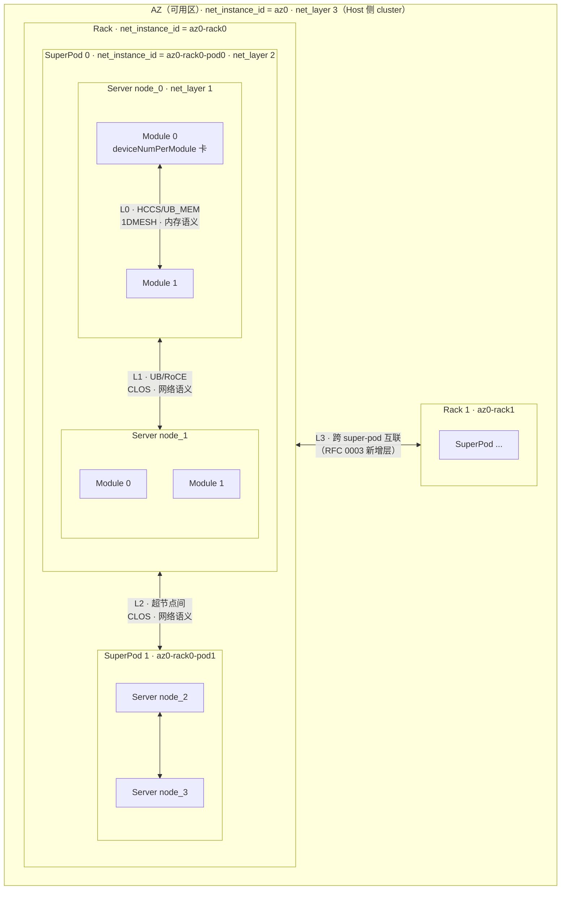
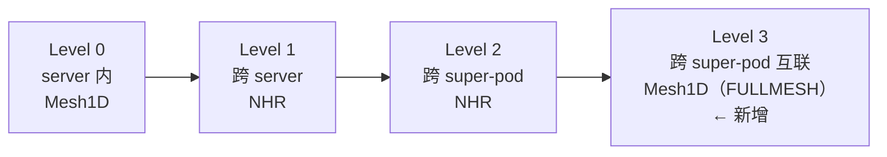
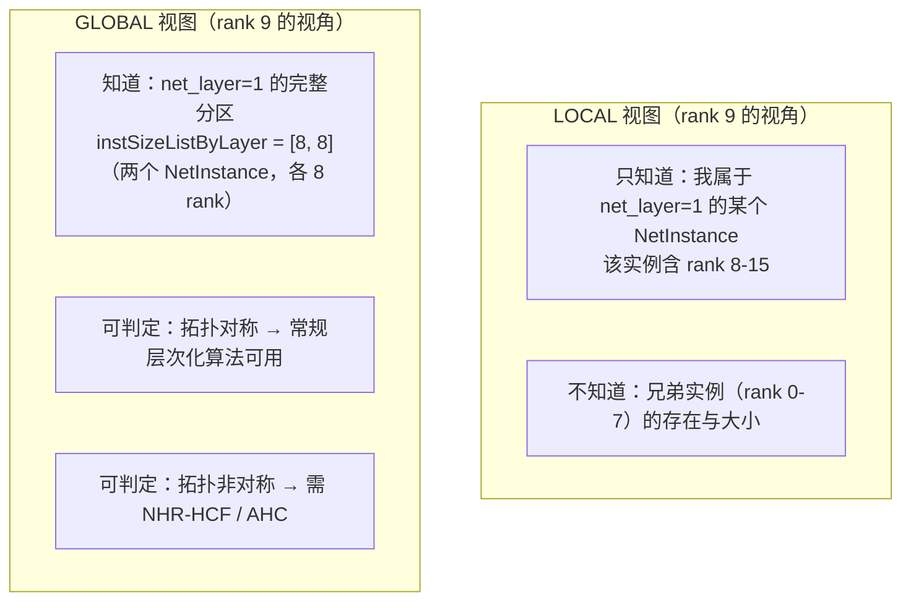
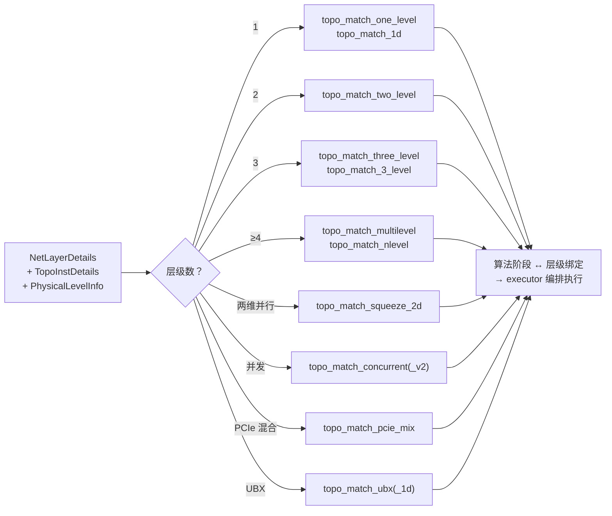
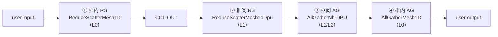

# 层次化混合组网（Module × Server × SuperPod × AZ 多级嵌套）

> **深度参考** · 前置阅读：[《集合通信》第 5 章｜拓扑、分层与重叠](/通信与昇腾/05-拓扑、分层与重叠.md)。本篇为参考手册体例，检索导向；事实基线见文首引用块。

> 昇腾集群组网描述之一，也是**其余四种组网的统一框架**——单服务器、RoCE 集群、UB 超节点、多平面都是本形态的特例或正交维度。
> 依据：`hccl/docs/zh/rfcs/0003-executor-template-refactor.md`（**4 层拓扑权威口径**）、`hccl/src/ops/op_common/inc/alg_param.h`（层级容量常量与 `PhysicalLevel*` 结构）、`hccl/src/ops/op_common/topo_info/physical_level*.cc`、`hccl/src/ops/op_common/algorithm/topo_match/`（13 个层级匹配器）、`hccl/docs/zh/user_guide/cluster_info_config/rank_table_config_a5.md`（`net_instance_id` 层级命名）、`hccl/docs/zh/user_guide/coll_algo_intro/algo_intro.md`（两级/三级分级通信）。

## 1. 拓扑形态：真实集群是多级嵌套



**层级链**：`Module`（A2 A+X 场景 CPU 侧拆分，`moduleNum` 可与 `serverNum` 不符）→ `Server`（L0 HCCS）→ `SuperPod`（L1 UB/RoCE）→ `Rack/AZ`（L2+）→ `cluster`（Host 侧）

## 2. 4 层拓扑的权威口径（RFC 0003）

`hccl/docs/zh/rfcs/0003-executor-template-refactor.md` 给出了当前最完整的层级描述：

```text
4 层：server 内 Mesh (layer0) + 跨 server NHR (layer1)
      + 跨 super-pod NHR (layer2) + 跨 super-pod 互联 (layer3) ← 新增
```



### 2.1 为什么需要"任意层级"抽象（RFC 0003 的核心驱动力）

> 在旧架构下，适配四层拓扑意味着**每个算子新增 4 层编排执行器**，且与 3 层代码大量重复（4 层的前三阶段与 3 层完全相同，仅多了第 4 层），工作量线性膨胀：**6 个算子 ×（Sequence + Parallel + 可能的 OmniPipe 变体）≈ 12-18 个新执行器类，每个 300-500 行**。
>
> 这正是重构的核心驱动力：**需要一个能抽象描述任意层级组合的统一数据结构，使新增拓扑层级只需在算法表中注册算法执行策略，而非复制整套执行器代码，即可实现新增算法**。

| 场景 | 旧架构新增代码量 | 重构后新增代码量 |
| --- | --- | --- |
| **3 层 → 4 层拓扑**（每算子） | 新增 2-3 个执行器类 + 对应 Template（**~1000 行**） | 算法表追加 1 个叶子节点（**~10 行**） |
| **新增 Parallel 变体**（每算子） | 新增 1 个执行器类（**~300-500 行**） | 修改算法树的 `execPolicy` 和 `dataSplitRatio`（**~5 行**） |

重构目标：用 `HcclAlgorithm + AlgoExecDesc + TemplateExecDesc` 描述算法结构；用**通用 Executor** 解释 Sequence、Parallel 和嵌套组合，**替代 50+ 个特化执行器**。

### 2.2 嵌套编排的表达（RFC 0003 示例）

**嵌套 Parallel**——两个 Parallel 阶段串行执行，第一阶段数据不同子片分别沿两个维度扩散，第二阶段交换维度顺序：

```cpp
auto phase0 = AlgoExecDesc{ PARALLEL, {meshLevel0, nhrLevel1}, {1, 1} };
auto phase1 = AlgoExecDesc{ PARALLEL, {nhrLevel1, meshLevel0}, {1, 1} };
AlgoExecDesc root{ SEQUENCE, {shared(phase0), shared(phase1)}, {1, 1} };
```

> 这段代码是"层级 × 编排"组合的最凝练表达：**SEQUENCE 套 PARALLEL，每个 PARALLEL 内含两个层级的算法模板**（`meshLevel0` = L0 Mesh1D，`nhrLevel1` = L1 NHR），`dataSplitRatio = {1,1}` 表示两维等分。

## 3. 层级容量与数据结构

### 3.1 容量常量（`hccl/src/ops/op_common/inc/alg_param.h`）

```cpp
constexpr u32 HCCL_LOGIC_TOPO_LEVEL_NUM = 4;   // :43  HCCL 逻辑拓扑层级最多 4 级
constexpr u32 PHYSICAL_LEVEL_NUM_LIMIT  = 10;  // :46  物理层级上限 10
constexpr u32 TOPO_LEVEL_NUM_1 = 1;            // :104
constexpr u32 TOPO_LEVEL_NUM_2 = 2;            // :105
constexpr u32 TOPO_LEVEL_NUM_3 = 3;            // :106
```

配置文件侧：`net_layer` 取值 **[0,7]**、`level_list` 数组长度 **≤8**、`rank_addr_list` **≤24**（每 Die 单独配置）。

> **逻辑 4 级 vs 物理 10 级**：物理层级（`PHYSICAL_LEVEL_NUM_LIMIT=10`）描述硬件实际可探测的层次深度；逻辑层级（`HCCL_LOGIC_TOPO_LEVEL_NUM=4`）是算法编排能表达的层数上限。`physical_level_normalize.cc` 负责把物理层级**归一化**到逻辑层级。

### 3.2 层级信息的核心结构（`alg_param.h`）

| 结构 | 字段 | 作用 |
| --- | --- | --- |
| **`NetLayerDetails`** | `netLayerNum`、`netLayers`、`netInstNumOfLayer`、`instSizeListOfLayer`、`localNetInsSizeOfLayer` | 每层有多少 NetInstance、各实例多大、本地实例多大 |
| **`TopoInstDetails`** | `topoInstNum`、`sizeOfTopo`、`typeOfTopo`（`CommTopo`）、`ranksInTopo`、`rankNumForTopoType` | 每层的拓扑实例数量、大小、类型、成员 rank |
| **`PhysicalLevelInfo`** | `localRanks`（当前 rank 在该范围内可见的全部 rank，升序去重，必然含当前 rank）、`view`、`instSizeListByLayer`、`sourceRef` | **范围链上的一环**。整条链按三键排序，**相邻两环的 rank 集合满足包含关系（可以相等）** |
| **`PhysicalLevelView`** | `LOCAL = 0` / `GLOBAL = 1` | 见 §3.3 |
| **`PhysicalSourceRef`** | `netLayer`（恒有效）、`topoInstId`（该 Level 有 TopoInstance 支撑时才有效） | 该 Level 在 RankGraph 中的**原始身份，用于回查** |
| **`SubCommInfo`** | `infos[HCCL_LOGIC_TOPO_LEVEL_NUM]`（:475） | 各层子通信域信息 |
| **`PhysicalLevelIdx`** | `PHYSICAL_LEVEL_IDX_0` … `PHYSICAL_LEVEL_IDX_9`（:515-524） | 物理层级索引枚举（10 值） |

### 3.3 `PhysicalLevelView`：LOCAL vs GLOBAL（关键设计约束）

`alg_param.h` 原文注释：

> 该 Level 是否知道整个通信域在这个粒度上的完整划分。**这是 RankGraph 两组接口的能力差异，无法互相推导**：
> 只有 `GetInstSizeListByLayer` 看得到兄弟 NetInstance，`GetTopoInstsByLayer` 只看得到本 rank 所在的那一个

| 视图 | 含义 | `instSizeListByLayer` | 对应 RankGraph 接口 |
| --- | --- | --- | --- |
| **`LOCAL = 0`** | 只知道当前 rank 所在的那一块 | **恒为空** | `GetTopoInstsByLayer` |
| **`GLOBAL = 1`** | 知道该 netLayer 的完整分区 | **非空** | `GetInstSizeListByLayer` |

> **为什么这个区分重要**：算法选择需要知道"兄弟实例有多大"才能判断拓扑是否对称——例如 **NHR-HCF** 需要知道各超节点的 Server 数才能求最大公约数（`multiSuperPodDiffServerNumMode`），**AHC** 需要知道各 group 的卡数才能求 LCM。若只有 `LOCAL` 视图，这些算法无法决策。



### 3.4 `localRanks` 的局部性

> `localRanks`：当前 rank 在该范围内可见的全部 rank，升序去重，必然含当前 rank。**局部量：同一级上不同 rank 看到的集合不同**（rank 0 看到 {0..7}，rank 9 看到 {8..15}）

## 4. 层级拓扑匹配器（topo_match）

`hccl/src/ops/op_common/algorithm/topo_match/` 是"算法阶段 ↔ 拓扑层级"的绑定层，共 **15 个文件 = 13 个匹配器 + 2 个基类**，覆盖各种层级形态：

| 匹配器 | 适用层级形态 | 说明 |
| --- | --- | --- |
| `topo_match_one_level.cc` | 单层 | 纯 L0（单机场景） |
| `topo_match_1d.cc` | 单层 1D | 1DMesh 形态 |
| `topo_match_two_level.cc` | **两级（L0 + L1）** | 最常见（A2 双机、RoCE 集群） |
| `topo_match_three_level.cc`<br/>`topo_match_3_level.cc` | **三级（L0 + L1 + L2）** | 超节点集群（A3） |
| `topo_match_multilevel.cc`<br/>`topo_match_nlevel.cc` | **任意多级** | RFC 0003 的 4 层及以上 |
| `topo_match_concurrent.cc`<br/>`topo_match_concurrent_v2.cc` | 并发编排 | Concur 执行器 |
| `topo_match_squeeze_2d.cc` | **2D 压缩** | Parallel / OmniPipe 的两维切分 |
| `topo_match_pcie_mix.cc` | **PCIe 混合链路** | 标卡场景（`DpuSendSoleMesh` 注册时 `isSupportLevel0PcieMix = true`） |
| `topo_match_ubx.cc`<br/>`topo_match_ubx_1d.cc` | **UBX（UB 交换）组网** | 配套 `ins_temp_ubx_all_to_all_v_mesh_1D.cc` |
| `topo_match_base.cc`<br/>`topo_match_base_v2.cc` | 基类 | 两代基类 |



## 5. 分级通信编排（两级 / 三级）

> HCCL 通常按**节点内/节点间分为两级拓扑**、或按**节点内/节点间/超节点间分为三级拓扑**，分级执行集合通信，**不同的层级间链路带宽不同**。分级通信可以使通信任务编排与网络拓扑亲和，从而最大化利用链路能力。（`algo_intro.md`）

### 5.1 两级拓扑（Atlas A2 单算子模式）各算子阶段表

| 算子 | 阶段一 | 阶段二 | 阶段三 |
| --- | --- | --- | --- |
| **ReduceScatter** | Server 间 RS（L1） | Server 内 RS（L0） | — |
| **ReduceScatterV** | Server 间 RSV（L1） | Server 内 RSV（L0） | — |
| **AllGather** | Server 内 AG（L0） | Server 间 AG（L1） | — |
| **AllGatherV** | Server 内 AGV（L0） | Server 间 AGV（L1） | — |
| **AllReduce** | Server 内 RS（L0） | Server 间 AR（L1） | Server 内 AG（L0） |
| **Scatter** | Server 间 Scatter（L1） | Server 内 Scatter（L0） | — |
| **Broadcast** | Server 内 Scatter（L0） | Server 间 Broadcast（L1） | Server 内 AG（L0） |
| **Reduce** | Server 内 RS（L0） | Server 间 Reduce（L1） | Server 内 **Gather**（L0，结果仅发 root） |
| **AlltoAll / V / VC** | Server 内 A2A（L0） | Server 间 A2A（L1） | — |

**编排要点**：

| 规律 | 原因 |
| --- | --- |
| 归约/散布类（RS/RSV/Scatter）**先层间后层内** | 保证 Server 间通信数据块的**连续性** |
| 聚合类（AG/AGV）**先层内后层间** | 同样为保证 Server 间数据块连续 |
| AllReduce 把**大数据量阶段放 Server 内** | L0 带宽远高于 L1，先归约降量再跨机 |
| Broadcast 第一阶段用 **Scatter** 而非 Broadcast | 让 Server 内所有卡的网卡并行出口，跨机总带宽提升 p₀ 倍 |

### 5.2 三级拓扑的执行器实现

`*_3level` 后缀的执行器即三级拓扑实现：

| 执行器 | 算子 |
| --- | --- |
| `ins_v2_all_reduce_sequence_executor_aicpu_3level.cc` | AllReduce |
| `ins_v2_all_gather_sequence_executor_3level.cc` | AllGather |
| `ins_v2_reduce_scatter_sequence_executor_3level.cc` | ReduceScatter |
| `reduce_sequence_executor_aicpu_3level.cc` | Reduce |
| `scatter_sequence_aicpu_executor_3level.cc` | Scatter |
| `ins_v2_broadcast_sequence_executor_aicpu_3level.cc` | Broadcast |

> **6 个命令字全部有 3level 变体**——与 RFC 0003 提到的"6 个命令字（AllGather、AllReduce、Broadcast、Reduce、ReduceScatter、Scatter）"完全对应。

### 5.3 950 Sequence 执行器的四级实例



CCL Buffer 对半分为 **ccl-in / ccl-out** 两区，阶段间数据交接全部通过 `BufferType::HCCL_BUFFER` 显式声明。详见 [../algorithms/算法组合.md §2.1.2](/通信与昇腾/参考手册/算法参考/算法组合.md)。

## 6. 层级信息流转全链路

```mermaid
flowchart TB
    subgraph SRC["配置来源"]
        T["拓扑文件<br/>edge_list: net_layer[0,7]<br/>link_type · protocols<br/>topo_type · topo_instance_id"]
        RT["rank table<br/>level_list（≤8 层，升序）<br/>net_layer · net_instance_id<br/>net_type · rank_addr_list · plane_id"]
    end
    SRC --> DET["hcomm: rank_info_detect/<br/>phy_topo_builder.cc → phy_topo.cc<br/>AddTopoGraph(netLayer, Graph)"]
    DET --> RGB["hcomm: rank_graph_builder.cc<br/>+ detour_rules / detour_service（绕路）<br/>+ updater_for_64_plus_1（非对称超节点）"]
    RGB --> NI["hcomm: net_instance.cc<br/>NetInstance（netLayer + netInstId + netType）<br/>netLayers_ 集合"]
    NI --> API["RankGraph 查询接口<br/>GetNetLayers / GetInstTopoTypeByNetLayer<br/>GetInstSizeByNetLayer / GetInstSizeListByNetLayer<br/>GetTopoInstsByLayer / GetRanksByTopoInst<br/>GetLinks / GetEndpointDesc"]
    API --> TI["hccl: topo_info/<br/>topo.cc · topo_host.cc<br/>physical_level_build.cc（构建范围链）<br/>physical_level_normalize.cc（物理→逻辑归一化）"]
    TI --> STRUCT["NetLayerDetails · TopoInstDetails<br/>PhysicalLevelInfo（localRanks · view · sourceRef）<br/>SubCommInfo infos[4]"]
    STRUCT --> ALGSEL["算法层级选择<br/>SetAlgoLevel0/1/2（scatter.cc 为样本）<br/>GetDefaultAlgoLevel0Module / GetDefaultAlgoLevel1V1<br/>→ AlgType{L0, L1, L2}"]
    ALGSEL --> SEL["auto_selector + CostModel + cost_table<br/>→ 组合算法名（如 CcuSchedAllReduceParallelMeshNHR）"]
    SEL --> TM["topo_match（13 个匹配器）<br/>算法阶段 ↔ 层级绑定"]
    TM --> EX["executor 编排<br/>sole / sequence(±3level) / parallel /<br/>concurrent / omnipipe(±2d/3d) / order_preserved"]
    EX --> TPL["template 按引擎执行<br/>aicpu / aiv / ccu<br/>（+ intra / inter / dpu 阶段模板）"]
```



## 7. 各产品的层级能力对比

| 产品 | 支持层级 | rank table 版本 | 层级表达方式 | L2 算法可配 |
| --- | --- | --- | --- | --- |
| **Atlas A2** | L0 + L1（两级） | `1.0` | **隐式**：由 `server_id` 划分 Server；`moduleIdx`/`moduleNum`/`deviceNumPerModule` 表达 Module 粒度 | — |
| **Atlas A3** | L0 + L1 + L2（三级） | `1.2` | **显式超节点**：`super_pod_list[super_pod_id, server_list]` + `super_device_id`（SDID） | ✅ Ring/H-D_R/NHR/NB（需 AI_CPU 展开模式） |
| **Ascend 950PR&950DT** | L0 + L1（+ L3 Host 侧） | `2.0` | **拓扑文件 + rank table 双文件**：`level_list` 逐层描述（≤8 层），含 `plane_id` 多平面 | —（950 的 NHR 是唯一自适应算法） |
| **Atlas 训练系列（910）** | L0 + L1 | — | 隐式；910_93 有 `NP_DOUBLE_RING` 特殊 L0 | — |
| **Atlas 300I Duo** | 仅 L0（单 Server） | — | 单 Server；多数算子有卡数上限 | — |

### 7.1 A2 的 Module 粒度特殊性

> `alg_param.h:259`：**A2 A+X 场景 moduleNum 可能与 serverNum 不符**

A+X Server（昇腾 AI 处理器 + x86 CPU）场景下，Module 是 **CPU 侧的拆分单位**，与物理 Server 不一定一一对应。因此需要独立的 `moduleIdx` / `moduleNum` / `deviceNumPerModule` 字段，以及 `isDiffDeviceModule` / `multiModuleDiffDeviceNumMode`（多 Module 异卡数模式）来表达非对称。

`COMM_TOPO_A2AXSERVER = 4`（`hccl_rank_graph.h:44`）与 `TopoType::A2_AX_SERVER`（`topo_common_types.h:38`）是这一形态的专用拓扑类型。

## 8. 层次化组网与算法选择的耦合

分层是算法选择的**核心输入**：

| 决策点 | 依赖的层级信息 |
| --- | --- |
| **WHOLE_RING vs 分层组合** | 若所有 level 均为 `WHOLE_RING`，则退化为**单一大环**（`alg_type.h:38,54,68` 三处注释一致）；否则按层组合。取舍由 selector 按卡数/数据量/层级质量自动决定 |
| **L0 算法** | 每聚合域卡数 + 链路形态（HCCS/SIO/PCIe/HCCS_SW 探测结果） |
| **L1 算法** | Server 数（≥8 / 2 的幂 / 非 2 的幂）+ 产品形态 + 数据量 |
| **L2 算法** | 超节点个数 + 是否非对称（`multiSuperPodDiffServerNumMode` → NHR-HCF）+ 是否带宽收敛（→ AHC） |
| **编排方式** | 层级数（1→Sole，2→Sequence/Parallel，3→Sequence3level/OmniPipe2d，4→嵌套 AlgoExecDesc） |
| **引擎** | L0 可用 AIV/CCU；L1/L2 主力 AICPU_TS；A2 用 Host CPU_TS |
| **拓扑匹配器** | 层级数与形态（two_level / three_level / nlevel / squeeze_2d / pcie_mix / ubx） |

详见 [../algorithms/分层矩阵.md](/通信与昇腾/参考手册/算法参考/分层矩阵.md)、[../03_L0L1L2分级通信实现原理.md](/通信与昇腾/参考手册/总览/L0-L1-L2分级原理.md)。

## 9. 适用场景

**所有真实部署形态**——本文其余四种组网均为本形态的特例或正交维度：

| 组网 | 与本形态的关系 |
| --- | --- |
| [单服务器组网](/通信与昇腾/参考手册/组网形态/单机内部.md) | 只有 L0 一层的退化形态 |
| [服务器间 RoCE 组网](/通信与昇腾/参考手册/组网形态/RoCE集群.md) | L0 + L1 两层形态（无超节点） |
| [UB 超节点组网](/通信与昇腾/参考手册/组网形态/UB超节点.md) | L0 + L1 + L2 三层形态 |
| [多平面组网](/通信与昇腾/参考手册/组网形态/多平面网络.md) | **正交维度**——每个层级内部都可有多平面 |
| [整机形态](/通信与昇腾/参考手册/组网形态/整机形态.md) | **正交维度**——描述"卡装在什么整机里"，影响 L0 算法分支与引擎约束 |

## 10. 参考资料

**代码（最高可信度）**

- `hccl/src/ops/op_common/inc/alg_param.h`：`HCCL_LOGIC_TOPO_LEVEL_NUM`（:43）、`PHYSICAL_LEVEL_NUM_LIMIT`（:46）、`TOPO_LEVEL_NUM_1/2/3`（:104-106）、`Level0Shape`/`Level0MeshType`（:156-167）、`NetLayerDetails`/`TopoInstDetails`/`PhysicalLevelView`/`PhysicalSourceRef`/`PhysicalLevelInfo`、层级字段（:253-264）、`SubCommInfo infos[4]`（:475）、`PHYSICAL_LEVEL_IDX_0..9`（:515-524）
- `hccl/src/ops/op_common/topo_info/`：`topo.cc`、`topo_host.cc`、`physical_level.h`、`physical_level_build.cc`、`physical_level_normalize.cc`
- `hccl/src/ops/op_common/algorithm/topo_match/`：13 个层级匹配器
- `hccl/src/ops/*/algorithm/executor/*_3level.cc`：6 个命令字的三级拓扑执行器
- `hccl/src/common/alg_type.h`：`AlgTypeLevel0/1/2` 与 `TagAlgType` 三层组合结构
- `hccl/src/ops/scatter/scatter.cc`：`SetAlgoLevel0/1/2` 层级映射样本
- `hcomm/include/hccl/hccl_rank_graph.h`：`CommTopo` 枚举（含 `COMM_TOPO_A2AXSERVER`）与层级查询接口
- `hcomm/src/coll_communicator_mgr/rank_graph/`：`rank_graph_v2.h`、`phy_topo/phy_topo.h`（`AddTopoGraph(netLayer, ...)`、`IsNetLayerExisted`）、`net_instance.h`、`rank_graph_builder/`（含 `updater_for_64_plus_1.cc`）

**仓内文档**

- `hccl/docs/zh/rfcs/0003-executor-template-refactor.md`：**4 层拓扑权威口径、旧架构代码膨胀问题、`AlgoExecDesc` 嵌套编排、代码量对比表**（本文 §2 来源）
- `hccl/docs/zh/rfcs/0002-HCCL-ALGO-Plugin.md`：根据拓扑信息（如 Level0Topo 的具体形状、层级数目等）选定算法名称；多层级下若 Level0Topo 形状为 Mesh，选择 `ParallelMesh1DNHR` 算法
- `hccl/docs/zh/user_guide/coll_algo_intro/algo_intro.md`：**两级/三级分级通信权威编排表**（本文 §5.1 来源）
- `hccl/docs/zh/user_guide/coll_algo_intro/hierarchical_comm_principle.md`：RS/AG/AR 分级流程图解
- `hccl/docs/zh/user_guide/cluster_info_config/rank_table_config_a2.md`、`_a3.md`、`_a5.md`：三套层级表达方式
- `hccl/docs/zh/architecture/architecture-brief.md` §2.2：RankGraph 分层拓扑模型
- `hcomm/docs/zh/comm_op_dev_guide/prog_models_concepts/topology_model.md`：拓扑层级抽象与 Layer 0/Layer 1 示例

**社区资料**

- 昇腾社区（hiascend.com）硬件安装与组网指南——AZ/Rack/SuperPod 的物理部署层次

