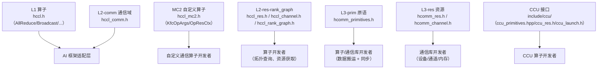
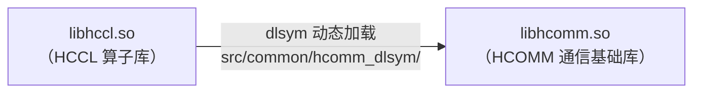

# 算子支持度、API 参考与构建编译

> 三部分参考：**① 算子支持度清单**（产品 × 算子 × 数据类型矩阵）、**② API 参考**（六级 API 分层）、**③ 构建编译**（build.sh/CMake/dlsym 解耦）。
>
> 事实来源：`hccl/docs/zh/user_guide/comm_ops_support_list/`（五套支持度清单）、`hccl/docs/zh/api_ref/`、`hcomm/docs/zh/api_ref/`、`hccl/docs/zh/architecture/architecture-brief.md` §3.3（API 分层）、`hccl/docs/zh/build/build.md`、`hccl/AGENTS.md`、`hcomm/AGENTS.md`。

---

## 1. 算子支持度清单

`hccl/docs/zh/user_guide/comm_ops_support_list/` 提供五套产品的通信算子支持矩阵：

| 产品 | 文档 |
| --- | --- |
| Ascend 950PR&950DT | `comm_ops_support_950.md` |
| Atlas A3 | `comm_ops_support_a3.md` |
| Atlas A2 | `comm_ops_support_a2.md` |
| Atlas 训练系列（910） | `comm_ops_support_910.md` |
| Atlas 推理系列（300I Duo） | `comm_ops_support_300i_duo.md` |

### 1.1 支持度矩阵维度

按**通信算子展开模式**（AI CPU / AIV / CCU_MS / CCU_SCHED 等）呈现，每算子 × 每网络运行模式（单算子/图模式）一行，列含：

| 维度 | 说明 |
| --- | --- |
| **单算子零拷贝** | 直接对业务传入内存操作，降低内存拷贝开销（见 [../comm/对称内存.md](/通信与昇腾/参考手册/协议与传输/对称内存.md)） |
| **确定性计算** | 归约类算子相同硬件+输入 → 相同输出（见 [reliability_security.md §2](/通信与昇腾/参考手册/运行与约束/可靠性与安全.md)） |
| **重执行** | 网络闪断时重新执行算子（仅 A3，见 [reliability_security.md §1.1](/通信与昇腾/参考手册/运行与约束/可靠性与安全.md)） |
| **节点内通信** | L0（Server 内） |
| **超节点内通信** | L1（超节点内 Server 间） |
| **超节点间通信** | L2（超节点间） |

> 标记：`√` 支持、`×` 不支持、`NA` 不涉及；未列出的展开模式/算子/网络运行模式代表不支持。

### 1.2 三个关键能力

| 能力 | 说明 |
| --- | --- |
| **单算子零拷贝** | 降低内存拷贝开销，HCCL 直接对业务传入内存操作，提升通信性能 |
| **通信算子重执行** | 网络故障导致通信闪断时，HCCL 尝试重新执行算子，提升稳定性 |
| **确定性计算** | 归约类算子在相同硬件和输入下多次执行产生相同输出 |

---

## 2. API 参考：六级分层

`architecture-brief.md` §3.3——HCCL & HCOMM 对外 API 分层：



| 层次 | 头文件 | 面向 | 职责 |
| --- | --- | --- | --- |
| **L1 算子** | `hccl/include/hccl.h` | AI 框架适配层 | AllReduce/Broadcast/AllGather/ReduceScatter/AlltoAll/Send/Recv 等标准集合通信算子入口 |
| **MC2** | `hccl/include/hccl_mc2.h` | 自定义通信算子开发者 | KfcOpArgs/OpResCtx（见 [../extension/mc2_and_rfc.md](/通信与昇腾/参考手册/扩展机制/mc2_and_rfc.md)） |
| **L2-comm** | `hcomm/include/hccl/hccl_comm.h` | 框架适配层 | 通信域创建（见 [../communicator/](/通信与昇腾/参考手册/通信域/)） |
| **L2-res-rank_graph** | `hccl_res.h`/`hccl_channel.h`/`hccl_rank_graph.h` | 算子开发者 | 拓扑查询、资源（Thread/Channel）获取 |
| **L3-prim** | `hcomm/include/hcomm_primitives.h` | 算子/通信库开发者 | 数据搬运（Write/Read/Reduce）+ 同步（Notify） |
| **L3-res** | `hcomm_res.h`/`hcomm_channel.h` | 通信库开发者 | 通信设备/通道/内存资源 |
| **CCU** | `hcomm/include/ccu/` | CCU 算子开发者 | CCU 资源对象封装与 Kernel Launch（见 [../engine/ccu.md](/通信与昇腾/参考手册/通信引擎/ccu.md)） |

### 2.1 通信算子接口（16 个）

`hccl/docs/zh/api_ref/comm_op_interface/`：`HcclAllReduce`、`HcclBroadcast`、`HcclAllGather`、`HcclAllGatherV`、`HcclReduce`、`HcclReduceScatter`、`HcclReduceScatterV`、`HcclScatter`、`HcclAlltoAll`、`HcclAlltoAllV`、`HcclAlltoAllVC`、`HcclSend`、`HcclRecv`、`HcclBatchSendRecv` 等。各算子语义详见 [../operators/](/通信与昇腾/参考手册/算子参考/)。

### 2.2 通信域管理接口

`hcomm/docs/zh/api_ref/comm_mgr_c/`（C）与 `comm_mgr_python/`（Python）：通信域创建/销毁/挂起恢复、Team、对称内存窗口等，详见 [../communicator/](/通信与昇腾/参考手册/通信域/)。

---

## 3. 构建编译

### 3.1 build.sh 命令

**hccl 仓**（`hccl/AGENTS.md`）：

```bash
bash build.sh --pkg                      # 编译 host 包（默认）
bash build.sh -u                         # 编译并运行 UT
bash build.sh -s                         # 编译并运行 ST
bash build.sh --static                   # 静态库构建
bash build.sh --asan                     # 启用 AddressSanitizer
bash build.sh --custom_ops_path=<PATH>   # 自定义算子工程
bash build.sh -j64                       # 并行编译
```

**hcomm 仓**（`hcomm/AGENTS.md`）：

```bash
bash build.sh --pkg            # 编译 host 包（默认）
bash build.sh --pkg --full     # 编译 host + device 全量包
bash build.sh -u               # 编译并运行 UT（= --ut）
bash build.sh -s               # 编译并运行 ST
bash build.sh --ut --noexec    # 编译 UT 但不执行
```

> 输出 `build_out/cann-<repo>_<version>_linux-<arch>.run`。推送前优先本地验证 `--pkg` + `--ut --noexec` + `--st --noexec`。

### 3.2 dlsym 解耦（核心架构约束）

**HCCL = HCCL 算子库（`cann/hccl`）+ HCOMM 通信基础库（`cann/hcomm`）**，两仓通过 **`dlsym` 动态加载解耦**，可独立编译、独立版本演进：



| 约束 | 说明 |
| --- | --- |
| **HCCL 不依赖 HCOMM 私有头** | HCCL 不得 `#include` HCOMM 私有头，不引入对 `cann/hcomm` 的编译期硬依赖 |
| **跨仓调用走符号表** | 经 `hccl/src/common/hcomm_dlsym/` 的符号表 + `dlsym` |
| **HCOMM 不反向依赖** | HCOMM 不得 `#include` HCCL 私有头 |

### 3.3 软件分层与依赖方向

| 软件层次 | 仓位置 |
| --- | --- |
| HCCL 集合通信算子（coll_comm_ops，L1） | `cann/hccl` |
| HCOMM 集合通信域管理（HCCM，L2） | `cann/hcomm/src/coll_communicator_mgr` |
| HCOMM 基础通信（L3） | `cann/hcomm/src/base_comm` |

> 依赖方向自上而下：`coll_comm_ops`（HCCL）→ `coll_communicator_mgr` → `base_comm`。下层不能反向依赖上层；控制面/数据面分离；legacy 不持续演进。

### 3.4 编码规范与 pre-commit

| 项 | 说明 |
| --- | --- |
| **命名** | 类/函数 PascalCase；成员变量 `camelCase_`；常量/宏 `UPPER_SNAKE_CASE` |
| **风格** | `.clang-format`（120 列、4 空格、指针右对齐、K&R 大括号）；C++14 |
| **pre-commit** | clang-format v18.1.8 + OAT 合规检查；新增源文件须带 CANN-2.0 许可头 |
| **静态告警** | 须通过 CANN 静态检查（CI codecheck），编译无告警 |

---

## 4. 参考资料

- `hccl/docs/zh/user_guide/comm_ops_support_list/`：五套产品算子支持度清单
- `hccl/docs/zh/api_ref/`：`hccl_header_and_lib.md`、`comm_op_interface/`（16 个算子 API）
- `hcomm/docs/zh/api_ref/`：`hcomm_header_and_lib.md`、`comm_mgr_c/`、`comm_mgr_python/`、`comm_opdev/`
- `hccl/docs/zh/architecture/architecture-brief.md` §3.3：对外 API 分层关系
- `hccl/docs/zh/build/build.md`、`hccl/AGENTS.md`、`hcomm/AGENTS.md`：构建命令与架构约束
- 关联：[README.md](/通信与昇腾/参考手册/运行与约束/)、[../communicator/](/通信与昇腾/参考手册/通信域/)（通信域管理 API）、[../operators/](/通信与昇腾/参考手册/算子参考/)（算子语义）、[../extension/mc2_and_rfc.md](/通信与昇腾/参考手册/扩展机制/mc2_and_rfc.md)（MC2 框架）、[../01_HCCL集合通信概述.md](/通信与昇腾/参考手册/总览/HCCL概述.md)（API 分层与架构约束）

