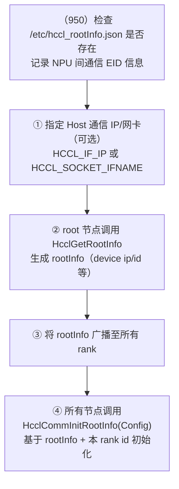
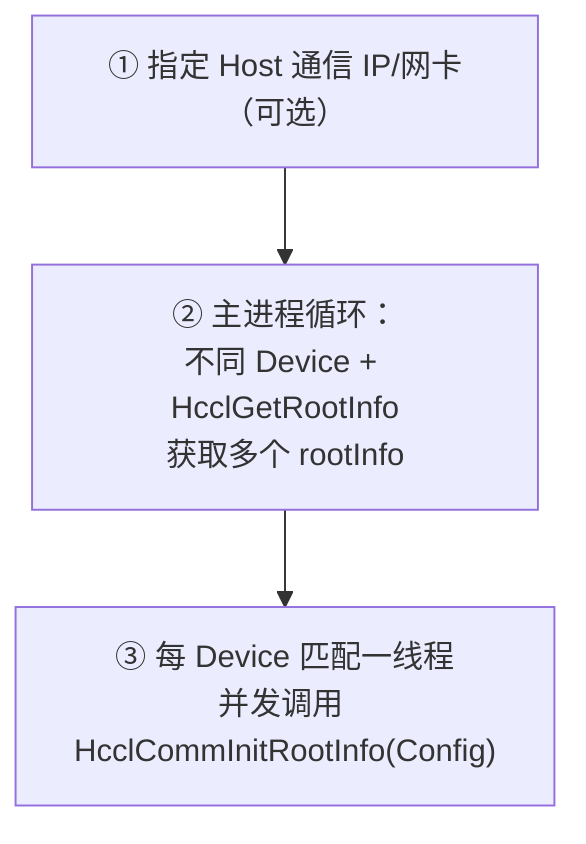
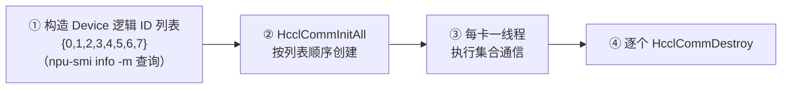

# 通信域创建：四种方式详解

> **深度参考** · 前置阅读：[源码课程单元 2｜控制面：通信域的一生](/通信与昇腾/源码课程/02-control-plane.md)。本篇为参考手册体例，检索导向；事实基线见文首引用块。

> 通信域创建是 HCCL 控制面的第一步。本文详解 [README.md §3](/通信与昇腾/参考手册/通信域/) 的四种创建方式的**完整流程、参数与代码示例**。
>
> 事实来源：`hccl/docs/zh/user_guide/api_comm_impl.md`（通信域管理权威）、`hcomm/docs/zh/api_ref/comm_mgr_c/`（各创建接口）、`hcomm/docs/zh/api_ref/comm_mgr_c/figures/`（流程图）。

---

## 1. 方式①：基于 rank table 创建

多机集合通信、有完整集群信息配置文件（rank table）的场景。**每张卡用一个单独进程**：


```c
int devId = 0;
char* rankTableFile = "/home/rank_table.json";  // rank table 文件路径
HcclComm hcclComm;                               // 通信域句柄
HcclCommInitClusterInfo(rankTableFile, devId, &hcclComm);  // 初始化
/* 集合通信操作 */
HcclCommDestroy(hcclComm);                       // 销毁
```

> **要点**：rank table 的文件路径、权限须正确，且**在集群各 rank 保持一致**——HCCL 会在后续算子的参数面建链过程中做 rank table **一致性校验**，不满足则终止业务。rank table 配置详见 [../04_昇腾集群组网总览.md §4](/通信与昇腾/参考手册/总览/cluster-topology.md)。

---

## 2. 方式②：基于 root 节点信息创建（集群协商）

多机场景**无完整 rank table** 时，基于 root 节点信息创建——又称**集群协商方式**：通过 Host 侧网卡向 root 节点建立 socket 连接，进行信息汇聚与分发生成集群信息。


> 图源：`hcomm/docs/zh/api_ref/comm_mgr_c/figures/comminit_rootinfo.png`

### 2.1 场景 A：每个 Device 对应一个业务进程



### 2.2 场景 B：每个 AI Server 一个进程、每 Device 一个线程


> 图源：`hcomm/docs/zh/api_ref/comm_mgr_c/figures/single_thread_loop_call_example.png`



> **950 前置检查**：基于 root 节点信息创建前，须检查 `/etc/hccl_rootInfo.json` 是否存在（记录 NPU 间通信的 **EID**，环境部署后自动生成）；若无此文件，需在源码仓提 issue。

### 2.3 Host 通信网卡选择

| 方式 | 环境变量 | 说明 |
| --- | --- | --- |
| **方式一** | `HCCL_IF_IP` | 配置通信 IP（IPv4/IPv6，仅一个），用于与 root 节点通信 |
| **方式二** | `HCCL_SOCKET_IFNAME` + `HCCL_SOCKET_FAMILY` | 配置网卡名 + IP 协议版本（AF_INET/AF_INET6） |

`HCCL_SOCKET_IFNAME` 支持 4 种网卡匹配规格（多网卡逗号分隔，取最先匹配）：

```bash
export HCCL_SOCKET_IFNAME==eth0,enp0   # 精确匹配：使用指定 eth0 或 enp0
export HCCL_SOCKET_IFNAME=^=eth0,enp0  # 精确排除：不使用 eth0 与 enp0
export HCCL_SOCKET_IFNAME=eth,enp      # 模糊匹配：使用所有 eth/enp 前缀网卡
export HCCL_SOCKET_IFNAME=^eth,enp     # 模糊排除：不使用 eth/enp 前缀网卡
```

> **优先级**：`HCCL_IF_IP` > `HCCL_SOCKET_IFNAME`。均不配置时自动选择：`docker/lo 以外网卡（字典序升序）> docker 网卡 > lo 网卡`。若当前节点所选网卡与 root 节点网卡链路不通，将导致建链失败。

---

## 3. 方式③：单机内批量创建（HcclCommInitAll）

单机通信场景，**一个进程统一创建多张卡的通信域**（每卡对应一个线程）：



```c
uint32_t ndev = 8;
int32_t devices[8] = {0, 1, 2, 3, 4, 5, 6, 7};  // Device 逻辑 ID 列表
HcclComm comms[ndev];
HcclCommInitAll(ndev, devices, comms);            // 批量创建
// 启动 ndev 个线程，每线程 args[i].comm = comms[i] 执行集合通信
for (uint32_t i = 0; i < ndev; i++) { HcclCommDestroy(comms[i]); }
```

> **约束**：多线程调用集合通信 API（如 `HcclAllReduce`）时，须确保不同线程调用的**前后时间差不超过建链超时等待时间**（`HCCL_CONNECT_TIMEOUT`，默认 120s），避免建链超时。

---

## 4. 方式④：基于已有通信域切分子通信域

`HcclCreateSubCommConfig` 基于已有通信域切分具有特定配置的子通信域——**无需 socket 建链与 rank 信息交换**，可应用于**业务故障下的快速通信域创建**。


> 图源：`hcomm/docs/zh/api_ref/comm_mgr_c/figures/comm_domain_split.png`

```c
HcclComm globalHcclComm;
HcclCommInitClusterInfo(rankTableFile, devId, &globalHcclComm);  // 全局通信域
HcclCommConfig config;
HcclCommConfigInit(&config);
config.hcclBufferSize = 50;
strcpy(config.hcclCommName, "comm_1");
HcclComm hcclComm;
uint32_t rankIds[4] = {0, 1, 2, 3};                              // 子域 rank 列表
HcclCreateSubCommConfig(&globalHcclComm, 4, rankIds, 1, devId, &config, &hcclComm);
```

> **约束**：**不支持嵌套切分**（不能在子通信域中进一步切分子通信域）。

---

## 5. 端口配置（单卡多进程）

单卡多进程场景须配置端口避免冲突（`api_comm_impl.md`）：

| 产品 | 配置方式 |
| --- | --- |
| **950 / A3 / A2** | rank table 配置 `device_port` 字段，不同业务进程设不同端口；或用 `HCCL_HOST_SOCKET_PORT_RANGE` + `HCCL_NPU_SOCKET_PORT_RANGE`（可设 `auto`）分别配置 Host/NPU 侧通信端口 |

```bash
export HCCL_HOST_SOCKET_PORT_RANGE="auto"
export HCCL_NPU_SOCKET_PORT_RANGE="auto"
```

> 多进程会对资源开销、通信性能产生一定影响。各产品单卡多进程的支持与并发约束详见 [../reference/constraints.md](/通信与昇腾/参考手册/运行与约束/constraints.md)。

---

## 6. 四种方式对比速查

| 维度 | ① rank table | ② rootInfo | ③ InitAll | ④ 子域切分 |
| --- | --- | --- | --- | --- |
| **接口** | `HcclCommInitClusterInfo(Config)` | `HcclGetRootInfo`+`HcclCommInitRootInfo(Config)` | `HcclCommInitAll` | `HcclCreateSubCommConfig` |
| **场景** | 多机有配置文件 | 多机无配置文件 | 单机多卡 | 已有域派生 |
| **进程模型** | 每卡一进程 | 每卡一进程 / 每 Server 一进程多线程 | 一进程多线程 | 基于父域 |
| **socket 建链** | 需 | 需（向 root） | 单机内 | **免** |
| **rank 信息交换** | 需 | 需（root 汇聚分发） | 单机内 | **免** |
| **典型用途** | 标准多机训练 | 弹性/动态集群 | 单机测试/推理 | **故障快速恢复** |

---

## 7. 参考资料

- `hccl/docs/zh/user_guide/api_comm_impl.md`：通信域管理（本文主要来源）
- `hcomm/docs/zh/api_ref/comm_mgr_c/`：`HcclCommInitClusterInfo.md`、`HcclCommInitRootInfo.md`、`HcclGetRootInfo.md`、`HcclCommInitAll.md`、`HcclCreateSubCommConfig.md`、`HcclCommConfigInit.md`
- `hccl/docs/zh/user_guide/hccl_env/`：`HCCL_IF_IP.md`、`HCCL_SOCKET_IFNAME.md`、`HCCL_SOCKET_FAMILY.md`、`HCCL_CONNECT_TIMEOUT.md`、`HCCL_HOST_SOCKET_PORT_RANGE.md`、`HCCL_NPU_SOCKET_PORT_RANGE.md`
- 示例代码：`hcomm/examples/01_communicators/`（one_device_per_process / rank_table / per_pthread）
- 关联：[README.md](/通信与昇腾/参考手册/通信域/)、[config.md](/通信与昇腾/参考手册/通信域/config.md)、[../04_昇腾集群组网总览.md](/通信与昇腾/参考手册/总览/cluster-topology.md)（rank table 配置）、[../debug/localization_flow.md](/通信与昇腾/参考手册/排障手册/localization_flow.md)（创建失败诊断）

