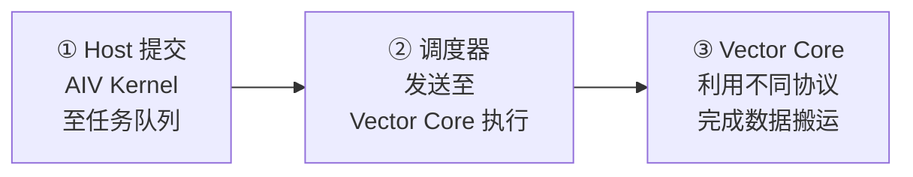
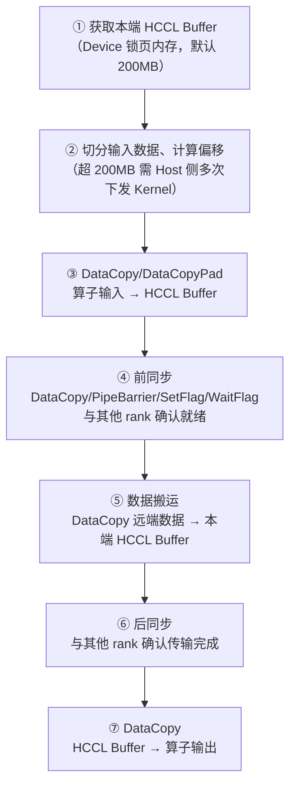

# AIV 通信引擎

> **深度参考** · 前置阅读：[源码课程单元 4｜通信引擎与三引擎编排](/通信与昇腾/源码课程/04-通信引擎与三引擎编排.md)。本篇为参考手册体例，检索导向；事实基线见文首引用块。

> **低时延通信场景的主力引擎**（L0）。通信算子的执行逻辑与操作步骤由 **Vector Core（AIV，AI Core 中的向量核）** 直接执行——Host 提交 AIV Kernel，调度器发送至 Vector Core，Vector Core 利用不同协议完成数据搬运。**低时延**，但占用 Vector 计算核。
>
> 事实来源（可信度：代码 > 仓内文档 > 社区资料）：
> `hcomm/src/legacy/ascend950/unified_platform/aiv/`（`ub_memory_transport.*`、`urma_direct_transport.*` AIV 数据通路）、`hcomm/docs/zh/comm_op_dev_guide/prog_models_concepts/{comm_engine.md,concurrency_model.md}`、`hcomm/docs/zh/comm_op_dev_guide/aiv_comm_op_dev/`（开发流程与任务编排）、`hccl/docs/zh/user_guide/hccl_env/HCCL_OP_EXPANSION_MODE.md`（AIV 约束与控核）、`hccl/docs/zh/user_guide/concepts.md`（AIV 术语）。

---

## 1. 定位与特点

| 维度 | 说明 |
| --- | --- |
| **Thread 抽象** | AICore Block（Vector Core） |
| **并发实体** | Vector Core |
| **同步实现** | Device 内存（软同步标记位） |
| **优势** | 低时延 |
| **约束** | 通信占用 Vector 计算核，需多个 Vector 核才能打满通信带宽；通信算子与计算算子竞争计算核资源，可能互相影响 |
| **适用场景** | 低时延通信、小数据量（**L0 主力**） |
| **支持产品** | 950PR&950DT；Atlas A3（**仅超节点内**通信）；Atlas A2（**仅单机**通信） |
| **`OpExecuteConfig`** | `AIV = 3`、`AIV_ONLY = 4` |
| **算法名前缀** | `Aiv*`（如 `AivAllReduceSoleMeshOneShot`、`AivAllGatherSoleMesh`） |

> **AIV** = AI Core 中的 Vector Core（`concepts.md`）。昇腾分离架构下 Vector Core 的官方名称即 AIV，承担向量计算与低时延通信。

---

## 2. 任务执行流程


> 图源：`hcomm/docs/zh/comm_op_dev_guide/prog_models_concepts/figures/aiv_communication.png`



> **要点**：AIV 低时延但**占 Vector 计算核**，适合小数据低时延场景。数据搬运由 Vector Core 直接驱动，不经 TS 任务描述符下发，故时延低。

---

## 3. 编程模型：Ascend C 数据拷贝与同步

AIV 通信算子基于 **Ascend C 编程语言**的数据拷贝接口和同步接口完成算法编排（`aiv_comm_op_dev/task_sched.md`）。

AI Core 可访问的外部存储称 **Global Memory（GM）**、内部存储称 **Local Memory**；`GlobalTensor` 存放 GM 全局数据，`LocalTensor` 存放 Local Memory 数据。底层均使用 Ascend C 的 **DataCopy** 接口（支持 GlobalTensor ↔ LocalTensor 双向拷贝）：

| 操作 | 数据流向 | Ascend C 接口 |
| --- | --- | --- |
| **软同步 Record** | 标记值在 LocalTensor 设置后拷贝到 GlobalTensor | `DataCopy`、`SetFlag` |
| **软同步 Wait** | 标记值在 GlobalTensor，拷贝到 LocalTensor 后标量比较，非预期值则重试 | `DataCopy`、`WaitFlag` |
| **数据搬运** | 源/目的均在 GlobalTensor，须经 Vector Core 内部存储中转（GM→LocalTensor→GM） | `DataCopy`、`DataCopyPad` |
| **随路 Reduce** | LocalTensor→GlobalTensor 传输时开启原子归约 | `SetAtomicAdd`（SUM）、`SetAtomicMax`（MAX） |

> 与 AICPU_TS 用 `hcomm_primitives.h` 的 `Hcomm*OnThread` 原语不同，**AIV 直接用 Ascend C 的 DataCopy/SetFlag/WaitFlag/PipeBarrier**——这是 AIV 引擎在编程模型上最显著的差异。

---

## 4. 任务编排（Vector Core 侧）



AllGather 的 Vector Core 侧编排示例（`task_sched.md`，`CpGM2GM` 封装片上内存间拷贝、`Record1vN`/`WaitNv1` 封装 rank 间同步）：

```c
if (GetBlockIdx() != rank) {
    WaitNv1(tag);                                  // rank 间同步，等待其他 rank 数据就绪
    PipeBarrier<PIPE_ALL>();
    CpGM2GM(outputGM + GetBlockIdx() * count, cclGMOther, count);  // 读对端数据到本 rank 输出
    Record(GetBlockIdx(), tag);                    // 与对端后同步
    Wait(GetBlockIdx(), tag);
} else {
    CpGM2GM(cclGMSelf, inputGM, count);            // 本 rank 输入 → 中转内存，供其他 rank 读
    PipeBarrier<PIPE_ALL>();
    Record1vN(tag);                                // 通知其他 rank 来读
    CpGM2GM(outputGM + count * rank, cclGMSelf, count);  // 中转内存 → 用户输出
}
```

---

## 5. AIV 数据通路（Transport）

AIV 引擎在 950 平台有两条专用数据通路（`hcomm/src/legacy/ascend950/unified_platform/aiv/`）：

| 通路 | 类 | 协议 / 语义 | 说明 |
| --- | --- | --- | --- |
| **UB Memory** | `UbMemoryTransport` | UB_MEM · 内存语义 | 基于 IPC 的对称内存映射，交换 CclBufferInfo（addr/size/tokenId/tokenValue），见 [../comm/ub_mem.md](/通信与昇腾/参考手册/协议与传输/ub_mem.md) |
| **URMA Direct** | `UrmaDirectTransport` | URMA · 内存语义 | 直接组装 WQE 经 URMA 搬运，提供 `GetAiRMAWQ`/`GetAiRMACQ`，见 [../comm/urma.md](/通信与昇腾/参考手册/协议与传输/urma.md) |

`UbMemoryTransport`（`aiv/ub_memory_transport.h`）状态机：`INIT → SOCKET_OK → SEND_MEM_INFO → RECV_MEM_INFO → RECV_MEM_INFO_PROCESS → SEND_NAME → RECV_NAME → READY`；向算子开发暴露 `GetLocMemBuffer(bufIndex)` / `GetRmtMemBuffer(bufIndex)`。

`UrmaDirectTransport`（`aiv/urma_direct_transport.h`）：`WQE_SIZE = 64`，`GetAiRMAWQ()` 返回 `HcclAiRMAWQ`（含 `wqeSize`、`localTokenId`、`rmtObjId`、`rmtTokenValue`），`GetAiRMACQ()` 返回 `HcclAiRMACQ`。

---

## 6. 控核能力（Vector Core 分配）

AIV 模式支持**控核**——业务根据计算算子与通信算子的并发情况配置 Vector Core 核数（`HCCL_OP_EXPANSION_MODE.md`）。若分配的核数无法满足算法编排要求，HCCL 报错并提示所需最低核数。

| 产品 | 算子 | 建议最低 Vector 核数 |
| --- | --- | --- |
| **Atlas A3** | Broadcast | ≥ ranksize |
| **Atlas A3** | AllGather、非确定性 ReduceScatter | ≥ max(2, ⌈ranksize/20⌉) |
| **Atlas A3** | AllReduce、确定性 ReduceScatter、AlltoAll/V/VC | ≥ max(2, ⌈ranksize/20⌉) 且为**偶数**（奇数向上取整至下一偶数） |
| **Atlas A2** | AllReduce、ReduceScatter、ReduceScatterV | ≥ 24 |
| **Atlas A2** | Broadcast、AlltoAll/V/VC、AllGather、AllGatherV | ≥ 16 |

---

## 7. 支持算子与数据类型

各产品 AIV 模式支持的算子（`HCCL_OP_EXPANSION_MODE.md`）：

| 产品 | 支持算子 | 数据类型要点 |
| --- | --- | --- |
| **950PR&950DT** | Broadcast、Reduce、AllReduce、ReduceScatter、Scatter、AllGather、AlltoAll/V/VC、Send、Recv | Reduce/AllReduce：int8/16/32/64、float16/32、bfp16；ReduceScatter 额外支持 **hifloat8** |
| **Atlas A3** | Broadcast、AllReduce、ReduceScatter、AllGather、AlltoAll/V/VC | 仅超节点内单机/多机，**不支持跨超节点**；AllReduce/RS 仅 sum/max/min |
| **Atlas A2** | Broadcast、AllReduce、AlltoAll/V/VC、AllGather、ReduceScatter、AllGatherV、ReduceScatterV | 仅单机；AllGatherV/ReduceScatterV 仅单算子模式 |

---

## 8. 配置与约束

| 项 | 说明 |
| --- | --- |
| **环境变量** | `HCCL_OP_EXPANSION_MODE=AIV` |
| **通信域粒度** | `HcclCommConfig` 将某通信域展开模式设为 AIV（不支持多通信域同时 AIV 并行，否则不可预期行为） |
| **组网约束** | 仅支持**对称组网**、推理特性 |
| **大数据量回退** | A3/950 的 Broadcast/AllReduce/ReduceScatter/AllGather/AlltoAll（单机）数据量超阈值自动切换 AI_CPU；AlltoAllV/VC、AlltoAll（多机）配 AIV **不自动切换**——任意两 rank 间最大数据量 ≤ 1MB 时建议 AIV，否则用 AI_CPU |
| **确定性计算优先级** | 设 `HCCL_DETERMINISTIC=true/strict` 时确定性计算优先级更高，某些场景 AIV 展开可能不生效 |
| **A2 Box16 异构子框** | Atlas 200T A2 Box16 异构子框不支持跨框通信 |
| **对称内存** | AIV + URMA、AIV + UB Memory 两场景支持对称内存注册（见 [../comm/对称内存.md](/通信与昇腾/参考手册/协议与传输/对称内存.md)） |

---

## 9. 算法选择（AIV 侧）


> 图源：`hcomm/docs/zh/comm_op_dev_guide/aiv_comm_op_dev/figures/aiv_algo_select.png`


> 图源：`hcomm/docs/zh/comm_op_dev_guide/aiv_comm_op_dev/figures/aiv_dev_flow.png`。AIV 开发流程：定义算子接口 → 查询拓扑 → 算法选择 → 创建资源 → **任务编排** → 算子下发（与 CCU 的"算子下发→算法执行"顺序不同，AIV 先编排后下发）。

---

## 10. 代码落点

| 组件 | 路径 |
| --- | --- |
| **AIV 数据通路（950）** | `hcomm/src/legacy/ascend950/unified_platform/aiv/`：`ub_memory_transport.{h,cc}`、`urma_direct_transport.{h,cc}` |
| **引擎选择** | `hccl/src/ops/*/selector/*_auto_selector.cc`、`selector_engine.cc`（`Aiv*` 前缀） |
| **加速模式枚举** | `hccl/src/ops/op_common/inc/alg_param.h:133-153`（`AIV=3`、`AIV_ONLY=4`） |
| **AIV kernel 模板** | `hccl/src/ops/*/algorithm/复盘写作模板.md/aiv/`（各算子 AIV 模板，如 ReduceScatter 的 hifloat8 kernel） |

---

## 11. 参考资料

- `hcomm/docs/zh/comm_op_dev_guide/prog_models_concepts/comm_engine.md`：AIV 执行流程
- `hcomm/docs/zh/comm_op_dev_guide/prog_models_concepts/concurrency_model.md`：AIV 并发实体（Vector Core + Device 内存）
- `hcomm/docs/zh/comm_op_dev_guide/aiv_comm_op_dev/`：`overall_flow.md`、`task_sched.md`、`algo_select.md`、`op_dispatch.md`、`create_res.md`、`query_topo.md`、`define_op_if.md`
- `hccl/docs/zh/user_guide/hccl_env/HCCL_OP_EXPANSION_MODE.md`：AIV 约束、控核、数据类型
- `hccl/docs/zh/user_guide/concepts.md`：AIV 术语
- 关联：[README.md](/通信与昇腾/参考手册/通信引擎/)（引擎总览）、[../comm/ub_mem.md](/通信与昇腾/参考手册/协议与传输/ub_mem.md)、[../comm/urma.md](/通信与昇腾/参考手册/协议与传输/urma.md)、[../comm/对称内存.md](/通信与昇腾/参考手册/协议与传输/对称内存.md)

