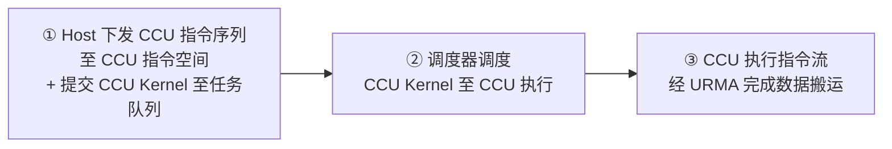
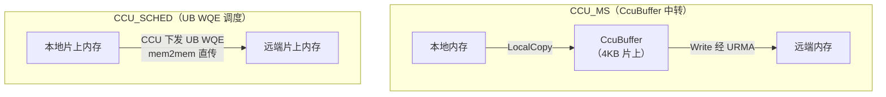
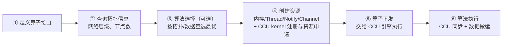

# CCU 通信引擎

> **深度参考** · 前置阅读：[源码课程单元 4｜通信引擎与三引擎编排](/通信与昇腾/源码课程/04-comm-engines.md)。本篇为参考手册体例，检索导向；事实基线见文首引用块。

> **集合通信加速单元（Collective Communication Unit）**——昇腾 NPU 中位于 **IO Die** 上的专用集合通信协处理器。CCU 接收 NPU 调度器下发的集合通信任务，执行通信算法指令流，完成跨 NPU 的同步、地址交换、数据传输与归约（Reduce），**经 URMA（Unified Remote Memory Access）搬运数据**。高带宽、低时延，且少占计算核与访存带宽。
>
> 事实来源（可信度：代码 > 仓内文档 > 社区资料）：
> `hcomm/include/ccu/`（`ccu_primitives.hpp`/`ccu_res.h`/`ccu_res_defs.h`/`ccu_launch.h` 及各资源头）、`hcomm/src/legacy/ascend950/unified_platform/ccu/`（`ccu_context`/`ccu_device`/`ccu_microcode`/`ccu_representation`）、`hcomm/src/legacy/ascend950/unified_platform/resource/ccu_transport/`（`ccu_jetty.cpp`/`ccu_transport.cpp`/`ccu_connection.cpp`）、`hcomm/src/base_comm/primitives/api_c_adpt/ccu/`、`hcomm/docs/zh/comm_op_dev_guide/prog_models_concepts/CCU_models_concepts.md`（编程模型权威）、`hccl/docs/zh/user_guide/hccl_env/HCCL_OP_EXPANSION_MODE.md`（CCU_MS/CCU_SCHED）。

---

## 1. 定位与特点

| 维度 | 说明 |
| --- | --- |
| **Thread 抽象** | Mission |
| **并发实体** | Mission（CCU 任务） |
| **同步实现** | CCU 同步寄存器（Notify）+ 通用寄存器（Variable） |
| **物理位置** | IO Die 上的专用协处理器 |
| **数据搬运** | 经 **URMA**（统一远端内存访问），见 [../comm/urma.md](/通信与昇腾/参考手册/协议与传输/urma.md) |
| **优势** | 减少访存带宽与计算核占用；高带宽、低时延；升精度归约提升确定性 |
| **约束** | 受限于片上资源，支持的通信域数量有限；不能跨 Die 使用另一 IO Die 的网络设备 |
| **适用场景** | 高带宽、低时延通信（**L0/L1**） |
| **支持产品** | Ascend 950PR&950DT 系列（CCU_MS 在 950PR 不支持） |
| **`OpExecuteConfig`** | `CCU_MS = 5`、`CCU_SCHED = 6`、`CCU_FAIL`（资源不足回退标记） |
| **算法名前缀** | `CcuMS*`（如 `CcuMSAllReduceSoleMesh2Die`）、`CcuSched*`（如 `CcuSchedAllReduceParallelMeshNHR`） |

---

## 2. 为什么需要 CCU

传统通信方式中，集合通信依赖 AI CPU、AI Core 等计算单元通过软件协议栈构造通信任务描述符、驱动硬件执行——**占用计算核/算力，且软件协议栈调度开销大，通信整体延迟高**。

CCU 作为专用处理器解决这三个问题：

| 优势 | 机理 |
| --- | --- |
| **① 节省访存带宽** | 内置独立片上 MS（Memory Slice），结合通信算子数据移动特征，将 AllReduce 等算子的访存需求**降低约一个数量级**，释放访存带宽供计算算子使用，提升通算并发性能 |
| **② 提升精度归约与确定性** | 利用独立片上 MS 和**升精度归约单元**，确保加法顺序和浮点截断误差可控，提升归约精度与确定性 |
| **③ 低时延不占计算核** | 硬件加速通信任务描述符的构造与下发，降低时延的同时不占计算算力，为低时延业务提供独立硬件支持 |

---

## 3. CCU 架构

### 3.1 在 Ascend 950 中的位置


> 图源：`hcomm/docs/zh/comm_op_dev_guide/prog_models_concepts/figures/ccu_in_950.png`。CCU 位于 **IO Die** 上。一个设备可能含多个 IO Die，不同 IO Die 包含不同网络设备——**一个 CCU 不能跨 Die 使用另一个 IO Die 的网络设备通信**。

### 3.2 内部组件


> 图源：`hcomm/docs/zh/comm_op_dev_guide/prog_models_concepts/figures/ccu_arch.png`

| 组件 | 说明 |
| --- | --- |
| **片上缓存** | 片上数据缓存，以 **4KB 分片**为基础操作单元，支持多片的片上归约操作 |
| **通用寄存器** | 存放 CCU 执行过程中的参数或数据，支持简单赋值和加法运算 |
| **同步寄存器** | 实现类似信号量的同步操作，支持 Wait 或 Set 操作 |
| **地址寄存器** | 存放通信操作的内存地址（未来会取消，用通用寄存器替代） |
| **并发执行引擎** | 提供 CCU 的并发与循环执行指令能力 |
| **指令空间** | 存储 CCU 执行的指令序列 |
| **Channel 表** | 存放多个 Channel 表项，每项含用于 UB 通信的上下文信息 |

---

## 4. 任务执行流程


> 图源：`hcomm/docs/zh/comm_op_dev_guide/prog_models_concepts/figures/ccu_communication.png`



---

## 5. 资源抽象

`hcomm/include/ccu/`（`CCU_models_concepts.md` 资源抽象表）：

| 资源类型 | 说明 | 对应硬件资源 | 头文件 |
| --- | --- | --- | --- |
| `ccu::Variable` | 变量 | 通用寄存器 | `ccu_variable.hpp` |
| `ccu::Address` | 地址 | 地址寄存器 | `ccu_address.hpp` |
| `ccu::Event` | 事件 | 同步寄存器 | `ccu_event.hpp` |
| `ccu::CcuBuffer` | 片上缓存分片（4KB） | CCU 片上缓存 | `ccu_buffer.hpp` |
| `ccu::LocalAddr` | 本地地址（含地址 + token） | Address + Variable | `ccu_local_addr.hpp` |
| `ccu::RemoteAddr` | 远端地址（含地址 + token） | Address + Variable | `ccu_remote_addr.hpp` |

控制面资源类型枚举（`hcomm/include/ccu/ccu_res_defs.h:28-38`，`HcommCcuResType`）：

| 值 | 枚举 | 资源 |
| --- | --- | --- |
| 0 | `HCOMM_CCU_RES_TYPE_LOOP` | Loop 资源 |
| 1 | `HCOMM_CCU_RES_TYPE_CCU_BUF` | CCU Buffer 资源 |
| 2 | `HCOMM_CCU_RES_TYPE_VARIABLE` | Variable 资源 |
| 3 | `HCOMM_CCU_RES_TYPE_ADDRESS` | Address 资源 |
| 4 | `HCOMM_CCU_RES_TYPE_EVENT` | Event 资源 |
| 5 | `HCOMM_CCU_RES_TYPE_CCU_THREAD` | CCU Thread 资源 |
| 6 | `HCOMM_CCU_RES_TYPE_INSTRUCTION` | Instruction 资源 |
| 7 | `HCOMM_CCU_RES_TYPE_CASC_CNT` | Cascade Counter 资源 |

资源创建（`CCU_models_concepts.md`）：

```c
ccu::Variable var;              // 单个资源：默认构造
ccu::CcuBuffer buf;
ccu::Array<ccu::Variable> vars(10);  // 批量连续资源（Loop/LoopGroup 要求连续性）
ccu::Array<ccu::Event> events(5);
```

> ⚠️ 原生数组（`Variable vars[10]`）**不保证资源连续性**；CCU 并发操作对资源连续性有要求，须用 `ccu::Array`。资源创建后**不支持动态回收**（局部作用域结束后对象销毁，但寄存器资源不回收）。

---

## 6. 数据搬运能力


> 图源：`hcomm/docs/zh/comm_op_dev_guide/prog_models_concepts/figures/ccu_datacopy.png`

| 通路 | 方向 | 数据面接口（`ccu_primitives.hpp`） |
| --- | --- | --- |
| 本地内存 ↔ Variable/Address 寄存器 | 加载 / 保存 | `Load` / `Store` / `LoadArg` |
| 本地内存 ↔ CcuBuffer | 读 / 写 | `LocalCopy`（MemToBuffer / BufferToMem） |
| CcuBuffer ↔ 远端内存 | 读 / 写 | `Read`（MemToBuffer）/ `Write`（BufferToMem） |
| 本地内存 ↔ 远端内存 | 读 / 写 | `Read`（MemToMem）/ `Write`（MemToMem） |
| 写远端寄存器 | 同步寄存器 / Variable | `NotifyRecord` / `WriteVariableWithNotify` / `WriteVarAtomicAdd` |
| 带归约读写 | Reduce | `ReadReduce` / `WriteReduce` / `LocalReduce` |

### 6.1 CcuBuffer 片上归约


> 图源：`hcomm/docs/zh/comm_op_dev_guide/prog_models_concepts/figures/ccubuffer.png`

- 支持**最多 8 个 CcuBuffer 按序 Reduce**，输入类型与输出类型一致
- Reduce 操作：**ADD、MAX、MIN**
- 数据类型：FP32、FP16、BF16、INT32、INT16、INT8、UINT8
- **FP16/BF16 的 ADD 操作升精度为 FP32 归约**，避免精度损失

### 6.2 典型用法：片上缓存中转降访存


> 图源：`hcomm/docs/zh/comm_op_dev_guide/prog_models_concepts/figures/ccu_typical_usage.png`

| 操作 | 不用片上缓存 | 用片上缓存 |
| --- | --- | --- |
| **Reduce**（n 个对端） | 2(n−1) 次读 + (n−1) 次写 | **n 次读 + 1 次写** |
| **Broadcast**（n 个对端） | (n−1) 次读 + (n−1) 次写 | **1 次读 + (n−1) 次写** |

---

## 7. 并发模型：Loop / LoopGroup


> 图源：`hcomm/docs/zh/comm_op_dev_guide/prog_models_concepts/figures/ccu_loop.png`

| 概念 | 说明 |
| --- | --- |
| **Loop** | CCU 任务中的基础并发单元。Loop 内操作**串行**执行，不同 Loop **并行**执行；可循环执行内部操作，配合 CcuBuffer 循环搬运数据；参数为循环次数、每次循环的内存地址增量偏移 |
| **LoopGroup** | 将一组 Loop 复制多份增加并发 Loop 个数。Loop 不能单独执行，须放在 LoopGroup 中；可指定从哪个 Loop 开始复制、复制次数、复制后每组 Loop 的资源 id 偏移 |


> 图源：`hcomm/docs/zh/comm_op_dev_guide/prog_models_concepts/figures/ccu_loopgroup.png`。CcuBuffer 大小有限、单次搬运量有限，利用**多 Loop 并发**撑满链路带宽。

```c
ccu::Func func([](){ Write(chann, remoteMem, localCcuBuf, 4096); });
ccu::Loop loop({4096, 10}, func);              // 循环 10 次，每次地址增量 4096B
ccu::LoopGroup loopGroup({5, 0, 4096*10, 10, 10}, {loop});  // 从第 0 个 Loop 起复制 5 份
```

> LoopGroup 复制后第 N 个 Loop 使用 `CcuBuffer x + N*offset`——开发时只能显式感知基础 CcuBuffer x，须**提前规划并申请资源避免越界**。

---

## 8. 同步机制

CCU 使用**同步寄存器**实现同步：Wait（等待掩码对应比特置位）、Record（置位掩码对应比特）。分两种场景：

| 场景 | 抽象 | 接口（`ccu_primitives.hpp`） |
| --- | --- | --- |
| 单 Device 本地操作 | **Event** | `EventRecord(evt, mask)` / `EventWait(evt, mask)` |
| 不同 Device 间通信 | **Notify** | `NotifyRecord(ch, notifyIdx, mask)` / `NotifyWait(ch, notifyIdx, mask)` |

```c
ccu::Event evt;
ccu::EventRecord(evt, 0x01);          // 本地事件置位
ccu::EventWait(evt, 0x01);            // 等待本地事件
ccu::NotifyRecord(channelHandle, 0, 0x12);  // 向远端发通知
ccu::NotifyWait(channelHandle, 0, 0x12);    // 等待远端通知
```

### 8.1 CCU 通信模型与 Channel


> 图源：`hcomm/docs/zh/comm_op_dev_guide/prog_models_concepts/figures/CCU_communication_model.png`。CCU 通信模型与网络语义模型类似，**区别是支持将本地 CcuBuffer 数据写到对端内存，或读对端内存到本地 CcuBuffer**。


> 图源：`hcomm/docs/zh/comm_op_dev_guide/prog_models_concepts/figures/ccu_channel.png`。CCU 的 Channel 可含多个 **Notify** 实例（对应 CCU 同步寄存器，向对端发/等同步信号）与多个 **Variable** 实例（对应 CCU 通用寄存器，与对端同步 Variable 数据）——**Variable 是 CCU 相对 RoCE Channel 的额外能力**。

---

## 9. 流程控制

| 类型 / 接口 | 说明 |
| --- | --- |
| `CCU_IF(cond) {...} CCU_ELSE {...}` | 条件分支（`ccu_control_flow_macro.h`） |
| `CCU_WHILE(cond) {...}` | 循环 |
| `ccu::Func` | 函数块定义 |
| `ccu::CallFunc<func>(...)` | 调用函数块 |

```c
ccu::Func myFunc([](Variable x, Variable y){ ... });
Variable arg1, arg2;
ccu::CallFunc<myFunc>(arg1, arg2);
```

---

## 10. 两种工作模式：CCU_MS vs CCU_SCHED

`HCCL_OP_EXPANSION_MODE.md`：

| 模式 | `OpExecuteConfig` | 数据通路 | 特点 | 支持算子 |
| --- | --- | --- | --- | --- |
| **CCU_MS** | `CCU_MS = 5` | 经 **CcuBuffer** 中转（片上小容量高速缓冲） | 节省内存读写带宽；CCU 资源不足自动回退 AI_CPU；**Ascend 950PR 不支持** | Broadcast/Reduce/AllReduce/ReduceScatter/AllGather（**仅单机**） |
| **CCU_SCHED** | `CCU_SCHED = 6` | CCU 作**调度器**，向 UB 引擎下发 **UB WQE**，片上内存→片上内存直传 | 不使用 CcuBuffer；单机 AR/RS/Reduce 数据量超阈值自动回退 AI_CPU | **全算子**；RSV/AGV 仅单 Server |



> **数据类型约束（CCU_MS）**：Reduce/AllReduce/ReduceScatter 仅支持 int16、int32、float16、float32、bfp16。

---

## 11. CCU 算子开发流程


> 图源：`hcomm/docs/zh/comm_op_dev_guide/ccu_comm_op_dev/figures/ccu_dev_flow.png`



### 11.1 Kernel 注册与 Launch（`ccu_launch.h`）

| 接口 | 作用 |
| --- | --- |
| `HcommCcuKernelRegisterStart(insHandle)` | 开始注册 |
| `HcommCcuKernelRegister(insHandle, dieId, kernelFuncName, kernelFunc, kernelArgs, argNum, kernelHandle)` | 注册 CCU Kernel |
| `HcommCcuKernelRegisterEnd(insHandle)` | 结束注册 |
| `HcommCcuGetTaskArgsNum(kernelHandle, taskArgsNum)` | 查询任务参数个数 |
| `HcommCcuKernelLaunch(threadHandle, kernelHandle, taskArgs, argNum)` | 下发 Kernel 到 Thread 执行 |

### 11.2 资源管理（`ccu_res.h`）

| 接口 | 作用 |
| --- | --- |
| `HcommCcuInsResDescCreate(dieId, resDesc)` / `Destroy` | 创建/销毁 CCU 实例资源描述符 |
| `HcommCcuInsResDescSetNum(resDesc, resType, resNum)` / `QueryNum` | 按类型设置/查询资源数量 |
| `HcommCcuInsCreate(...)` / `HcommCcuInsDestroy` | 创建/销毁 CCU 实例 |
| `HcommCcuVariableAlloc(insHandle, dieId, num, varHandle)` | 预约连续 Variable(XN) 资源并映射地址 |
| `HcommCcuEventAlloc(insHandle, dieId, num, eventHandle)` | 预约连续 Event(CKE) 资源 |
| `HcommCcuVariableGetAddr` / `HcommCcuEventGetAddr` | 查询资源的进程可访问虚拟地址 |

> 句柄生命周期与 `insHandle` 绑定，无显式释放接口，由 `HcommCcuInsDestroy` 统一解映射并还池。CKE 池与 kernel 完成事件共用且单 die 容量有限。

### 11.3 算法选择（CCU 侧）


> 图源：`hcomm/docs/zh/comm_op_dev_guide/ccu_comm_op_dev/figures/ccu_algo_select.png`

---

## 12. 微码与指令表示

CCU Kernel 经**翻译器**翻译为微码指令序列部署到 CCU。指令表示层（`hcomm/src/legacy/ascend950/unified_platform/ccu/ccu_representation/ccu_rep.h`）覆盖：

| 指令族 | 代表指令（`ccu_rep_*`） |
| --- | --- |
| **参数/赋值** | `nop`、`loadarg`、`assign`、`add`、`load`/`store`、`load_var`/`store_var` |
| **循环/并发** | `setloop`、`loop`、`loopgroup`、`loopblock`、`loopgroupcall`、`repeat` |
| **本地同步** | `locpostsem`、`locwaitsem` |
| **远端同步** | `rempostsem`、`rempostvar`、`remwaitgroup`、`remwaitsem` |
| **共享同步** | `postsharedsem`、`postsharedvar` |
| **数据搬运** | `read`、`write`、`loccpy`、`remMem` |
| **CcuBuffer** | `buflocread`、`buflocwrite`、`bufreduce`、`bufread`、`bufwrite` |
| **函数/条件** | `funccall`、`funcblock`、`condition` |

> CCU 翻译器根据程序使用的网络设备推导指令序列应部署到哪个 CCU 设备上——**须保证使用的网络设备都在一个 Die 上**。

---

## 13. CCU 传输与 Jetty

CCU 经 UB 网络设备通信，使用 **Jetty**（UB 的 QP 等价物）。`hcomm/src/legacy/ascend950/unified_platform/resource/ccu_transport/ccu_jetty.cpp`：

| 要素 | 值 / 说明 |
| --- | --- |
| **Jetty 模式** | `HrtJettyMode::CCU_CCUM_CACHE`（当前仅支持该模式） |
| **JFC 模式** | `HrtUbJfcMode::CCU_POLL` |
| **预留 jettyId** | `[1024, 1024+127]` 为 ccuJetty 预留 |
| **连接类型** | `CcuCtpConnection`（UB_CTP）/ `CcuTpConnection`（UB_RTP），见 `ccu_transport.cpp:33-41` |
| **WQE token** | 适配 URMA，直接组装 WQE 的 TOKENID 需移位 `URMA_TOKEN_ID_RIGHT_SHIFT = 8`（`orion_adapter_hccp.h:57`） |

CCU 内存类型位图（`orion_adapter_hccp.h:773-794`，`CcuMemTypeBitmap`）：`INS`、`GSA`、`XN`（Variable）、`CKE`（Event）、`LOOP_CKE`、`PFE`、`CHN`（Channel）、`JETTY_CTX`、`MISSION_CTX`、`LOOP_CTX`、`MISSION_SQE`、`CQE_BLOCK0~2`、`WQEBB`、`MS_BLOCK0~3`（片上 MS）。

---

## 14. 约束与限制

`CCU_models_concepts.md` 约束章节：

| 类别 | 约束 |
| --- | --- |
| **参数加载** | CCU 任务描述符最多支持 **13 个 64bit 参数**；`LoadArg` 必须在程序最开始调用 |
| **资源创建** | 资源创建后不支持动态回收 |
| **数据搬运** | 长度不能为 0（否则硬件行为不可预知）；本地→远端搬运长度 **< 256MB**；涉及 CcuBuffer 的操作长度 **≤ 4096B**；不支持读写其他设备的 CcuBuffer |
| **并发操作** | Loop 内只能放数据搬运指令和 Wait 指令；Loop 循环次数必须 > 0；用立即数作参数会消耗 Variable 资源保存配置；创建 Loop/LoopGroup 前须提前计算并申请资源避免越界 |
| **指令部署** | CCU 位于一个设备的 IO Die 上，**不能跨 Die 使用另一 IO Die 的网络设备**；程序使用的网络设备须在同一 Die 上 |
| **通信域数量** | 受片上资源限制，支持的通信域数量有限 |
| **确定性计算** | `DETERMINISTIC_STRICT` 模式不支持 CCU_MS/CCU_SCHED，回退 AICPU |
| **标卡** | 标卡环境配置 CCU_MS **直接拦截报错**；CCU_SCHED 遇 PCIe 链路域回退 AICPU_TS（>8 卡再回退 AIV） |

---

## 15. 代码落点

| 组件 | 路径 |
| --- | --- |
| **编程接口（数据面）** | `hcomm/include/ccu/ccu_primitives.hpp`（Write/Read/LocalCopy/LocalReduce/Notify/Event/Loop 等） |
| **资源对象** | `hcomm/include/ccu/ccu_variable.hpp`、`ccu_address.hpp`、`ccu_event.hpp`、`ccu_buffer.hpp`、`ccu_local_addr.hpp`、`ccu_remote_addr.hpp`、`ccu_array.hpp`、`ccu_func.hpp`、`ccu_loop.hpp` |
| **资源/启动接口（控制面）** | `hcomm/include/ccu/ccu_res.h`、`ccu_res_defs.h`、`ccu_launch.h`、`ccu_types.h` |
| **流程控制宏** | `hcomm/include/ccu/ccu_control_flow_macro.h` |
| **原语实现适配** | `hcomm/src/base_comm/primitives/api_c_adpt/ccu/`：`ccu_launch.cc`、`ccu_primitives_impl.cc`、`ccu_res_c_adpt.cc` |
| **CCU 实现（950）** | `hcomm/src/legacy/ascend950/unified_platform/ccu/`：`ccu_context/`、`ccu_device/`、`ccu_microcode/`、`ccu_representation/`、`dfx/` |
| **CCU 传输** | `hcomm/src/legacy/ascend950/unified_platform/resource/ccu_transport/`：`ccu_transport.cpp`、`ccu_jetty.cpp`、`ccu_connection.cpp`、`ccu_transport_group.cpp` |
| **HCCP/URMA 适配** | `hcomm/src/legacy/ascend950/unified_platform/external_system/orion_adapter_hccp.{h,cc}` |

---

## 16. 参考资料

- `hcomm/docs/zh/comm_op_dev_guide/prog_models_concepts/CCU_models_concepts.md`：CCU 编程模型与概念（架构/资源/数据搬运/并发/同步/流程控制/约束，本文主要来源）
- `hcomm/docs/zh/comm_op_dev_guide/prog_models_concepts/comm_model.md` §CCU 通信模型
- `hcomm/docs/zh/comm_op_dev_guide/ccu_comm_op_dev/`：`overall_flow.md`、`algo_select.md`、`algo_exec.md`、`create_res.md`、`op_dispatch.md`、`define_op_if.md`、`query_topo.md`、`build_deploy.md`
- `hcomm/docs/zh/api_ref/comm_opdev/data_plane_api/ccu/`：CCU 数据面 API（arg_load_store / data_movement / execution_control / resource_allocation_operation / synchronization）
- `hcomm/docs/zh/api_ref/comm_opdev/control_plane_api/ccu_resource_mgmt/`、`ccu_kernel_launch_execution/`：CCU 控制面 API
- `hccl/docs/zh/user_guide/hccl_env/HCCL_OP_EXPANSION_MODE.md`：CCU_MS/CCU_SCHED 模式与回退
- 关联：[README.md](/通信与昇腾/参考手册/通信引擎/)（引擎总览）、[../comm/urma.md](/通信与昇腾/参考手册/协议与传输/urma.md)（URMA 数据通路）、[../comm/ub_network.md](/通信与昇腾/参考手册/协议与传输/ub_network.md)（UB Jetty/HCCP）、[../algorithms/algo_selector.md](/通信与昇腾/参考手册/算法参考/algo_selector.md)（引擎回退规则）

