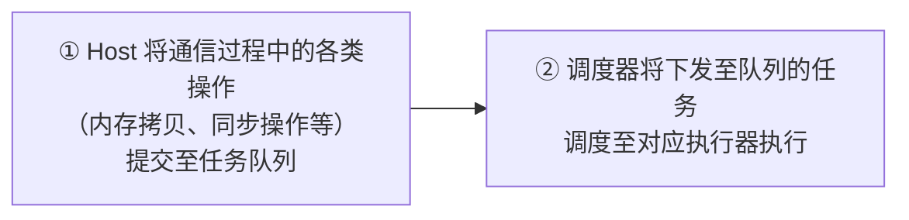

# Host CPU_TS 通信引擎

> **深度参考** · 前置阅读：[源码课程单元 4｜通信引擎与三引擎编排](/通信与昇腾/源码课程/04-通信引擎与三引擎编排.md)。本篇为参考手册体例，检索导向；事实基线见文首引用块。

> **Atlas A2 系列专用的历史路径**。由 **Host CPU** 展开通信逻辑，向 Device 侧的任务调度系统（TS，Task Scheduler）提交通信操作相关任务，TS 调度到执行器执行。**不占用计算核**，但下发开销大、随任务数线性增加。
>
> 事实来源（可信度：代码 > 仓内文档 > 社区资料）：
> `hcomm/include/hcomm_res_defs.h`（`COMM_ENGINE_CPU_TS`）、`hcomm/include/hcomm_primitives.h`（与 AICPU_TS 共用数据面原语）、`hcomm/src/base_comm/primitives/api_c_adpt/cpu_primitives_c_adpt.cc`、`hcomm/docs/zh/comm_op_dev_guide/prog_models_concepts/{comm_engine.md,concurrency_model.md}`、`hccl/docs/zh/user_guide/hccl_env/HCCL_OP_EXPANSION_MODE.md`（A2 的 HOST/HOST_TS）。

---

## 1. 定位与特点

| 维度 | 说明 |
| --- | --- |
| **Thread 抽象** | NPU Stream |
| **并发实体** | Stream |
| **同步实现** | NPU Notify 寄存器 |
| **调度器** | Device 侧 TS（Task Scheduler） |
| **优势** | 不占用计算核 |
| **约束** | 下发开销大，随任务数线性增加 |
| **适用场景** | —（A2 历史路径，新场景不推荐） |
| **支持产品** | **Atlas A2 系列专用** |
| **`OpExecuteConfig`** | `HOSTCPU_TS = 1`（`HOSTCPU = 8` 为不带 TS 的变体） |
| **算法名前缀** | 无独立前缀（A2 路径，selector 内部按 `HOSTCPU_TS` 处理） |

> 与 AICPU_TS 的关键差异：AICPU_TS 的通信逻辑跑在 **Device 侧 AICPU 核**，Host CPU_TS 的通信逻辑跑在 **Host 侧 CPU**——后者每次任务都需 Host→Device 下发，故下发开销随任务数线性增长。

---

## 2. 任务执行流程

由 Host CPU 向 Device 侧的 TS 提交通信操作相关任务：

> 图源：`hcomm/docs/zh/comm_op_dev_guide/prog_models_concepts/figures/hostcpu_ts_schedule.png`

| 步骤 | 动作 | 主体 |
| --- | --- | --- |
| ① | 将内存拷贝、同步等操作提交至任务队列 | Host CPU |
| ② | 将任务调度至对应执行器执行 | Device TS 调度器 |

---

## 3. 数据面原语

Host CPU_TS 与 AICPU_TS **共用同一套** L3-prim 数据面原语（`hcomm/include/hcomm_primitives.h`）：`HcommLocalCopyOnThread`、`HcommWrite/ReadOnThread`、`HcommThreadNotify*`、`HcommChannelNotify*` 等。差异仅在**展开位置**（Host vs Device AICPU）与 **C 接口适配**（`cpu_primitives_c_adpt.cc` vs `aicpu_ts_primitives_c_adpt.cc`）。

原语分类详见 [aicpu_ts.md §3](/通信与昇腾/参考手册/通信引擎/aicpu_ts.md) 与 [../03_L0L1L2分级通信实现原理.md §3](/通信与昇腾/参考手册/总览/L0-L1-L2分级原理.md)。

---

## 4. 配置与约束

| 项 | 说明 |
| --- | --- |
| **环境变量** | `HCCL_OP_EXPANSION_MODE=HOST`（A2 默认，Device 侧按硬件型号自动选调度器）/ `HOST_TS`（Host 向 Device TS 下发任务） |
| **A2 可选展开模式** | HOST（默认）、HOST_TS、AI_CPU（仅 AllGather/AlltoAll/V/VC）、AIV |
| **典型层级** | A2 的 L0（Server 内 HCCS）与 L1（Server 间 RoCE）均可由 Host CPU_TS 承载 |
| **通信方式** | [RoCE/RDMA](/通信与昇腾/参考手册/协议与传输/roce_rdma.md)（L1）、[HCCS](/通信与昇腾/参考手册/协议与传输/hccs_pcie.md)（L0） |

> A2 的 L1 大数据量场景也可用 AICPU_TS（`HCCL_OP_EXPANSION_MODE=AI_CPU`，仅 AllGather/AlltoAll 族）；Host CPU_TS 是 A2 的默认与历史主力路径。

---

## 5. 代码落点

| 组件 | 路径 |
| --- | --- |
| **数据面原语（C 适配）** | `hcomm/src/base_comm/primitives/api_c_adpt/cpu_primitives_c_adpt.cc` |
| **引擎枚举** | `hcomm/include/hcomm_res_defs.h:108-109`（`COMM_ENGINE_CPU=0`、`COMM_ENGINE_CPU_TS=1`） |
| **加速模式枚举** | `hccl/src/ops/op_common/inc/alg_param.h:133-153`（`HOSTCPU_TS=1`、`HOSTCPU=8`） |

---

## 6. 参考资料

- `hcomm/docs/zh/comm_op_dev_guide/prog_models_concepts/comm_engine.md`：Host CPU+TS 执行流程
- `hcomm/docs/zh/comm_op_dev_guide/prog_models_concepts/concurrency_model.md`：Stream + NPU Notify 寄存器
- `hccl/docs/zh/user_guide/hccl_env/HCCL_OP_EXPANSION_MODE.md`：A2 的 HOST/HOST_TS 配置
- 关联：[README.md](/通信与昇腾/参考手册/通信引擎/)（引擎总览）、[aicpu_ts.md](/通信与昇腾/参考手册/通信引擎/aicpu_ts.md)（共用数据面原语）、[../networking/RoCE集群.md](/通信与昇腾/参考手册/组网形态/RoCE集群.md)（A2 的 L1 组网）

