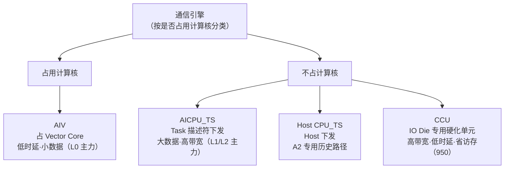
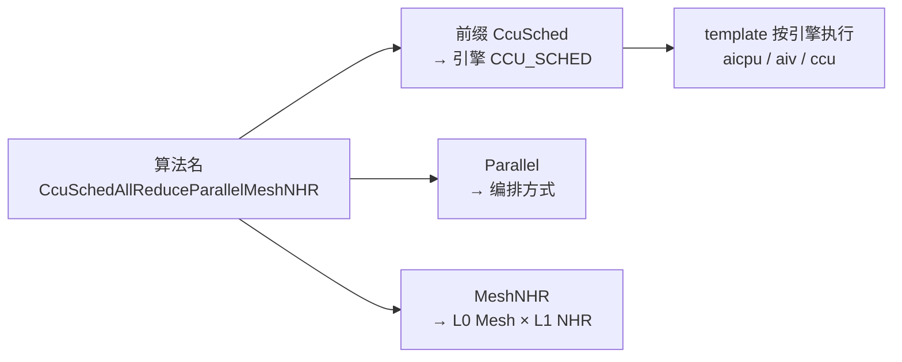

# engine：通信引擎

> **深度参考** · 前置阅读：[源码课程单元 4｜通信引擎与三引擎编排](/通信与昇腾/源码课程/04-comm-engines.md)。本篇为参考手册体例，检索导向；事实基线见文首引用块。

> **谁在真正搬数据**。通信引擎是通信实体中**执行通信任务的核心模块**：向上接收通信资源（Endpoint/Channel/CommMem）与算法编排下发的任务，向下通过**线程执行调度器**驱动**通信硬件**完成数据搬移。
>
> 本目录与 [networking/](/通信与昇腾/参考手册/组网形态/)（卡怎么连）、[comm/](/通信与昇腾/参考手册/协议与传输/)（数据怎么搬）平级，三者共同构成集群基础设施层。引擎的**选择与回退规则**见 [../algorithms/algo_selector.md](/通信与昇腾/参考手册/算法参考/algo_selector.md)，引擎在**分级通信中的落点**见 [../03_L0L1L2分级通信实现原理.md §4](/通信与昇腾/参考手册/总览/l0l1l2-principle.md)。
>
> 事实来源（可信度：代码 > 仓内文档 > 社区资料）：
> `hcomm/include/hcomm_res_defs.h`（`CommEngine` 枚举）、`hcomm/include/ccu/`（CCU 编程接口）、`hcomm/include/hcomm_primitives.h`（数据面原语）、`hcomm/src/base_comm/primitives/`（原语实现）、`hcomm/src/legacy/ascend950/unified_platform/{aiv,ccu}/`（AIV/CCU 实现）、`hccl/src/ops/op_common/inc/alg_param.h`（`OpExecuteConfig` 加速模式）、`hcomm/docs/zh/comm_op_dev_guide/prog_models_concepts/`（`comm_engine.md`/`concurrency_model.md`/`CCU_models_concepts.md`）、`hccl/docs/zh/user_guide/hccl_env/HCCL_OP_EXPANSION_MODE.md`。

---

## 1. 引擎模型：Thread + 线程调度器

通信引擎 = **Thread（执行上下文）+ 线程执行调度器（调度执行）**。一个引擎可含多个 Thread 并发执行，不同 Thread 通过 ThreadNotify/ChannelNotify 协调顺序。


> 图源：`hccl/docs/zh/architecture/diagrams/comm_engine_model.excalidraw.svg`

| 组成 | 职责 | 举例 |
| --- | --- | --- |
| **Thread（线程）** | 通信任务的执行上下文，承载一串数据面算子（LocalReduce、ChannelRead/Write、Notify 等） | Stream / Vector Core / Mission |
| **线程执行调度器** | 将 Thread 上的算子调度到硬件执行 | TS（Task Scheduler）/ STARS / 操作系统 |
| **通信硬件** | 实际搬移数据的硬件 | RoCE 网卡、SDMA、UB 网卡、CCU |

> **一句话**：AICPU_TS 引擎即由 **AICPU 运行通信 Kernel、TS 调度 Task** 协同完成；CCU 引擎即由 **CCU 执行微码指令流、经 URMA 搬运**。

---

## 2. 引擎枚举（`CommEngine`）

`hcomm/include/hcomm_res_defs.h:106-114`：

| 值 | 枚举 | 说明 |
| --- | --- | --- |
| -1 | `COMM_ENGINE_RESERVED` | 保留的通信引擎 |
| 0 | `COMM_ENGINE_CPU` | HOST CPU 引擎 |
| 1 | `COMM_ENGINE_CPU_TS` | HOST CPU TS 引擎 |
| 2 | `COMM_ENGINE_AICPU` | AICPU 引擎 |
| 3 | `COMM_ENGINE_AICPU_TS` | AICPU TS 引擎 |
| 4 | `COMM_ENGINE_AIV` | AIV 引擎 |
| 5 | `COMM_ENGINE_CCU` | CCU 引擎 |

> 枚举有 6 个引擎值，但工程上对外文档化为**四种主力引擎**（AICPU_TS / Host CPU_TS / AIV / CCU）——`CPU`/`AICPU` 是不带 TS 调度的变体，`CPU_TS`/`AICPU_TS` 才是实际承载通信的调度模式。

---

## 3. 四种主力引擎对比

`hcomm/docs/zh/comm_op_dev_guide/prog_models_concepts/comm_engine.md`（权威口径）：

| 引擎 | Thread 抽象 | 优势 | 约束 | 适用场景 | 支持产品 | 详见 |
| --- | --- | --- | --- | --- | --- | --- |
| **AICPU_TS** | NPU Stream | 不占计算核，通信效率高 | 静态开销大，小数据量不友好 | 大数据高带宽（**L1/L2 主力**） | 950PR&950DT、Atlas A3 | [aicpu_ts.md](/通信与昇腾/参考手册/通信引擎/aicpu_ts.md) |
| **Host CPU_TS** | NPU Stream | 不占计算核 | 下发开销大，随任务数线性增加 | —（A2 历史路径） | Atlas A2 专用 | [host_cpu_ts.md](/通信与昇腾/参考手册/通信引擎/host_cpu_ts.md) |
| **AIV** | AICore Block（Vector Core） | 低时延 | 占 Vector 计算核，与计算算子抢资源 | 小数据低时延（**L0 主力**） | 950PR&950DT、A3（仅超节点内）、A2（仅单机） | [aiv.md](/通信与昇腾/参考手册/通信引擎/aiv.md) |
| **CCU** | Mission | 高带宽低时延，少占计算核与访存带宽 | 受片上资源限制，通信域数量有限 | 高带宽低时延（**L0/L1**） | 950PR&950DT | [ccu.md](/通信与昇腾/参考手册/通信引擎/ccu.md) |



> **选型主线**：小数据低时延 → **AIV**；大数据高带宽 → **AICPU_TS**；既要带宽又要时延且省访存 → **CCU**（950 硬化通路）；A2 历史路径 → **Host CPU_TS**。

---

## 4. 并发模型：Thread 在不同引擎下的实体


> 图源：`hcomm/docs/zh/comm_op_dev_guide/prog_models_concepts/figures/concurrency_model.png`

| 引擎 | 并发实体 | 同步实现 | Thread 封装 |
| --- | --- | --- | --- |
| **AICPU_TS / Host CPU_TS** | Stream | NPU Notify 寄存器 | Thread = Stream + Notify 寄存器 |
| **AIV** | Vector Core | Device 内存 | Thread = AIV 核 + Device 内存 |
| **CCU** | Mission | CCU 同步寄存器（Notify）+ 通用寄存器（Variable） | Thread = Mission + CCU 寄存器 |

> `Thread` 是对"并发实体 + 同步资源"的统一封装抽象——**这是 HCCL 能用同一套算法模板跑在四种引擎上的关键**。并发单元间无资源冲突即可并行执行，通信任务与 Thread 绑定。

同步机制的两种场景（详见 [../03_L0L1L2分级通信实现原理.md §3.2](/通信与昇腾/参考手册/总览/l0l1l2-principle.md)）：

| 同步方式 | 场景 | 接口 |
| --- | --- | --- |
| **ThreadNotify** | 同一通信实体内 Thread 间 | `ThreadNotifyRecord` / `ThreadNotifyWait` |
| **ChannelNotify** | 不同通信实体间（经 Channel） | `ChannelNotifyRecord` / `ChannelNotifyWait` |

---

## 5. 加速模式：`OpExecuteConfig` 与 `HCCL_OP_EXPANSION_MODE`

通信域粒度的加速模式（`hccl/src/ops/op_common/inc/alg_param.h:133-144`），由环境变量 `HCCL_OP_EXPANSION_MODE` 配置：

```cpp
enum class OpExecuteConfig {
    DEFAULT = 0, HOSTCPU_TS = 1, AICPU_TS = 2, AIV = 3, AIV_ONLY = 4,
    CCU_MS = 5, CCU_SCHED = 6, AICPU = 7, HOSTCPU = 8, CCU_FAIL
};
```

| 配置值 | 含义 | 引擎 |
| --- | --- | --- |
| `DEFAULT` | 由 selector 自动选定 | — |
| `HOSTCPU_TS` / `HOSTCPU` | Host CPU 展开 | Host CPU_TS |
| `AICPU_TS` / `AICPU`（`AI_CPU`） | AI CPU 展开，TS/STARS 调度 | AICPU_TS |
| `AIV` / `AIV_ONLY` | Vector Core 展开并执行 | AIV |
| `CCU_MS` | CCU 展开，经 **CcuBuffer** 中转 | CCU（MS 模式） |
| `CCU_SCHED` | CCU 作调度器，下发 **UB WQE** 片上内存直传 | CCU（SCHED 模式） |
| `CCU_FAIL` | CCU 资源不足回退标记 | — |

各产品的默认值与可选值不同（`HCCL_OP_EXPANSION_MODE.md`）：

| 产品 | 默认 | 可选 |
| --- | --- | --- |
| **950PR&950DT** | `AICPU_TS` | AI_CPU/AICPU_TS、AICPU_CacheDisable、AIV、CCU_MS（950PR 不支持）、CCU_SCHED |
| **Atlas A3** | `AI_CPU` | AI_CPU、AICPU_CacheDisable、AIV |
| **Atlas A2** | `HOST` | HOST、HOST_TS、AI_CPU（仅 AG/A2A 族）、AIV |
| **Atlas 300I Duo** | `HOST` | HOST、AI_CPU（仅单机单域 AllReduce） |

> **配置优先级**：通信域粒度（`HcclCommConfig.hcclOpExpansionMode`）> 环境变量 `HCCL_OP_EXPANSION_MODE`。

---

## 6. 算法名 = 引擎前缀 + 编排 + 拓扑

selector 输出的算法名自带引擎信息，可直接反推该算法跑在哪种引擎上（详见 [../algorithms/algo_selector.md §4](/通信与昇腾/参考手册/算法参考/algo_selector.md)）：

| 前缀 | 引擎（`OpExecuteConfig`） | 数据通路 | 示例 |
| --- | --- | --- | --- |
| `Aicpu*` | `AICPU_TS = 2` | AICPU 下发 Task 描述符，TS 调度 | `AicpuAllReduceParallelMeshNHR` |
| `Aiv*` | `AIV = 3` / `AIV_ONLY = 4` | Vector Core 直接执行 | `AivAllReduceSoleMeshOneShot` |
| `CcuMS*` | `CCU_MS = 5` | CCU + CcuBuffer 中转（仅单机） | `CcuMSAllReduceSoleMesh2Die` |
| `CcuSched*` | `CCU_SCHED = 6` | CCU 下发 UB WQE，片上内存直传 | `CcuSchedAllReduceParallelMeshNHR` |



---

## 7. 引擎选择与回退（速查）

**同一通信域默认只用一种引擎**，由算法选择器自动选定。完整规则见 [../algorithms/algo_selector.md §3](/通信与昇腾/参考手册/算法参考/algo_selector.md)，关键回退：

| 触发条件 | 回退行为 |
| --- | --- |
| `DETERMINISTIC_STRICT` + CCU_MS / CCU_SCHED | 回退 **AICPU** |
| CCU 资源不足 | 自动切换 **AI_CPU**（`CCU_FAIL`） |
| CCU_SCHED + 单机 AR/RS/Reduce 数据量超阈值 | 自动切换 **AI_CPU** |
| CCU_SCHED + PCIe 链路域 | 回退 **AICPU_TS**（>8 卡再回退 AIV） |
| 标卡环境配置 CCU_MS | **直接拦截报错** |
| AIV + 大数据量（超阈值） | 自动切换 **AI_CPU**（部分算子） |

---

## 8. 引擎 × 层级 × 通信方式

引擎与网络层级（L0/L1/L2）、通信方式（[comm/](/通信与昇腾/参考手册/协议与传输/)）的对应：

| 引擎 | 主力层级 | 典型通信方式 | 数据面原语入口 |
| --- | --- | --- | --- |
| **AIV** | L0（Server 内） | [UB_MEM](/通信与昇腾/参考手册/协议与传输/ub_mem.md)、[URMA](/通信与昇腾/参考手册/协议与传输/urma.md)、[HCCS](/通信与昇腾/参考手册/协议与传输/hccs_pcie.md) | Ascend C `DataCopy`/`SetFlag`/`WaitFlag` |
| **AICPU_TS** | L1/L2（Server 间/超节点间） | [RoCE/RDMA](/通信与昇腾/参考手册/协议与传输/roce_rdma.md)、[UB 网络语义](/通信与昇腾/参考手册/协议与传输/ub_network.md)、[URMA](/通信与昇腾/参考手册/协议与传输/urma.md) | `hcomm_primitives.h`（`HcommWrite/Read*OnThread`） |
| **CCU** | L0/L1（950 硬化） | [URMA](/通信与昇腾/参考手册/协议与传输/urma.md)、[UB 网络语义](/通信与昇腾/参考手册/协议与传输/ub_network.md) | `ccu/ccu_primitives.hpp`（`ccu::Write/Read/LocalCopy`） |
| **Host CPU_TS** | L0/L1（A2） | [RoCE/RDMA](/通信与昇腾/参考手册/协议与传输/roce_rdma.md)、[HCCS](/通信与昇腾/参考手册/协议与传输/hccs_pcie.md) | `hcomm_primitives.h` |

---

## 9. 文档索引

| 文档 | 引擎 | 一句话 |
| --- | --- | --- |
| [aicpu_ts.md](/通信与昇腾/参考手册/通信引擎/aicpu_ts.md) | **AICPU_TS** | AICPU 运行通信 Kernel 下发 Task 描述符，TS/STARS 调度执行；不占计算核，大数据高带宽主力；含 Task Cache 省展开开销 |
| [ccu.md](/通信与昇腾/参考手册/通信引擎/ccu.md) | **CCU** | IO Die 上的专用集合通信协处理器；片上缓存 + 三类寄存器 + Loop/LoopGroup 并发 + 微码指令流；经 URMA 搬运；CCU_MS/CCU_SCHED 两模式 |
| [aiv.md](/通信与昇腾/参考手册/通信引擎/aiv.md) | **AIV** | Vector Core 直接执行通信算子；基于 Ascend C DataCopy/同步原语；低时延，占计算核；支持控核 |
| [host_cpu_ts.md](/通信与昇腾/参考手册/通信引擎/host_cpu_ts.md) | **Host CPU_TS** | Host CPU 展开、向 Device TS 下发任务；Atlas A2 专用历史路径；下发开销随任务数线性增长 |

---

## 10. 参考资料

**代码（最高可信度）**

- `hcomm/include/hcomm_res_defs.h`：`CommEngine` 枚举（:106-114）
- `hcomm/include/hcomm_primitives.h`：数据面原语全量 API（AICPU_TS/CPU_TS/AIV 共用）
- `hcomm/include/ccu/`：`ccu_primitives.hpp`、`ccu_res.h`、`ccu_res_defs.h`、`ccu_launch.h`、`ccu_variable.hpp`/`ccu_event.hpp`/`ccu_buffer.hpp`/`ccu_loop.hpp` 等（CCU 编程接口）
- `hcomm/src/base_comm/primitives/`：`api_c_adpt/`（C 接口适配）、`aicpu/task_cache/`（AICPU Task Cache）、`api_c_adpt/ccu/`（CCU launch/res）
- `hcomm/src/legacy/ascend950/unified_platform/aiv/`：`ub_memory_transport.*`、`urma_direct_transport.*`（AIV 数据通路）
- `hcomm/src/legacy/ascend950/unified_platform/ccu/`：`ccu_context/`、`ccu_device/`、`ccu_microcode/`、`ccu_representation/`（CCU 实现）
- `hccl/src/ops/op_common/inc/alg_param.h`：`OpExecuteConfig`（:133-144）、`ENGINE_STR_MAP`（:147-153）
- `hccl/src/ops/*/selector/*_auto_selector.cc`、`selector_engine.cc`：引擎选择与回退

**仓内文档**

- `hcomm/docs/zh/comm_op_dev_guide/prog_models_concepts/`：`comm_engine.md`（四引擎对比权威）、`concurrency_model.md`（Thread 抽象）、`CCU_models_concepts.md`（CCU 编程模型）、`comm_model.md`（通信模型）
- `hcomm/docs/zh/comm_op_dev_guide/{aicpu,aiv,ccu}_comm_op_dev/`：三套算子开发流程（总体流程/任务编排/算法选择/资源创建/算子下发）
- `hcomm/docs/zh/architecture/architecture-brief.md` §2.4：通信引擎介绍
- `hccl/docs/zh/user_guide/hccl_env/HCCL_OP_EXPANSION_MODE.md`：引擎展开模式、CCU_MS/CCU_SCHED、各产品支持
- `hccl/docs/zh/user_guide/concepts.md`：术语（AIV/TS/CCU/SDMA）

**社区资料**

- 昇腾社区（hiascend.com）CCU 集合通信加速单元、AIV/Vector Core 相关公开资料——与本地仓同源（站点需 JS 渲染无法直接抓取，以本地仓为准）

